# Executive summary for the Board

**The Board's question:** "How should NovaFin use ML to grow its business while maintaining acceptable levels of credit, fraud, market, liquidity and derivatives risk?", and with ₹1,000 crore of new capital: "Where should NovaFin deploy its capital, what risks will it take, and how should those risks be controlled?"

**In one sentence: put ₹300 crore into equities protected by a put, ₹51 crore into strategic initiatives (all but ₹1 crore in units that clear the 6.8% hurdle), ₹5 crore into an HFT pilot and ₹6 crore into hedging, and hold ₹638 crore in safe securities that are released in tested steps: ₹286 crore into re-priced approved loans, ₹164 crore into fixed Review loans and up to ₹88 crore into future initiatives, keeping a ₹100 crore floor. That earns about ₹91.8 crore a year (9.2%) now, against about −₹2 crore if the money went the bank's current way; even a crash, a rate cut and failing initiatives together cost only about ₹5 crore; and once lending is released, NovaFin's businesses hold ₹506 crore instead of ₹56 crore.**

| Category | ₹ crore | Expected ₹ crore a year | Bad-year result (₹ crore) | Owner |
| --- | --- | --- | --- | --- |
| Corporate lending | 1.03 | 0.07 | −0.06 | Head of Lending / Head of Strategy |
| Retail lending | 4.18 | 0.56 | −0.06 | Head of Lending / Head of Strategy |
| Digital banking | 19.43 | 2.54 | −0.84 | Head of Digital + Fraud Operations |
| Wealth management | 15.28 | 2.69 | 0.54 | Head of Wealth |
| Equity investments | 300.00 | 46.83 | −30.00 | Chief Investment Officer |
| High frequency trading | 5.00 | 0.00 | −0.50 | Head of Trading |
| Derivatives hedging | 17.06 | −4.24 | −6.05 | Derivatives desk / Chief Risk Officer |
| Liquidity reserve | 638.03 | 43.39 | 31.90 | Treasurer (ALCO) |

The bad-year column is each category's own bad year. Initiatives total ₹51.4 crore: the Corporate, Retail, Digital and Wealth rows, plus ₹11.5 crore of Risk Analytics inside Derivatives hedging (whose other ₹5.6 crore is the put and the option-book hedge).

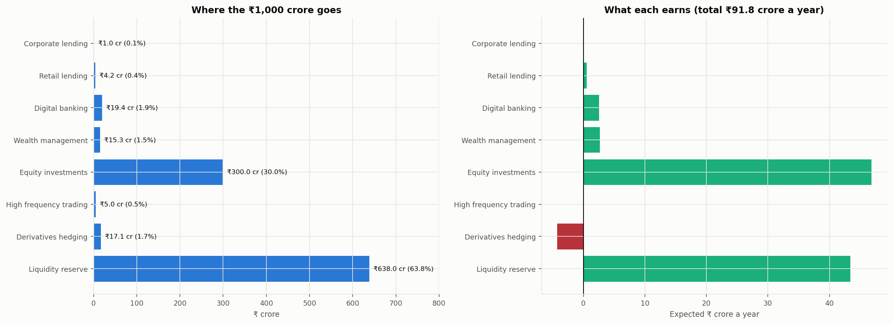

**Why this, and not the bank's current way?**

| Way to deploy ₹1,000 crore | Profit a year (₹ crore) | Money put into NovaFin's businesses (₹ crore) | Bad year, all at once (₹ crore) | Profit (% a year) | Within the ₹100 crore bad-year budget? |
| --- | --- | --- | --- | --- | --- |
| The bank's way (status quo) | −2.4 | 923.1 | −74.3 | −0.2 | Yes |
| All in safe securities | 68.0 | 0.0 | 50.0 | 6.8 | Yes |
| All in equities, unprotected | 156.0 | 0.0 | −200.0 | 15.6 | No |
| Our plan (Year 1) | 91.8 | 56.4 | −5.1 | 9.2 | Yes |

**What the ₹100 crore bad-year budget is:** a loss limit, not an amount we allocate. It is the most the whole ₹1,000 crore plan may lose in one bad year (10%). The brief gives no figure ("acceptable levels of" risk), so 5%, 10% and 15% were considered and 10% was agreed (M9-10). All ₹1,000 crore is allocated; the ₹100 crore reserve floor below is a different rule that happens to be the same size.

**The capital plan, part 1: what we put to work now**

| Use | ₹ crore | Expected ₹ crore a year | Bad-year result (₹ crore) | Owner | First action and when |
| --- | --- | --- | --- | --- | --- |
| Equities: all 15 stocks, equal weight, with a 1-year 90% put | 305.4 | 41.4 | −35.4 | Chief Investment Officer | Month 1: buy, and buy the put |
| Initiatives ready now: 1075 Wealth in full, 1062 Corporate Banking in stages | 3.2 | 0.5 | 0.0 | Head of Strategy | Now |
| Initiatives after review: Wealth, Payments, Digital Banking, Risk Analytics, SME units that beat 6.8% | 48.2 | 6.6 | −1.0 | Head of Strategy (+ Head of Fraud Operations for Digital) | Quarters 1–2: review unit by unit, release in stages |
| HFT trading pilot with a stop rule | 5.0 | 0.0 | −0.5 | Head of Trading | Now; decide after 1 quarter |
| Option book hedge (choice C: delta + half vega) | 0.1 | 0.0 | 0.0 | Derivatives desk | Now, reset daily |
| Liquidity reserve: government securities (released by the plan below) | 638.0 | 43.4 | 31.9 | Treasurer with ALCO | Now |

**The capital plan, part 2: how the ₹638 crore reserve is released.** The reserve is a waiting room, not idle money: it earns ₹43.4 crore a year while it waits, and each step moves only when its test passes. Releasing the loans today, at today's prices, would cost ₹19.6 crore a year.

| Step | Release | ₹ crore | Released when (the test) | Checked | Owner | If the test fails |
| --- | --- | --- | --- | --- | --- | --- |
| 1 | Approved loans, re-priced | 286 | Re-priced approved loans earn at least 6.8% a year after expected loss (rate about 12.3%); the scorecard stays stable (score drift PSI ≤ 0.25; defaults ≤ 1.5 × predicted in every band); the whole plan's bad year stays within ₹100 crore | Every quarter | Chief Risk Officer + Head of Lending; ALCO releases | The money stays in the reserve, earning 6.8% |
| 2 | Review loans, fixed | 164 | The same test, at a rate of about 15.6% (or the risk cut by collateral or a check); only after step 1 has passed | Every quarter, after step 1 | Chief Risk Officer + Head of Lending; ALCO releases | The money stays in the reserve, earning 6.8% |
| 3 | Future initiatives (up to) | 88 | Each project passes Module 1's rules: Expected NPV above 0, return above 6.8% a year, loss tolerance decides full or staged funding; Digital projects only while the fraud rule runs; the whole plan's bad year stays within ₹100 crore | At each project review | Head of Strategy; CFO approves | Not funded; the money stays in the reserve |
| Floor | Minimum reserve, never released | 100 | Not released: at least 10% of the ₹1,000 crore stays safe | Every quarter | Treasurer with ALCO | — |

**The capital plan, part 3: what each stage changes (profit, growth, risk)**

| Stage | Liquidity reserve (₹ crore) | Loan book (₹ crore) | Money working in NovaFin's businesses (₹ crore) | Profit a year (₹ crore) | Profit a year, bank view (₹ crore) | Bad year, all at once (₹ crore) | Bad year if collateral also fetches less, LGD 60% (₹ crore) | Profit above the bank's way (₹ crore a year) |
| --- | --- | --- | --- | --- | --- | --- | --- | --- |
| Today (Year 1) | 638.0 | 0.0 | 56.4 | 91.8 | 91.8 | −5.1 | −5.1 | 94.2 |
| After step 1: approved loans re-priced | 352.1 | 285.9 | 342.4 | 91.8 | 96.4 | −15.5 | −31.1 | 94.2 |
| After step 2: Review loans fixed | 188.2 | 449.9 | 506.3 | 91.8 | 99.0 | −27.0 | −57.0 | 94.2 |
| After step 3: future initiatives (if like today's) | 100.0 | 449.9 | 594.4 | 97.9 | 105.1 | −33.1 | −63.1 | 100.3 |

Profit never falls: re-priced loans are planned at exactly the 6.8% hurdle, so lending earns what the reserve did, and the business grows; the bank view (deposits fund 88% of each loan at 5%) adds the profit leverage gives. Step 3 assumes future initiatives perform like today's. The bad year uses at most a third of the ₹100 crore loss limit; if collateral also fetches less (LGD 60%: a defaulted loan loses 60% instead of 40%), it reaches −₹63.1 crore after step 3, still inside it.

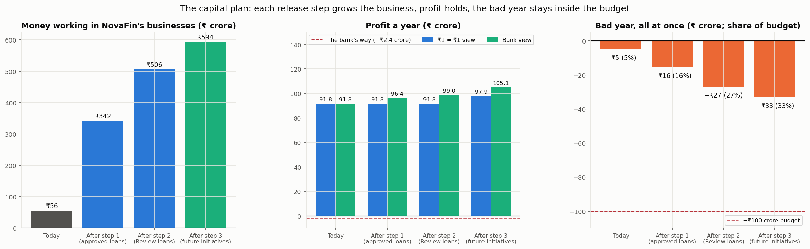

**The action plan we ask the Board to approve (phased):**

| # | Phase | Action | Owner | When | ₹ effect | How we know it worked |
| --- | --- | --- | --- | --- | --- | --- |
| 1 | Now | Approve the allocation and the reserve release plan | Board | This meeting | ₹91.8 crore a year expected (9.2%) vs ₹68 crore all in safe securities; worst combined year −₹5.1 crore | Plan approved; every owner below named |
| 2 | Now | Fund the two ready projects: 1075 (Wealth) in full, 1062 (Corporate Banking) in stages at milestones | Head of Strategy | Now | ₹3.2 crore | Milestones met on time and on budget |
| 3 | Now | Run the order-timing model on the desk's and the equity book's orders; start the ₹5 crore trading pilot with a stop rule | Head of Trading | Now; continue or stop the pilot after 1 quarter | Saves ₹1,315 per ₹1 crore of orders; pilot loss capped at ₹0.5 crore | Savings stay positive; pilot net profit above 0 after costs, otherwise it stops |
| 4 | Now | Make the ML fraud rule the condition for Digital banking money; staff the investigation team | Head of Fraud Operations | Before any Digital banking release | Cost of fraud risk 1.55% of money moved vs 6.13% unscreened | Cost of fraud risk stays at or below 2% of money moved |
| 5 | Now | Hedge the option book with choice C (delta + half vega), reset daily | Derivatives desk | Now | Cuts the option book's 1-in-100 bad day by 45% | 1-in-100 bad day at or below 4% of the book |
| 6 | Month 1 | Buy ₹300 crore of equities (all 15, equal weight) with a 1-year 90% put | Chief Investment Officer | Within a month | +₹46.8 crore a year expected; the put costs ₹5.4 crore and caps a 20% crash at ₹35.4 crore instead of ₹60 crore | VaR within its limit every month; put renewed every year |
| 7 | Quarter 1 | Re-price the loan book by scorecard band, Retail first: approved loans about 12.3% (8.75% today), Review loans about 15.6% (9.76% today) | Chief Risk Officer + Head of Lending | Within a quarter | Prepares ₹450 crore of lending; lending it at today's prices would cost ₹19.6 crore a year | Re-priced loans earn at least 6.8% after expected loss; good borrowers are kept |
| 8 | Quarter 1 | Set up the model inventory, owners and triggers (the governance table); first independent validation within a year | Chief Risk Officer | Within a quarter | Model risk controlled | Inventory live; every trigger has an owner |
| 9 | Quarters 1–2 | Review and release the initiative units that beat 6.8% (Wealth, Payments, Digital Banking, Risk Analytics, SME), unit by unit, in stages | Head of Strategy | Over 2 quarters | ₹48.2 crore at about 13.7% a year | Each released project passes review; milestones met |
| 10 | Every quarter | Release step 1: ₹286 crore from the reserve into re-priced approved loans once the test passes | ALCO (Chief Risk Officer + Head of Lending) | Quarterly test; planned in Year 2 | Loan book +₹286 crore; money working in the businesses ₹342 crore; profit ≥ ₹91.8 crore (₹96.4 crore in the bank view) | Test passed; combined bad year −₹15.5 crore, inside the ₹100 crore budget |
| 11 | Every quarter | Release step 2: ₹164 crore into Review loans once fixed (re-priced, collateral added or checked) | ALCO (Chief Risk Officer + Head of Lending) | After step 1; planned in Year 2 | Loan book ₹450 crore; money working ₹506 crore; profit ≥ ₹91.8 crore (₹99.0 crore in the bank view) | Test passed; combined bad year −₹27.0 crore (27% of the budget) |
| 12 | Ongoing | Release step 3: up to ₹88 crore for future initiatives, only through Module 1's rules | Head of Strategy; CFO approves | As projects pass review | If they perform like today's: profit about ₹97.9 crore a year; money working ₹594 crore | Each project: Expected NPV above 0, return above 6.8%, within loss tolerance |
| 13 | Every quarter | Stress-test the whole plan; pause any release that would take the combined bad year past ₹100 crore; keep the ₹100 crore floor | CFO with ALCO | Every quarter | Worst combined year today −₹5.1 crore; −₹27.0 crore after steps 1–2; −₹63.1 crore after all three if collateral also fetches less | Every scenario inside the ₹100 crore budget |

<<PAGEBREAK>>

# How this report meets the brief's evaluation criteria

| Criterion (brief) | Where it is shown | In one line |
| --- | --- | --- |
| **Technically sound ML** | Chapter 4 (each module) and the ML scorecard (chapter 3.3) | Every model is tested against a simple benchmark on data it never saw. Shuffled-label luck test: Modules 1, 4, 5, 7 and 8; Modules 2 and 3 use paired 95% ranges over 25 rounds and a held-out test instead. Check of training against unseen scores (overfitting): Modules 1, 2, 3, 7 and 8. Models that win drive decisions; Module 1's weak one only screens slow payers (36 into Reject; the risk rating alone gives a similar list) |
| **Strong financial reasoning** | Chapter 2 (framework), every module's ₹ metric, chapter 3 | Every module's result becomes ₹ (NPV, ECL, cost of fraud, CLV, return after costs, Black-Scholes); every use of the ₹1,000 crore faces a 6.8% hurdle and a bad-year test |
| **Rigorous validation** | ML scorecard; each module's checks; reproducibility | Out-of-sample and time-ordered tests, shuffled-label luck tests (Modules 1, 4, 5, 7, 8), calibration, DeLong, paired 95% ranges; seed 42; every runner gives the same files as its notebooks |
| **Integrated decision-making across modules** | Chapter 3.2 (integration map), Module 9 inputs | All modules hand over the same fields; one ranking decides the ₹1,000 crore; results pass between modules (e.g. Module 6's risk prices Module 8's put) |
| **Excellent executive communication** | This summary, the Board deck, every module's workbook | Answer first, ₹ throughout, plain words, actions with owners |
| **Financial decision framework** (brief's 'asks') | Chapter 2 | Six steps from data to control, applied in every module |
| **Detailed report, module-wise methodology** (brief's 'asks') | Chapters 4 to 6; each module's full report is in the code folder | Method, models, results, decisions, limitations and charts, module by module |
| **Code Guide, reusable Python/Colab code framework** (brief's 'asks') | Chapter 7; the Code Guide is a separate PDF, `final_deliverables/NovaFin_Code_Guide.pdf` in the code folder | How the code is built, how to run it anywhere, what every file does |

# 1. The approach: from data to decision

The Board asked for "an integrated answer", not "a collection of isolated ML models". Every module follows the brief's chain **Data → ML prediction → Financial metric → Risk assessment → Business decision**, and Module 9 combines them:

```text
Modules 1–8:  data → model (validated) → ₹ metric → bad-year test → decision rule → owner and control
                                       ↓  the same fields from every module ("Module 9 inputs")
Module 9:     return per ₹ vs the 6.8% hurdle → best uses first within limits → stress tests → governance → actions
```

# 2. The financial decision framework
Every result passes six steps before it drives money: **1 Data → 2 ML prediction (tested against a benchmark on unseen data; drives decisions fully only if it wins) → 3 Financial metric in ₹ → 4 Risk (bad year, stress) → 5 Decision rule (hurdle 6.8%, capacity, caps, budget) → 6 Control (owner, watch, trigger → action).**

| Module | 1 Data | 2 ML prediction | 3 Financial metric in ₹ | 4 Risk | 5 Decision rule | 6 Control and owner |
| --- | --- | --- | --- | --- | --- | --- |
| 1 Corporate finance | 180 initiatives | P(Success): lasso (weak; screens 36 slow payers into Reject) | NPV, Expected NPV, IRR by business unit | Payback, loss tolerance, 1-in-20 bad case | Fund / Review / Reject; return above 6.8% | Staged release; Head of Strategy |
| 2 Credit risk | 5,000 loans | PD: lasso scorecard (calibrated) | ECL = PD × 40% × loan; return per ₹ lent | PD × 2 recession; LGD 60% | Approve / Review / Reject; required rate | PSI, defaults vs PD; Chief Risk Officer |
| 3 Fraud | 30,000 transactions | P(fraud): LightGBM | Cost of fraud risk per ₹ moved | Fraud × 3 | Investigate above 4.76% (brief's costs) | Weekly cost check; Fraud Operations |
| 4 Customers | 5,000 customers | Churn: no model beats a coin flip beyond luck | CLV; fee yield 1.80% | Market −20%, churn × 2 | No model-driven retention spend | Randomised test first; Head of Wealth |
| 5 Equity markets | 15 stocks, 43 test months | Returns: no model beats luck | Return vs holding all 15 (after costs in Module 6) | Swing 10.9–13.2% for any top 5 vs 6.7% for all 15 | No ML stock-picking | Revisit only with new data; CIO |
| 6 Portfolio | Daily returns | Not ML (Markowitz vs equal weight) | Return 15.6%, Sharpe | VaR, CVaR, −20% crash | Equal weight | Monthly VaR limit; CIO |
| 7 HFT | Order book, 20 days | Direction: logistic regression | ₹ saved per ₹1 crore of orders; profit after costs | Costs +1 bp | Time orders; pilot with stop rule | Daily savings; Head of Trading |
| 8 Derivatives | 10,000 options | ML pricing loses to Black-Scholes | BS value, Greeks, put cost | 1-in-100 bad day; volatility −5 | BS pricing; hedge C; 90% put on equities | Daily hedge limit; derivatives desk |
| 9 Allocation | Modules 1–8 inputs | Uses every module's validated result | Return per ₹ deployed vs 6.8% | 8 stress scenarios; ₹100 crore budget | Best uses first within limits | Quarterly ALCO review; CFO |

<<PAGEBREAK>>

# 3. Integrated capital allocation (Module 9)

## 3.1 The answer
**In one sentence: put ₹300 crore into equities protected by a put, ₹51 crore into strategic initiatives (all but ₹1 crore in units that clear the 6.8% hurdle), ₹5 crore into an HFT pilot and ₹6 crore into hedging, and hold ₹638 crore in safe securities that are released in tested steps: ₹286 crore into re-priced approved loans, ₹164 crore into fixed Review loans and up to ₹88 crore into future initiatives, keeping a ₹100 crore floor. That earns about ₹91.8 crore a year (9.2%) now, against about −₹2 crore if the money went the bank's current way; even a crash, a rate cut and failing initiatives together cost only about ₹5 crore; and once lending is released, NovaFin's businesses hold ₹506 crore instead of ₹56 crore.**

#### Where the ₹1,000 crore goes (Year 1)


| Category | ₹ crore | Share | Expected return | What the money buys |
| --- | --- | --- | --- | --- |
| Equity investments | 300.0 | 30.0% | 15.6% | All 15 stocks, equal weight (no ML stock-picking) |
| Digital banking | 19.4 | 1.9% | 13.1% | Digital Banking and Payments initiatives, only while the ML fraud rule runs |
| Wealth management | 15.3 | 1.5% | 17.6% | Wealth initiatives (one approved now) |
| Derivatives hedging | 17.1 | 1.7% | cost | Risk Analytics initiatives (₹11.5 crore), the 90% put on the equities (₹5.4 crore a year), option-book hedge C (₹0.1 crore) |
| High frequency trading | 5.0 | 0.5% | 0% planned | Trading pilot with a stop rule (order timing needs no capital) |
| Retail lending | 4.2 | 0.4% | 13.3% | SME initiatives; approved retail loans wait in the reserve until re-priced |
| Corporate lending | 1.0 | 0.1% | 6.3% | One approved Corporate Banking initiative; corporate loans wait until re-priced |
| Liquidity reserve | 638.0 | 63.8% | 6.8% | Government securities; ₹286 crore earmarked for re-priced lending |
| **Total** | **1,000** | | **9.2% (₹91.8 crore)** | |

#### Is it better than what NovaFin would do anyway? (profit, growth, safety)

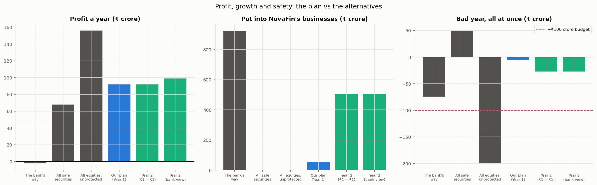

| Way to deploy ₹1,000 crore | Profit a year | Put into NovaFin's businesses | Bad year, all at once |
| --- | --- | --- | --- |
| The bank's way (every loan at today's prices, all 180 initiatives) | **−₹2.4 crore** | ₹923 crore | −₹74 crore |
| All in safe securities | ₹68.0 crore | ₹0 | +₹50 crore |
| All in equities, unprotected | ₹156 crore | ₹0 | **−₹200 crore** (twice the budget) |
| **Our plan, Year 1** | **₹91.8 crore** | ₹56 crore | **−₹5 crore** |
| **Year 2, after re-pricing** | ₹91.8 crore (₹99.0 crore in the bank view) | **₹506 crore** | −₹27 crore |

- **The bank's way loses money:** its lending earns 0.43% above expected losses (on actual losses it breaks even at a 0.48% cost of funds) and its initiatives lose 3.6% a year. Putting more money through today's practice lowers profit.
- **Growth comes from re-pricing, not from lending more at today's prices.** Approved loans need about 12.3% a year (8.75% today), Review loans about 15.6% (9.8%). Once re-priced loans pass the quarterly test, ₹450 crore moves from the reserve into lending.

#### The capital plan: what we use now, and how the ₹638 crore reserve is put to work

**In one line: the reserve is a waiting room, not idle money. It earns ₹43.4 crore a year while it waits, ₹538 crore of it moves into lending and initiatives as each test is passed, and only a ₹100 crore floor stays safe for good.**

**1. What we put to work now (Year 1)**

| Use | ₹ crore | Earns a year | Bad year | Owner | First action |
| --- | --- | --- | --- | --- | --- |
| Equities: all 15 stocks, equal weight, with a 1-year 90% put | 305.4 | +₹41.4 crore | −₹35.4 crore (20% crash, the put pays) | Chief Investment Officer | Month 1: buy, with the put |
| Initiatives ready now: 1075 Wealth in full, 1062 Corporate Banking in stages | 3.2 | +₹0.5 crore | ₹0.0 crore | Head of Strategy | Now |
| Initiatives after review: Wealth, Payments, Digital Banking, Risk Analytics, SME | 48.2 | +₹6.6 crore | −₹1.0 crore (1-in-20 case) | Head of Strategy | Quarters 1–2, unit by unit |
| HFT trading pilot with a stop rule | 5.0 | ₹0 planned | −₹0.5 crore (stop rule) | Head of Trading | Now; decide after 1 quarter |
| Option book hedge (choice C) | 0.1 | ₹0.0 crore | Cuts the 1-in-100 bad day by 45% | Derivatives desk | Now, reset daily |
| **Liquidity reserve, released by the plan below** | **638.0** | **+₹43.4 crore** | +₹31.9 crore (rates fall to 5%) | Treasurer with ALCO | Now |
| **Total** | **1,000** | **₹91.8 crore (9.2%)** | **−₹5.1 crore, all at once** | | |

**2. The reserve release plan: what moves the ₹638 crore, and when**

| Step | ₹ crore | What it funds | Released when (the test) | Checked | Owner | If the test fails | Cost of releasing it now, at today's prices |
| --- | --- | --- | --- | --- | --- | --- | --- |
| 1 | 286 | Approved loans, re-priced | Re-priced loans earn at least 6.8% a year after expected loss (rate about 12.3%, 8.75% today); the scorecard stays stable (score drift PSI ≤ 0.25; defaults ≤ 1.5 × predicted in every band); the plan's combined bad year stays within ₹100 crore | Every quarter | Chief Risk Officer + Head of Lending; ALCO releases | Stays in the reserve, earning 6.8% | ₹10.0 crore a year |
| 2 | 164 | Review loans, fixed | The same test at about 15.6% (9.8% today), or the risk cut by collateral or a person checking each large loan; only after step 1 | Every quarter, after step 1 | Chief Risk Officer + Head of Lending; ALCO releases | Stays in the reserve | ₹9.6 crore a year |
| 3 | up to 88 | Future initiatives | Each project passes Module 1's rules: Expected NPV above 0, return above 6.8% a year, loss tolerance decides full or staged funding; Digital only while the fraud rule runs; combined bad year within ₹100 crore | At each project review | Head of Strategy; CFO approves | Not funded; stays in the reserve | — |
| Floor | 100 | Never released | At least 10% of the ₹1,000 crore stays safe, for withdrawals and a bad year | Every quarter | Treasurer with ALCO | — | — |
| **Total** | **638** | | | | | | **₹19.6 crore a year** if all loans went out today |

**3. What each stage changes: profit, growth, risk**


| Stage | When | Reserve | Loan book | Money working in NovaFin's businesses | Profit a year | Profit, bank view | Bad year, all at once (budget used) | Same, if collateral also fetches less (LGD 60%) | Profit above the bank's way |
| --- | --- | --- | --- | --- | --- | --- | --- | --- | --- |
| Today | Now | ₹638 crore | ₹0 | ₹56 crore | ₹91.8 crore | ₹91.8 crore | −₹5.1 crore (5%) | −₹5.1 crore (5%) | +₹94.2 crore |
| After step 1 | Quarterly test; planned in Year 2 | ₹352 crore | ₹286 crore | ₹342 crore | ₹91.8 crore | ₹96.4 crore | −₹15.5 crore (16%) | −₹31.1 crore (31%) | +₹94.2 crore |
| After step 2 | Year 2 | ₹188 crore | ₹450 crore | ₹506 crore | ₹91.8 crore | ₹99.0 crore | −₹27.0 crore (27%) | −₹57.0 crore (57%) | +₹94.2 crore |
| After step 3 (if like today's initiatives) | As projects pass review | ₹100 crore (the floor) | ₹450 crore | ₹594 crore | ₹97.9 crore | ₹105.1 crore | −₹33.1 crore (33%) | −₹63.1 crore (63%) | +₹100.3 crore |

- **Growth:** money working in NovaFin's own businesses grows from ₹56 crore to ₹506 crore after the two lending steps, and up to ₹594 crore with step 3, ten times today.
- **Profit:** never falls. Re-priced loans are planned at exactly the 6.8% hurdle, so in the ₹1 = ₹1 view lending earns what the reserve did; anything above the hurdle is upside. In the bank view (deposits fund 88% of each loan at 5%), profit rises to ₹99.0 crore, and to ₹105.1 crore with step 3.
- **Loss avoided:** lending the ₹450 crore today, at today's prices, would cost ₹19.6 crore a year against the reserve and lose money in a recession. Waiting for the test avoids that.
- **Risk:** the combined bad year grows as money goes to work, but uses at most a third of the ₹100 crore budget (−₹33.1 crore after step 3). If collateral also fetches less (60% of a defaulted loan lost instead of 40%), it reaches −₹57.0 crore after step 2 and −₹63.1 crore after step 3: still inside the budget. Every release is stress-tested first.

#### What the ML adds

| Module | ₹ effect |
| --- | --- |
| Credit risk | +₹7.4 crore a year above actual losses, with ₹354 crore less lent at risk |
| Initiatives | +₹17.4 crore a year expected (the 33 the plan funds, ₹51.4 crore at 13.7%, instead of all 180 at −3.6%); mostly from the NPV, payback and hurdle rules, because the success model only screens slow payers (the risk rating alone gives a similar Review list: 31 vs 38) |
| Equities | +₹15.0 crore a year on ₹300 crore by **not** following ML stock picks that failed validation (measured over 43 months; the gap is not beyond luck, p 0.39) |
| Fraud | Saves ₹4.58 crore per ₹100 crore of money moved |
| HFT order timing | ₹3.43 crore a year (261 trading days) per ₹100 crore of orders a day |
| **Total of the first three** | **₹39.8 crore a year** against the same decisions without this work (the loan book, the 180 initiatives, the ₹300 crore of equities), before fraud and order-timing savings, which scale with volumes. The equities ₹15.0 crore is measured but not proven beyond luck (p 0.39) |

#### How safe is it?

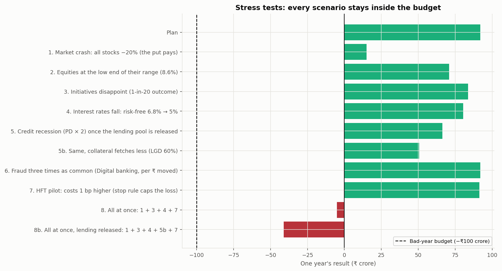

| Stress | Year's result |
| --- | --- |
| Plan | +₹91.8 crore |
| Market crash −20% (the put pays) | +₹15.0 crore |
| Equities at the low end (8.6%) | +₹70.8 crore |
| Rates fall to 5% | +₹80.3 crore |
| Credit recession with the approved loans released at today's prices (LGD 60%) | +₹50.6 crore |
| **All at once, today** | **−₹5.1 crore** |
| All at once, approved loans released at today's prices (LGD 60%) | −₹41.1 crore |
| All at once, all three steps released (loans re-priced, LGD 60%) | −₹63.1 crore |
| Reverse stress | With the put no crash can break the ₹100 crore budget; without it a 50% fall would (with the rest of the plan earning as expected) |

**What the ₹100 crore is:** the bad-year budget, the most the whole ₹1,000 crore plan may lose in one bad year (10%). It is a **loss limit, not an amount we allocate**: all ₹1,000 crore is allocated. The brief gives no figure (it asks for "acceptable levels of" risk), so 5%, 10% and 15% were considered and 10% was agreed (M9-10). It did not shape the split: the 30% cap stopped equities first. The reserve floor is also ₹100 crore (10%), but it is a different rule: money that is never released.

All scenarios stay inside the ₹100 crore budget. Two ways to read how much of it is used today: **5%** (−₹5.1 crore) is the whole year's result, with the reserve's interest counted; **₹37.5 crore** is what the allocation rule counts, adding each use's own bad year and no interest, which leaves ₹62.5 crore.

#### Why it looks like this
- **Few uses beat the 6.8% risk-free rate at scale:** equities (13.8% after the put) and ₹50 crore of initiatives. Lending at today's prices earns 3.3% and loses 2.2% in a recession.
- **The optimiser (method B) lands on the same split:** the result comes from the evidence and the limits, not the method.
- **The bank view of lending** (12% capital) beats the hurdle only if deposits cost under 2.8%, and loses 33% of the capital in a recession even at 2%. That's why the main view stays ₹1 = ₹1 and growth waits for re-pricing.
- **Evidence strength:** ₹638 crore strong (market rate), ₹306 crore medium (equities, the put, the option-book hedge), ₹51 crore weak (initiatives, staged), ₹5 crore pilot.
- **Liquidity:** ₹943 crore can come back within days; ₹51 crore (initiatives) is locked in for about 5 years; ₹5 crore (the put) is spent each year.

#### Limitations
- **Synthetic data:** equities move independently, and every option on a stock has its own price. Real-market risk is a stress estimate.
- **No data links the businesses,** so the scenarios are set by hand. No cost of funds, running costs or recovery data. Lending's Year 2 assumes re-priced loans keep the same borrowers.
- **Short histories:** 43 months for equities, 3 test days for HFT. The P(Success) model is weak; it only screens slow payers (36 into Reject), and the risk rating alone gives a similar list.

## 3.2 Integrated decision-making: how the modules feed each other
| Link | What passes | How it is used | ₹ effect |
| --- | --- | --- | --- |
| Module 5 → Module 6 | No model predicts returns beyond luck | Module 6 holds all 15 at equal weight instead of ML picks | +₹15.0 crore a year on ₹300 crore (not beyond luck, p 0.39) |
| Module 6 → Module 8 | Equities' real-market swing (19.4%) and crash loss (−20%) | Module 8 prices the put that protects Module 9's equities | Crash loss ₹60 crore → ₹35.4 crore for ₹5.4 crore a year |
| Module 6 → Module 7 | Equity turnover (≈ 0.8× a year) | Order timing applied to the equity book's own trades | ₹0.03 crore a year |
| Module 1 → Modules 3, 4 | Return per ₹ of capital by business unit | Gives Digital banking and Wealth a return per ₹ of capital (no other data has one) | Digital 13.2%, Payments 13.0%, Wealth 17.6% a year |
| Module 3 → Digital banking money | Fraud cost 1.55% of money moved with the rule (6.13% without) | Digital banking initiatives are funded only while the rule runs | Saves ₹4.58 crore per ₹100 crore moved |
| Module 2 → Module 9 lending pool | Approved loans earn 3.3%; re-pricing needs about 12.3% | Lending waits in an earmarked pool; released when re-priced (growth path) | ₹450 crore of loan growth in Year 2 |
| Module 2 → stress tests | PD × 2 recession: −2.15% per ₹ lent | Scenario 5 of the allocation's stress test | −₹6.2 crore if the pool were lent in a recession |
| Module 8 → governance | Hedge C cuts the option book's 1-in-100 bad day by 45%; delta-only is worse than none | Hedging rule and trigger in the governance table | 1-in-100 bad day ≤ 4% of the book |
| Modules 1–8 → Module 9 | The same fields from every module (return, bad year, capacity, evidence) | One ranking across all businesses, best uses first | ₹91.8 crore a year vs −₹2.4 crore the bank's way |

## 3.3 Sound ML, validation and explainability
A model drives decisions only if it beats a simple benchmark on data it never saw; a weak one is used at most as a screen (Module 1's moves 36 Medium/High-risk slow payers from Review to Reject; the risk rating alone gives a similar list). Otherwise the simpler choice wins, which is itself a validated decision.

| Module | Predicts | Models compared (and benchmark) | Result on unseen data | Verdict | Validation | Explained by | Used in the allocation? |
| --- | --- | --- | --- | --- | --- | --- | --- |
| 1 Corporate finance | P(Success) | Lasso vs logistic, tree, forest, boosting; benchmark = historical success rate | ROC-AUC 0.578 ± 0.08; luck p 0.17 | Not beyond luck on ranking; its flag separates failures (30% vs 14%) | Repeated cross-validation; shuffled labels | Odds ratios | Screens 36 slow payers into Reject; the rating alone gives a similar list |
| 2 Credit risk | PD (default) | Lasso vs logistic, tree, forest, LightGBM; benchmark = the bank's own interest rate | ROC-AUC 0.731 vs 0.702 for the bank's rate (cross-validation); 0.741 vs 0.719 (1,000 test loans) | Won all 25 cross-validation rounds; on the test loans alone not proven at 95% (p = 0.065). Well calibrated (all 4 checks pass) | Cross-validation + held-out test; calibration tests; trees ruled out for overfitting | Odds ratios; a reason per loan | Yes: lending decisions |
| 3 Fraud | P(fraud) | Logistic, lasso, tree, forest, LightGBM; benchmark = amount alone | PR-AUC 0.132 vs 0.116, ROC-AUC 0.794 vs 0.788 (cross-validation); 0.124 vs 0.103, 0.815 vs 0.787 (later test) | ROC-AUC gain proven on the test; PR-AUC gain just touches zero. Cuts the cost of fraud risk 6.13% → 1.55% of money moved | Cross-validation + time-ordered test; costs from the brief | Reasons in words per transaction | Yes: condition for Digital banking |
| 4 Customers | Churn | Logistic, tree, forest, LightGBM (+ a 115-input search) | ROC-AUC 0.490 (coin flip 0.5); luck p 0.83 | No model beats a coin flip beyond luck | Shuffled labels; Bonferroni line | — | No (randomised test first) |
| 5 Equity markets | Next-month return | Linear, ridge, forest, LightGBM; benchmark = holding all 15 | Ridge IC 0.004; best top-5 p ≥ 0.40 | No model beats luck | Walk-forward, 43 months; shuffled returns | — | No (hold all 15) |
| 7 HFT | Next 0.1 s direction | Logistic, forest, LightGBM; benchmark = order-book imbalance alone | AUC 0.791 vs 0.781 (DeLong p < 0.0001); luck p 0.0099 | Beats the benchmark beyond luck; overfitting gap +0.003 | Separate tuning and test days; DeLong; shuffled labels | Buyer/seller balance in plain words | Yes: order timing; pilot |
| 8 Derivatives | Option price | Direct ML and hybrid × 4 models; benchmark = Black-Scholes | Average gap BS ₹6.07 vs best ML ₹6.22 | ML worse than Black-Scholes in all 12 groups and 13 of 15 stocks | Held-out options; paired 95% ranges; shuffled corrections | Greeks | No (Black-Scholes) |

Reproducibility: seed 42 everywhere; each module's runner gives the same files as its standalone notebooks (checked file by file on the project's computer; a fresh install of the libraries changed numbers by at most 0.000001).

## 3.4 Method, comparison and the lending sensitivity
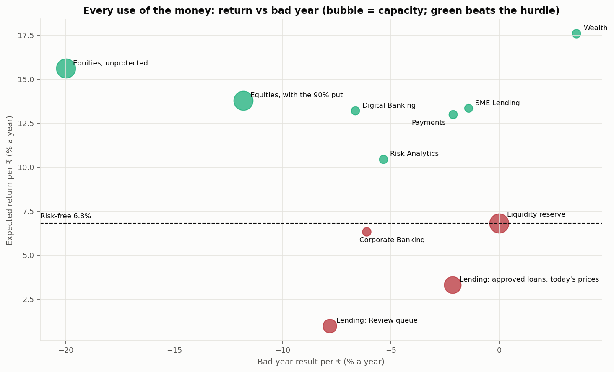
**Method A (chosen):** best uses first, by return above 6.8% per ₹ of bad-year loss, within capacity, a 30% cap per category, a ₹100 crore bad-year budget and a 10% minimum reserve; the rest to the reserve. **Method B (optimiser, with assumed links between businesses)** lands on the same shape:

| Caution (λ) | Initiatives (₹ crore) | Equities with put (₹ crore) | Lending (approved) (₹ crore) | Liquidity reserve (₹ crore) | Expected return (% a year) | Yearly swing (%) |
| --- | --- | --- | --- | --- | --- | --- |
| 2 | 51.4 | 300.0 | 0.0 | 648.6 | 9.3 | 4.8 |
| 5 | 51.4 | 300.0 | 0.0 | 648.6 | 9.3 | 4.8 |
| 10 | 51.4 | 279.1 | 0.0 | 669.5 | 9.1 | 4.5 |
| Method A (chosen) | 51.4 | 300.0 | 0.0 | 648.6 | 9.2 | 4.8 |

Method A's reserve column also holds the ₹5 crore pilot and the ₹5.6 crore of hedging (put and option book): ₹638.0 crore is the reserve itself.

**Lending as a leveraged bank business** (sensitivity, 12% capital):

| Cost of funds (% a year) | Return on capital, normal year (%) | Return on capital, recession year (%) |
| --- | --- | --- |
| 2.0 | 12.8 | −32.6 |
| 3.0 | 5.5 | −39.9 |
| 4.0 | −1.8 | −47.3 |
| 5.0 | −9.2 | −54.6 |
| 6.0 | −16.5 | −61.9 |

## 3.5 Governance and controls
| Model or control | Used for | Owner | What is watched | Trigger → action | How it is explained |
| --- | --- | --- | --- | --- | --- |
| PD scorecard (Module 2) | Lending decisions; the lending-pool release test | Chief Risk Officer (credit) | Monthly: score drift (PSI), defaults by band vs PD | PSI > 0.25 or defaults > 1.5 × PD in a band → re-fit; release the pool only for re-priced loans earning ≥ 6.8% after expected loss | Odds ratios; a reason for every loan |
| Fraud model and 4.76% line (Module 3) | Condition for Digital banking money | Head of Fraud Operations | Weekly: fraud caught, false alarms, cost per ₹ moved | Cost > 2% of money moved → review the line; investigations above capacity → add staff | Reasons in words per transaction |
| P(Success) model (Module 1) | Screens slow payers only (weak: ROC-AUC 0.58) | Head of Strategy | Success of funded initiatives vs predicted | Review money released only after human review, in stages at milestones | Odds ratios; every check per initiative |
| Order-timing model (Module 7) | Desk order timing; the HFT pilot | Head of Trading | Daily saving per ₹1 crore of orders; pilot profit after costs | Savings negative 5 days running → switch off; pilot stops if net profit < 0 | Buyer/seller balance in plain words |
| No model, by evidence (Modules 4, 5, 6, 8) | Stock-picking, option pricing, churn targeting | Investments, derivatives, wealth heads | — | Revisit only with new data; churn needs a randomised test before any spend | Results tables in each module |
| Equity limit and 90% put (Modules 6, 8) | ₹300 crore cap; crash protection | Chief Investment Officer | Monthly VaR (₹8 crore per ₹100 crore a month); the put's floor | VaR above limit → cut back to the cap; renew the put every year | Scenario table |
| Option-book hedge C (Module 8) | Volatility and stock risk of the option book | Derivatives desk | Daily: 1-in-100 bad day ≤ 4% of the book | Above the limit → resize the hedge | Hedging-choice table |
| The allocation (Module 9) | ₹1,000 crore | CFO with the asset–liability committee (ALCO) | Quarterly: stress tests, budget used, pool release test | Any scenario losing more than ₹100 crore → move money toward the reserve | Allocation and stress tables |

Across all models: a model inventory; three lines of defence (owner, yearly independent validation, internal audit); people decide every Review case; reproducible notebooks as the validation pack.

<<PAGEBREAK>>

# 4. Module-wise methodology and results
Each module below shows its method on the six framework steps, its ML verdict, and its own summary. **Where a § number appears (e.g. §5.4), it points to that section of the module's full report, `reports/module_N_report.pdf` in that module's folder.** File names refer to the project's code folder, submitted as the ZIP.


## 4.1 Module 1: Corporate finance: strategic initiatives

**Method (the six framework steps):**

| Step | In this module |
| --- | --- |
| 1 Data | 180 initiatives |
| 2 ML prediction | P(Success): lasso (weak; screens 36 slow payers into Reject) |
| 3 Financial metric in ₹ | NPV, Expected NPV, IRR by business unit |
| 4 Risk | Payback, loss tolerance, 1-in-20 bad case |
| 5 Decision rule | Fund / Review / Reject; return above 6.8% |
| 6 Control and owner | Staged release; Head of Strategy |

**ML verdict:**

| Predicts | Models compared (and benchmark) | Result on unseen data | Verdict | Validation | Used in the allocation? |
| --- | --- | --- | --- | --- | --- |
| P(Success) | Lasso vs logistic, tree, forest, boosting; benchmark = historical success rate | ROC-AUC 0.578 ± 0.08; luck p 0.17 | Not beyond luck on ranking; its flag separates failures (30% vs 14%) | Repeated cross-validation; shuffled labels | Screens 36 slow payers into Reject; the rating alone gives a similar list |

**Summary from the module report:**

| Decision | Initiatives | Capital | Expected NPV (sum) | What it means |
| --- | --- | --- | --- | --- |
| **Fund** | 2 | **₹3.2 crore** | **+₹56.0 lakh** | **1075** (Wealth, Low risk; Expected NPV +48.2 lakh): fund in full. **1062** (Corporate Banking, Low risk; +7.8 lakh): fund in stages, releasing money at milestones |
| **Review** | 38 | up to **₹62.9 crore** | −₹1,006.6 lakh | Attractive but uncertain: 6 value-creating projects with Medium/High risk (Expected NPV +1.3 to +40.0 lakh), and 32 "slow payers" whose value arrives after year 3, so their 3-year Expected NPV is still negative. Examined in the priority order given |
| **Reject** | 140 | ₹217.3 crore | −₹8,931.1 lakh | Each with its reasons: 96 repay too late or never, 8 promise less than their cost of money, 36 are flagged at risk by the model |

**Expected NPV** = P(Success) × NPV, the brief's measure of value: what an initiative is worth today, weighted by its chance of success. Only the 8 initiatives with a positive NPV have a positive Expected NPV. §5 shows how it is used together with risk, payback, the hurdle, the model's flag and loss tolerance.

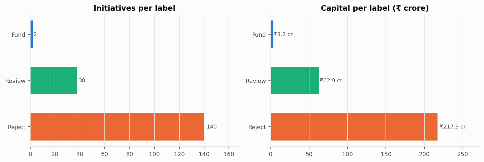

*Initiatives (left) and capital (right) per label. Blue = Fund, aqua = Review, orange = Reject.*

**The five findings behind the answer:**
1. **The bank's risk rating is the one reliable signal of success.** Low-risk initiatives succeeded 89% of the time, against 69–70% for Medium and High (§3).
2. **On 3 years of cash, almost nothing repays its investment.** Only 8 of 180 initiatives have a positive 3-year NPV (§3, §5).
3. **Machine learning confirmed and quantified the risk rating, but found nothing beyond it.** The best model (lasso) ties a simple lookup on the rating (§4).
4. **The downside of failure decides how money is released.** Loss tolerance turns "fund" into "fund in full" or "fund in stages" without guessing a recovery rate (§5).
5. **Strategic initiatives can absorb at most about ₹66 crore of the ₹1,000 crore,** and only ₹3.2 crore is ready now. The rest of the capital must go to NovaFin's other businesses (Module 9).

#### 1.1 What we recommend the Board does

1. **Fund now (₹3.2 crore):** 1075 in full; 1062 in stages, releasing money at milestones, because it stays worth funding only if a failure loses no more than about 36% of its investment.
2. **Review the 38 in the order given** (§5.4). Start with the 6 value-creating Medium/High-risk projects, judging each by its loss tolerance; then the 32 slow payers, fastest payback first.
3. **Look hardest at Corporate Banking's 7 Review projects** (₹14.8 crore, the largest Review exposure of any unit). Ask why past Corporate Banking initiatives failed before approving any of them (§6.1).
4. **Screen every future initiative on risk first.** Low risk is the one reliable signal of success. Medium- and High-risk proposals need a closer look, e.g. a pilot, before money is committed.
5. **Decide how patient to be.** At a 5-year payback limit, 38 initiatives reach Review; at 6 years, 47. Each extra year rests on cash flows the data doesn't cover (§5.3b, §6.2).
6. **Don't rely on business-case numbers to predict success.** NPV, cash return and revenue plans don't predict it; use them to value an initiative, not to judge whether it will succeed.
7. **Collect better data before relying on prediction.** The model can't tell projects of the same risk rating apart. Sponsor track record, delivery milestones and post-launch results would give it something to learn from.

---

**Evidence behind the model** (ROC-AUC and Brier score of the seven models over 25 test rounds.)

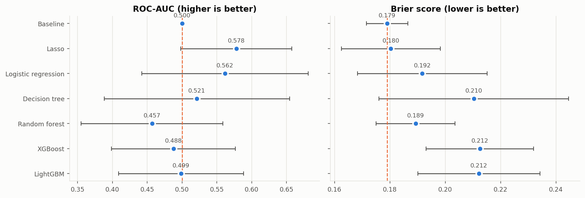

<<PAGEBREAK>>

## 4.2 Module 2: Credit risk

**Method (the six framework steps):**

| Step | In this module |
| --- | --- |
| 1 Data | 5,000 loans |
| 2 ML prediction | PD: lasso scorecard (calibrated) |
| 3 Financial metric in ₹ | ECL = PD × 40% × loan; return per ₹ lent |
| 4 Risk | PD × 2 recession; LGD 60% |
| 5 Decision rule | Approve / Review / Reject; required rate |
| 6 Control and owner | PSI, defaults vs PD; Chief Risk Officer |

**ML verdict:**

| Predicts | Models compared (and benchmark) | Result on unseen data | Verdict | Validation | Used in the allocation? |
| --- | --- | --- | --- | --- | --- |
| PD (default) | Lasso vs logistic, tree, forest, LightGBM; benchmark = the bank's own interest rate | ROC-AUC 0.731 vs 0.702 for the bank's rate (cross-validation); 0.741 vs 0.719 (1,000 test loans) | Won all 25 cross-validation rounds; on the test loans alone not proven at 95% (p = 0.065). Well calibrated (all 4 checks pass) | Cross-validation + held-out test; calibration tests; trees ruled out for overfitting | Yes: lending decisions |

**Summary from the module report:**

| Decision | Loans | ₹ lent | Actual default | Interest − actual loss, per year | What it means |
| --- | --- | --- | --- | --- | --- |
| **Approve** | 2,934 (59%) | **₹285.9 crore** | **11.3%** | **+₹10.45 crore** | Lend at the rate charged. Passes every check |
| **Review** | 1,045 (21%) | ₹163.9 crore | 21.8% | +₹0.59 crore | Lendable once fixed: re-price to the required rate, add collateral, or have a person check a large loan. Each loan's action is in the decision file |
| **Reject** | 1,021 (20%) | ₹189.8 crore | 42.7% | **−₹7.96 crore** | PD above 30%: no price within risk appetite covers the risk |
| *Today's book* | *5,000* | *₹639.7 crore* | *19.9%* | *+₹3.07 crore* | *Every loan the bank actually made* |

**Terms:**
- **PD** (probability of default): the chance a borrower fails to repay within the year.
- **ECL** (expected credit loss) = PD × LGD × loan amount: the loss to expect on average in a year. **LGD** (loss given default) is the share of the loan lost if the borrower defaults, 40% here.
- **"Interest − actual loss"** is what a group of loans really earned above its credit losses, before the bank's cost of funds and running costs.

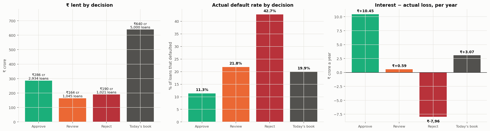

**The five findings behind the answer:**
1. **The bank's pricing barely covers its risk.** Today's book earns only ₹3.07 crore a year above its credit losses on ₹639.7 crore. It breaks even at a cost of funds of just **0.48% a year**: at any realistic cost, the book loses money (§5, §6.1).
2. **A fifth of the loans cause half the expected loss.** Very High-risk loans (PD above 30%) are 20% of loans but carry **52% of the expected loss**, and lose ₹8 crore a year on their own (§4).
3. **The bank's price gets risk backwards in places.** Loans the scorecard calls safer are charged **9.45%** and default 11.4%. Loans it calls riskier are charged only **9.05%** and default 22.8%. The bank's price never identifies a truly low-risk borrower; the scorecard finds 220 that default only 3.2% (§4, §6.1).
4. **Machine learning adds real but modest value, mostly through pricing and mostly in Retail.** The scorecard ranks risk better than the bank's price (ROC-AUC 0.731 vs 0.702 over 25 rounds) and is well calibrated (₹63.0 crore loss predicted, ₹62.7 crore actual). In the decision, the same rule driven by the bank's own price earns **₹3.09 crore a year less** at a higher default rate (§3, §6.2).
5. **The recommendation holds under every assumption tested.** For cost of funds 0–3%, LGD 30–60% and collateral recovery 50–70%, Reject never changes and the approved loans stay profitable (§5).

#### 1.1 What we recommend the Board does

1. **Adopt the decision rule now** (§5): approve 2,934 loans (₹285.9 crore) and reject 1,021, using the scorecard's PD and a 6% risk-appetite cap. Approved loans default 11.3% against 19.9% today, and earn more than three times what today's whole book earns.
2. **Work the Review queue (₹163.9 crore) to lend more.** Each loan in the decision file carries its action:
   - 301 under-priced loans (₹38.1 crore) need at most 1 point more interest;
   - weakly secured loans typically need about 27% of the loan in extra collateral;
   - 76 loans (₹32.2 crore) need only a credit committee check because of their size.
3. **Re-price the whole book by scorecard band, not the current rate grid, starting with Retail.** Today's pricing loses money at any cost of funds above 0.48%, and charges safer borrowers more than riskier ones. The scorecard's ranking gain over the bank's price is largest in Retail (+0.035 to +0.038 ROC-AUC); in Corporate the bank's price already ranks about as well (§3.7).
4. **Win the safe borrowers the bank's price can't see.** The 220 Low-risk loans (3.2% default) are charged about 7.5%. Offering them sharper rates is the safest growth available.
5. **Keep approval below about 73%** unless the scorecard is re-checked. Above that level, the bank's own price ranks applicants slightly better (§6.3).
6. **Choose the risk appetite knowingly.** Tightening the cap from 6% to 4% cuts defaults to 8.7%, but lends ₹103.6 crore less and earns ₹2.34 crore a year less (§5.3).
7. **Collect the missing data:**
   - recovery amounts on defaulted loans, so LGD can be measured instead of assumed;
   - the bank's actual cost of funds;
   - outcomes for a small sample of loans the rule would reject, to test it on applicants the bank normally turns down.
8. **Re-check the model regularly.** Each quarter, re-check calibration and the cap on new loans. Watch the very largest loans, which the model under-predicts (§5.2).

#### 1.2 Conclusions for the evaluator

**Machine learning.**
- A champion vs challenger design tested whether borrower fundamentals predict default better than the bank's own price.
- A 7-input lasso scorecard won all 25 cross-validation rounds on ROC-AUC. On 1,000 untouched test loans the ranking, probability and recall measures improve (ROC-AUC +0.023), precision is 2.1 points lower and the loss at 70% approval ₹0.26 crore higher (both within the noise), and the gain is **not proven at the 95% level** (DeLong p = 0.065). We report it as real but modest.
- Random forest and LightGBM were ruled out for overfitting.
- The PDs pass four calibration checks on all loans and on the test loans, so no correction was needed.
- The brief's four bands pass four evidence tests with no merges.
- Every threshold was agreed before the result was seen, tested on the data, and has its source and check recorded.

**Finance.**
- ECL is right in rupees (₹63.04 crore expected, ₹62.72 crore actual).
- The bank's pricing is the core problem: it breaks even at a 0.48% cost of funds and misprices risk in both directions.
- The rule turns PD into a money decision with every brief factor: PD, ECL, borrower characteristics (through the PD), loan size, collateral and risk appetite.
- It gives the Board a trade-off table instead of one number, and an action for every Review loan.

---

**Evidence behind the model** (Brier score and ROC-AUC over 25 rounds, mean ± 1 standard deviation. Orange = champion, grey = reference, blue = challengers. Average PD vs actual default rate in 10 PD groups, and predicted vs actual loss by group.)

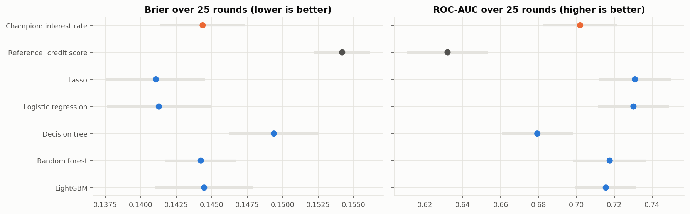

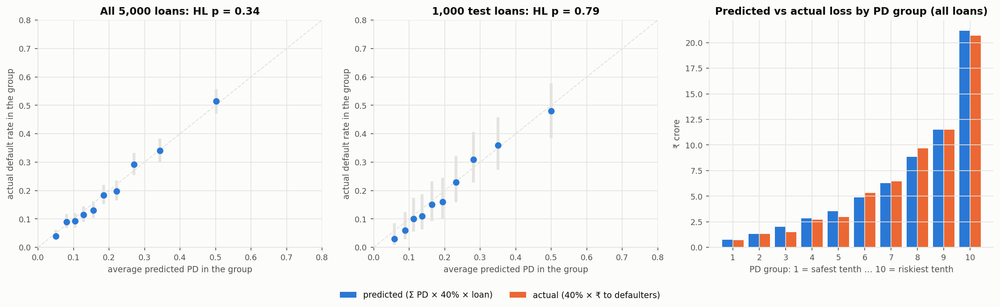

<<PAGEBREAK>>

## 4.3 Module 3: Fraud detection

**Method (the six framework steps):**

| Step | In this module |
| --- | --- |
| 1 Data | 30,000 transactions |
| 2 ML prediction | P(fraud): LightGBM |
| 3 Financial metric in ₹ | Cost of fraud risk per ₹ moved |
| 4 Risk | Fraud × 3 |
| 5 Decision rule | Investigate above 4.76% (brief's costs) |
| 6 Control and owner | Weekly cost check; Fraud Operations |

**ML verdict:**

| Predicts | Models compared (and benchmark) | Result on unseen data | Verdict | Validation | Used in the allocation? |
| --- | --- | --- | --- | --- | --- |
| P(fraud) | Logistic, lasso, tree, forest, LightGBM; benchmark = amount alone | PR-AUC 0.132 vs 0.116, ROC-AUC 0.794 vs 0.788 (cross-validation); 0.124 vs 0.103, 0.815 vs 0.787 (later test) | ROC-AUC gain proven on the test; PR-AUC gain just touches zero. Cuts the cost of fraud risk 6.13% → 1.55% of money moved | Cross-validation + time-ordered test; costs from the brief | Yes: condition for Digital banking |

**Summary from the module report:**

**Investigate a transaction when the fraud model's chance of fraud is above 4.76%.** On 6,000 later transactions that the model never learned from, per 1,000 transactions:

| Rule | Investigations | Frauds caught | Fraud ₹ caught | Cost, brief's costs | Real cost (fraud at its actual amount) |
| --- | --- | --- | --- | --- | --- |
| Investigate nothing | 0 | 0% | 0% | ₹2.40 lakh | ₹6.66 lakh |
| **Investigate if chance of fraud > 4.76%** | **79** | **52%** | **80%** | **₹1.48 lakh (−38%)** | **₹1.68 lakh (−75%)** |
| Investigate if chance × amount is large enough (finance view) | 157 | 63% | 89% | — | ₹1.42 lakh (−79%) |
| Investigate everything | 1,000 | 100% | 100% | ₹4.88 lakh | ₹4.88 lakh |

**Terms:**
- **Chance of fraud (P(fraud)):** the supervised model's probability that a transaction is fraud.
- **4.76%:** the brief's ₹500 investigation cost ÷ (₹10,000 missed-fraud cost + ₹500). Above it, the expected loss from letting a transaction through beats the cost of checking it.

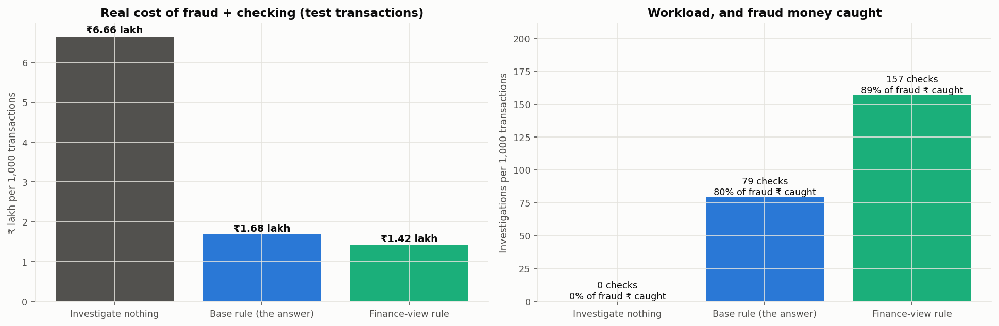

**The five findings behind the answer:**
1. **Fraud is rare by count but large by money.** 2.28% of transactions, but 6.2% of the money moved: ₹2.01 crore. The average fraud is ₹29,380, against ₹10,327 for a normal transaction (§3).
2. **Amount carries almost all the signal.** Of 16 columns tested, only the amount and the amount against the customer's usual amount separate fraud. Transactions of ₹25,000 and over are 9% of transactions but hold 84% of the money lost. City, merchant, time, device and history carry nothing in this data (§3).
3. **There are two kinds of fraud.** Large, unusual frauds hold most of the money, and every method finds them. A third of frauds look ordinary, carry about 8% of the money, and no method finds them (§3, §5, §7).
4. **Machine learning helps modestly, and most in combination with amount.** The supervised model beats "largest amount first" beyond chance. On its own it finds more frauds but fewer rupees; combined with the amount it finds more of both. Anomaly detection, without labels, does worse than either (§4, §5).
5. **The cost-based threshold saves 38% under the brief's costs, and 75% in real money.** The brief's flat ₹10,000 understates what fraud costs, by about three times (§6).

#### 1.1 What we recommend the Board does

1. **Adopt the rule: investigate when the chance of fraud is above 4.76%.** That is about 79 checks per 1,000 transactions, catching half the frauds and 80% of the fraud money. Real saving: ₹4.98 lakh per 1,000 transactions.
2. **Settle the two cost assumptions before staffing the team.** If a missed fraud costs 40 times a check (not 20), investigations nearly triple, to 223 per 1,000.
3. **Consider the finance-view rule if investigators can be added.** Ranking by chance × amount saves ₹26,000 more per 1,000 transactions, but doubles the checks (157 per 1,000).
4. **Don't run anomaly detection as the main screen.** It saves only 13% and adds 3–6 frauds the model misses. Keep it, if at all, as a watch for new fraud patterns.
5. **Collect the data that would find the ordinary-looking frauds.** Real device fingerprints, login and location history, and payee details. In this file, device and customer columns behave like random labels.
6. **Re-check the model and the line regularly.** The chances were honest around the 4.76% line on these 20 months. Fraud patterns change, so check every quarter.

#### 1.2 Conclusions for the evaluator

**Machine learning.**
- Every column was tested on one agreed rule: significant after adjusting for 16 tests, and able to separate fraud on its own (single-column ROC-AUC of at least 0.60). Only amount and the amount ratio passed.
- Eleven model set-ups were compared over 25 cross-validation rounds against an "amount alone" benchmark, with an overfitting limit and a "simplest wins when within chance" rule fixed before results. A small LightGBM model was chosen: PR-AUC 0.132 vs 0.116 for amount alone. On the time-ordered test set, its ranking and probability gains are proven; its PR-AUC gain just touches zero.
- Isolation Forest, fitted without the label, flags transactions six times riskier than average but ranks worse than both, beyond chance.
- The threshold comes from the costs, and was checked against trying every cut-off and against calibration on both sides of the line.

**Finance.**
- Fraud costs 6.1% of money moved with no screening, and 1.55% with the rule (1.24% lost, 0.31% investigating).
- The brief's flat ₹10,000 understates real losses about three times. Counted in real money, the rule saves 75%.
- Workload, not model accuracy, is the main lever the Board controls.

---

**Evidence behind the model** (Share of frauds and of fraud ₹ caught at every investigation budget: model, amount alone, and model × amount.)

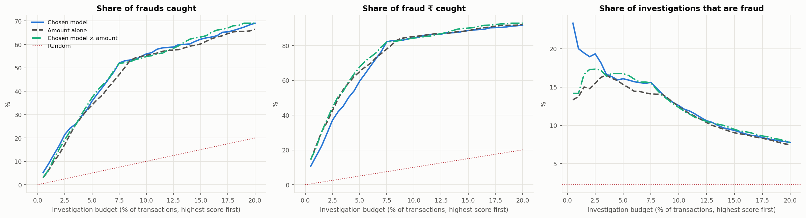

<<PAGEBREAK>>

## 4.4 Module 4: Customer analytics

**Method (the six framework steps):**

| Step | In this module |
| --- | --- |
| 1 Data | 5,000 customers |
| 2 ML prediction | Churn: no model beats a coin flip beyond luck |
| 3 Financial metric in ₹ | CLV; fee yield 1.80% |
| 4 Risk | Market −20%, churn × 2 |
| 5 Decision rule | No model-driven retention spend |
| 6 Control and owner | Randomised test first; Head of Wealth |

**ML verdict:**

| Predicts | Models compared (and benchmark) | Result on unseen data | Verdict | Validation | Used in the allocation? |
| --- | --- | --- | --- | --- | --- |
| Churn | Logistic, tree, forest, LightGBM (+ a 115-input search) | ROC-AUC 0.490 (coin flip 0.5); luck p 0.83 | No model beats a coin flip beyond luck | Shuffled labels; Bonferroni line | No (randomised test first) |

**Summary from the module report:**

**Relationship managers should prioritise the 1,000 highest-value customers**: the 278 in "Priority retention" first, then the 722 in "Protect", each ordered by CLV. They are worth ₹93,019 to ₹4,39,367 each and hold **₹13.79 crore, 42% of all customer value**, in 20% of customers.

**Why value and not churn risk:**

| Finding | Evidence |
| --- | --- |
| **Churn can't be predicted from this data** (Task 1) | No column, no model, no combined-input search and no simple bank rule beats random by more than luck. The five models: ROC-AUC 0.49–0.56 over 25 rounds, against 0.5 for a coin flip; shuffled-label test p 0.20–0.84 (that test, and its chart below, use one 5-fold split, where the scores are 0.457–0.534) |
| **Customer value can be estimated exactly** (Task 2) | CLV = max(0, 4% × income + 3% × account + 1.2% × loan + 1.8% × investment − ₹5,000 × complaints), matching all 5,000 customers within ₹0.01 (one paisa) |
| **So the four groups differ in value, not in risk** (Task 3) | Actual churn is about the same in every group (1.1–2.0%, p = 0.67). "Priority retention", rated riskiest by the model, churns least (1.08%) |

**Would the list have worked? (back-test)**

A back-test checks a list chosen without knowing who left against what actually happened:

| Way of choosing 1,000 | Leavers reached (of 89) | Value of those leavers (of ₹56.0 lakh that left) | Value contacted |
| --- | --- | --- | --- |
| **Recommended: the 1,000 highest-value customers** | 14 | **₹18.7 lakh** | **₹13.79 crore (42%)** |
| Chance of churn × CLV | 16 | ₹17.5 lakh | ₹11.96 crore (36%) |
| Churn score only | 15 | ₹8.5 lakh | ₹5.82 crore (18%) |
| Random 1,000 (average of 500) | 17.7 | ₹11.2 lakh | ₹6.57 crore (20%) |

No list reaches more leavers than random. The recommended list reaches the most *value*, because high-value customers are worth more when they leave.

**Is calling worth it?** If nobody is called, the expected loss on the list is 1.78% × ₹13.79 crore = **₹24.5 lakh**. The real call success rate is unknown, so no figure is assumed:
- **The break-even:** at ₹500 a call, the 1,000 calls (₹5 lakh) pay off only if they keep at least **20%** of would-be leavers.
- **The ceiling:** even if every call worked, retention would protect at most **₹19.5–22.0 lakh**.

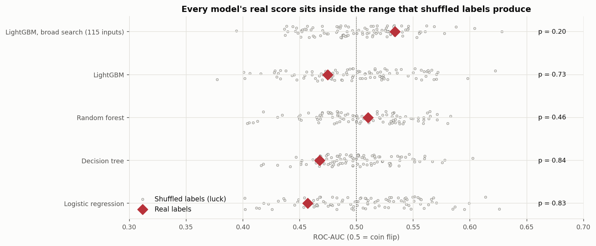

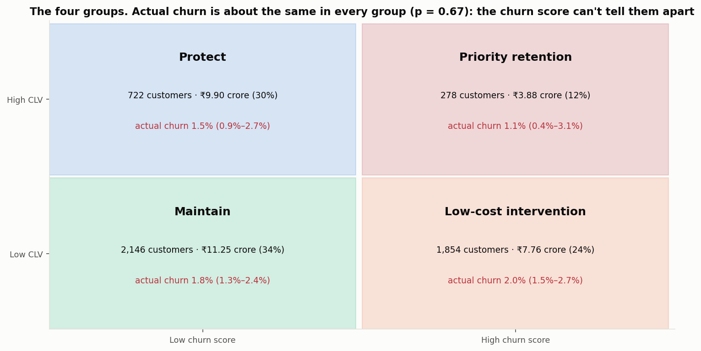

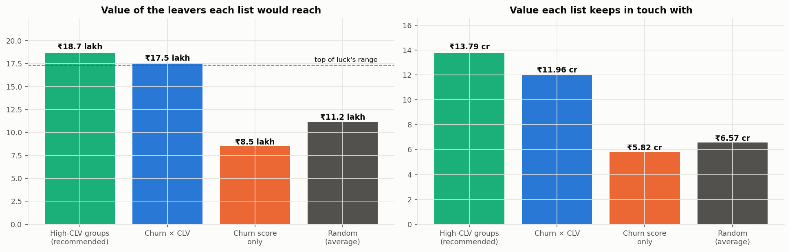

**Recommendations for management:**
1. **Call the 1,000 highest-value customers** (`FINAL_M4_T3_contact_list.csv`, in call order, with the reason for each).
2. **Test before scaling.** Call a random half of a test group, leave the other half, and compare who leaves, to measure the real success rate.
3. **Reduce complaints.** Each costs ₹5,000 of customer value (Task 2), ₹3.81 crore in all (12% of the book). It's the one value driver the bank directly controls.
4. **Collect month-by-month data** (balances, transactions, product closures, service calls). It is what could make churn predictable.

---


<<PAGEBREAK>>

## 4.5 Module 5: Equity markets

**Method (the six framework steps):**

| Step | In this module |
| --- | --- |
| 1 Data | 15 stocks, 43 test months |
| 2 ML prediction | Returns: no model beats luck |
| 3 Financial metric in ₹ | Return vs holding all 15 (after costs in Module 6) |
| 4 Risk | Swing 10.9–13.2% for any top 5 vs 6.7% for all 15 |
| 5 Decision rule | No ML stock-picking |
| 6 Control and owner | Revisit only with new data; CIO |

**ML verdict:**

| Predicts | Models compared (and benchmark) | Result on unseen data | Verdict | Validation | Used in the allocation? |
| --- | --- | --- | --- | --- | --- |
| Next-month return | Linear, ridge, forest, LightGBM; benchmark = holding all 15 | Ridge IC 0.004; best top-5 p ≥ 0.40 | No model beats luck | Walk-forward, 43 months; shuffled returns | No (hold all 15) |

**Summary from the module report:**

**On this data, ML cannot identify stocks with superior future returns. No model's picks beat holding all 15 stocks equally beyond luck, and holding all 15 had about half the risk.**

| Finding | Evidence |
| --- | --- |
| **No model predicts which stocks will do better** (Task 1) | Four models and two simple benchmarks, walk-forward over 43 months (645 predictions each): ICs −0.049 to +0.005. Luck alone gives −0.08 to +0.08; every model sits inside (shuffled-returns p 0.53–0.93) |
| **Nothing in the data predicts returns** (Task 1) | 0 of 66 input tests pass (22 inputs × next day, week, month); no sector, calendar or VIX effect; the best of 946 combined conditions is luck (p 0.48). The macro columns are random numbers |
| **No portfolio of the models' top picks beats holding all 15 beyond luck** (Task 2) | ₹100 crore in all 15 grew to **₹169.0 crore** (15.8% a year, 31 Jan 2023 – 31 Aug 2026, before costs). Models' top 5: ₹133.2 to ₹187.2 crore, p 0.40–0.98; a random top 5: ₹113 to ₹251 crore |
| **The answer holds under every variation tried** (Task 2) | Top 3, 5 or 7 stocks (the "best" model changes each time); quarterly instead of monthly; weighting the top 5 by the model's confidence (lowers the ML models' returns) |
| **Picking 5 stocks nearly doubles the risk, for no proven gain** (Task 2) | Volatility 10.9%–13.2% a year for any top 5, against 6.7% for all 15: about 1.8 times. All 15 had the best return per unit of risk (2.34 vs 0.63–1.75) |

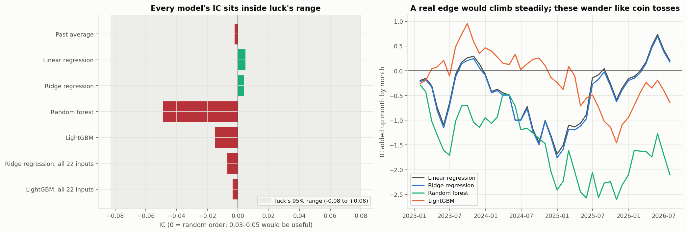

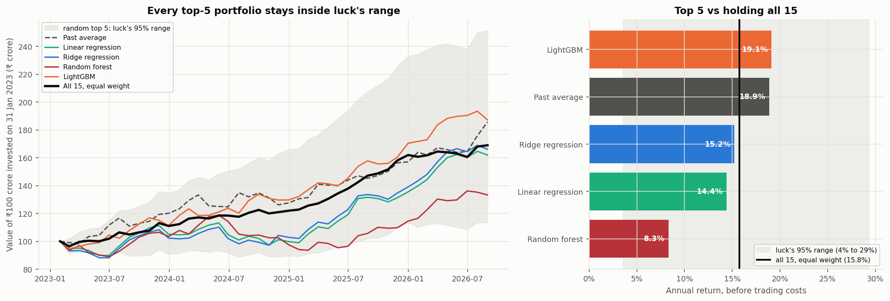

**Recommendations for the investment committee:**
1. **Don't use these models to pick stocks.** They add risk (about 1.8 times), heavy trading (the portfolio turned over 11–16 times a year) and no proven return.
2. **Hold the stocks broadly:** equal weight, or the optimised mix Module 6 compares.
3. **Don't fund an ML stock-picking programme on this evidence.** A small edge (IC 0.03–0.05, worth about ₹3–5 crore a year on ₹100 crore) could exist and stay hidden in 43 months of 15 stocks.
4. **Re-test when better data is available:** real market data with genuine macro series, more stocks, a longer history, and company fundamentals (earnings, valuations).

---


<<PAGEBREAK>>

## 4.6 Module 6: Portfolio optimisation and risk

**Method (the six framework steps):**

| Step | In this module |
| --- | --- |
| 1 Data | Daily returns |
| 2 ML prediction | Not ML (Markowitz vs equal weight) |
| 3 Financial metric in ₹ | Return 15.6%, Sharpe |
| 4 Risk | VaR, CVaR, −20% crash |
| 5 Decision rule | Equal weight |
| 6 Control and owner | Monthly VaR limit; CIO |


**Summary from the module report:**

**Hold NovaFin's equity portfolio equally weighted. No optimised portfolio beat it beyond luck (the best, Markowitz, earned 16.6% against 15.6% a year, p 0.79), and it had the least risk and the lowest cost; the ML-predicted-return portfolio did worst.**

| Finding | Evidence |
| --- | --- |
| **ML predictions became an actual portfolio** | Each month, ridge's forecasts went into a Markowitz optimiser (maximum Sharpe, 0–25% per stock): `FINAL_M6_A_portfolio_weights.csv` |
| **Equal weight has the best return for the risk** | Sharpe 1.06 vs 0.80 (Markowitz), 0.36 (ML), 0.51 (top 5); worst fall −4.2% vs −12% to −17% |
| **No optimiser beats equal weight beyond luck** | Markowitz 16.6% vs 15.6% a year, p 0.79; ML 10.6%, p 0.39 (line 0.017) |
| **The ML portfolio does worst** | −₹24.6 crore vs equal weight on ₹100 crore over 3.58 years; trades 90% of the portfolio a month |
| **Equal weight has the smallest loss on every risk measure, except a 20% fall in all stocks, which costs every strategy the same** | 1-day VaR ₹0.76 crore per ₹100 crore (others ₹1.16–1.29 crore); worst month ₹3.76 crore (others ₹6.15–7.67 crore) |
| **This data understates real risk about 2.5 times** | With stocks moving together like real large-caps (correlation 0.4), equal weight's swing rises from 7.8% to 19.4% a year |
| **A market-wide crash can't be diversified away** | Every stock −20% costs ₹20 crore per ₹100 crore in every strategy |

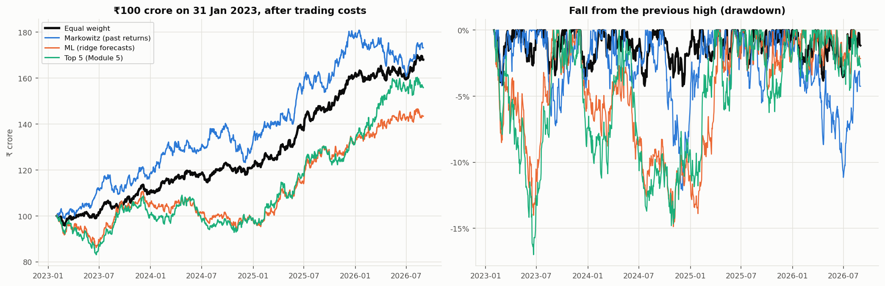

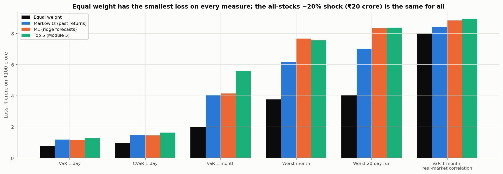

**Recommendations for the investment committee:**
1. **Hold the equity portfolio equally weighted**, reset monthly: best return per unit of risk, smallest falls, about 0.2% a year in trading costs.
2. **Don't optimise on expected returns from this data:** neither past averages nor ML forecasts predict (Module 5), so optimisers concentrate money on noise.
3. **Plan equity risk at real-market levels** (about 19% yearly swing; about ₹8 crore 1-month VaR per ₹100 crore), not this data's 7.8%.
4. **Control crash risk through the size of the equity allocation (Module 9) and hedging (Module 8):** diversification can't reduce it.
5. **Re-test minimum-risk Markowitz on real market data:** there, stocks differ in risk and move in groups, so its weights would differ from equal weight.

---


<<PAGEBREAK>>

## 4.7 Module 7: High-frequency trading

**Method (the six framework steps):**

| Step | In this module |
| --- | --- |
| 1 Data | Order book, 20 days |
| 2 ML prediction | Direction: logistic regression |
| 3 Financial metric in ₹ | ₹ saved per ₹1 crore of orders; profit after costs |
| 4 Risk | Costs +1 bp |
| 5 Decision rule | Time orders; pilot with stop rule |
| 6 Control and owner | Daily savings; Head of Trading |

**ML verdict:**

| Predicts | Models compared (and benchmark) | Result on unseen data | Verdict | Validation | Used in the allocation? |
| --- | --- | --- | --- | --- | --- |
| Next 0.1 s direction | Logistic, forest, LightGBM; benchmark = order-book imbalance alone | AUC 0.791 vs 0.781 (DeLong p < 0.0001); luck p 0.0099 | Beats the benchmark beyond luck; overfitting gap +0.003 | Separate tuning and test days; DeLong; shuffled labels | Yes: order timing; pilot |

**Summary from the module report:**

**Yes, on both counts. ML predicts the next tenth of a second's move well, and it improves order execution: timing the desk's own orders saves about ₹1,300 per ₹1 crore. Trading on the signal, using the cost-aware rule that Task 1's results point to, makes about ₹700 per ₹1 crore trade, every test day, but most of the gross gain goes on costs.**

| Finding | Evidence |
| --- | --- |
| **The order book predicts the next move** | Right 60.6% of the time on unseen days, against 42.0% for guessing; the percentages are honest |
| **Most of the skill is one number** | The balance of waiting buyers and sellers: 12% of moves are rises when sellers dominate, 81% when buyers do |
| **ML adds a small, real gain** | Logistic regression beats the simple balance rule: AUC 0.791 vs 0.781 (gain 95% range +0.008 to +0.012), in all 10 stocks and on all 3 test days; passes the luck test (p = 0.0099); smallest overfitting gap (+0.003) |
| **Timing the desk's orders saves money** | ₹1,315 per ₹1 crore of orders, beyond luck, on buys and sells and in all 10 stocks: ₹3.4 crore a year per ₹100 crore a day |
| **Task 1's results reshaped the trading rule** | Spreads are widest when the model is most confident, so trading only when the expected gain beats that moment's own cost more than doubles profit (+₹10.3 lakh vs +₹4.5 lakh for a fixed confidence cut-off) |
| **Trading on the signal pays, modestly** | +₹700 per ₹1 crore trade after all costs (8% of moments traded); +₹10.3 lakh over 3 test days, 95% range +₹6.4 to +₹14.1 lakh, every day positive; 86% of the gross gain goes on costs, and 1 bp of unmeasured cost turns it into a loss |

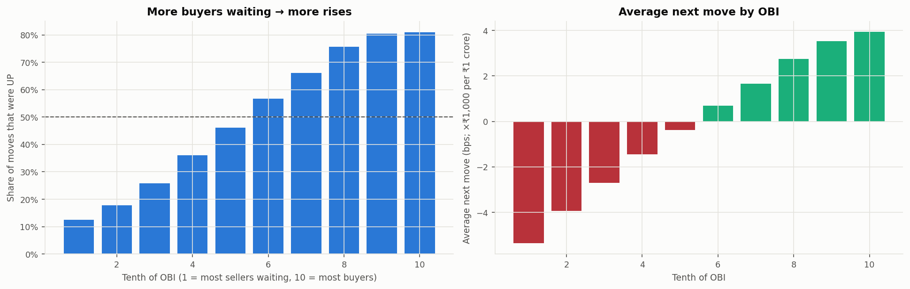

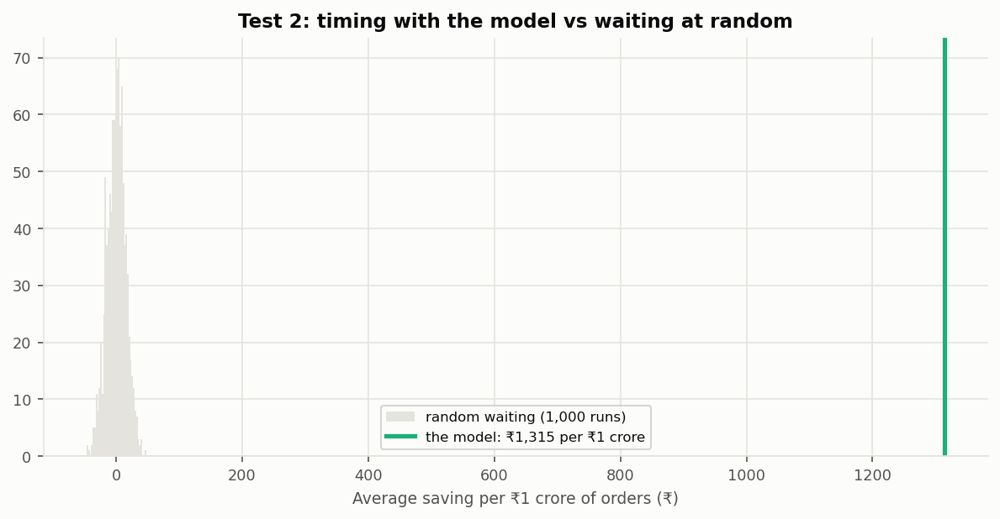

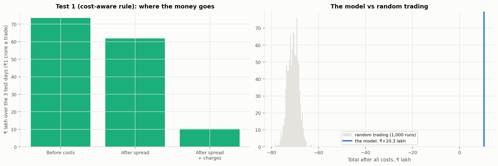

**Recommendations for the Head of Trading:**
1. **Use the model to time the desk's own orders.** It's a dependable saving, with no extra charges.
2. **Run the cost-aware trading rule as a measured pilot.** Feed the real costs into the rule, which then trades less and stays profitable, and stop if the profit after costs turns negative.
3. **Measure real brokerage, slippage and fill prices** before scaling any trading.
4. **Collect longer-horizon prices and order-fill data** to test longer waits and limit orders.

#### The recommendation: what it means, what it adds, why it matters

**It answers the Head of Trading's two-part question** ("predict short-horizon price movements **and improve order execution**") and the brief's "does the prediction generate enough economic value?". It turns the analysis into what to do, and what each part is worth.

**1. Time the desk's own orders now.**
- **What it means:** the desk already places large client orders every day. When it has to buy, it checks the model first. If the model expects the price to dip in the next tenth of a second, it waits a moment and buys a little cheaper (the reverse for sales).
- **What it adds:** about **₹1,315 saved for every ₹1 crore of orders**, which is about **₹1.3 lakh a day, ₹3.4 crore a year** for a desk placing ₹100 crore of orders a day. It grows with the desk's volume.
- **Why now:** there's no extra cost (the order and its taxes happen anyway), it's reliable (buys and sells, all 10 stocks, far beyond luck), and it's low-risk (it changes only *when* an order goes in, not *whether*).

**2. Run the cost-aware trading rule as a measured pilot.**
- **What it means:** NovaFin could also trade for its own profit, buying and selling within a tenth of a second when the expected gain beats that moment's cost. On the test days this made **+₹700 per ₹1 crore trade, +₹10.3 lakh over 3 days, profitable every day**.
- **Why a pilot, not full scale:**
  - The margin is thin. Of ₹4,994 caught per trade before costs, ₹4,294 (86%) went on the spread and taxes.
  - It rests on costs that were assumed, not measured (zero brokerage, fills at the quoted price). If the real cost is 1 bp higher and the rule isn't told, the ₹10.3 lakh becomes a ₹4.4 lakh loss.
- **The pilot, step by step:**
  1. Start with small trades in the narrow-spread stocks, where most of the profit came from (NOVA09: +₹4.7 lakh).
  2. Record the real brokerage, the prices actually achieved and the slippage.
  3. Feed the real cost into the rule. Told the true cost, it trades less and stayed profitable even at 1 bp more (+₹0.7 lakh).
  4. Stop if the profit after costs turns negative.
- **What it adds:** a chance at extra trading income, with the true costs found out before real money is committed.

**Why it matters for the Board and Module 9**

| Without the recommendation | With it |
| --- | --- |
| "The model is 60.6% accurate", which says nothing about money | Two concrete uses, each with a ₹ value and a risk level |
| Risk of funding a trading desk on a thin, cost-sensitive profit | Capital goes only where the gain is solid (order timing); trading earns its place through a pilot |
| Module 9 can't value high-frequency trading | Module 9 gets ₹1,315 saved per ₹1 crore of orders as a cost saving, and trading as a small pilot rather than a capital line |

**In short:** the model's value lies mainly in making the desk's existing trading cheaper, which is dependable and should start now. Trading on it for profit may add more, but only after its real costs are proven.


<<PAGEBREAK>>

## 4.8 Module 8: Derivatives

**Method (the six framework steps):**

| Step | In this module |
| --- | --- |
| 1 Data | 10,000 options |
| 2 ML prediction | ML pricing loses to Black-Scholes |
| 3 Financial metric in ₹ | BS value, Greeks, put cost |
| 4 Risk | 1-in-100 bad day; volatility −5 |
| 5 Decision rule | BS pricing; hedge C; 90% put on equities |
| 6 Control and owner | Daily hedge limit; derivatives desk |

**ML verdict:**

| Predicts | Models compared (and benchmark) | Result on unseen data | Verdict | Validation | Used in the allocation? |
| --- | --- | --- | --- | --- | --- |
| Option price | Direct ML and hybrid × 4 models; benchmark = Black-Scholes | Average gap BS ₹6.07 vs best ML ₹6.22 | ML worse than Black-Scholes in all 12 groups and 13 of 15 stocks | Held-out options; paired 95% ranges; shuffled corrections | No (Black-Scholes) |

**Summary from the module report:**

**Pricing: ML doesn't improve on Black-Scholes on this data. Exposure: yes — BS's Greeks show volatility is the book's biggest risk, and a delta + half vega hedge cuts the bad days by almost half (1-in-100 bad day −₹1.03 lakh → −₹56,653).**

| Finding | Number |
| --- | --- |
| BS is close to the market | Average gap ₹5.84 (about 3.1% of price), no bias (+₹0.05) |
| The gap has no pattern | Direction differs in no group; a learned correction makes it worse |
| ML on 2,000 unseen options | BS ₹6.07 · hybrid ML ₹6.22 (₹0.15 worse) · direct ML ₹8.48 (₹2.41 worse); BS best in 12 of 12 groups |
| The book (one unit of each option) | Worth ₹19.4 lakh; moves like ₹22.6 lakh of shares |
| Biggest risk | Volatility falling 5 points: −₹2.40 lakh (a 5% stock fall: −₹0.80 lakh) |
| 1-in-100 bad day: no hedge / delta only / **delta + half vega** | −₹1.03 lakh / −₹1.15 lakh (worse) / **−₹56,653** |
| Running C | ≈ ₹10,900 day 1; ≈ ₹45,500 a year of daily re-hedging (252 trading days, the usual count for option volatility); ≈ ₹13.3 lakh cash tied up |
| Data issue | Every option on a "stock" has its own spot and volatility: pricing unaffected; full vega hedge (D) unreliable |
| By stock | BS best in 13 of 15; stock exposure SBIN ₹2.08 lakh to TITAN ₹0.78 lakh; volatility risk similar in every stock |

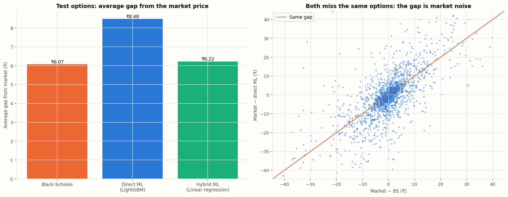

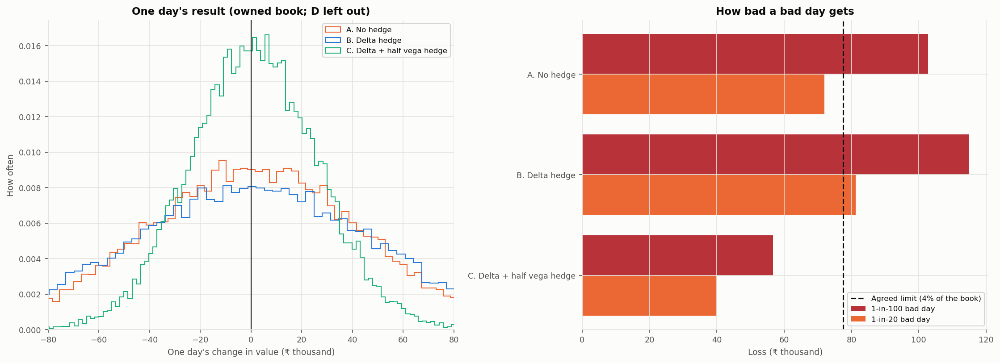

**Recommendations:**
1. **Keep pricing with Black-Scholes;** don't deploy ML pricing (it would add ₹1,500–₹24,000 of mispricing per 10,000 options).
2. **Hedge with choice C, delta + half vega:** sell 3,813 one-year at-the-money calls (₹8.7 lakh received) and buy ≈ ₹22.0 lakh of shares (a holding, not a cost); reset the shares daily. 1-in-100 bad day −₹1.03 lakh → −₹56,653; costs ≈ ₹10,900 on day 1 and ≈ ₹45,500 a year; ≈ ₹13.3 lakh cash tied up.
3. **Don't use a delta-only hedge:** worse than no hedge on bad days (−₹1.15 lakh) and the costliest to run (₹77,500 a year).
4. **The Board sets the 1-in-100 bad-day limit; the choice rule picks the hedge:** 3%–5% of the book → C (4% agreed default); 6% → no hedge.
5. **Revisit ML with real market data** (price history, implied volatility), where smiles and estimation errors give ML something to learn.


<<PAGEBREAK>>

# 5. Risks and limitations

| Type | What it means here | How we handled it |
| --- | --- | --- |
| **Data limitations** | The datasets are synthetic: stocks move independently, every option on a stock has its own price, there is no cost of funds, recovery or fee-revenue data, and the files can't be linked across businesses | Real-market risk added as stress estimates; gaps marked as assumptions in every module's hand-off; scenarios set by hand in Module 9 |
| **Model risk** | Some models are weak (P(Success), ROC-AUC 0.58) or show no skill (churn, returns, ML option pricing) | Full use only where they beat a benchmark beyond luck; the weak one only screens slow payers; no-skill ones not used |
| **Short histories** | 43 months of equities, 3 test days of HFT, one pricing day of options | Ranges and luck tests reported; pilots and staged releases instead of full commitments |
| **Assumption risk** | Risk-free 6.8%, LGD 40%, trading costs, the ₹100 crore bad-year budget (10%) | Sensitivities in each module; Module 9 stress tests and reverse stress |

### Module 1: Corporate finance: strategic initiatives

| Limitation | Consequence for the decision |
| --- | --- |
| **Only 3 years of cash flow** | Almost every NPV is negative. Break-even and the Review label keep good slow payers in view, but anything after year 3 is an assumption (the year-3 cash flow repeated) |
| **The brief's Expected NPV ignores the cost of failure** | Covered by loss tolerance without guessing; the true loss on failure is unknown |
| **Weak prediction** (ROC-AUC 0.58; permutation p = 0.17) | The model's probabilities are only as accurate as a flat 77%, and its signal is the risk rating. The 36 model-based rejections and 7 extra Review places should be read with that in mind (§6.3) |
| **180 initiatives, 42 failures** | Every measure has a wide range (± 0.08 on ROC-AUC); unit differences can't be confirmed |
| **Synthetic data** | Patterns such as the 2.00% ROI floor suggest generated data; real relationships may differ |
| **Backtest on the same initiatives** | "Past success" by label checks consistency, not future performance |
| **Association, not cause** | Low risk *goes with* success; relabelling doesn't make a project safer |
| **Judgement thresholds** (Low risk only, 5 years, 0.767) | Each is stated, justified and tested where it matters (sensitivity) |
| **Revenues and costs are projections at proposal time** | If they were actual results, using them to predict success would be leakage |

---
### Module 2: Credit risk

- **LGD and recovery are assumed, not measured.** The data has no recovery amounts. The rule holds across flat LGD of 30–60% and recovery of 50–70%, but the size of every rupee figure depends on it.
- **The ML gain is not proven at 95%** on the 1,000 test loans (DeLong p = 0.065). It should be confirmed on new applications before the scorecard carries weight on its own.
- **One-year view.** PD and interest are both yearly, and default does not rise with loan term in this data. Longer loans may behave differently in reality.
- **No cost-of-funds figure in the data.** The base uses none; 1–3% is shown.
- **Outcomes are seen only for loans the bank made.** How applicants it turned down would have behaved is unknown (the reject-inference problem).
- **Judgement thresholds:** the 5% size cut-off and 50% recovery send loans to a person only; they never decide on their own.
- **Synthetic data.** Retail and Corporate behave identically and sector risk has only a weak effect, so one model serves both and Customer_Type carries no information (§3.7). Real portfolios usually differ; the segment tests should be re-run on real data.
- **The model under-predicts the largest loans** (top 2%). The size flag covers this, but it is a known weakness to monitor.

---
### Module 3: Fraud detection

- **The data looks synthetic.** Device, city, merchant and customer history carry no signal, unlike real fraud data. The customer columns change on every transaction. Results here would be the first to re-test on real data.
- **A sample:** about 49 transactions a day, against "thousands" in the brief. Rates and per-1,000 figures carry over; daily totals must be scaled.
- **Small test set:** 144 test frauds. Ranges are wide, and some gains (PR-AUC) are not proven on the test set alone.
- **The two costs are assumptions,** and the workload depends heavily on their ratio. Missed frauds are assumed fully lost.
- **No new fraud types can appear in a fixed file,** so anomaly detection's main real-world value couldn't be tested.
- **Fraud_Flag is taken as correct.** Undetected fraud among "honest" transactions would understate every catch rate.

---
### Module 4: Customer analytics

- **Only 89 leavers.** A weak real churn effect could hide below what this data can detect: "not predictable" means "not detectable here".
- **One snapshot per customer.** Churn is usually signalled by change over time (falling balances, closed products), which this file can't show.
- **The data looks synthetic:** no churn signal in any column, and CLV an exact formula. Results should be re-tested on real data.
- **CLV's construction is undocumented;** the banking meanings of its weights are our reading. It ignores churn, time and loyalty.
- **No record of past retention calls,** so the success rate and call cost are unknown. The break-even and ceiling bound the value without assuming them.
- **No later period of data,** so the back-test uses the same customers (with out-of-fold churn scores).
- **The data doesn't say whether churn and CLV are per year or over all time,** so Module 9's rates are "per period of the data".

---
### Module 5: Equity markets

- **43 months and 15 stocks:** an edge smaller than IC 0.08 can't be told from luck.
- **The data looks synthetic:** random macro columns, independent stocks, bell-curve returns. Real markets have common moves, fatter tails and real macro links.
- **No fundamentals:** no earnings, valuations or report dates, so quarterly-results strategies can't be tested.
- **Before trading costs, no dividends:** costs would lower every model's return (they trade 11–16 times the portfolio a year).
- **Model settings fixed in advance, not tuned:** tuning on 43 months of noise would fit the noise, but a tuned model could behave differently on other data.

---
### Module 6: Portfolio optimisation and risk

- **43 test months:** modest real differences between strategies could stay hidden; every p-value is high.
- **Synthetic-looking data:** independent stocks, bell-curve returns, random macro columns. Measured risk is far below real markets'; stress test (c) adjusts for co-movement but not for fat tails.
- **Assumed inputs:** trading cost, risk-free rate and the 0.4 correlation are assumptions, each checked or stated.
- **Long-only, monthly, no dividends;** no constraints by sector or liquidity.

---
### Module 7: High-frequency trading

- **A tenth of a second only:** the data shows no longer horizon, and no information on order fills.
- **Assumptions:** fills at the quoted price, no market impact, zero brokerage. Each would only lower Test 1's profit, which is concentrated in the narrow-spread stocks.
- **20 days of one month; the data looks simulated** (trade size has no effect).
### Module 8: Derivatives

- **The data looks simulated:** market = BS ± about 3% noise, with each option's own volatility given. Real markets have volatility smiles and estimated volatility, where ML can add value. The "no" is about this data.
- **Every option on a "stock" has its own spot and volatility:** a real stock has one of each; this makes the full vega hedge (D) look perfect when it wouldn't be.
- **Owned vs written** isn't in the data; results shown for both.
- **One pricing day:** no test of hedge performance over time; the simulation's assumptions (correlation 0.4, volatility moves of about 1 point a day) are checked but not measured.
- **Volatility is moved by the same points for every option;** option trading cost (1% of premium) is an assumption.
- **One unit of each option;** options on the same stock carry different spot prices, so the hedge is sized in ₹.
- **No dividends.**


<<PAGEBREAK>>

# 6. Assumptions register (from every module's hand-off)

| Module | Assumptions behind the hand-off figures |
| --- | --- |
| 1 Corporate finance: strategic initiatives | 3 years of cash flow in the data (year 3 repeated for payback beyond); 5-year payback limit; cost of money 6%; P(Success) from a weak model (ROC-AUC 0.58) |
| 2 Credit risk | LGD 40% (no recovery data); one-year view; no cost of funds or running costs in the data; synthetic data (Retail and Corporate behave alike) |
| 3 Fraud detection | Brief's costs: ₹10,000 per missed fraud, ₹500 per honest transaction checked (false alarm); missed frauds lost at their actual amount here; a 20-month sample (about 49 transactions a day) — rates carry over, daily totals must be scaled |
| 4 Customer analytics | New money earns like this customer book; CLV and churn period not stated in the data; call success rate unknown |
| 5 Equity markets | Monthly rebalancing; walk-forward with 24 training months; before trading costs; 15 stocks; data looks synthetic (random macro columns, independent stocks) |
| 6 Portfolio optimisation and risk | Trading cost 0.15% per ₹ traded; risk-free 6.8%; 43 test months (31 Jan 2023 – 31 Aug 2026); 15 stocks; data looks synthetic (independent stocks, random macro columns); no dividends |
| 7 High-frequency trading | Spread paid both ways + 3.5 bps Indian intraday charges per round trip; zero brokerage; orders filled at the quoted price and too small to move it; 0.1-second horizon only; 3 test days; data looks simulated (trade size has no effect) |
| 8 Derivatives | One unit of each option, owned (written shown as a check); one pricing day (31 Aug 2026); each option has its own spot and volatility even within a stock; no dividends; simulation: stocks correlated 0.4, volatility moves about 1 point a day and rises when stocks fall; share charges 0.1%, option charges 1% of premium, margin not modelled; 359 market prices below the lowest logical price treated as data errors |

Module 9's own assumptions: risk-free 6.8%; ₹1 of capital = ₹1 deployed (the leveraged bank view as a sensitivity); no data links the businesses, so stress scenarios are set by hand; the HFT pilot is planned at 0%; re-priced loans keep the same borrowers.

<<PAGEBREAK>>

# 7. The code framework (summary; the full guide is the separate Code Guide)

| Layer | What it is | Files |
| --- | --- | --- |
| Data helpers | Load, check and prepare each dataset; leakage columns never used as inputs | `module_0N_*/helpers/m0N_data.py` |
| Task notebooks | One per task, with the sections that task needs, from: data, exploration, inputs, models, overfitting, luck test, model choice, ₹ case, test once, calibration, segments, drivers, findings, hand-off, save | `module_0N_*/notebooks/*.ipynb` |
| Final output builders | One workbook per module (Read me with column guide, key numbers, Board actions, task tabs, hand-off, Module 9 inputs, decisions, evidence index) | `scripts/final_workbook.py`, `module_0N_*/helpers/m0N_final_output.py` |
| Runners | Run a whole module in order, locally or in Colab; give the same files as the standalone notebooks | `module_0N_*/run_module_N.ipynb` |
| Final deliverables | This report and the Code Guide, built from the project's files | `scripts/build_final_deliverables.py`, `scripts/md_to_pdf.py` |

Reproducibility: seed 42 in every random step; each runner was checked file by file against the standalone notebooks on our computer. A fresh install of the libraries gave the same key numbers (differences of at most 0.000001, from a different maths library).
