# Module 1 — Corporate Finance: Strategic Capital Allocation

## Final report

**The business problem (brief, verbatim):**
> NovaFin has several strategic initiatives competing for limited capital.
> Management wants to know:
> Which initiatives should receive funding?

**Context (brief):** at the end of the project the Board provides **₹1,000 crore of incremental capital** to be deployed across NovaFin's businesses. Module 1 answers how much of it strategic initiatives should receive, and which ones.

**Data:** `strategic_initiatives.csv`, 180 initiatives. Money is in ₹ lakh (1 lakh = ₹1,00,000; 100 lakh = ₹1 crore). Rates and returns are in % a year.

**How to read this report.** Each section opens with its conclusion, so you can stop at any depth. Every number comes from a notebook output in `outputs/`, every term is defined where it is first used, and the glossary at the end collects them all.

| Item | Where |
| --- | --- |
| **Final output (open this first)** | **`outputs/FINAL_M1_module_output.xlsx`**: Read me · Key numbers · Board actions · every task's final file · Hand-off · Decisions · Evidence index (project decision P-21) |
| Run everything | `run_module_1.ipynb` (Run all) |
| Task notebooks | `notebooks/m01_task1_eda.ipynb`, `m01_task2_model.ipynb`, `m01_task3_decision.ipynb` |
| Detailed task reports | `reports/task1_report.md`, `task2_report.md`, `task3_report.md` |
| Decisions and their reasons | `docs/decisions.md` |
| Final decision file (hand-off to Module 9) | `outputs/task3/FINAL_M1_T3_initiative_decisions.csv` |

---

## 1. The answer in brief

| Decision | Initiatives | Capital | Expected NPV (sum) | What it means |
| --- | --- | --- | --- | --- |
| **Fund** | 2 | **₹3.2 crore** | **+₹56.0 lakh** | **1075** (Wealth, Low risk; Expected NPV +48.2 lakh): fund in full. **1062** (Corporate Banking, Low risk; +7.8 lakh): fund in stages, releasing money at milestones |
| **Review** | 38 | up to **₹62.9 crore** | −₹1,006.6 lakh | Attractive but uncertain: 6 value-creating projects with Medium/High risk (Expected NPV +1.3 to +40.0 lakh), and 32 "slow payers" whose value arrives after year 3, so their 3-year Expected NPV is still negative. Examined in the priority order given |
| **Reject** | 140 | ₹217.3 crore | −₹8,931.1 lakh | Each with its reasons: 96 repay too late or never, 8 promise less than their cost of money, 36 are flagged at risk by the model |

**Expected NPV** = P(Success) × NPV, the brief's measure of value: what an initiative is worth today, weighted by its chance of success. Only the 8 initiatives with a positive NPV have a positive Expected NPV. §5 shows how it is used together with risk, payback, the hurdle, the model's flag and loss tolerance.

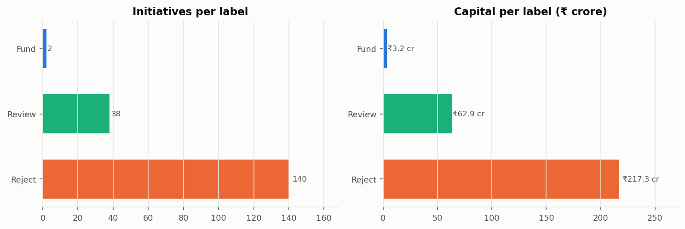

*Initiatives (left) and capital (right) per label. Blue = Fund, aqua = Review, orange = Reject.*

**The five findings behind the answer:**
1. **The bank's risk rating is the one reliable signal of success.** Low-risk initiatives succeeded 89% of the time, against 69–70% for Medium and High (§3).
2. **On 3 years of cash, almost nothing repays its investment.** Only 8 of 180 initiatives have a positive 3-year NPV (§3, §5).
3. **Machine learning confirmed and quantified the risk rating, but found nothing beyond it.** The best model (lasso) ties a simple lookup on the rating (§4).
4. **The downside of failure decides how money is released.** Loss tolerance turns "fund" into "fund in full" or "fund in stages" without guessing a recovery rate (§5).
5. **Strategic initiatives can absorb at most about ₹66 crore of the ₹1,000 crore,** and only ₹3.2 crore is ready now. The rest of the capital must go to NovaFin's other businesses (Module 9).

### 1.1 What we recommend the Board does

1. **Fund now (₹3.2 crore):** 1075 in full; 1062 in stages, releasing money at milestones, because it stays worth funding only if a failure loses no more than about 36% of its investment.
2. **Review the 38 in the order given** (§5.4). Start with the 6 value-creating Medium/High-risk projects, judging each by its loss tolerance; then the 32 slow payers, fastest payback first.
3. **Look hardest at Corporate Banking's 7 Review projects** (₹14.8 crore, the largest Review exposure of any unit). Ask why past Corporate Banking initiatives failed before approving any of them (§6.1).
4. **Screen every future initiative on risk first.** Low risk is the one reliable signal of success. Medium- and High-risk proposals need a closer look, e.g. a pilot, before money is committed.
5. **Decide how patient to be.** At a 5-year payback limit, 38 initiatives reach Review; at 6 years, 47. Each extra year rests on cash flows the data doesn't cover (§5.3b, §6.2).
6. **Don't rely on business-case numbers to predict success.** NPV, cash return and revenue plans don't predict it; use them to value an initiative, not to judge whether it will succeed.
7. **Collect better data before relying on prediction.** The model can't tell projects of the same risk rating apart. Sponsor track record, delivery milestones and post-launch results would give it something to learn from.

---

## 2. The chain: how the three tasks fit together

The brief defines the analysis as a chain, where **each link's output feeds the next**:

```text
  DATA            →   ML PREDICTION     →   FINANCIAL METRIC    →   RISK ASSESSMENT     →   BUSINESS DECISION
  Task 1              Task 2                Task 3                  Task 3                  Task 3
  180 initiatives     P(Success) for        NPV, Expected NPV       risk rating, hurdle,    Fund / Review / Reject,
  checked and         each initiative       = P(Success) × NPV,     P(Success) gate,        priority, funding
  understood          (validated model)     break-even life         loss tolerance          condition
```

| Link | Task | Input | Method | Key output | Passed on as |
| --- | --- | --- | --- | --- | --- |
| Data | 1 | Raw CSV | Quality checks, 6 brief items, statistical tests, Board view in ₹ | Risk is the signal; 3-year NPV rarely positive | The derived columns (shared helper) |
| ML prediction | 2 | 26 inputs | 7 models over 25 cross-validation rounds; benchmark; explainability | Lasso's P(Success); drivers of success | `outputs/task2/FINAL_M1_T2_success_probability.csv` |
| Financial metric, risk, decision | 3 | P(Success) + finance data | NPV, Expected NPV, break-even, hurdle, gate rule, loss tolerance, sensitivity | Fund 2, Review 38, Reject 140 | `outputs/task3/FINAL_M1_T3_initiative_decisions.csv` (to Module 9) |

**What the brief asks of each task (verbatim):**

> **Task 1: Exploratory analysis.** Students should examine: Investment distribution · ROI distribution · Risk categories · Business-unit performance · Relationship between growth and ROI · Relationship between investment and success
>
> **Task 2: Predict initiative success.** Target: Historical_Success. Compare models to model target variable and compare their performance detailing explainability (which characteristics make an initiative more likely to succeed).
>
> **Task 3: Financial decision.** Students should calculate an approximate project NPV and expected NPV and final decision classifying as whether to fund (High expected value and acceptable risk), review (Potentially attractive but significant uncertainty) and reject (Low expected value or excessive risk). Expected NPV = P(Success) × NPV

The ML prediction is **an input to finance**, not a rival to it. The decision rests on finance and risk measures, and the sensitivity analysis (§6.3) shows exactly how much the ML link changes it.

---

## 3. Data (Task 1): what the 180 initiatives look like

**Conclusion:** the data is clean. Risk rating is the only clear signal of success, investment size is not one, and on 3 years of cash almost no initiative pays back.

### 3.1 Data quality

| Check | Result | Action |
| --- | --- | --- |
| Missing values, duplicates, negative money | None | — |
| Expected_ROI exactly 2.00% | 11 initiatives | Kept; looks like a floor in how the data was made |
| Operating cost above year-1 revenue | 18 initiatives | Kept; a first-year loss is normal for a new project |
| Target balance | 138 succeeded, 42 failed (**77% success**) | Mild imbalance, which shapes how Task 2 scores models |

**Total requested:** ₹283.4 crore, 28% of the Board's ₹1,000 crore.

**Why exploring all 180 rows here is safe.** No model is trained in Task 1, so there's nothing to leak into. The inputs the Task 2 models use were fixed from finance reasoning *before* modelling, not chosen by their link with success, so Task 1's findings can't inflate Task 2's scores.

### 3.2 The findings, one per brief item

| Brief item | Finding | Evidence |
| --- | --- | --- |
| Investment distribution | Even spread from ₹31 to ₹296 lakh; median ₹155 lakh; no long tail | Mean ₹157 lakh ≈ median |
| ROI distribution | Median Expected_ROI 10.5%; 75% beat their own Interest_Rate. **ROI falls as risk rises** (Low 12.0% → High 8.3%), the opposite of the usual risk–return trade | Medians by risk level |
| Risk categories | **Low 89% success, Medium 69%, High 70%** | Chi-square p = 0.014 |
| Business-unit performance | Success 63% (Corporate Banking) to 87% (SME Lending), but the gap could be chance | Chi-square p = 0.36 |
| Growth vs ROI | Faster-growing business units promise higher ROI; the economy (GDP) and a project's own revenue growth do not | Business_Growth r = 0.56 (p < 0.0001); GDP r = 0.12; own revenue growth r = 0.03 |
| Investment vs success | **Size does not predict success** (77% / 78% / 75% by thirds), but drives 3-year NPV | Mann–Whitney p = 0.90; investment vs NPV r = −0.60 |

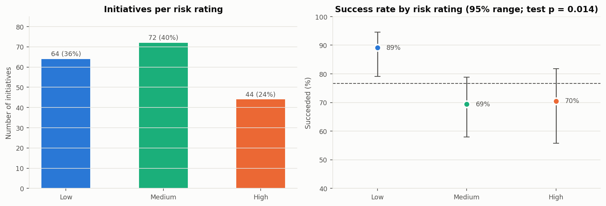

*Left: initiatives per risk level. Right: success rate per level; the bar is the 95% range, the dashed line the overall 77%.*

### 3.3 The methods, in brief

**95% range for a success rate (Wilson interval).** With small groups a success rate is uncertain. The Wilson range gives where the true rate very likely lies:

```text
p̂ = successes ÷ n,   z = 1.96
centre     = (p̂ + z²/(2n)) ÷ (1 + z²/n)
half-width = [z ÷ (1 + z²/n)] × √( p̂(1 − p̂)/n + z²/(4n²) )
Low risk: 57 of 64 → p̂ = 0.891 → centre 0.869, half-width 0.077 → 79% to 95%
```

**Chi-square test of independence.** Do success rates differ across groups more than chance would allow?

```text
Expected count of a cell = row total × column total ÷ grand total
χ² = Σ (Observed − Expected)² ÷ Expected,  over every cell
Degrees of freedom = (rows − 1) × (columns − 1)
```

| Risk | Failed: observed | Failed: expected | Succeeded: observed | Succeeded: expected |
| --- | --- | --- | --- | --- |
| Low | **7** | 14.9 | 57 | 49.1 |
| Medium | 22 | 16.8 | 50 | 55.2 |
| High | 13 | 10.3 | 31 | 33.7 |

- χ² = 8.55 with 2 degrees of freedom, so p = 0.014.
- If risk made no difference, a gap this large would appear only about 1.4% of the time.
- Most of χ² comes from Low risk failing far less often than expected: 7 against 14.9.
- **Conditions:** each initiative is counted once (independence), and every expected count is above 5.

**Correlation r** measures how strongly two columns move together in a straight line: −1 (opposite) to +1 (together), 0 = no straight-line link. **Mann–Whitney** compares two groups' values by their ranks, without assuming a bell shape.

### 3.4 The money: cash flow and NPV

```text
Cash flow in year t:  CFt = Revenue_Year t − Operating_Cost            (Operating_Cost is yearly)
Discount rate:        r = Interest_Rate ÷ 100                          (each initiative's own cost of money)
NPV (3 years):        NPV = −Initial_Investment + CF1 ÷ (1 + r) + CF2 ÷ (1 + r)² + CF3 ÷ (1 + r)³
```

**NPV (Net Present Value)** = today's value of the cash an initiative brings in, minus what it costs. Future cash is **discounted**, because ₹100 next year is worth less than ₹100 today (today's money could earn interest meanwhile).

**Worked example, initiative 1002:**
- Investment 286.69; revenues 111.52, 141.54 and 149.05; operating cost 89.01; Interest_Rate 6.63%.

```text
CF1 = 22.51,  CF2 = 52.53,  CF3 = 60.04
NPV = −286.69 + 22.51 ÷ 1.0663 + 52.53 ÷ 1.0663² + 60.04 ÷ 1.0663³
    = −286.69 + 21.11 + 46.20 + 49.52 = −169.9 lakh
```

**Only 8 of 180 initiatives have a positive 3-year NPV**, yet 135 promise an Expected_ROI above their Interest_Rate. The promised yearly return looks healthy, but 3 years of cash rarely repays the investment. On average the yearly cash flow is about 20.5% of the investment, so 3 years return only about 62% of it.

### 3.5 Board view in ₹: where the capital sits and where it was lost

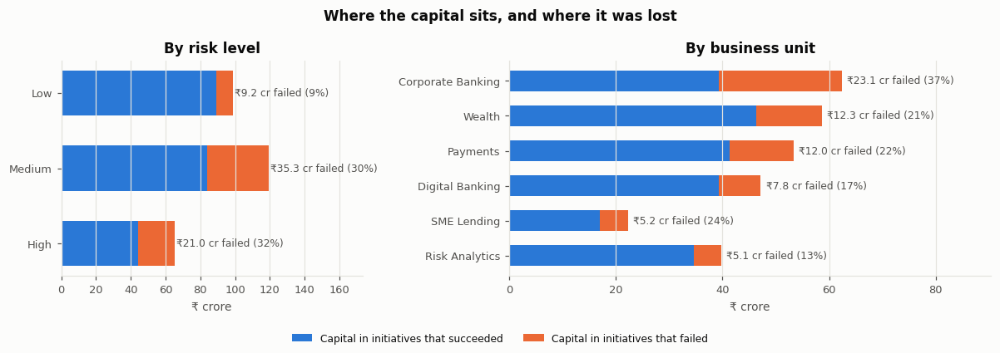

*Capital per risk level and business unit. Blue = initiatives that succeeded, orange = those that failed.*

```text
Failed capital = Σ Initial_Investment of initiatives that failed  (₹65.5 crore, 23% of all capital)
```

| Group | Share of capital | Share of all failed capital | Share of its own capital lost |
| --- | --- | --- | --- |
| Low risk | 35% | 14% | 9% |
| Medium + High risk | **65%** | **86%** | about 30% |
| Corporate Banking | 22% | **35%** | **37%** |

**For the Board:**
- Risk is where the money was lost.
- Corporate Banking loses money out of proportion to its size, but not because it carries more High-risk projects (only 17% are High risk).
- Project size is not the problem.

---

## 4. Prediction (Task 2): can success be predicted?

**Conclusion:**
- Success is only weakly predictable.
- **Lasso logistic regression** is the best of seven candidate models and is passed to Task 3. But a simple lookup on the bank's own risk rating ties it: the model's signal *is* the risk rating.
- In finance terms, its "at risk" flag points reviewers at the capital that was actually lost.

### 4.1 How models were tested: repeated stratified 5-fold cross-validation

A model must be judged on initiatives it has **not** seen. One 80/20 split would leave only 36 test initiatives (about 8 failures), so the score would swing wildly on luck. Instead:

```text
5 folds × 5 repeats = 25 rounds
each round: train on 144 initiatives (4 folds) → test on the other 36 (1 fold)
stratified: every fold keeps the 77/23 success/failure mix
every model faces the SAME 25 splits (fixed random seed), so comparisons are fair ("paired")
```

Everything a model learns (scaling, category columns, lasso's penalty) is learned **inside** each round from the 144 training rows only. That prevents **leakage**, i.e. information from the test rows sneaking into training. Each initiative is a test row 5 times, so its **out-of-fold** P(Success) is the average of 5 predictions from models that never saw it. That is what Task 3 uses.

**The 26 inputs**, the same for every model and fixed before any modelling:

| Group | Inputs | Count |
| --- | --- | --- |
| Given numbers | Initial_Investment, Revenue_Year1, Revenue_Year2, Revenue_Year3, Operating_Cost, Expected_ROI, Business_Growth, GDP_Growth, Interest_Rate, Competition_Index | 10 |
| Derived from each row's own numbers | CF1, CF2, CF3 (yearly cash flows), NPV_3yr, Revenue_Growth_Y1_Y3, Cash_Return_Pct, ROI_Spread (Expected_ROI − Interest_Rate) | 7 |
| Categories as 0/1 columns | Business_Unit (6 units), Risk_Rating (Low, Medium, High) | 9 |

**Why fixed in advance:** choosing inputs *after* seeing which ones link with success would make the test scores look better than the model really is. Lasso is the one model allowed to choose, and it does so **inside** each training round, blind to the test rows.

**The seven candidate models:**

| Model | What it is | Settings (fixed, no tuning) |
| --- | --- | --- |
| Baseline | Says the training success rate (about 77%) for every initiative: the score to beat | — |
| **Lasso logistic regression** | Weighted sum of inputs → probability, with a penalty that switches weak inputs off | Penalty chosen by an inner 5-fold CV in each round (10 values, best Brier) |
| Logistic regression | Weighted sum of inputs → probability, with a mild penalty on all weights | Standard penalty (C = 1) |
| Decision tree | A flowchart of yes/no questions learned from the data | At most 3 questions deep; at least 10 initiatives per end box |
| Random forest | 300 trees on random resamples, averaged | Depth ≤ 4; at least 5 per end box |
| XGBoost | 200 small trees built one after another, each correcting the last | Depth 2; learning rate 0.05; 80% of rows and inputs per tree |
| LightGBM | Another implementation of the same idea as XGBoost | Depth 2, 4 leaves; learning rate 0.05; at least 10 per leaf |

### 4.2 The measures

| Measure | Formula / meaning | Why it matters here |
| --- | --- | --- |
| **ROC-AUC** | Chance that a random success gets a higher P(Success) than a random failure. 0.5 = coin toss, 1.0 = perfect | Capital is limited, so initiatives must be ranked |
| **Brier score** | Average of (P(Success) − outcome)², with outcome 1 = success, 0 = failure. Lower is better | Task 3 multiplies P by NPV, so an error in P becomes an error in ₹ |
| Failure recall | Failures flagged ÷ all failures | Funding a failure loses the investment |
| Capital lift | Share of failed capital caught ÷ share of capital reviewed (1.0 = random review) | Does the flag point reviewers at the money that was lost? |

**Brier example:** P = 0.8 costs (0.8 − 1)² = 0.04 if the initiative succeeds, but (0.8 − 0)² = 0.64 if it fails. Saying 77% for everyone scores 0.767 × 0.233 = **0.179**, the score to beat.

**"At risk" flag:** P(Success) below the base rate of 0.767 (138 ÷ 180), i.e. less likely to succeed than a typical initiative.

### 4.3 Results

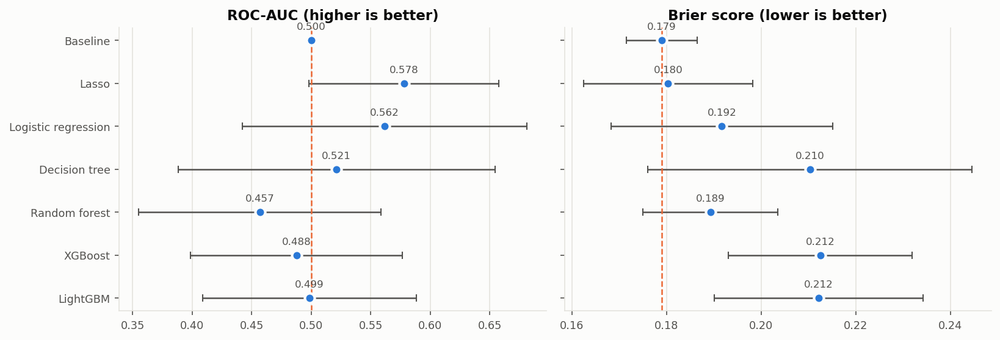

*Mean ± 1 standard deviation over 25 test rounds. Left: ROC-AUC (dashed = coin toss). Right: Brier (dashed = always 77%).*

| Model | ROC-AUC | Brier | Failure recall | Average P(Success) |
| --- | --- | --- | --- | --- |
| Baseline (always 77%) | 0.500 | 0.179 | 0.00 | 0.767 |
| **Lasso** (chosen) | **0.578 ± 0.080** | **0.180** | **0.74** | 0.748 |
| Logistic regression | 0.562 | 0.192 | 0.54 | 0.766 |
| Decision tree | 0.521 | 0.210 | 0.56 | 0.767 |
| Random forest | 0.457 | 0.189 | 0.43 | 0.761 |
| XGBoost | 0.488 | 0.212 | 0.34 | 0.785 |
| LightGBM | 0.499 | 0.212 | 0.33 | 0.794 |
| *Risk rating only (benchmark)* | *0.577* | *0.176* | *0.81* | *0.767* |

**Why no class balancing.** Reweighting the 42 failures to look like half the data pulls the average P(Success) down to 0.51–0.69 when the real rate is 0.77. That would understate every Expected NPV in Task 3 by up to a third, and it made every Brier score worse.

### 4.4 Why the complex models fail: overfitting

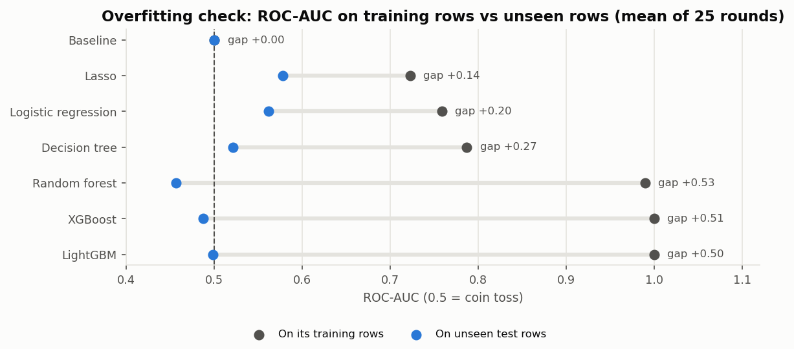

*Grey = score on the 144 rows the model trained on; blue = score on the 36 it never saw. The line between them is the overfitting gap.*

| Model | ROC-AUC on training rows | ROC-AUC on unseen rows | Gap |
| --- | --- | --- | --- |
| Lasso | 0.72 | 0.58 | **0.14** (smallest) |
| Logistic regression | 0.76 | 0.56 | 0.20 |
| Decision tree | 0.79 | 0.52 | 0.27 |
| Random forest | **0.99** | 0.46 | **0.53** |
| XGBoost | **1.00** | 0.49 | **0.51** |
| LightGBM | **1.00** | 0.50 | **0.50** |

**Overfitting** means learning quirks of the training rows that don't repeat in new data.
- With 144 training rows (about 34 failures) and 26 inputs, the tree ensembles memorise their training rows almost perfectly, then score at coin-toss level on new ones.
- Lasso overfits least, because its penalty switches off inputs that don't earn their place.

### 4.5 Choosing the model: the ML case and the finance case

**The rule (decision M1-16):**
1. Lowest Brier score, with ROC-AUC not clearly worse than the best.
2. When two models tie, prefer the simpler one.
3. The model must pass the finance checks.

**"Clearly worse" is tested with a paired comparison.** Because every model faces the same 25 test sets, we compare two models round by round:

```text
d_k = Brier(model B) − Brier(lasso) in round k, for k = 1 … 25
95% range = mean(d) ± 2.06 × SD(d) ÷ √25        (2.06 = t-value for 24 degrees of freedom)
Logistic regression vs lasso: +0.0113 ± 0.0064 = +0.005 to +0.018  → entirely above 0: really worse
```

The t-value of 2.06, rather than 1.96, allows for the spread itself being estimated from only 25 differences. A range that includes 0 means the two models **can't be told apart**.

| | ML case | Finance case |
| --- | --- | --- |
| **Lasso** | Lowest Brier of the candidates; highest ROC-AUC; best failure recall (0.74); smallest overfitting gap of the real models | Average P 0.748 against a real 0.767, so slightly **cautious**, never over-optimistic; about 7 named inputs read as odds ratios, so the Board can see *why* |
| Logistic regression | Brier really worse (+0.011) | 26 weights, several repeating each other |
| Tree models | Rank near or below chance (ROC-AUC 0.46–0.52) | XGBoost and LightGBM average 0.785 and 0.794: **over-optimistic**, so they would overstate Expected NPV and push towards over-funding. Black boxes |

**The rupee replay.** If each model's out-of-fold flag had decided which initiatives get a closer review:

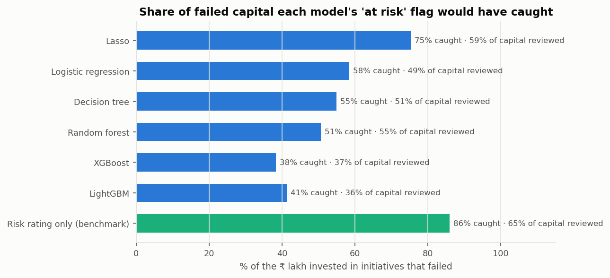

*Share of the capital lost to failures that each model's flag would have pointed reviewers at.*

- **Lasso:** reviewing 59% of capital catches **75% of failed capital** (lift 1.27).
- **Random forest's flag is worse than random** (lift 0.92).
- **The risk-rating benchmark does at least as well:** 86% caught, reviewing 65% (lift 1.32).

### 4.6 The honest result: the benchmark

A **risk-rating-only model** is a lookup. In each round it predicts each risk level's training success rate (about Low 0.89, Medium 0.69, High 0.70). It **ties lasso**:

- Brier difference −0.005, 95% range −0.010 to +0.001, so a tie.
- **Within** each risk level, lasso ranks no better than chance: ROC-AUC Low 0.23 (7 failures), Medium 0.54, High 0.28.

**What it means:** the predictive signal in this data *is* the bank's own risk rating. Lasso found it and showed the other 25 inputs add nothing reliable. That is a real result: it turns "the rating matters" from an assumption into evidence, and tells the bank to spend diligence on **reducing risk** rather than polishing business-case numbers.

**Why lasso is still the model passed on:**
- Lasso was an agreed candidate that picks its inputs **inside** each training round, so its score is honest.
- The benchmark was designed *after* the results showed the rating carries the signal, so its score is likely flattering.
- Task 3 shows the Board the decisions from both (§6.3).

**Is the signal better than luck?** A **permutation test** shuffles the success labels 100 times (destroying any real link) and re-scores the model:

```text
p = (luck scores at least as high as the real score + 1) ÷ (100 + 1) = (16 + 1) ÷ 101 = 0.17
```

On ranking alone, luck can't be ruled out. But lasso beats a coin toss in 21 of 25 rounds, and its flag separates failure rates (30.2% flagged against 13.5% not flagged; chi-square p = 0.015). The signal is weak but real, and it is the risk rating's.

### 4.6b Are the probabilities right? (calibration) And what goes to Task 3

Task 3 multiplies P(Success) by NPV, so the probabilities themselves must be roughly right, not just the ranking. Sorting the 180 initiatives by their out-of-fold P(Success) into 5 groups of 36:

| Group | Average predicted P(Success) | Actual success rate | 95% range |
| --- | --- | --- | --- |
| 1 (lowest) | 0.64 | 0.75 | 0.59–0.86 |
| 2 | 0.69 | 0.67 | 0.50–0.80 |
| 3 | 0.74 | 0.69 | 0.53–0.82 |
| 4 | 0.80 | 0.94 | 0.82–0.99 |
| 5 (highest) | 0.86 | 0.78 | 0.62–0.88 |

- The points scatter around "predicted = actual", with no consistent bias up or down, so the probabilities are used as they are (no recalibration).
- The scatter also shows they carry limited information beyond about 77%. That matches the benchmark result.

**What goes to Task 3:** for each initiative, lasso's out-of-fold P(Success), the average of its 5 predictions, each made by a model that never saw it. The range is **0.56 to 0.90**, with a median of 0.74; the middle half lies between 0.68 and 0.82. The file is `outputs/task2/FINAL_M1_T2_success_probability.csv`.

### 4.7 How lasso works, and what drives success

**Lasso in plain steps:**
1. **Logistic regression** gives each input a weight, adds the weighted inputs into a score, and turns the score into a probability: P = 1 ÷ (1 + e^(−score)).
2. **Lasso adds "rent" for every unit of weight.** It minimises Σ |weights| + C × Σ log-loss. An input keeps a weight only if it improves the fit by more than its rent; otherwise the weight is set to **exactly 0**. So lasso **chooses its own inputs**.
3. **It finds the weights one input at a time, in cycles** (coordinate descent), each time asking what the *other* inputs still leave unexplained. So it keeps one of each pair of near-duplicates (it keeps Expected_ROI and drops ROI_Spread).
4. **The rent level is chosen inside each training round** by an inner 5-fold cross-validation over 10 values. The same value (C ≈ 0.36) won in 24 of 25 rounds.
5. Inputs are first **scaled** to (value − average) ÷ standard deviation, so the rent is fair across ₹ and % inputs.

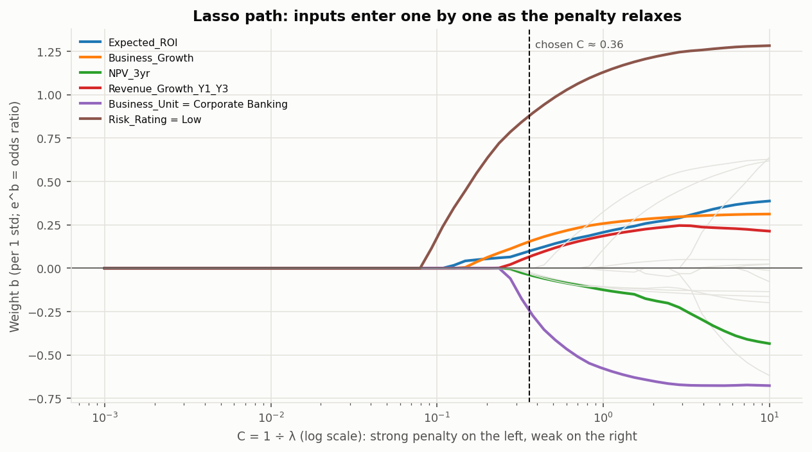

*Each line is one input's weight as the rent falls from left to right. The order in which inputs leave zero is lasso's priority: Low risk first, then Expected_ROI, Business_Growth and revenue growth. Dashed line: the chosen penalty.*

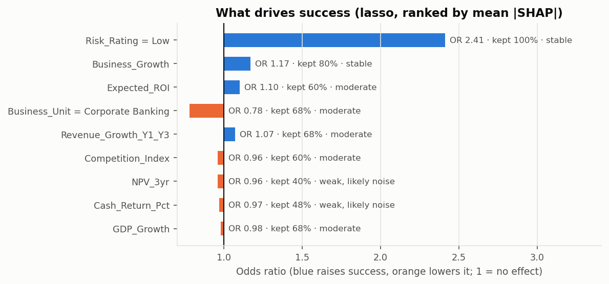

*Odds ratio of each input lasso uses, ranked by how much it moves predictions. Blue raises success, orange lowers it.*

**Reading an odds ratio.** Odds = P ÷ (1 − P). An odds ratio of 2.41 for Low risk means:

```text
typical initiative: P = 0.767 → odds = 0.767 ÷ 0.233 = 3.3
Low risk:           odds = 3.3 × 2.41 = 7.9 → P = 7.9 ÷ (1 + 7.9) = 0.89
```

So Low risk moves a typical initiative from **77% to about 89%**, matching Task 1's 89%.

| Driver | Effect | Stability (rounds kept) | Business reasoning | What the Board can do |
| --- | --- | --- | --- | --- |
| **Low risk** | Odds × 2.41 | 100% | Fewer unknowns in execution, technology and regulation; Low risk also promises the highest ROI | Screen on risk first; look harder at Medium/High risk before committing |
| Business_Growth | × 1.17 per standard deviation | 80% | A growing line of business brings demand and cross-selling | Favour growing lines; test the growth assumption |
| Expected_ROI | × 1.10 per standard deviation | 60% | A higher return is a margin of safety against overruns | Ask for an ROI case with downside scenarios |
| Corporate Banking | × 0.78 | 68% | Hypothesis: large, bespoke, few-client projects with long sales cycles | Closer review; not a reason to cut the unit |
| Competition_Index | × 0.96 per standard deviation | 60% | Crowded markets squeeze price and take-up | Ask how the initiative will win |
| NPV, cash return, GDP | Tiny, against intuition | 40–68% | 3-year NPV measures payback speed, not delivery | A strong business case on paper doesn't predict success |

These are **associations, not causes**: relabelling a project "Low risk" doesn't make it safer.

**SHAP: explaining a single prediction.** SHAP splits one initiative's prediction into a push from each input, measured in log-odds (ln(P ÷ (1 − P)), the scale on which the model adds its inputs). Each push is that input's fair share of the difference between this initiative and the average one. Averaging the size of the pushes over all 180 initiatives (mean |SHAP|) ranks the drivers above.

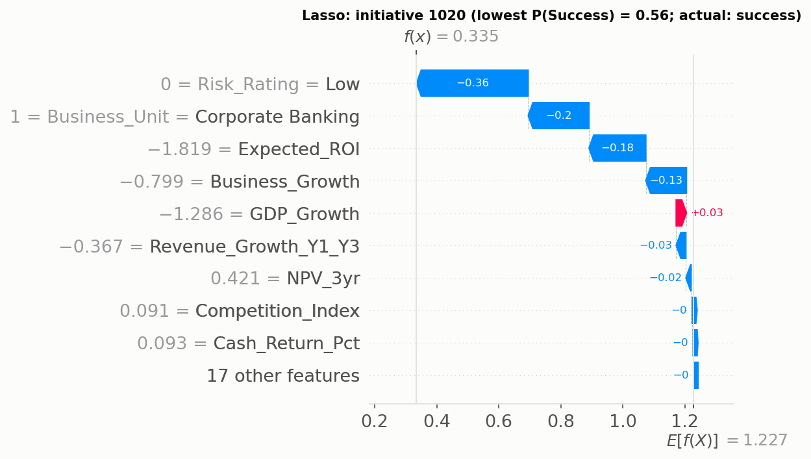

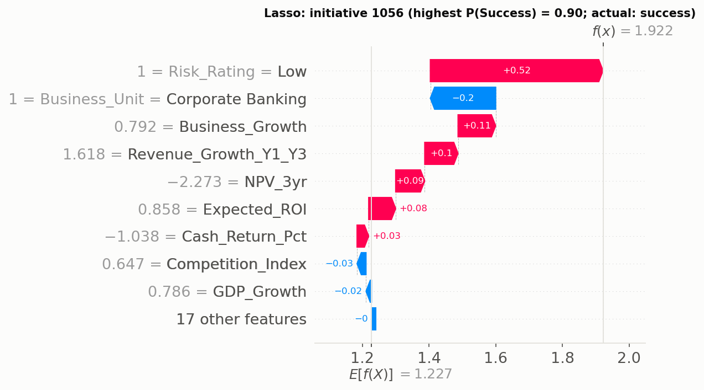

*Top: initiative 1020 (P(Success) 0.56). Bottom: initiative 1056 (0.90). Each bar is one input's push from the average (1.23 in log-odds, about 77%). Values on the left are in standard units, i.e. (value − average) ÷ standard deviation.*

| | 1020 (lowest) | 1056 (highest) |
| --- | --- | --- |
| Business unit | Corporate Banking (−0.20) | Corporate Banking (−0.20) |
| Risk rating | Not Low (−0.36) | **Low (+0.52)** |
| Business growth | Below average (−0.13) | Above average (+0.11) |
| Expected ROI | Well below average (−0.18) | Above average (+0.08) |

**Both are Corporate Banking, yet they sit at opposite ends.** Low risk outweighs the unit penalty, so the rating decides most of the gap between the most and least promising initiatives. (The charts come from one explanation fit on all 180 rows, so their end points differ slightly from the out-of-fold probabilities used for decisions, by design.)

---

## 5. Decision (Task 3): Fund, Review or Reject

**Conclusion:**
- Fund 2 (₹3.2 crore), Review 38 (₹62.9 crore), Reject 140.
- The rule uses every finance and risk measure: value (NPV), risk rating, payback (break-even), return against the cost of money (hurdle), the model's flag (gate), and the downside of failure (loss tolerance).

### 5.1 The measures

```text
Expected NPV     = P(Success) × NPV                                          (brief's formula)
Break-even life  = smallest N where −Investment + Σ (t = 1 … N) CFt ÷ (1 + r)^t ≥ 0,  with CFt = CF3 after year 3
Hurdle           = passes when Expected_ROI > Interest_Rate
Loss tolerance   = L* = P × NPV ÷ ((1 − P) × Investment)                      (positive NPV only)
```

- **Expected NPV:** the value of an initiative weighted by its chance of success. 1075: 0.867 × 55.57 = **+48.2 lakh**.
  - P is always above 0, so Expected NPV has the same sign as NPV. P can scale value but never turn a loss into a gain.
  - For a negative NPV, a *higher* P makes Expected NPV *more* negative, so Expected NPV is never used to rank loss-making projects.
- **Break-even life:** how many years of cash it takes to repay the investment in today's money. After year 3 we repeat the year-3 cash flow. It is a *measurement* of how much an initiative relies on cash beyond the data, not a forecast. Initiative 1002 breaks even in **year 8**.
- **Hurdle:** the promised yearly return must beat the yearly cost of money. 135 of 180 pass.
- **Loss tolerance:** the brief's Expected NPV treats a failure as costing nothing. In reality a failure loses part or all of the investment:

  ```text
  Expected value = P × NPV − (1 − P) × L × Investment          (L = share of the investment lost on failure)
  Setting it to 0 and solving for L gives L* above.
  1062: 0.79 × 9.86 ÷ (0.21 × 103.26) = 0.36  → worth funding only if a failure loses no more than about 36%
  1075: 0.867 × 55.57 ÷ (0.133 × 220.85) = 1.64 → worth funding even if a failure loses everything
  ```

  L* uses only our own numbers, so **no recovery rate has to be guessed**.

### 5.2 The rule (decision M1-06, agreed point by point)

```text
NPV > 0 and Risk_Rating = Low                                          →  FUND     "High expected value and acceptable risk"
NPV > 0 but Medium or High risk                                        →  REVIEW   "Potentially attractive but significant uncertainty" (the risk)
NPV ≤ 0, but break-even ≤ 5 years AND passes the hurdle
          AND P(Success) ≥ 0.767 (not flagged "at risk")              →  REVIEW   "... significant uncertainty" (payback after the data ends)
everything else                                                        →  REJECT   "Low expected value or excessive risk"

Funding condition:  loss tolerance ≥ 100% → fund in full;  below 100% → fund in stages (release at milestones)
Order:              Fund by Expected NPV; Review group 1 by loss tolerance; Review group 2 by break-even year, then P(Success)
```

| Point | Choice | Why | Alternatives rejected |
| --- | --- | --- | --- |
| A. Shape | A gate rule | Each label traces to one phrase of the brief, and every decision is explainable in one line | Expected NPV bands (for losses a higher P ranks *worse*); a weighted score (arbitrary weights); filling the budget (₹1,000 crore exceeds the ₹283 crore requested) |
| B. Acceptable risk | **Low only** | Medium fails as often as High (69% vs 70%) and loses as much capital (30% vs 32%); Low succeeds 89% and loses 9% | "Not High" (contradicted by the data); a model veto (the model can't separate projects within a risk level) |
| C. Slow-payer gate | P ≥ 0.767 | The same "at risk" line as Task 2. Without a gate, Review fills with average projects. A wrong pass costs reviewer time, not capital | No gate (Review 74 at 76% success); rating only |
| D. Payback limit | 5 years | Only 2 years of assumed cash beyond the data; the median break-even life; a common payback threshold | 4 and 6 years, shown as sensitivity |
| E. Downside | Loss tolerance → funding condition | Covers the cost of failure without guessing it | A full-loss formula as a gate (needs an unknowable recovery rate) |
| F. Order and reasons | Ordered lists; a reason for every initiative | A priority list for the Board and Module 9, and an audit trail | Ranking all by Expected NPV (penalises the likeliest successes) |

### 5.3 Results

| Label | Initiatives | Capital | Expected NPV (sum) | Average P(Success) | Past success of these initiatives (backtest) |
| --- | --- | --- | --- | --- | --- |
| Fund | 2 | ₹3.2 crore | +₹56.0 lakh | 0.83 | 1 of 2 |
| Review | 38 | ₹62.9 crore | −₹1,006.6 lakh | 0.81 | **84%** |
| Reject | 140 | ₹217.3 crore | −₹8,931.1 lakh | 0.73 | 75% |

**Reading the Expected NPV column.**
- Fund's positive total comes from 1075 and 1062.
- Review's total is negative because 32 of its 38 are slow payers whose value arrives after year 3. That is exactly why they need a review rather than funding.
- Expected NPV can't separate the slow payers from the rejects, because both are negative. That's why the rule uses break-even, the hurdle and the model's flag for them.

**Past success** is how often these same initiatives actually succeeded. It's a consistency check on the rule, not proof of future results.

**Why the 140 were rejected:**

| Reason | Initiatives |
| --- | --- |
| Breaks even only after 5 years | 79 |
| Never breaks even | 17 |
| Fails the hurdle | 8 |
| Passes every finance check but is flagged at risk by the model | 36 |

**The 36 the model rejects** are all Medium or High risk (25 Medium, 11 High); the bank's rating alone would hold back the same kind. This is the one place the model decides a label. It was kept deliberately, because Review should stay focused.

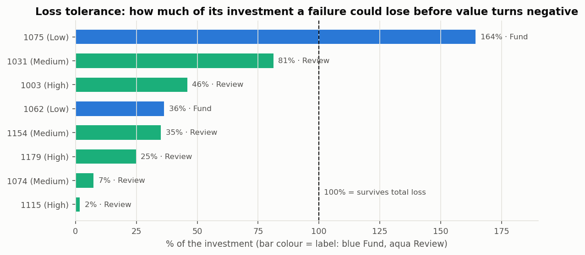

*How much of its investment each positive-NPV initiative could lose on failure before its value turns negative. Only 1075 exceeds 100%.*

### 5.3b How sensitive is the result to the 5-year payback limit?

The same rule was rerun at 4 and 6 years. The limit decides how many years of cash *beyond the data* the Board will rely on (limit − 3):

| Payback limit | Years assumed beyond the data | Fund | Review (of which slow payers) | Reject | Review capital |
| --- | --- | --- | --- | --- | --- |
| 4 years | 1 | 2 | 21 (15) | 157 | ₹33.0 crore |
| **5 years (chosen)** | **2** | **2** | **38 (32)** | **140** | **₹62.9 crore** |
| 6 years | 3 | 2 | 47 (41) | 131 | ₹77.6 crore |

Fund never changes. A more cautious Board cuts the Review list from 38 to 21; a more patient one adds 9 initiatives (8 of them Low risk), at the cost of relying on a third year of unseen cash.

### 5.4 The priority lists

| List | Order | Initiatives |
| --- | --- | --- |
| **Fund** | Expected NPV | 1. **1075** Wealth, Low: +48.2 lakh, loss tolerance 164%, **in full** · 2. **1062** Corporate Banking, Low: +7.8 lakh, 36%, **in stages** |
| **Review group 1:** positive NPV, Medium/High risk | Loss tolerance, most robust first | 1031 (81%) · 1003 (46%) · 1154 (35%) · 1179 (25%) · 1074 (7%) · 1115 (2%). The last two need near-certain success to be worth it |
| **Review group 2:** slow payers | Break-even year, then P(Success) | 15 repay in year 4, led by 1021 (Digital Banking), 1149, 1038, 1162 and 1107; then 17 in year 5. 25 of the 32 are Low risk |

---

## 6. How the pieces connect: cross-task conclusions

### 6.1 Corporate Banking across the three tasks

| Task | What it showed |
| --- | --- |
| 1 | Lowest success rate (63%), the most capital (₹62.3 crore), **35% of all failed capital**. But only 17% of its projects are High risk, so the risk rating doesn't explain it |
| 2 | Lasso keeps "Corporate Banking" in 68% of rounds, with odds of success × 0.78. The model sees the same weakness |
| 3 | Rejected **no more often than other units**: 77% of its initiatives, against 72–87% elsewhere |

| Business unit | Fund | Review | Reject | Reject share | Review capital |
| --- | --- | --- | --- | --- | --- |
| Corporate Banking | 1 | 7 | 27 | 77% | **₹14.8 crore (largest)** |
| Wealth | 1 | 8 | 26 | 74% | ₹13.1 crore |
| Risk Analytics | 0 | 7 | 18 | 72% | ₹11.5 crore |
| Payments | 0 | 7 | 29 | 81% | ₹10.1 crore |
| Digital Banking | 0 | 7 | 27 | 79% | ₹9.3 crore |
| SME Lending | 0 | 2 | 13 | 87% | ₹4.2 crore |

**Why:** the decision rule works on the risk rating and payback, not on the business unit, so Corporate Banking's unit-specific weakness passes through it.

**What the Board should do:**
- Its **7 Review projects carry the largest Review exposure (₹14.8 crore).** 1074 has almost no margin for failure (loss tolerance 7%), and the other 6 all repay only in year 5, at the bottom of the slow-payer list.
- They deserve the **closest review**, including why past Corporate Banking initiatives failed.
- Its one Fund project, **1062, is already funded in stages**, which limits the exposure.
- Cutting the unit is not supported: the unit difference is not statistically firm (p = 0.36).

### 6.2 Likely to succeed is not the same as creating value

**The tension:**
- Tasks 1 and 2 say Low risk is the safest bet (89% success).
- Yet Task 3 **rejects 37 Low-risk initiatives (₹55.1 crore)**, and those 37 actually succeeded **95%** of the time.

**Why:**
- The brief's "success" (Historical_Success) records whether an initiative delivered. It does **not** say whether it repaid its investment in time.
- These 37 are rejected on **value**:
  - 29 break even only after 5 years (median break-even **7 years**);
  - 4 never break even;
  - 4 promise less than their cost of money.
- Their median Expected ROI is 8.7%, well below Low risk's 12.0%. These are safe projects with thin economics.

**What the Board would need to believe to fund them:** that the year-3 cash flow will keep coming for 7 years or more. The data covers only 3. Allowing 6 years adds 9 initiatives to Review, 8 of them Low risk (§5.3b). That is the price of patience: a third year of cash nobody has seen.

**The lesson for capital allocation:** "will it succeed?" and "is it worth the money?" are separate questions. The chain answers them in order: ML estimates the first, finance the second, and only an initiative that passes both is funded.

### 6.3 What the machine learning changed in the decisions

The same rule was run three times, changing only where P(Success) comes from:

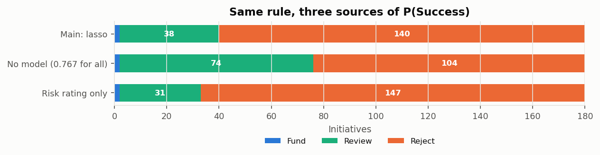

*Fund (blue), Review (aqua) and Reject (orange) under each source of P(Success).*

| P(Success) from | Fund | Review | Reject | Review past success |
| --- | --- | --- | --- | --- |
| **Lasso** (main) | 2 | 38 | 140 | 84% |
| No model (0.767 for everyone) | 2 | 74 | 104 | 76% |
| Risk rating only (Low 0.89, Medium 0.69, High 0.70) | 2 | 31 | 147 | 84% |

- **Fund doesn't depend on the model**, because P can't change the sign of NPV.
- **A prediction is needed for the slow-payer gate.** With no model, every initiative gets exactly 0.767 and passes, so Review fills with average projects.
- **The bank's rating does almost all the work.** Lasso adds 7 Medium/High projects to Review that the rating would not. Since lasso can't rank within a risk level, these aren't evidence-backed, but they cost only reviewer time.

**Overall:** the ML was done properly and is used where the brief puts it. Its value in this module is **evidence**:
- the rating is the one reliable signal;
- business-case numbers don't predict success;
- the complex models only memorise.

It isn't a new predictor. With more history, the same pipeline will show whether new signals appear.

---

## 7. Key decisions

| ID | Decision | Choice | Reason |
| --- | --- | --- | --- |
| M1-01 | Is Operating_Cost yearly? | Yearly | Confirmed; cash flow = revenue − cost each year |
| M1-02 | Discount rate | Each initiative's own Interest_Rate | Set by the market, not the project. Discounting at Expected_ROI would be circular |
| M1-03 | Years of cash in NPV | 3, as given | The data has no year 4. An "approximate NPV" (brief); the effect is shown via break-even |
| M1-04 | Dependence on later cash | Break-even life | Uses only given numbers; a measurement, not a forecast |
| M1-05 | Hurdle | Expected_ROI > Interest_Rate | The promised return must beat the cost of money |
| M1-07, M1-18 | Validation | Repeated stratified 5-fold CV, 25 identical rounds | Stable, fair (paired) comparison on 180 rows; everything learned inside the rounds |
| M1-14 | Model settings | Fixed; only lasso's penalty chosen by inner CV | 180 rows are too few for tuning to pay off |
| M1-15 | Class imbalance | No balancing | Balancing distorts the probabilities Task 3 multiplies by NPV |
| M1-16, M1-19 | Model choice | Lowest Brier + finance checks → lasso | Accurate, cautious, explainable probabilities |
| M1-17 | Inputs | All 26, fixed in advance, plus lasso | No after-the-fact input picking |
| M1-21 | Value in ₹ | Rupee replay of each model's flag | The Board decides on money, not scores |
| M1-22 | Benchmark | Risk-rating lookup, not a candidate | Tests what ML adds; it ties, and that's reported |
| M1-06 | Decision rule | Gate rule A–F (§5.2) | Every label traces to the brief; every decision has a reason |
| M1-20, M1-23 | Sensitivity | Three sources of P(Success); 4/5/6-year cut-offs | Shows how much decisions depend on the model and on judgement |

The full log, with every option considered, is in `docs/decisions.md`.

---

## 8. Hand-off to Module 9 (the ₹1,000 crore allocation)

| Item | Value |
| --- | --- |
| Ready to fund now | **₹3.2 crore**: 1075 in full (₹2.2 crore), 1062 in stages (₹1.0 crore) |
| Possible after review | Up to **₹62.9 crore** (38 initiatives, in priority order). An upper bound: money flows only if a review approves |
| **Ceiling for strategic initiatives** | **About ₹66 crore (6.6% of ₹1,000 crore)** |
| Not to be funded | ₹217.3 crore (140 initiatives) |
| File | `outputs/task3/FINAL_M1_T3_initiative_decisions.csv`: the Board decision file (guide below) |

**Column guide for `outputs/task3/FINAL_M1_T3_initiative_decisions.csv`** (one row per initiative; no blank cells; no codes):

| Column | What it shows | Example (1021) |
| --- | --- | --- |
| Initiative_ID, Business_Unit, Risk_Rating | Who it is | 1021, Digital Banking, Low |
| Investment (₹ lakh) | Money requested | 195.20 |
| NPV 3 years (₹ lakh) | Today's value of 3 years of cash, minus the investment | −39.28 |
| P(Success) | The model's out-of-fold probability of success | 0.8868 |
| Expected NPV (₹ lakh) | P(Success) × NPV, the brief's value measure | −34.83 |
| Check: value | Is NPV positive? | Not positive: NPV −39.3, Expected NPV −34.8 |
| Check: risk | Is the risk acceptable for Fund (Low only)? | Low: acceptable for Fund |
| Check: payback | Break-even year against the 5-year limit | Year 4: within the 5-year limit |
| Check: hurdle | Does the promised return beat the cost of money? | Pass: Expected_ROI 10.5% > cost of money 6.0% |
| Check: model | Is it flagged "at risk" (P(Success) below 0.767)? | Not at risk: P(Success) 0.89 ≥ 0.767 |
| Check: loss tolerance | How much a failure could lose before value turns negative (positive NPV only) | Not applicable: NPV not positive |
| Decision | Fund / Review / Reject | Review |
| Decision path | Which route of the rule it took, in words | Review: slow payer (pays back within 5 years) |
| Funding condition | Fund in full / in stages; otherwise why it doesn't apply | Not applicable: decided after review |
| Priority | Position in its list | Review group 2 (slow payers): #1 of 32 |
| Full reason | The deciding factor first, then the other checks | Review (slow payer): NPV −39.3 over 3 years … but pays back in year 4, passes the hurdle and is not flagged by the model … |

The money columns stay numeric and complete, so Module 9 can add them up.

---

### 8.1 Module 9 inputs: return and risk per ₹, by business unit (decision M1-24; notebook step 10c)

**Why:** Module 9 compares every business on the same fields. Module 1's data has investment, revenue and costs by business unit, so it gives Digital banking, Payments and Wealth a return per ₹ of capital that no other file has.

**How:** return per ₹ a year is the internal rate of return (the yearly rate at which the money put in and the cash coming back balance out), over Module 1's 5-year payback limit (years 4–5 repeat year 3). Each initiative's cash is weighted by its P(Success); **a failed initiative returns no cash**. The bad case is the 1-in-20 outcome of which initiatives succeed (2,000 random draws, seed 42).

| Business unit (Fund + Review initiatives) | Initiatives | Capacity (₹ crore) | Expected return a year | 1-in-20 bad case | If all succeed |
| --- | --- | --- | --- | --- | --- |
| Corporate Banking | 8 | 15.8 | **6.3%** | -6.1% | 14.3% |
| Digital Banking | 7 | 9.3 | **13.2%** | -6.6% | 22.3% |
| Payments | 7 | 10.1 | **13.0%** | -2.1% | 18.8% |
| Risk Analytics | 7 | 11.5 | **10.4%** | -5.4% | 18.5% |
| SME Lending | 2 | 4.2 | **13.3%** | -1.4% | 25.9% |
| Wealth | 9 | 15.3 | **17.6%** | 3.6% | 27.7% |
| All units | 40 | 66.2 | **12.1%** | 5.9% | 20.8% |

- **Deployable initiatives earn about 12.1% a year**, above the 6.8% risk-free rate, with a 1-in-20 bad case of 5.9%.
- **Wealth is strongest** (17.6%, and positive even in the bad case); Corporate Banking weakest (6.3%).
- **All 180 initiatives together would earn -3.6% a year:** the rejected ones lose money in every unit, confirming Module 1's rejections on a return-per-₹ basis.
- **Evidence is weak** (P(Success) model ROC-AUC 0.58; cash after year 3 assumed), and the money is locked in for about 5 years. Module 9 should treat these as small, staged commitments.

## 9. Limitations

| Limitation | Consequence for the decision |
| --- | --- |
| **Only 3 years of cash flow** | Almost every NPV is negative. Break-even and the Review label keep good slow payers in view, but anything after year 3 is an assumption (the year-3 cash flow repeated) |
| **The brief's Expected NPV ignores the cost of failure** | Covered by loss tolerance without guessing; the true loss on failure is unknown |
| **Weak prediction** (ROC-AUC 0.58; permutation p = 0.17) | The model's probabilities are only as accurate as a flat 77%, and its signal is the risk rating. The 36 model-based rejections and 7 extra Review places should be read with that in mind (§6.3) |
| **180 initiatives, 42 failures** | Every measure has a wide range (± 0.08 on ROC-AUC); unit differences can't be confirmed |
| **Synthetic data** | Patterns such as the 2.00% ROI floor suggest generated data; real relationships may differ |
| **Backtest on the same initiatives** | "Past success" by label checks consistency, not future performance |
| **Association, not cause** | Low risk *goes with* success; relabelling doesn't make a project safer |
| **Judgement thresholds** (Low risk only, 5 years, 0.767) | Each is stated, justified and tested where it matters (sensitivity) |
| **Revenues and costs are projections at proposal time** | If they were actual results, using them to predict success would be leakage |

---

## Glossary

| Term | Meaning |
| --- | --- |
| **₹ lakh / crore** | 1 lakh = ₹1,00,000; 1 crore = 100 lakh = ₹1,00,00,000 |
| **Cash flow (CFt)** | Revenue in year t minus the yearly operating cost |
| **Discounting** | Converting future cash into today's money: divide by (1 + r) for each year of waiting |
| **NPV** | Net Present Value: today's value of the cash an initiative brings in, minus its investment |
| **Expected NPV** | P(Success) × NPV (brief's formula) |
| **Expected_ROI** | The promised yearly profit as a % of the investment |
| **Interest_Rate** | The yearly cost of money for the initiative; used as its discount rate |
| **Hurdle** | The test Expected_ROI > Interest_Rate: does the promise beat the cost of money? |
| **Break-even life** | Years of cash flow needed for NPV to reach 0 (year-3 cash flow repeated after year 3) |
| **Slow payer** | Negative 3-year NPV, but repays within 5 years and passes the hurdle |
| **Loss tolerance (L\*)** | P × NPV ÷ ((1 − P) × Investment): the largest share of the investment a failure could lose before expected value turns negative |
| **Failed capital** | Investment in initiatives that failed |
| **P(Success)** | The model's predicted probability that an initiative succeeds |
| **Base rate** | 138 ÷ 180 = 0.767, the share of initiatives that succeeded |
| **"At risk" flag** | P(Success) below the base rate |
| **Out-of-fold prediction** | A prediction made by a model that never saw that initiative |
| **Cross-validation** | Repeatedly training on part of the data and testing on the rest, so every score comes from unseen data |
| **Stratified** | Every fold keeps the same success/failure mix as the whole data |
| **Leakage** | Information from the test data or the answer reaching the model during training, making scores look too good |
| **Overfitting** | Learning quirks of the training rows that don't repeat in new data: high training score, low test score |
| **ROC-AUC** | Chance a random success gets a higher P than a random failure; 0.5 = coin toss |
| **Brier score** | Average of (P − outcome)²; lower is better; 0.179 for "always 77%" |
| **Failure recall** | Share of real failures the flag catches |
| **Capital lift** | Share of failed capital caught ÷ share of capital reviewed; 1.0 = random review |
| **Logistic regression** | A model that adds weighted inputs into a score and turns it into a probability |
| **Lasso** | Logistic regression with a penalty on the size of the weights, which sets weak inputs to exactly 0 |
| **Odds, odds ratio** | Odds = P ÷ (1 − P). An odds ratio multiplies the odds: 2.41 takes 77% to 89% |
| **Log-odds** | ln(P ÷ (1 − P)), the scale on which logistic regression adds its inputs |
| **SHAP** | A method that splits one prediction into the push from each input |
| **Decision tree / random forest / XGBoost / LightGBM** | Models built from yes/no questions; the last three combine many trees |
| **Class balancing** | Reweighting rare outcomes to look common; not used here because it distorts probabilities |
| **Benchmark** | A simple reference model used to check whether a complex model adds anything |
| **p-value** | How often a result this extreme would appear if there were no real effect; below 0.05 = unlikely to be chance |
| **95% range (Wilson)** | The range the true rate very likely lies in, given the group size |
| **Chi-square test** | Compares observed counts with those expected if groups didn't differ |
| **Mann–Whitney test** | Compares two groups' values by rank, without assuming a bell shape |
| **Correlation (r)** | Strength of a straight-line link, from −1 to +1 |
| **Paired comparison (t = 2.06)** | Compares two models round by round on the same test sets; 2.06 is the 95% t-value for 24 degrees of freedom |
| **Permutation test** | Shuffles the labels to see how often luck matches the real score |
| **Sensitivity analysis** | Re-running the decision with different assumptions to see which results change |
