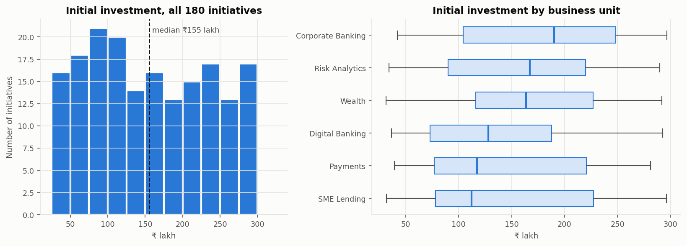
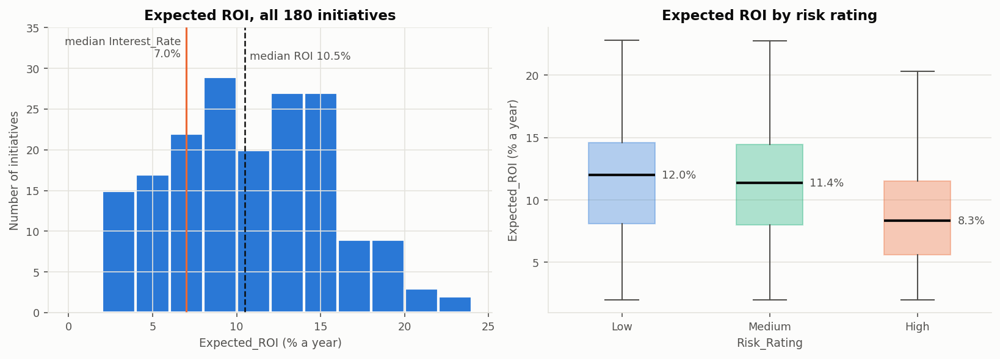
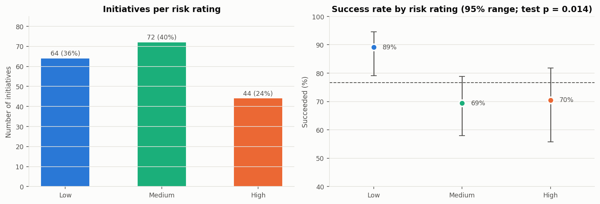
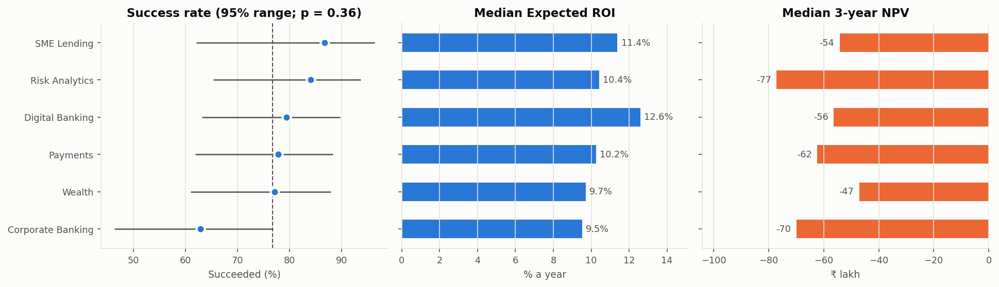
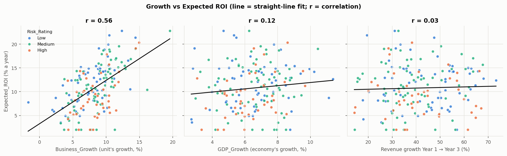
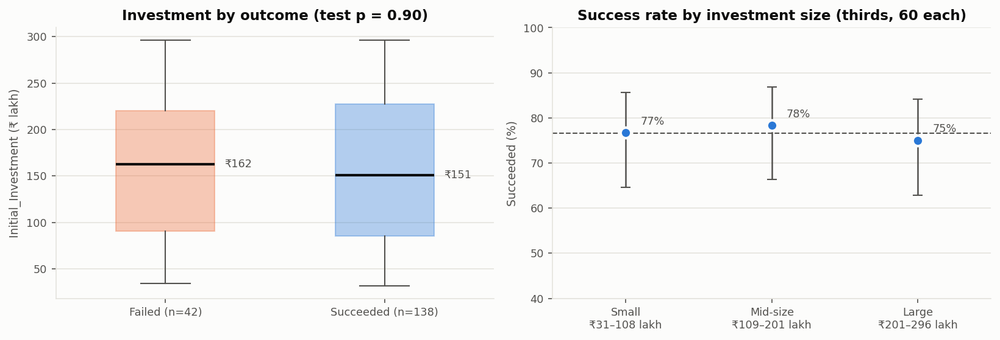
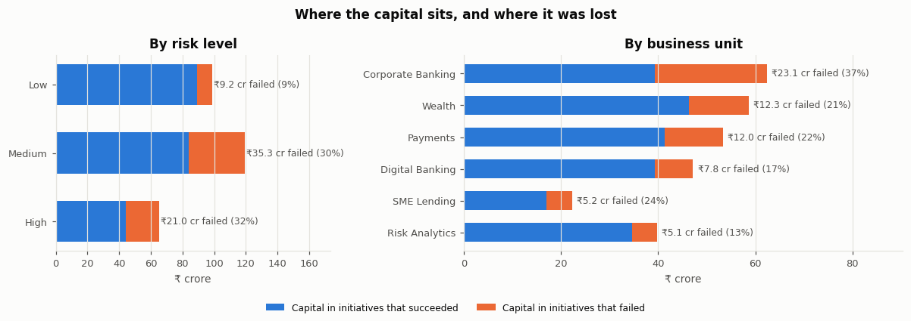

# Module 1 — Task 1 Report: Exploratory analysis of strategic initiatives

**Brief (verbatim):**
> **Task 1: Exploratory analysis**
> Students should examine:
> - Investment distribution
> - ROI distribution
> - Risk categories
> - Business-unit performance
> - Relationship between growth and ROI
> - Relationship between investment and success

**Where this sits in the chain:** **Data** → ML Prediction → Financial Metric → Risk Assessment → Business Decision. Task 1 is the *Data* step. It checks the data is usable and shows what is likely to drive success (Task 2) and value (Task 3).

**Units:** all money is in ₹ lakh (1 lakh = ₹1,00,000; 100 lakh = ₹1 crore), as set by project decision P-02.

| Item | Where |
| --- | --- |
| Code and outputs | `notebooks/m01_task1_eda.ipynb`: all Task 1 code, one section per brief item; runs on its own (locally or in Colab) or from `run_module_1.ipynb` |
| Shared code used | `helpers/m01_data.py` (load and check data, add derived columns), `helpers/m01_finance.py` (cash flows, NPV) |
| Tables and charts | `outputs/task1/` (CSV + PNG per item, `key_numbers.json`) |
| Decisions used | M1-02, M1-03 (for 3-year NPV), M1-08 to M1-13, all in `docs/decisions.md` |

---

## 1. Summary for management

1. **The data is clean:** 180 initiatives, nothing missing, no duplicates. Together they ask for **₹283 crore**, which is 28% of the ₹1,000 crore being allocated.
2. **Risk rating is the only clear signal of success.** Low-risk initiatives succeeded **89%** of the time; Medium **69%** and High **70%**. This gap is very unlikely to be chance (p = 0.014).
3. **Size of investment does not predict success.** Small, mid-size and large initiatives succeed at 77%, 78% and 75%. Size does matter for value: bigger projects have much worse 3-year NPV (Net Present Value: today's value of the cash a project brings in, minus what it costs).
4. **High-risk initiatives promise *less* return, not more.** The median Expected ROI (Return on Investment: promised yearly profit ÷ money invested) is 12.0% for Low risk but 8.3% for High risk. Normally, taking more risk should be paid with a higher return, so High-risk projects here offer a poor trade.
5. **Faster-growing units promise higher ROI.** Business_Growth and Expected_ROI move together strongly (correlation 0.56): each extra 1 point of unit growth comes with about 0.9 points more ROI. Growth of the economy (GDP_Growth) and a project's own revenue growth show almost no link to the promised ROI.
6. **Business units differ less than they appear to.** Success ranges from 63% (Corporate Banking) to 87% (SME Lending), but the groups are small and the difference could be chance (p = 0.36). **Corporate Banking deserves a closer look.** It asks for the most money (₹62 crore) and has both the lowest success rate and the lowest median ROI.
7. **In money terms, most of the loss sits in two places** (section 3.7).
   - ₹65.5 crore (23%) of the capital went into initiatives that failed.
   - **Medium- and High-risk initiatives hold 65% of the capital but 86% of the failed capital.**
   - **Corporate Banking holds 22% of the capital but 35% of the failed capital.**
8. **On 3 years of cash alone, almost nothing pays back.** Only 8 of the 180 initiatives have a positive 3-year NPV. Yet 135 of the 180 promise an ROI above their Interest_Rate, the yearly cost of money and the minimum return a project must beat. This tension carries into Task 3.

---

## 2. Data quality checks (done before any analysis)

| Check | Result | What we did |
| --- | --- | --- |
| Rows | 180, one per initiative | — |
| Missing values | 0 | — |
| Duplicate Initiative_ID | 0 | — |
| Negative money values | 0 | — |
| Expected_ROI exactly 2.00% | **11 initiatives** | Kept. This looks like a floor (lowest allowed value) in how the data was made; noted as a limitation (M1-10) |
| Business_Growth below 0 | 1 (initiative 1127, Wealth, −1.72%) | Kept; a shrinking unit is plausible |
| Operating_Cost above Year 1 revenue | 18 | Kept; a loss in the first year is normal for a new project |
| Category labels | 6 business units, 3 risk levels, success 0/1, all spelled consistently | — |

Target balance: 138 succeeded and 42 failed (**77% success**). This mild imbalance shapes how Task 2 models are scored.

---

## 3. Findings, one per brief item

### 3.1 Investment distribution



*Left: how many initiatives ask for each amount (₹25-lakh bands). Right: spread of investment per business unit (box = middle half, line = median).*

| | Initiatives | Total (₹ crore) | Median (₹ lakh) | Range (₹ lakh) |
| --- | --- | --- | --- | --- |
| **All** | 180 | **283.4** | **155** | 31–296 |
| Corporate Banking | 35 | 62.3 | 190 | 42–296 |
| Wealth | 35 | 58.6 | 164 | 31–292 |
| Payments | 36 | 53.3 | 118 | 39–281 |
| Digital Banking | 34 | 47.1 | 128 | 37–292 |
| Risk Analytics | 25 | 39.8 | 167 | 35–290 |
| SME Lending | 15 | 22.3 | 112 | 32–296 |

- Investments are spread **evenly** between about ₹30 and ₹300 lakh. There is no long tail of very large projects, and the mean (₹157 lakh) is close to the median (₹155 lakh).
- Every unit has both small and large projects. **Corporate Banking** asks for the most in total and has the largest typical project.

### 3.2 ROI distribution



*Left: Expected ROI of all 180 initiatives; dashed line = median ROI, orange line = median Interest_Rate (the cost of money). Right: Expected ROI by risk level.*

ROI (Return on Investment) here is the given **Expected_ROI**: the promised yearly profit as a % of the money invested. For example, invest ₹100 lakh, earn ₹10.5 lakh a year → 10.5%.

| Group | Median Expected_ROI | Middle half of values | Share with Expected_ROI above its Interest_Rate |
| --- | --- | --- | --- |
| All | **10.5%** | 7.3–14.2% | 75% |
| Low risk | 12.0% | 8.1–14.6% | 80% |
| Medium risk | 11.4% | 8.0–14.5% | 78% |
| High risk | **8.3%** | 5.6–11.5% | **64%** |
| Digital Banking (best unit) | 12.6% | 9.2–15.4% | 82% |
| Corporate Banking (lowest unit) | 9.5% | 7.9–14.0% | 74% |

- Expected_ROI runs from 2.0% to 22.8%, roughly bell-shaped around 10.5%.
- The median Interest_Rate (the yearly cost of money) is 7.0%. Three in four initiatives promise more than their own Interest_Rate, so they pass the **hurdle check** (decision M1-05).
- **ROI falls as risk rises**, the reverse of the usual finance rule that more risk should be paid with more return.
- **Cross-check from the cash-flow columns.** The yearly cash flow is Revenue minus Operating_Cost. Typically (median) it equals about **20.7% of the investment a year** (average 20.5%). But 3 years × about 21% is only about 62% of the money back, which is why the 3-year NPV is usually negative (see 3.4). In other words, Expected_ROI and the 3-year cash figures describe the same projects differently: Expected_ROI implies a longer life than 3 years.

### 3.3 Risk categories



*Left: number of initiatives per risk level. Right: success rate per risk level; the vertical bar is the 95% range, the dashed line the overall 77%.*

| Risk_Rating | Initiatives | Share | Success rate (95% range) | Median Expected_ROI | Money asked (₹ crore) |
| --- | --- | --- | --- | --- | --- |
| Low | 64 | 36% | **89%** (79–95%) | 12.0% | 98.6 |
| Medium | 72 | 40% | 69% (58–79%) | 11.4% | 119.4 |
| High | 44 | 24% | 70% (56–82%) | 8.3% | 65.4 |

- The "95% range" is the range the true success rate very likely falls in, given how few projects each group has (a Wilson interval).
- A chi-square test asks whether success differs across the three groups more than chance would allow. **p = 0.014**: if risk level made no difference, a gap this large would appear only about 1.4% of the time. So the difference is **very unlikely to be chance**.
- The break is **Low versus the rest**. Medium and High succeed at almost the same rate.
- Low-risk initiatives are the best on both counts: most likely to succeed *and* highest promised ROI.

### 3.4 Business-unit performance



*Per business unit: success rate with 95% range (left), median Expected ROI (middle), median 3-year NPV in ₹ lakh (right).*

3-year NPV = today's value of Year 1–3 cash flows, discounted at the row's own Interest_Rate, minus Initial_Investment (decisions M1-02, M1-03).

```text
NPV = −Initial_Investment + CF1/(1 + r) + CF2/(1 + r)² + CF3/(1 + r)³
CFt = Revenue_Year t − Operating_Cost        r = Interest_Rate ÷ 100
```

| Business_Unit | n | Success (95% range) | Median Expected_ROI | Median 3-yr NPV (₹ lakh) | 3-yr NPV > 0 | Share High risk |
| --- | --- | --- | --- | --- | --- | --- |
| SME Lending | 15 | 87% (62–96%) | 11.4% | −54 | 1 | 13% |
| Risk Analytics | 25 | 84% (65–94%) | 10.4% | −77 | 0 | 24% |
| Digital Banking | 34 | 79% (63–90%) | **12.6%** | −56 | 1 | 26% |
| Payments | 36 | 78% (62–88%) | 10.2% | −62 | 0 | 31% |
| Wealth | 35 | 77% (61–88%) | 9.7% | **−47** | **4** | 29% |
| Corporate Banking | 35 | **63%** (46–77%) | 9.5% | −70 | 2 | 17% |

- Success varies from 63% to 87%, but the 95% ranges overlap heavily. The test (p = 0.36) says this **could be chance**, so we do **not** rank units on success alone.
- **Digital Banking** promises the highest ROI and comes from the fastest-growing unit (median Business_Growth 9.4%).
- **Wealth** has the least negative median NPV and half of all 8 positive-NPV initiatives.
- **Corporate Banking** is the one to watch: most money asked (₹62 crore), lowest success rate, lowest median ROI. Its failures do not come from High risk, since only 17% of its projects are High risk.

### 3.5 Relationship between growth and ROI



*Expected ROI against three growth measures; each dot is one initiative, coloured by risk level; the black line is the straight-line fit.*

The brief does not say which "growth" it means, so we test all three growth columns (decision M1-09). r is the correlation, from −1 to +1, where 0 means no straight-line link. p below 0.05 means the link is unlikely to be chance.

| Growth measure | Link with Expected_ROI | Link with 3-year cash return |
| --- | --- | --- |
| **Business_Growth** (how fast the business unit grows) | **r = 0.56**, p < 0.0001; +1 point growth ≈ +0.9 points ROI | r = 0.33 |
| GDP_Growth (how fast the economy grows) | r = 0.12, p = 0.12 (not significant) | r = 0.06 |
| Revenue growth Year 1 → Year 3 (the project's own) | r = 0.03 (none) | r = 0.22 |

- **Faster-growing units promise higher ROI.** This holds at every risk level: r = 0.60 for Low, 0.62 for Medium and 0.50 for High.
- The economy's growth does not explain the promised ROI.
- **A project's own revenue growth does not explain its promised ROI.** Expected_ROI follows the unit's growth rather than the project's revenue path. This is one more sign that Expected_ROI and the cash-flow columns are separate views of value (see 3.2).
- **Supporting check.** A straight-line model of Expected_ROI on the four economic columns explains 35% of its variation. Business_Growth adds +0.90 points of ROI per point of growth. Interest_Rate subtracts 0.70 points of ROI per point of interest (p = 0.005): when money is dearer, projects promise less.

### 3.6 Relationship between investment and success



*Left: investment of failed vs successful initiatives. Right: success rate for small, mid-size and large initiatives, with 95% ranges.*

| Investment size (thirds, 60 each) | Range (₹ lakh) | Success (95% range) | Median 3-yr NPV (₹ lakh) |
| --- | --- | --- | --- |
| Small | 31.5–108.2 | 77% (65–86%) | −25 |
| Mid-size | 108.6–201.0 | 78% (66–87%) | −66 |
| Large | 201.1–296.5 | 75% (63–84%) | **−124** |

Thirds = the 180 initiatives sorted by investment and split into three groups of 60 (decision M1-12).

- The median investment is ₹151 lakh for successful projects and ₹162 lakh for failed ones. A Mann–Whitney test, which compares two groups without assuming a bell shape, gives **p = 0.90**: no difference. The correlation between investment and success is 0.01.
- **Investment size says nothing about the chance of success.**
- But investment is the **biggest driver of 3-year NPV** (correlation −0.60), along with Operating_Cost (−0.80). Large projects lose about five times as much value over 3 years as small ones, because their cash flows do not grow in step with the money put in.

### 3.7 Board view in ₹: where the capital sits and where it was lost (notebook step 9)



*Capital in each risk level and business unit, split into initiatives that succeeded (blue) and failed (orange). The label shows the failed capital and the share of that group's own capital it represents.*

```text
Failed capital               = Σ Initial_Investment of initiatives that failed
Share of all failed capital  = failed capital of a group ÷ failed capital of all 180 (₹65.5 crore)
```

| Group | Capital | Share of capital | Success rate | Failed capital | Share of its own capital lost | Share of all failed capital |
| --- | --- | --- | --- | --- | --- | --- |
| Low risk | ₹98.6 crore | 35% | 89% | ₹9.2 crore | 9% | 14% |
| Medium risk | ₹119.4 crore | 42% | 69% | ₹35.3 crore | 30% | 54% |
| High risk | ₹65.4 crore | 23% | 70% | ₹21.0 crore | 32% | 32% |
| **Corporate Banking** | ₹62.3 crore | 22% | 63% | **₹23.1 crore** | **37%** | **35%** |
| Wealth | ₹58.6 crore | 21% | 77% | ₹12.3 crore | 21% | 19% |
| Payments | ₹53.3 crore | 19% | 78% | ₹12.0 crore | 22% | 18% |
| Digital Banking | ₹47.1 crore | 17% | 79% | ₹7.8 crore | 17% | 12% |
| SME Lending | ₹22.3 crore | 8% | 87% | ₹5.2 crore | 24% | 8% |
| Risk Analytics | ₹39.8 crore | 14% | 84% | ₹5.1 crore | 13% | 8% |

**What it means for the Board:**
- **Risk is where the money is lost.**
  - Medium and High risk hold 65% of the capital but 86% of the failed capital.
  - High-risk projects also promise the lowest return: median Expected ROI 8.3%, and only 64% pass the hurdle, against 80% for Low risk. Their trade is poor on both counts.
- **Corporate Banking loses money out of proportion to its size.**
  - Its High-risk share is low (17%), so the risk rating doesn't explain the gap.
  - The Board should ask *why* through closer review. It shouldn't cut the unit: the unit difference in success rates is not statistically firm (p = 0.36).
- **Size is not the problem.** Small, mid and large projects fail at similar rates (section 3.6), so rationing by size would not reduce the loss.

Tables: `outputs/task1/9_board_view_risk.csv`, `FINAL_M1_T1_business_unit_view.csv`.

---

## 4. What this means for the next tasks

| Finding | Use in Task 2 (predict success) | Use in Task 3 (NPV and decision) |
| --- | --- | --- |
| Risk_Rating is the clearest success signal | Keep Risk_Rating as a feature; expect it to rank high in SHAP | Suggests risk should be part of the funding decision (how it was used: Task 3 report §2) |
| No single column links strongly to success (largest is Expected_ROI at 0.12) | **Expect modest accuracy.** Report it honestly with the spread across folds; do not overfit 180 rows | Suggests P(Success) alone won't separate initiatives much (how it was used: Task 3 report §2 and §6) |
| Investment size does not predict success | Keep it as a feature but expect little from it | Size drives NPV, so large projects will be rejected more often on value, not on risk |
| Only 8 initiatives have 3-year NPV > 0 | — | Expected NPV will be negative for most. Break-even life (M1-04) and the hurdle check (M1-05) separate "slow payback" from "never pays back" |
| Expected_ROI follows Business_Growth, not the cash flows | Both are features; the ROI spread (Expected_ROI − Interest_Rate) is added (docs/approach.md) | Explains why ROI looks healthy while NPV is negative; reported to management |
| Corporate Banking: most money, lowest success | Business_Unit stays a feature | Watch whether its initiatives land in Reject |

---

## 5. Model and data split for Task 1

- **No model is trained in Task 1**, so there is no train/test split. All 180 rows are described (decision M1-08).
- **Leakage guard** (leakage = information from the answer sneaking into the model). The Task 2 feature list in `docs/approach.md` was fixed from finance reasoning *before* this analysis, and Task 1 does not choose features by looking at their link with success. Task 2 then judges every model only on rows it did not train on, using repeated stratified 5-fold cross-validation (M1-07).

---

## 6. Risks and limitations

- **Small groups.** SME Lending has 15 initiatives and High risk has 44. Success rates come with wide 95% ranges, and differences between units cannot be confirmed.
- **The data is synthetic.** The 2.00% ROI floor (11 rows) and the almost flat spread of investments suggest generated data, so real-world patterns may be stronger or messier.
- **NPV uses 3 years only**, so it is a lower bound for projects that last longer (decision M1-03).
- **Revenues and costs are treated as projections made when each initiative was proposed** (decision M1-13). If they were actual results, using them to predict success would be leakage. The brief uses them for NPV at funding time, and they barely relate to success (correlation 0.01–0.03).
- **Correlation is not cause.** Faster unit growth comes *with* higher ROI. It does not prove that growth causes it.
- **Several tests are run at once**, so one result near p = 0.05 could be luck. The two main results (risk p = 0.014; growth p < 0.0001) are well clear of that.
