# Module 1 — Task 2 Report: Predicting initiative success

**Brief (verbatim):**
> **Task 2: Predict initiative success**
> Target: Historical_Success
> Compare models to model target variable and compare their performance detailing explainability (which characteristics make an initiative more likely to succeed).

**Where this sits in the chain:** Data → **ML Prediction** → Financial Metric → Risk Assessment → Business Decision. Task 2 produces P(Success), the predicted probability that each initiative succeeds. Task 3 multiplies it by NPV (Net Present Value: today's value of the cash a project brings in, minus what it costs) to get Expected NPV.

| Item | Where |
| --- | --- |
| Code and outputs | `notebooks/m01_task2_model.ipynb`: runs on its own (locally or in Colab) or from `run_module_1.ipynb` |
| Helpers used | `helpers/m01_data.py` (data plus derived columns), `helpers/m01_style.py` (chart style) |
| Tables and charts | `outputs/task2/` |
| Output for Task 3 | `outputs/task2/FINAL_M1_T2_success_probability.csv` (Initiative_ID, P_Success, At_Risk) |
| Decisions | M1-07, M1-14 to M1-19, M1-21 (rupee replay) and M1-22 (risk-rating benchmark), in `docs/decisions.md`. M1-20 and M1-23 are Task 3's sensitivity runs |

---

## 1. Summary for management

The Board reads both ML and finance, so the case is made in both languages, with equal weight.

**The ML case**
1. **Seven models**, each trained and tested on the **same 25 rounds** of cross-validation. Every score comes from initiatives the model never saw.
2. **Success is only weakly predictable from this data.**
   - The best model, **lasso logistic regression**, ranks initiatives better than a coin toss (ROC-AUC 0.578, against 0.5), and does so in 21 of the 25 rounds.
   - Its probabilities are no more accurate than saying 77% for everyone (Brier score 0.180 against 0.179; it's the average squared gap between the predicted probability and what actually happened, so lower is better).
   - **A lookup on the bank's own risk rating ties it** (ROC-AUC 0.577, Brier 0.176; section 5.1b). The signal in this data *is* the risk rating. Lasso found and confirmed it; nothing else adds reliably.
3. **Simple beats complex.**
   - Lasso keeps about 7 of the 26 inputs, shrinks their weights, and keeps one of each group of near-duplicate inputs.
   - Random forest, XGBoost and LightGBM score at chance (ROC-AUC 0.46–0.50): 180 initiatives are too few for them.
4. **No class balancing.** It would push average P(Success) down to 0.51–0.69 when the real rate is 0.77.

**The finance case**
1. **Money at stake.** ₹65.5 crore of the ₹283.4 crore (23%) went into initiatives that failed.
2. **Lasso's "at risk" flag points at that money.**
   - Replayed honestly, it would have sent 59% of the capital to closer review and caught **75% of the failed capital**. That is a capital lift of 1.27, i.e. 27% better than reviewing the same amount at random.
   - The tree models' flags point at the *safer* projects.
   - A flag of "Medium or High risk" alone does at least as well (86% caught, lift 1.32). The flag's value comes from the rating.
3. **Honest probabilities protect Expected NPV.**
   - Lasso's average P (0.748) sits just below the real 0.767, so it is slightly cautious.
   - XGBoost and LightGBM (0.785 and 0.794) would overstate Expected NPV and push towards over-funding.
4. **What drives success, and what the Board can do:**
   - **Low risk** takes a typical initiative from about 77% to about 89% success. Screen on risk first. Medium/High-risk projects need a closer look before money is committed, for example a pilot (how Task 3 treats them: Task 3 report §2).
   - **Growing business lines** and a **stronger ROI case** (a margin of safety) help.
   - **Corporate Banking** lags for reasons its risk rating doesn't explain. Review it; don't cut it.
   - A strong **NPV on paper does not predict success**.

**Decision.** Lasso's P(Success) goes to Task 3: **of the candidate models**, it is the only one that is at least as accurate as the rest *and* honest, explainable and finance-sensible. A lookup on the bank's risk rating ties it (§5.1b).
- How Task 3 uses these probabilities and the "at risk" flag, and how much its decisions depend on them, is in the Task 3 report (§2 and §6).

---

## 2. How the models were trained and tested

- **Inputs:** 26 columns fixed before modelling (decision M1-17):
  - 10 given numbers;
  - 7 derived from them (cash flows, 3-year NPV, revenue growth, cash return, ROI spread);
  - Business_Unit and Risk_Rating as 0/1 columns.
- **Seven models:**
  - a baseline that always says the base rate (77%);
  - **lasso** logistic regression;
  - logistic regression;
  - decision tree;
  - random forest;
  - XGBoost;
  - LightGBM.
- **No class balancing** (M1-15). Balancing would distort the probabilities that Task 3 multiplies by NPV (see section 4).
- **Fixed settings, no tuning** (M1-14). The one exception: lasso chooses its penalty with an inner cross-validation inside each training round.
- **Repeated stratified 5-fold cross-validation** (M1-07, M1-18):
  - every model is trained 25 times on 144 initiatives and tested on the other 36;
  - all models face the same 25 splits;
  - every score below is the mean ± standard deviation over those 25 test rounds.
- **"At risk" cut-off:** P(Success) below the base rate: 0.767 on all 180 initiatives (138 ÷ 180). Inside each cross-validation round, that round's own training rate is used, which is almost the same.

---

## 3. Model comparison

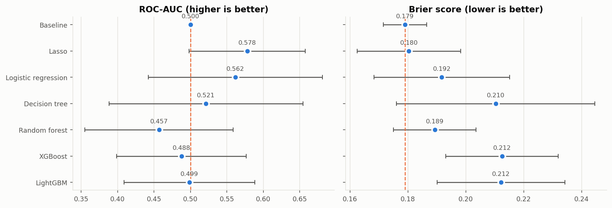

*Mean ± 1 standard deviation over 25 test rounds. Left: ROC-AUC (dashed line = coin toss). Right: Brier score (dashed line = always saying 77%).*

| Model | ROC-AUC | Brier (lower = better) | Failure recall | Failure precision | Failure F1 | Accuracy | Mean P(Success) |
| --- | --- | --- | --- | --- | --- | --- | --- |
| Baseline (always 77%) | 0.500 | **0.179** | 0.00 | 0.00 | 0.00 | 0.77 | 0.77 |
| **Lasso** | **0.578 ± 0.080** | **0.180 ± 0.018** | **0.74** | 0.29 | **0.42** | 0.52 | 0.75 |
| Logistic regression | 0.562 ± 0.119 | 0.192 ± 0.023 | 0.54 | 0.28 | 0.37 | 0.56 | 0.77 |
| Decision tree | 0.521 ± 0.133 | 0.210 ± 0.034 | 0.56 | 0.24 | 0.33 | 0.52 | 0.77 |
| Random forest | 0.457 ± 0.102 | 0.189 ± 0.014 | 0.43 | 0.20 | 0.27 | 0.47 | 0.76 |
| XGBoost | 0.488 ± 0.089 | 0.212 ± 0.019 | 0.34 | 0.22 | 0.26 | 0.57 | 0.79 |
| LightGBM | 0.499 ± 0.090 | 0.212 ± 0.022 | 0.33 | 0.23 | 0.26 | 0.58 | 0.79 |

How to read the measures:
- **ROC-AUC** = the chance that a randomly chosen success gets a higher P(Success) than a randomly chosen failure. 0.5 = coin toss; 1.0 = perfect ranking.
- **Brier score** = average of (P(Success) − outcome)², where outcome is 1 for success and 0 for failure. 0 is perfect; saying 77% for everyone scores 0.179. For example, P = 0.8 costs (0.8 − 1)² = 0.04 if the initiative succeeds, but (0.8 − 0)² = 0.64 if it fails.
- **Failure measures** treat failure as the case to catch:
  - recall: the share of real failures flagged;
  - precision: of those flagged, the share that really failed;
  - F1: combines the two.
- **Accuracy** is misleading here: "always success" scores 77% while catching no failures.
- **Formulas**, with TP = failures flagged, FN = failures missed, FP = successes flagged, TN = successes not flagged:

  ```text
  Recall    = TP ÷ (TP + FN)        Precision = TP ÷ (TP + FP)
  F1        = 2 × Precision × Recall ÷ (Precision + Recall)
  Accuracy  = (TP + TN) ÷ all initiatives
  ```

**Findings:**
- **Lasso is the best of the candidates** on the measures that matter: the highest ROC-AUC, the lowest Brier score of the real models, and the best failure recall and F1. It does not beat the 77% baseline on Brier (next bullet) or the risk-rating benchmark (§5.1b).
- **The tree ensembles are at or below chance (0.46–0.50).** With about 34 failures in each training round, they fit patterns that don't repeat in the test round. This is **overfitting**; the evidence is in §3.1.
- **No model beats the baseline's Brier score.** Lasso ties it: the paired difference is +0.0014, with a 95% range of −0.005 to +0.008.


### 3.1 Overfitting check: training rows against unseen rows (notebook step 5b)

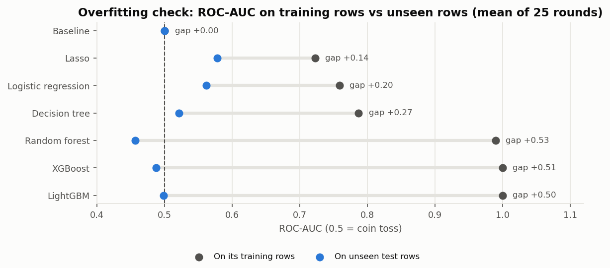

*Each model's ROC-AUC on the 144 rows it was trained on (grey) and on the 36 rows it never saw (blue), averaged over the same 25 rounds. The longer the line, the more the model memorised its training rows.*

**Overfitting** means a model learns quirks of its training rows that don't repeat in new data. It shows as a **gap**: high scores on the rows it trained on, low scores on rows it hasn't seen.

```text
ROC-AUC gap = average ROC-AUC on training rows − average ROC-AUC on test rows
```

| Model | ROC-AUC on training rows | ROC-AUC on unseen rows | Gap | Brier on training rows | Brier on unseen rows |
| --- | --- | --- | --- | --- | --- |
| Baseline | 0.50 | 0.50 | 0.00 | 0.179 | 0.179 |
| **Lasso** | 0.72 | **0.58** | **0.14** | 0.163 | **0.180** |
| Logistic regression | 0.76 | 0.56 | 0.20 | 0.151 | 0.192 |
| Decision tree | 0.79 | 0.52 | 0.27 | 0.141 | 0.210 |
| Random forest | **0.99** | 0.46 | **0.53** | 0.118 | 0.189 |
| XGBoost | **1.00** | 0.49 | **0.51** | 0.046 | 0.212 |
| LightGBM | **1.00** | 0.50 | **0.50** | 0.040 | 0.212 |

**What it shows:**
- **The tree ensembles memorise.** Random forest, XGBoost and LightGBM rank their own training rows almost perfectly (0.99–1.00), then fall to coin-toss level on new initiatives. Their training Brier scores (0.04–0.12) look excellent, which is exactly why a model must never be judged on the rows it learned from.
- **Lasso overfits least** (gap 0.14). Its penalty switches off inputs that don't earn their place, so it learns less noise. That is one reason it scores best on unseen rows.
- **Every gap is above 0,** because some optimism on training rows is normal. The point is the size: a gap of 0.5 means almost everything the model "learned" was noise.

Only the unseen-row scores are used to choose the model (§5). The training scores are shown only to explain why the complex models fail. Table: `outputs/task2/5b_train_vs_test.csv`.
---

## 4. Why we did not balance the classes

| Model | Mean P(Success), unweighted | Mean P(Success), balanced | Brier, unweighted | Brier, balanced | Failure recall, unweighted | Failure recall, balanced |
| --- | --- | --- | --- | --- | --- | --- |
| Lasso | 0.75 | **0.51** | 0.180 | 0.252 | 0.74 | 0.99 |
| Logistic regression | 0.77 | 0.55 | 0.192 | 0.256 | 0.54 | 0.81 |
| Decision tree | 0.77 | 0.58 | 0.210 | 0.263 | 0.56 | 0.80 |
| Random forest | 0.76 | 0.62 | 0.189 | 0.212 | 0.43 | 0.94 |
| XGBoost | 0.79 | 0.67 | 0.212 | 0.238 | 0.34 | 0.59 |
| LightGBM | 0.79 | 0.69 | 0.212 | 0.237 | 0.33 | 0.56 |

The real success rate is 0.77.
- **What balancing does:** it pulls the average predicted success down to 0.51–0.69 and worsens every Brier score.
- **What it buys:** more failures caught, but only because almost everything gets flagged.
- **What it would cost in Task 3:** Expected NPV = P(Success) × NPV would be understated by up to a third for *every* initiative.

This confirms decision M1-15.

---

## 5. Choosing the model for Task 3

| Model | Brier | ROC-AUC | Brier minus lasso (95% range) | AUC not clearly worse | Tied with lasso |
| --- | --- | --- | --- | --- | --- |
| **Lasso** | 0.180 | 0.578 | — | yes | — |
| Logistic regression | 0.192 | 0.562 | +0.011 (+0.005 to +0.018) | yes | no |
| Decision tree | 0.210 | 0.521 | +0.030 (+0.017 to +0.043) | no | no |
| Random forest | 0.189 | 0.457 | +0.009 (+0.004 to +0.014) | no | no |
| XGBoost | 0.212 | 0.488 | +0.032 (+0.025 to +0.040) | no | no |
| LightGBM | 0.212 | 0.499 | +0.032 (+0.023 to +0.041) | no | no |

Rule (decision M1-16):
1. Take the lowest Brier score.
2. Exclude models whose ROC-AUC is more than 0.05 below the best.
3. Prefer a simpler model if its score is tied, which is tested round by round on the same 25 splits.
4. Check the finance criteria (section 5.1 below; directions in section 7.5).

**Lasso wins among the eligible models:** every other one is significantly worse on Brier. Two references tie it: the 77% baseline, which isn't eligible because it can't rank initiatives, and the risk-rating benchmark (§5.1b), which isn't a candidate because it was built after seeing the results.

### 5.1 ML and finance scorecard (notebook step 8b)

| Model | Brier | ROC-AUC (± std) | Failure recall | Average P (real 0.767) | Effect on Expected NPV | Inputs used | Board can read it? | Outcome |
| --- | --- | --- | --- | --- | --- | --- | --- | --- |
| **Lasso** | **0.180** | **0.578 ± 0.080** | **0.74** | 0.748 | Slightly cautious | **7.4** | Yes: odds ratios | **Chosen** |
| Baseline | 0.179 | 0.500 | 0 | 0.767 | Neutral | 0 | Trivial | Not eligible: can't tell initiatives apart |
| Logistic regression | 0.192 | 0.562 ± 0.119 | 0.54 | 0.766 | Neutral | 26 | Partly: 26 weights | Rejected: Brier clearly worse |
| Decision tree | 0.210 | 0.521 ± 0.133 | 0.56 | 0.767 | Neutral | 26 | Yes | Rejected: Brier clearly worse, ROC-AUC lower, unstable |
| Random forest | 0.189 | 0.457 ± 0.102 | 0.43 | 0.761 | Neutral | 26 | No: black box | Rejected: worse than a coin toss at ranking |
| XGBoost | 0.212 | 0.488 ± 0.089 | 0.34 | 0.785 | **Overstates** | 26 | No: black box | Rejected: worse, and over-optimistic |
| LightGBM | 0.212 | 0.499 ± 0.090 | 0.33 | 0.794 | **Overstates** | 26 | No: black box | Rejected: worse, and over-optimistic |

Why each factor matters for a ₹ decision:
- **Brier:** Expected NPV = P(Success) × NPV, so an error in P becomes an error in money.
- **ROC-AUC:** capital is limited, so initiatives must be ranked.
- **Failure recall:** funding a failure loses the investment.
- **Average P against the real rate:** a model that is optimistic on average pushes towards over-funding.
- **Inputs and readability:** the Board must see *why* an initiative is flagged.

Lasso is the only model that does well on all of them. Table: `outputs/task2/8b_model_scorecard.csv`.

### 5.1b Benchmark: the bank's own risk rating (decision M1-22)

To test whether lasso adds anything beyond the rating the bank already has, the same 25 rounds were run with a **risk-rating-only model**: a lookup that predicts each risk level's training success rate (about Low 0.89, Medium 0.69, High 0.70).

| | ROC-AUC | Brier | Failure recall | Capital lift (5.2) |
| --- | --- | --- | --- | --- |
| Lasso (chosen) | 0.578 | 0.180 | 0.74 | 1.27 |
| **Risk rating only (benchmark)** | **0.577** | **0.176** | **0.81** | **1.32** |

**Can lasso separate successes from failures within a risk level?**

| Risk level | Initiatives | Failures | Lasso ROC-AUC within the level |
| --- | --- | --- | --- |
| Low | 64 | 7 | 0.23 |
| Medium | 72 | 22 | 0.54 |
| High | 44 | 13 | 0.28 |

**What it means:**
- The benchmark **ties** lasso. The Brier difference is −0.005, with a 95% range of −0.010 to +0.001.
- Within each risk level lasso ranks no better than chance.
- **The predictive signal in this data is the bank's own risk rating.** Lasso found it and showed the other 25 inputs add nothing reliable. That is the honest ML result.

**Why lasso is still the model passed to Task 3:**
- Lasso was a pre-agreed candidate that picks its inputs *inside* each training round.
- The benchmark was designed *after* seeing that the rating carries the signal, so its score is likely flattering.
- Task 3 shows the Board the decisions from both (M1-23).

Tables: `outputs/task2/8b_model_scorecard.csv`, `8b_within_risk_level.csv`.

### 5.2 In rupees: how much failed capital each model's flag would have caught (notebook step 8c)

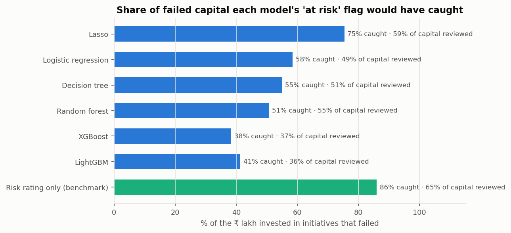

*Share of the capital invested in initiatives that failed, which each model's out-of-fold "at risk" flag would have pointed reviewers at. The label adds how much of all capital it would send to review.*

```text
Share of failed capital caught = Σ investment of failed initiatives flagged ÷ Σ investment of all failed initiatives
Capital lift                   = share of failed capital caught ÷ share of all capital reviewed   (1.0 = random review)
```

| Model | Capital sent to review | Failed capital caught | Capital lift | Failure rate: flagged vs not | Flag points the right way? |
| --- | --- | --- | --- | --- | --- |
| **Lasso** | ₹168.4 crore (59%) | **₹49.4 crore (75%)** | **1.27** | **30.2% vs 13.5%** | **Yes** |
| Logistic regression | ₹140.0 crore (49%) | ₹38.2 crore (58%) | 1.18 | 27.6% vs 19.4% | Yes |
| Decision tree | ₹144.6 crore (51%) | ₹36.0 crore (55%) | 1.08 | 26.4% vs 20.2% | Yes |
| Random forest | ₹156.0 crore (55%) | ₹33.2 crore (51%) | 0.92 | 20.4% vs 26.8% | **No** |
| XGBoost | ₹104.5 crore (37%) | ₹25.1 crore (38%) | 1.04 | 21.1% vs 24.8% | **No** |
| LightGBM | ₹101.6 crore (36%) | ₹27.0 crore (41%) | 1.15 | 22.4% vs 23.9% | **No** |
| *Risk rating only (benchmark)* | *₹184.8 crore (65%)* | *₹56.3 crore (86%)* | *1.32* | *30.2% vs 10.9%* | *Yes* |

- "Out-of-fold" means each initiative is scored by a model that never saw it, so this is an honest replay, not hindsight.
- The baseline is left out: it gives everyone almost the same P, so its flags are noise.
- **What it means for the Board:**
  - Lasso's flag sends reviewers where the money was actually lost: per rupee reviewed, it finds 27% more failed capital than random review.
  - Random forest's flag is worse than random (lift 0.92). The boosted models flag fewer projects, and the ones they flag fail *less* often than the rest.
- This replay is **evidence**, not a new selection rule (M1-21). The model was chosen by the rule in section 5 (M1-16).

---

## 6. Is it better than luck?

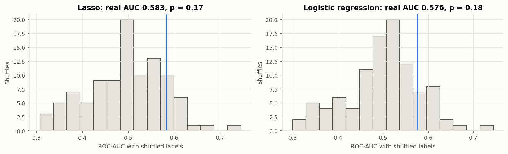

*ROC-AUC of 100 runs with shuffled labels (grey bars) against the real ROC-AUC (blue line).*

| Model | Real ROC-AUC (one 5-fold run) | Shuffled-label 95th percentile | p-value |
| --- | --- | --- | --- |
| Lasso | 0.583 | 0.626 | 0.17 |
| Logistic regression | 0.576 | 0.621 | 0.18 |

On ROC-AUC alone we **cannot rule out luck** at the usual 5% level. Two other pieces of evidence say the signal is weak but real:
- **Lasso beats a coin toss in 21 of the 25 rounds.**
- **Its "at risk" flag separates risk:**

| Out-of-fold result | Initiatives | Actually failed | Failure rate |
| --- | --- | --- | --- |
| Flagged at risk (P(Success) below the base rate, 0.767) | 106 | 32 | **30.2%** |
| Not flagged | 74 | 10 | **13.5%** |

That difference is unlikely to be chance (chi-square p = 0.015: the test compares the observed failures in each group with the number expected if the flag made no difference). **The signal is real, but it is the risk rating's.** Lasso's flag mostly marks the Medium- and High-risk initiatives. Flagging exactly those (the §5.1b benchmark) separates failure rates even more clearly: 30.2% against 10.9%. This matches Task 1, where Low-risk initiatives succeeded 89% of the time against about 70% for the rest.

---

## 7. Which characteristics make success more likely?

Explanations come from one fit of each model on all 180 initiatives. That fit is used only for explanation; every score above came from the test rounds.

### 7.1 Lasso: which inputs it keeps

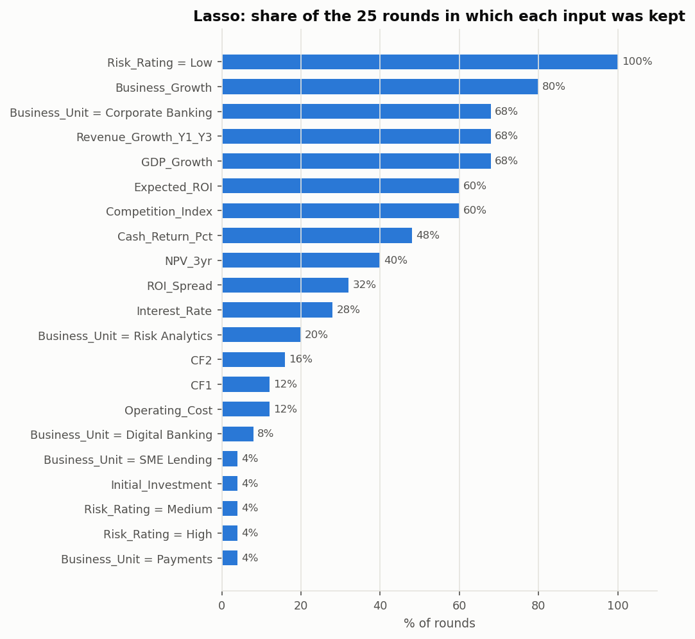

*Share of the 25 training rounds in which lasso kept each input. An input kept almost every time is a stable signal.*

| Input | Kept in rounds | Odds ratio (full fit) | Reading |
| --- | --- | --- | --- |
| Risk_Rating = Low | **100%** | **2.41** | Low risk multiplies the odds of success by about 2.4 |
| Business_Growth | 80% | 1.17 per 1 std (≈ 3 points of growth) | Faster-growing units succeed more |
| Business_Unit = Corporate Banking | 68% | 0.78 | Corporate Banking initiatives succeed less |
| Revenue_Growth_Y1_Y3 | 68% | 1.07 per 1 std | Faster revenue growth helps a little |
| GDP_Growth | 68% | 0.98 per 1 std | Almost no effect |
| Expected_ROI | 60% | 1.10 per 1 std (≈ 4.8 points of ROI) | A higher promised return helps a little |
| Competition_Index | 60% | 0.96 per 1 std | More competition lowers it slightly |

Odds = P ÷ (1 − P). An odds ratio of 2.4 means the odds are 2.4 times higher. For example, odds of 3 to 1 (a 75% chance) become 7.2 to 1 (an 88% chance). On average lasso keeps **7.4 of the 26 inputs** per round; the revenue, cash-flow and investment columns are almost never kept.

**How lasso chooses and ranks its inputs (notebook step 10b-ii).**

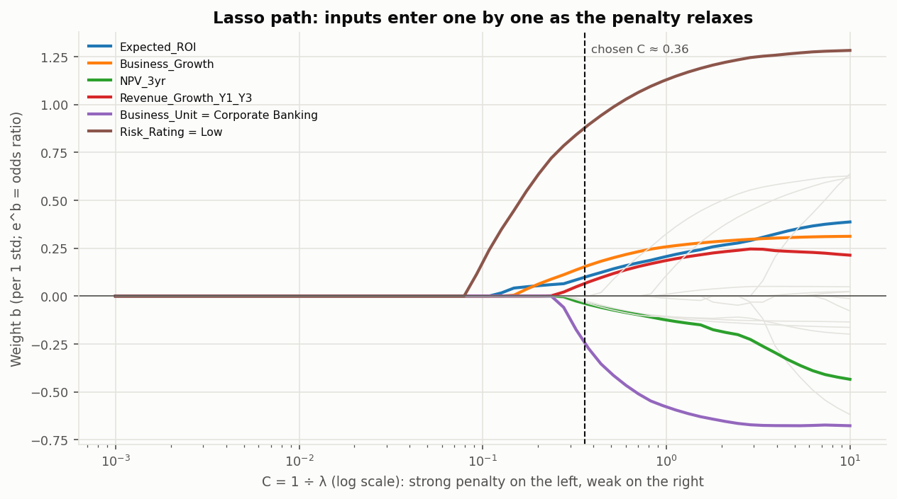

*Each line is one input's weight (per 1 standard deviation) as the penalty relaxes from left to right. Inputs leave zero one at a time, and the order of entry is lasso's priority ranking. The dashed line is the penalty the inner cross-validation chose in 24 of the 25 rounds (C ≈ 0.36).*

- **What lasso minimises:** Σ |weights| + C × Σ log-loss. Each input "costs" its absolute weight, so it is kept only if it cuts the fitting error by more than it costs. Inputs are scaled first so that the cost is fair across ₹ and % inputs.
- **How it decides:** the solver visits the inputs **one at a time** (coordinate descent). An input stays at exactly 0 unless it explains enough of what the model *still* gets wrong.
  - This is why lasso keeps Expected_ROI and drops ROI_Spread: once Expected_ROI is in, the spread adds almost nothing new.
  - Lasso never rotates or mixes inputs, so every weight belongs to a named input the Board can read.
- **Priority (order of entry):**
  1. Risk_Rating = Low;
  2. Expected_ROI;
  3. Business_Growth;
  4. Revenue_Growth_Y1_Y3;
  5. then a group (NPV_3yr, Corporate Banking, Competition_Index).

  At the chosen penalty, about 7 inputs are in.

**Why Expected_ROI enters second but is kept less often than Business_Growth (60% against 80%).** The two rankings measure different things:
- The **path** is drawn once, on all 180 initiatives. There Expected_ROI enters just before Business_Growth (at C = 0.126 against 0.148, almost together).
- The **keep rate** counts how often an input survives across 25 different training sets of 144 initiatives.

Expected_ROI and Business_Growth **move together** (correlation 0.56, Task 1), so they compete for the same information. Lasso tends to keep one of a correlated pair, and small changes in the training rows decide which. Business_Growth wins more often. **Read together:** both carry some signal and neither dominates. **Low risk is the only input that is first on the path *and* kept every time.**

### 7.2 SHAP: how each input pushes each initiative

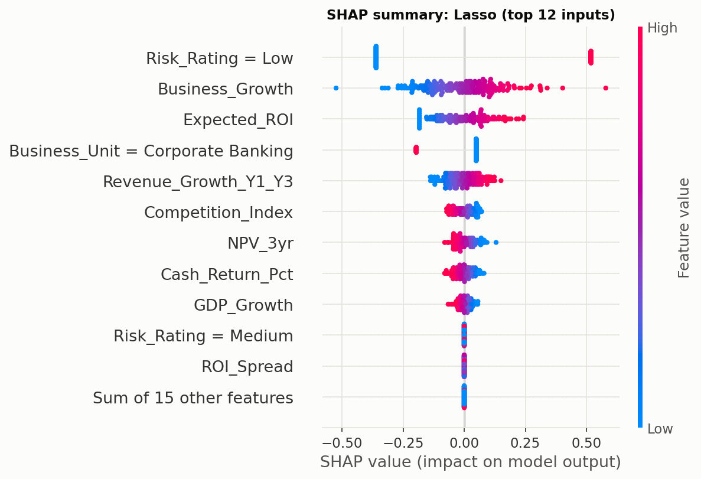

*Each dot is one initiative. The horizontal position is how much that input pushes its predicted success up (right) or down (left), in log-odds. The colour is the input's value, from low (blue) to high (red).*

**Log-odds** = ln(P ÷ (1 − P)), the scale on which logistic regression adds up its inputs. 0 means 50%; +1.23 means about 77%. Each +1 multiplies the odds by about 2.7.

- **Risk_Rating = Low** gives the largest push: about +0.5 for Low-risk initiatives and −0.35 for the rest.
- **Business_Growth, Expected_ROI and Revenue_Growth:** high values (red) sit on the right, so they raise success.
- **Corporate Banking:** being in the unit (red) sits on the left, so it lowers success.
- **Random forest** (the best tree model) ranks Risk_Rating = Low first as well, but its pushes are tiny. That matches its chance-level score.

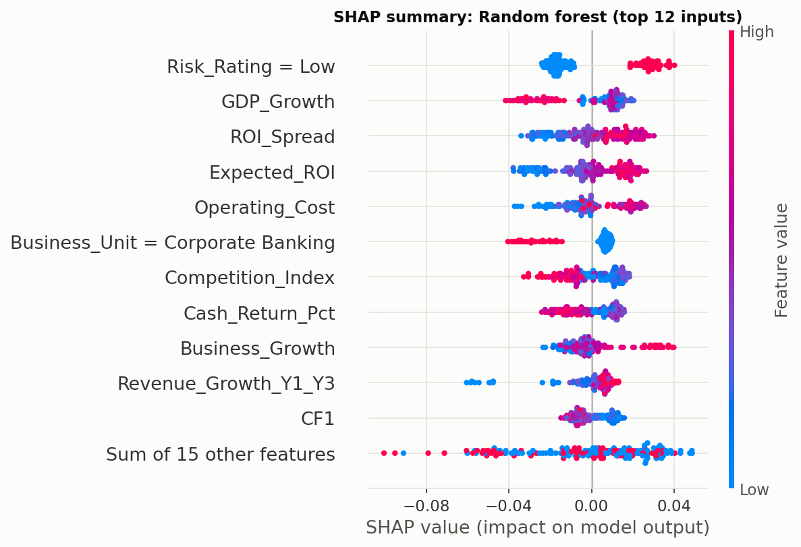

### 7.3 One initiative explained

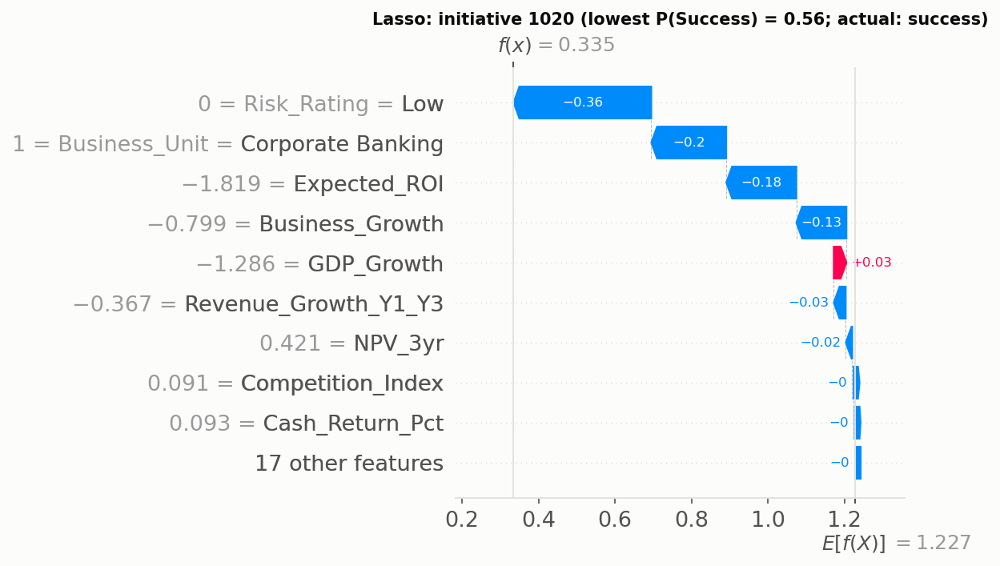

*Initiative 1020 has the lowest predicted chance (0.56). Starting from the average (1.23 in log-odds, about 77%), the chart shows how each input moves it down. Values on the left are in standard units, i.e. (value − average) ÷ standard deviation. For example, Expected_ROI is 1.8 standard deviations below average.*

- **What pulls it down:** it isn't Low risk (−0.36), it's in Corporate Banking (−0.20), its Expected ROI is well below average (−0.18), and so is its business growth (−0.13).
- **It actually succeeded.** A 56% chance still means more likely to succeed than not: the model gives probabilities, not certainties.

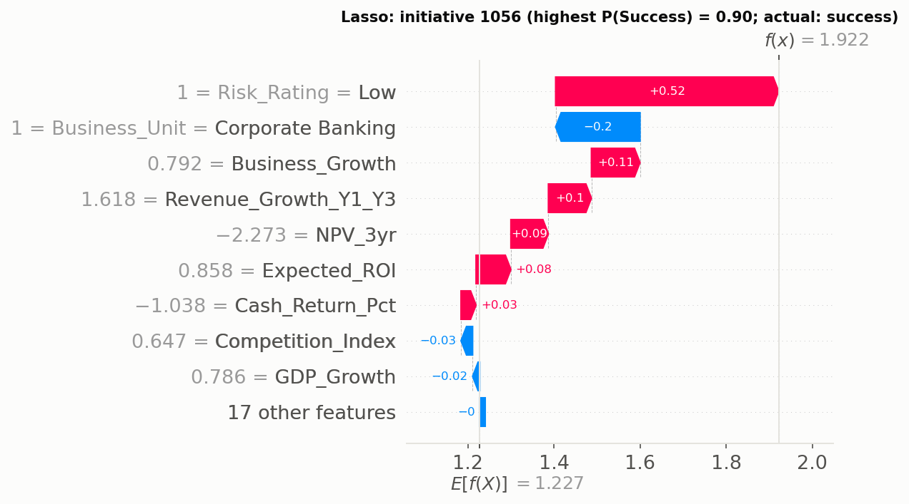

*Initiative 1056 has the highest predicted chance (0.90). The same reading as above, but the inputs push it up.*

- **What pushes it up:** it is Low risk (+0.52), its business unit is growing fast (+0.11), its revenue rises steeply (+0.10), and its Expected ROI is above average (+0.08).
- **It is also in Corporate Banking (−0.20)**, like 1020. The two charts show the model's logic in one picture: **Low risk outweighs the Corporate Banking penalty.** The rating decides most of the difference between the most and least promising initiatives.
- **Why the chart ends at 1.92 (about 0.87) while the title says 0.90.** The bars come from the single explanation fit on all 180 initiatives. The 0.90 is the out-of-fold probability passed to Task 3, the average of 5 models that never saw 1056. The two are close but not identical, by design: explanations use all the data, while scores and decisions use only unseen-data predictions.

### 7.4 Logistic regression with all 26 inputs (for comparison)

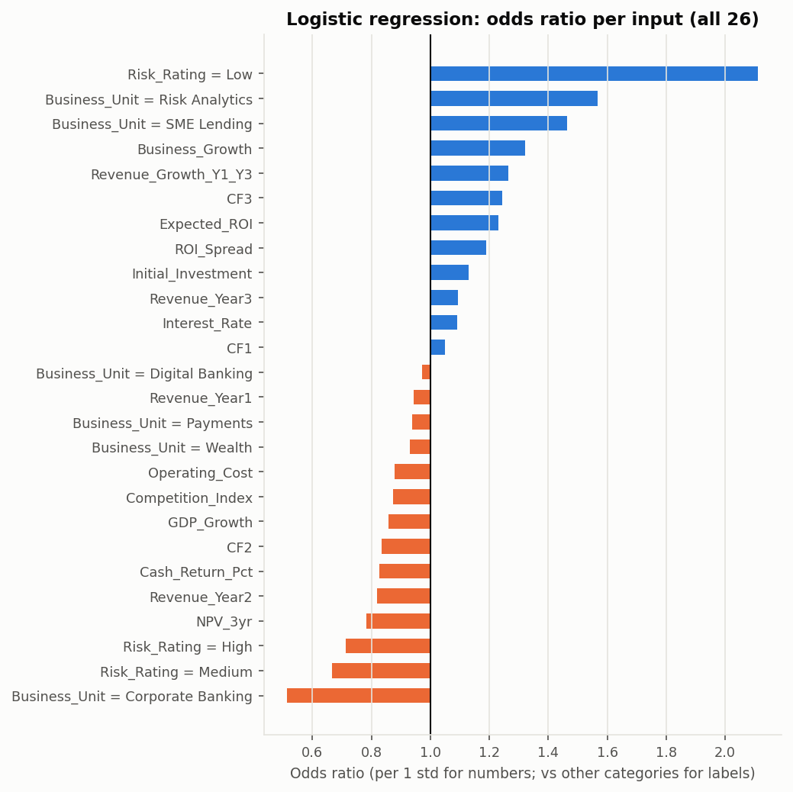

*Odds ratio of each of the 26 inputs in plain logistic regression. Above 1 (blue) raises the odds of success; below 1 (orange) lowers them.*

The same leaders appear: Low risk (2.1), Corporate Banking (0.52), Business_Growth, Expected_ROI and Revenue_Growth.

Many inputs repeat each other, e.g. CF1 = Revenue_Year1 − Operating_Cost. So their individual odds ratios can't be read on their own, and some of them have signs that look odd. This is one more reason lasso, which drops the duplicates, is easier to explain.

**Finance check (M1-16).** The main directions make financial sense: lower risk, faster growth and a higher promised return all raise success, and the weakest unit lowers it. A few small effects run against intuition: NPV_3yr, Cash_Return_Pct and GDP_Growth are slightly negative.
- **NPV_3yr and Cash_Return_Pct** are kept in fewer than half the rounds (40% and 48%): weak, likely noise.
- **GDP_Growth** is kept more often (68%), but its effect is tiny (odds ratio 0.98 per standard deviation, about 2%) and runs against expectation, so we don't treat it as a driver.

Stability labels used throughout (step 10e): kept in ≥ 80% of rounds = stable; 50–79% = moderate; below 50% = weak. A driver needs a moderate-or-better keep rate **and** an effect large enough to matter.

### 7.5 What drives success, ranked (notebook step 10e)

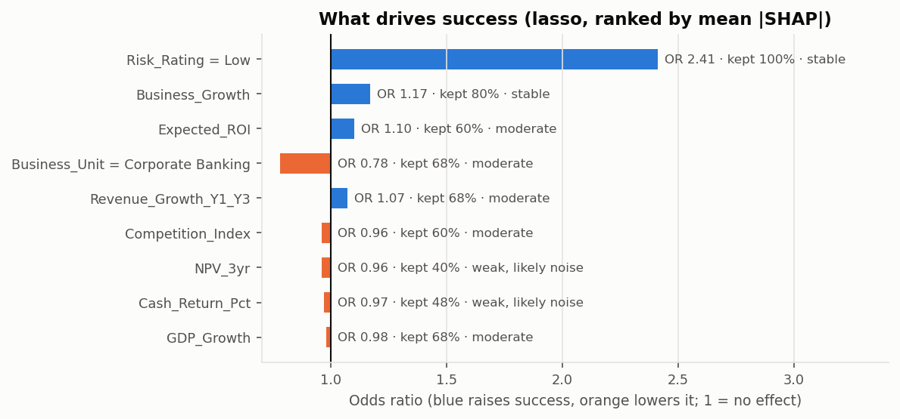

*Lasso odds ratio for each input it uses, ranked by how much the input moves predictions (mean |SHAP|). Blue raises success and orange lowers it. The label shows how often lasso kept the input across the 25 rounds.*

| Rank | Input | Direction | Lasso OR | Kept in rounds | Logistic OR | Random forest SHAP rank | Makes financial sense? | What it means for the bank |
| --- | --- | --- | --- | --- | --- | --- | --- | --- |
| 1 | **Risk_Rating = Low** | Raises | **2.41** | 100% (stable) | 2.11 | 1 | Yes | Strongest lever: favour low-risk initiatives, or de-risk them (pilot, phased funding) before approving |
| 2 | **Business_Growth** | Raises | 1.17 | 80% (stable) | 1.32 | 9 | Yes | Initiatives in fast-growing businesses succeed more often |
| 3 | Expected_ROI | Raises | 1.10 | 60% | 1.23 | 4 | Yes | A higher planned return goes with success; ask for a credible ROI case |
| 4 | Business_Unit = Corporate Banking | Lowers | 0.78 | 68% | 0.52 | 6 | No prior | Extra review and tighter milestones for this unit |
| 5 | Revenue_Growth_Y1_Y3 | Raises | 1.07 | 68% | 1.27 | 10 | Yes | Faster revenue plans succeed slightly more often |
| 6 | Competition_Index | Lowers | 0.96 | 60% | 0.87 | 7 | Yes | Crowded markets lower success slightly |
| 7 | NPV_3yr | Lowers (tiny) | 0.96 | 40% (weak) | 0.78 | 14 | No | Noise: a high paper NPV does not predict success |
| 8 | Cash_Return_Pct | Lowers (tiny) | 0.97 | 48% (weak) | 0.83 | 8 | No | Noise |
| 9 | GDP_Growth | Lowers (tiny) | 0.98 | 68% | 0.86 | 2 | No | Tiny effect against expectation; the unit's own growth matters more |

Lasso and plain logistic regression agree on the direction of every input. Random forest also ranks Low risk first.

**What this means:**
- A Low risk rating moves a typical initiative from about **77% to about 89%** chance of success: odds 3.3 × 2.4 ≈ 7.9, and P = 7.9 ÷ 8.9. That is the same as the 89% seen in Task 1.
- The levers the bank **controls** are the risk it accepts, the ROI case it demands, and how closely it reviews weaker units.
- It can only **select for** growth, competition and the economy. It can't change them.

**Cautions:**
- These are associations, not causes.
- The overall signal is weak (ROC-AUC 0.58).
- A strong NPV on paper does **not** predict success. Task 3 uses NPV to value the outcome, not to predict whether the initiative succeeds.

**The business reasoning behind each driver, for the Board** (notebook step 10e). Where the data can't prove a cause, the reasoning is marked as a hypothesis to check.

| Driver | Why it makes business sense | Evidence in our data | What the Board can do |
| --- | --- | --- | --- |
| **Low risk** | Fewer unknowns in execution, technology and regulation | 89% succeed against 69–70% for the rest (Task 1, p = 0.014). Low risk also has the highest median ROI (12.0% against 8.3% for High), so there is no trade-off | Screen on risk first. Medium/High-risk projects need a closer look before money is committed, for example a pilot (how Task 3 treats them: Task 3 report §2) |
| **Business_Growth** | A growing line of business gives demand and cross-selling | Strongest link to Expected ROI (r = 0.56) | Prioritise initiatives in growing lines; test the growth assumption |
| **Expected_ROI** | A higher return is a margin of safety against overruns | Second to enter the lasso path; logistic OR 1.23 | Ask for an ROI case with downside scenarios |
| **Corporate Banking** | Hypothesis: large, bespoke, few-client projects with long sales cycles | Lowest success (63%) and the most capital (₹62.3 crore). Its High-risk share (17%) is among the lowest, so risk doesn't explain it. Not statistically firm (p = 0.36) | Tighter milestones and a review of past failures; don't cut the unit |
| **Revenue growth Y1→Y3** | A rising revenue path is evidence of real demand | OR 1.07; kept in 68% of rounds | Check the path against pipeline or pilot data |
| **Competition_Index** | Crowded markets squeeze price and take-up | OR 0.96; kept in 60% of rounds | Ask how the initiative will win |
| **NPV_3yr, Cash_Return_Pct, GDP_Growth** | 3-year NPV is negative for 172 of 180 and measures payback speed, not delivery. Plans are sponsors' projections. GDP affects every unit alike | Tiny effects against intuition, unstable | Don't read a strong-looking business case as a sign of success. Value it separately (Task 3) |

---

## 8. Are the probabilities right?

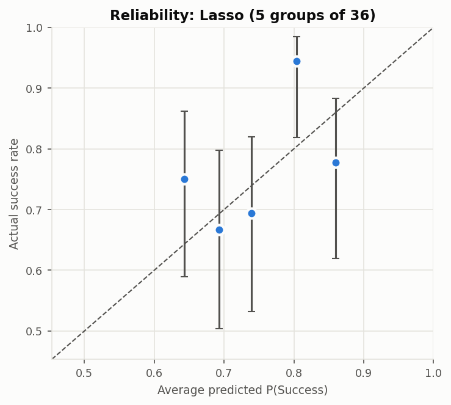

*Average predicted P(Success) against the actual success rate, in 5 groups of 36. The vertical bars are 95% ranges; the dashed line is perfect agreement.*

| Group (by predicted P) | Average predicted | Actual success rate (95% range) |
| --- | --- | --- |
| 1 (lowest) | 0.64 | 0.75 (0.59–0.86) |
| 2 | 0.69 | 0.67 (0.50–0.80) |
| 3 | 0.74 | 0.69 (0.53–0.82) |
| 4 | 0.80 | 0.94 (0.82–0.99) |
| 5 (highest) | 0.86 | 0.78 (0.62–0.88) |

The points scatter around the diagonal. Four of the five 95% ranges cover it; group 4's range sits a little above it. With groups of 36 there is no consistent bias to correct, so we don't recalibrate. But the scatter also shows the probabilities carry limited information beyond about 77%.

---

## 9. What goes to Task 3

- **File:** `outputs/task2/FINAL_M1_T2_success_probability.csv`.
- **Contents:** for each initiative, lasso's out-of-fold P(Success), i.e. the average of its 5 predictions, each made when that initiative was in the test round. Plus the At_Risk flag.
- **Spread:** 0.56 to 0.90. Median 0.74; the middle half lies between 0.68 and 0.82.
- **What this means for Task 3:** these probabilities are only as accurate as a flat 77%, so Task 3 should test how much its decisions depend on them (done in Task 3 report §6).

---

## 10. Risks and limitations

- **Weak signal.** ROC-AUC 0.58, and the shuffled-label check gives p = 0.17. The model is a warning sign, not a forecast to rely on alone.
- **The model's signal is the bank's own risk rating.** A lookup on Risk_Rating alone ties lasso (§5.1b), and within a risk level lasso ranks no better than chance. So the model mainly confirms and quantifies the rating; it doesn't add new information. Better prediction would need **new kinds of input** that tell projects of the same rating apart (e.g. sponsor track record, delivery milestones), not a more complex model.
- **Only 180 initiatives and 42 failures.** All measures have wide ranges (± 0.08 on ROC-AUC). More history would help more than a more complex model.
- **Synthetic data.** Relationships may be simpler, or noisier, than in real life.
- **Out-of-fold probabilities come from models trained on 144 rows.** A model trained on all 180 would differ slightly, but scores for such a model can't be checked honestly, so we pass on the out-of-fold ones.
- **Correlation, not causation.** For example, Low risk *goes with* success. Relabelling a project as Low risk would not make it succeed.
- **Inputs are projections made at proposal time** (decision M1-13). If they were actual results, using them would be leakage.
