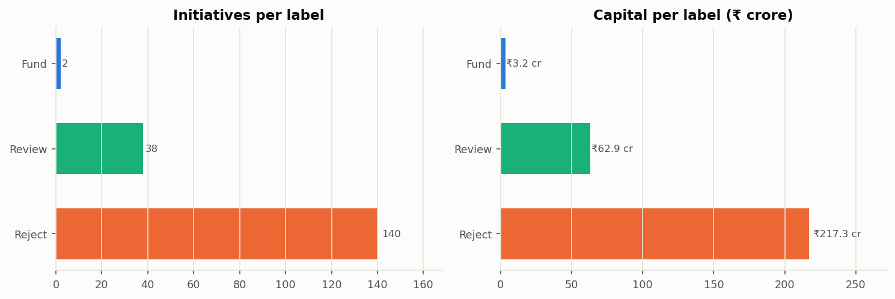
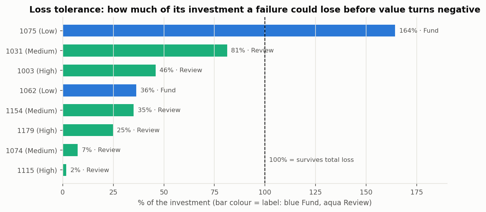
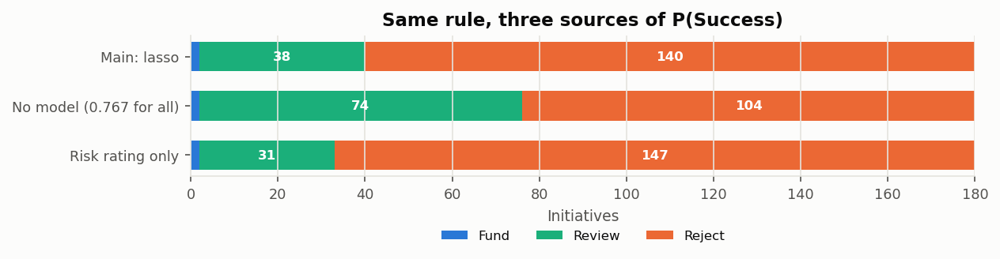

# Module 1 — Task 3 Report: Financial decision

**Brief (verbatim):**
> **Task 3: Financial decision**
> Students should calculate an approximate project NPV and expected NPV and final decision classifying as whether to fund (High expected value and acceptable risk), review (Potentially attractive but significant uncertainty) and reject (Low expected value or excessive risk).
> Expected NPV = P(Success) × NPV

**Where this sits in the chain:** Data → ML Prediction → **Financial Metric → Risk Assessment → Business Decision**. Task 2's P(Success) becomes an input to Expected NPV; finance and risk checks then decide.

| Item | Where |
| --- | --- |
| Code and outputs | `notebooks/m01_task3_decision.ipynb`: runs on its own (after Task 2 has run once) or from `run_module_1.ipynb` |
| Input from Task 2 | `outputs/task2/FINAL_M1_T2_success_probability.csv` (lasso's out-of-fold P(Success), At_Risk) |
| Helpers used | `helpers/m01_data.py` (data, derived columns, NPV), `helpers/m01_finance.py` (break-even life, hurdle), `helpers/m01_style.py` |
| Main output (hand-off to Module 9) | `outputs/task3/FINAL_M1_T3_initiative_decisions.csv`: one row per initiative, with every number behind its decision |
| Decisions | M1-02 to M1-06 (M1-06 points A–F), M1-20, M1-23 in `docs/decisions.md` |

All money is in ₹ lakh unless stated (100 lakh = ₹1 crore).

---

## 1. Summary for the Board

**The finance case**
1. **On 3 years of cash, almost nothing repays itself.** Only 8 of the 180 initiatives have a positive NPV (today's value of the cash they bring in, minus what they cost). Only those 8 can have a positive Expected NPV.
2. **Fund now: 2 initiatives, ₹3.2 crore.**
   - **1075** (Wealth, Low risk): Expected NPV +48.2 lakh. It stays worth funding even if a failure loses everything, so it is **funded in full**.
   - **1062** (Corporate Banking, Low risk): Expected NPV +7.8 lakh, but worth it only if a failure loses no more than about 36% of the money, so it is **funded in stages**.
3. **Review next: 38 initiatives, up to ₹62.9 crore**, in two priority lists.
   - **6 value-creating but riskier projects.** 1074 and 1115 have almost no margin for failure.
   - **32 "slow payers"** that repay in year 4 or 5, beat their cost of money and are not flagged at risk.
4. **Reject: 140 initiatives**, each with a one-line reason. 96 pay back too late or never, 8 promise less than their cost of money, and **36 pass every finance check but are rejected because the model flags them at risk**. This is the one place the model decides a label (§3).
5. **For Module 9:** strategic initiatives can use at most about **₹66 crore of the ₹1,000 crore** (Fund plus every Review project). The rest must be allocated to other businesses.

**The ML case**
1. The model's P(Success) feeds Expected NPV, loss tolerance and the order of the lists. It **changes labels in one place only**: the gate that decides which slow payers reach Review.
2. **What the ML adds, measured** (same rule, three sources of P):
   - **Fund is identical in every run.**
   - With **no model**, Review would hold 74.
   - With the **bank's risk rating alone**, 31.
   - **With lasso**, 38.
3. **Why the difference is small.** Task 2 showed lasso cannot rank projects within a risk level better than chance. Its 7 extra Review places are a cheap addition (reviewer time, not capital), not evidence-backed picks. The model's real effect is keeping 36 riskier slow payers out of Review, and the bank's own rating does almost the same.

**Decision:** fund 1075 in full and 1062 in stages; review the 38 in the order given; reject the 140 with the reasons stated.

---

## 2. How each decision is made

### 2.1 The money measures

```text
Cash flow in year t:  CFt = Revenue_Year t − Operating_Cost                              (M1-01)
NPV:                  −Initial_Investment + CF1 ÷ (1 + r) + CF2 ÷ (1 + r)² + CF3 ÷ (1 + r)³
                      r = the row's Interest_Rate ÷ 100 (the cost of money, M1-02); 3 years of data (M1-03)
Expected NPV:         P(Success) × NPV                                                    (brief's formula)
Break-even life:      years of cash flow needed for NPV to reach 0; after year 3 the year-3 cash flow repeats   (M1-04)
Hurdle:               passes when Expected_ROI > Interest_Rate                            (M1-05)
```

**Worked example, 1075:** NPV +55.57, P(Success) 0.867, so Expected NPV = 0.867 × 55.57 = +48.2 lakh.

### 2.2 The rule (decision M1-06, agreed point by point)

```text
NPV > 0 and Risk_Rating = Low                                      →  FUND     "high expected value and acceptable risk"
NPV > 0 but Medium or High risk                                    →  REVIEW   "attractive but significant uncertainty" (risk)
NPV ≤ 0 but break-even ≤ 5 years AND passes the hurdle
        AND P(Success) ≥ 0.767 (not flagged "at risk")             →  REVIEW   "attractive but significant uncertainty" (payback)
everything else                                                    →  REJECT   "low expected value or excessive risk"
```

| Point | Choice | Why |
| --- | --- | --- |
| A | A gate rule | Each label traces to one phrase of the brief, and every decision is explainable in one line. Alternatives rejected: Expected NPV bands (for losses a higher P ranks *worse*), a weighted score (arbitrary weights), filling the budget (₹1,000 crore exceeds the ₹283 crore requested) |
| B | Fund needs **Low** risk | Medium fails as often as High (69% against 70%) and loses as much capital (30% against 32%). Low succeeds 89% and loses 9% (Task 1, p = 0.014). It is also lasso's main finding |
| C | Slow payers need P ≥ 0.767 | The same "at risk" line as Task 2. A wrong pass costs reviewer time, not capital |
| D | Break-even within 5 years | Only 2 assumed years beyond the data; the median break-even life; a common payback threshold |
| E | Loss tolerance sets the funding condition | Covers the downside the brief's formula ignores, without guessing a recovery rate |
| F | Ordered lists and a reason for every initiative | A priority list for the Board and Module 9, and an audit trail |

---

## 3. Results



*Initiatives and capital in each label. Blue = Fund, aqua = Review, orange = Reject.*

| Label | Initiatives | Capital | Expected NPV (sum) | Average P(Success) | Past success (backtest) |
| --- | --- | --- | --- | --- | --- |
| **Fund** | 2 | ₹3.2 crore (1%) | +56.0 lakh | 0.83 | 1 of 2 |
| **Review** | 38 | ₹62.9 crore (22%) | −1,006.6 lakh | 0.81 | 84% |
| **Reject** | 140 | ₹217.3 crore (77%) | −8,931.1 lakh | 0.73 | 75% |

- **Past success** is how often these same initiatives actually succeeded. It is a consistency check on the rule, not proof of future results.
- Review's 84% is clearly above Reject's 75%.
- Fund has only 2 projects, so its 1-of-2 says nothing either way.
- Review's Expected NPV is negative because 32 of its 38 projects are slow payers whose value arrives after year 3. That is exactly why they are in Review and not in Fund.

**Why the 140 were rejected:**

| Reason | Initiatives |
| --- | --- |
| Breaks even only after 5 years | 79 |
| Never breaks even | 17 |
| Fails the hurdle (Expected_ROI ≤ Interest_Rate) | 8 |
| Passes every finance check but flagged at risk by the model | 36 |

**The 36 the model rejects.** These initiatives pass every finance check (break-even within 5 years, hurdle passed) but are flagged at risk by the model.
- **All are Medium or High risk** (25 Medium, 11 High). The bank's rating alone would hold back the same kind.
- **This is the one place the model decides a label.** We kept this deliberately (decision M1-06, point C): Review is a closer look, and reviewer time is limited.
- **The alternative is shown in the "no model" run (§6).** Reviewing all of them would take Review from 38 to 74, at a lower historical success rate (76% against 84%).

### 3.1 Decisions by business unit and risk level (notebook step 7b)

| Business unit | Fund | Review | Reject | Review capital | Reject capital |
| --- | --- | --- | --- | --- | --- |
| Corporate Banking | 1 | 7 | 27 | ₹14.8 crore | ₹46.5 crore |
| Digital Banking | 0 | 7 | 27 | ₹9.3 crore | ₹37.8 crore |
| Payments | 0 | 7 | 29 | ₹10.1 crore | ₹43.2 crore |
| Risk Analytics | 0 | 7 | 18 | ₹11.5 crore | ₹28.3 crore |
| SME Lending | 0 | 2 | 13 | ₹4.2 crore | ₹18.1 crore |
| Wealth | 1 | 8 | 26 | ₹13.1 crore | ₹43.3 crore |

Each unit gets a similar number into Review (2–8 initiatives); Corporate Banking and Wealth have one Fund project each.

| Risk level | Fund | Review | Reject | Review capital | Reject capital |
| --- | --- | --- | --- | --- | --- |
| Low | 2 | 25 | 37 | ₹40.3 crore | ₹55.1 crore |
| Medium | 0 | 9 | 63 | ₹15.2 crore | ₹104.3 crore |
| High | 0 | 4 | 40 | ₹7.5 crore | ₹57.9 crore |

Fund is entirely Low risk (rule point B), and Review is mostly Low risk (25 of 38).

37 Low-risk initiatives (₹55.1 crore) are rejected **on value, not risk**: 29 break even only after 5 years, 4 never do, and 4 fail the hurdle. None is rejected by the model. (Why a likely success can still be a reject: module report.)

Tables: `outputs/task3/7b_by_unit.csv`, `7b_by_risk.csv`.

---

## 4. Loss tolerance: covering the downside (point E)



*How much of its investment each positive-NPV initiative could lose on failure before its expected value turns negative. The dashed line at 100% means it survives total loss.*

The brief's Expected NPV treats a failure as costing nothing. Rather than guess the real loss, we solve for the largest loss each project can bear:

```text
Loss tolerance  L* = P × NPV ÷ ((1 − P) × Investment)
1062: 0.79 × 9.86 ÷ (0.21 × 103.26) = 0.36  → worth it only if a failure loses ≤ 36% of the money
```

| Initiative | Risk | Label | Expected NPV | Loss tolerance | Meaning |
| --- | --- | --- | --- | --- | --- |
| 1075 | Low | Fund | +48.2 | **164%** | **Fund in full**: survives even total loss |
| 1062 | Low | Fund | +7.8 | **36%** | **Fund in stages**: release money at milestones so the amount at risk stays below what it can afford to lose |
| 1031 | Medium | Review | +40.1 | 81% | Fairly robust |
| 1003 | High | Review | +27.7 | 46% | Moderate |
| 1154 | Medium | Review | +20.2 | 35% | Thin |
| 1179 | High | Review | +20.3 | 25% | Thin |
| 1074 | Medium | Review | +4.7 | **7%** | Needs near-certain success |
| 1115 | High | Review | +1.3 | **2%** | Needs near-certain success |

**Link to the ML:** the thinner the margin, the more the decision rests on P(Success) being right. Task 2 found the probabilities only as accurate as a flat 77%, so thin-margin projects are where the Board should be most careful.

---

## 5. Priority lists

| List | Order | First entries |
| --- | --- | --- |
| Fund | Expected NPV | 1075, 1062 |
| Review group 1 (positive NPV, Medium/High risk) | Loss tolerance, most robust first | 1031, 1003, 1154, 1179, 1074, 1115 |
| Review group 2 (slow payers) | Break-even year, then P(Success) | 15 that repay in year 4 (led by 1021, Digital Banking, Low risk), then 17 in year 5 |

Slow payers are not ranked by Expected NPV: their NPV is negative, so a higher P would push the likeliest successes to the bottom. Full lists: `outputs/task3/FINAL_M1_T3_initiative_decisions.csv`.

---

## 6. Sensitivity 1: what the ML adds (decisions M1-20, M1-23)



*The same rule run three times, changing only where P(Success) comes from.*

| Run | P(Success) | Fund | Review | Reject | Review past success | Decisions different from main |
| --- | --- | --- | --- | --- | --- | --- |
| **Main: lasso** | Task 2's out-of-fold probability | 2 | 38 | 140 | 84% | — |
| No model | 0.767 for everyone | 2 | 74 | 104 | 76% | 36 |
| Risk rating only | Low 0.89, Medium 0.69, High 0.70 | 2 | 31 | 147 | 84% | 7 |

**What it shows:**
- **Fund doesn't depend on the model.** P is always above 0, so it never changes the sign of Expected NPV.
- **Without any model, the slow-payer gate stops filtering.** The gate is "P(Success) ≥ 0.767". With no model, every initiative gets P = 0.767 exactly, so every one passes. All 68 finance-qualified slow payers then reach Review, making 74 with the 6 positive-NPV projects, and they succeeded only 76% of the time, no better than average. A prediction (or at least the risk rating) is needed here.
- **The bank's own risk rating does almost the same job as lasso:** 31 against 38 in Review, with the same 84% past success. The 7 extra are Medium/High projects that lasso rates just above the line. Task 2 showed it can't rank within a risk level, so they are not evidence-backed, but including them costs only reviewer time.
- **The honest message for the Board:** the ML was done properly and is used where the brief puts it. Its value here is confirming and quantifying the bank's own risk rating, not finding new signal.

---

## 7. Sensitivity 2: the break-even cut-off (point D)

| Cut-off | Years assumed beyond the data | Fund | Review (slow payers) | Reject | Review capital |
| --- | --- | --- | --- | --- | --- |
| 4 years | 1 | 2 | 21 (15) | 157 | ₹33.0 crore |
| **5 years** | **2** | **2** | **38 (32)** | **140** | **₹62.9 crore** |
| 6 years | 3 | 2 | 47 (41) | 131 | ₹77.6 crore |

A more cautious Board (4 years) cuts the Review list from 38 to 21; a more patient one (6 years) adds 9 projects. Fund never changes.

---

## 8. Hand-off to Module 9

- **Fund:** ₹3.2 crore, with funding conditions: 1075 in full, 1062 in stages.
- **Review:** up to ₹62.9 crore, in priority order. This is an upper bound; a project only receives money if the review approves it.
- **Ceiling for strategic initiatives:** about ₹66 crore, 6.6% of the ₹1,000 crore.
- **File:** `outputs/task3/FINAL_M1_T3_initiative_decisions.csv`, the Board decision file (notebook step 10b). For every initiative it shows **every check** behind the decision, not just the deciding one: value (NPV, Expected NPV), risk, payback, hurdle, the model's flag and loss tolerance, with the decision path, funding condition, priority and a full reason. No blank cells and no codes.

**Column guide for `outputs/task3/FINAL_M1_T3_initiative_decisions.csv`** (one row per initiative; no blank cells; no codes):

| Column | What it shows | Example (1021) |
| --- | --- | --- |
| Initiative_ID, Business_Unit, Risk_Rating | Who it is | 1021, Digital Banking, Low |
| Investment (₹ lakh) | Money requested | 195.20 |
| NPV 3 years (₹ lakh) | Today's value of 3 years of cash, minus the investment | −39.28 |
| P(Success) | The model's out-of-fold probability of success | 0.8868 |
| Expected NPV (₹ lakh) | P(Success) × NPV, the brief's value measure | −34.83 |
| Check: value | Is NPV positive? | Not positive: NPV −39.3, Expected NPV −34.8 |
| Check: risk | Is the risk acceptable for Fund (Low only)? | Low: acceptable for Fund |
| Check: payback | Break-even year against the 5-year limit | Year 4: within the 5-year limit |
| Check: hurdle | Does the promised return beat the cost of money? | Pass: Expected_ROI 10.5% > cost of money 6.0% |
| Check: model | Is it flagged "at risk" (P(Success) below 0.767)? | Not at risk: P(Success) 0.89 ≥ 0.767 |
| Check: loss tolerance | How much a failure could lose before value turns negative (positive NPV only) | Not applicable: NPV not positive |
| Decision | Fund / Review / Reject | Review |
| Decision path | Which route of the rule it took, in words | Review: slow payer (pays back within 5 years) |
| Funding condition | Fund in full / in stages; otherwise why it doesn't apply | Not applicable: decided after review |
| Priority | Position in its list | Review group 2 (slow payers): #1 of 32 |
| Full reason | The deciding factor first, then the other checks | Review (slow payer): NPV −39.3 over 3 years … but pays back in year 4, passes the hurdle and is not flagged by the model … |

The money columns stay numeric and complete, so Module 9 can add them up.

---

### Module 9 inputs: return and risk per ₹, by business unit (decision M1-24; notebook step 10c)

**Why:** Module 9 compares every business on the same fields. Module 1's data has investment, revenue and costs by business unit, so it gives Digital banking, Payments and Wealth a return per ₹ of capital that no other file has.

**How:** return per ₹ a year is the internal rate of return (the yearly rate at which the money put in and the cash coming back balance out), over Module 1's 5-year payback limit (years 4–5 repeat year 3). Each initiative's cash is weighted by its P(Success); **a failed initiative returns no cash**. The bad case is the 1-in-20 outcome of which initiatives succeed (2,000 random draws, seed 42).

| Business unit (Fund + Review initiatives) | Initiatives | Capacity (₹ crore) | Expected return a year | 1-in-20 bad case | If all succeed |
| --- | --- | --- | --- | --- | --- |
| Corporate Banking | 8 | 15.8 | **6.3%** | -6.1% | 14.3% |
| Digital Banking | 7 | 9.3 | **13.2%** | -6.6% | 22.3% |
| Payments | 7 | 10.1 | **13.0%** | -2.1% | 18.8% |
| Risk Analytics | 7 | 11.5 | **10.4%** | -5.4% | 18.5% |
| SME Lending | 2 | 4.2 | **13.3%** | -1.4% | 25.9% |
| Wealth | 9 | 15.3 | **17.6%** | 3.6% | 27.7% |
| All units | 40 | 66.2 | **12.1%** | 5.9% | 20.8% |

- **Deployable initiatives earn about 12.1% a year**, above the 6.8% risk-free rate, with a 1-in-20 bad case of 5.9%.
- **Wealth is strongest** (17.6%, and positive even in the bad case); Corporate Banking weakest (6.3%).
- **All 180 initiatives together would earn -3.6% a year:** the rejected ones lose money in every unit, confirming Module 1's rejections on a return-per-₹ basis.
- **Evidence is weak** (P(Success) model ROC-AUC 0.58; cash after year 3 assumed), and the money is locked in for about 5 years. Module 9 should treat these as small, staged commitments.

## 9. Risks and limitations

- **3-year NPV** (M1-03) makes almost every project negative. Break-even life and the Review label exist to stop good slow payers being lost, but anything beyond year 3 is an assumption (the year-3 cash flow repeated).
- **The brief's Expected NPV ignores the cost of failure.** Loss tolerance covers this without guessing, but the true loss on failure is unknown.
- **P(Success) is weak.** It is only as accurate as a flat 77%, and its ranking comes from the risk rating (Task 2, M1-22). Decisions that depend on it (the 36 "flagged at risk" rejections and the 7 extra Review places) should be read with that in mind. Section 6 shows the alternatives.
- **The backtest uses the same initiatives** whose outcomes are known, so it checks consistency, not future performance.
- **The thresholds are judgement calls:** Low risk only, 5 years, the 0.767 gate. Each is stated, justified and tested where it matters (sections 6–7).
