# Module 2 — Credit Risk: Corporate and Retail Lending

## Final report

**The business problem (brief, verbatim):**
> NovaFin wants to increase lending while reducing defaults.
> Management asks:
> Which loans should we approve, reject or send for manual review?

**The three tasks (brief, verbatim):**
> **Task 1: Predict Probability of Default.** Target: Default_Flag. Build models, evaluate performance
>
> **Task 2: Estimate PD.** For every borrower: PD = P(Default = 1 ∣ X). Generate: Loan_ID · Predicted_PD · Risk_Category. Suggested categories: <5% Low · 5–15% Medium · 15–30% High · >30% Very High. These thresholds are illustrative and should be justified rather than blindly adopted.
>
> **Task 3: Expected Credit Loss.** Assume: ECL = PD × LGD × EAD. For example, students may assume: LGD = 40% and: EAD = Loan Amount. Then calculate: ECLᵢ = PDᵢ × 0.40 × LoanAmountᵢ. **Final decision.** Recommend: Approve / Review / Reject based on: PD · ECL · borrower characteristics · loan size · collateral · risk appetite

**Data:** `nova_loans.csv`, 5,000 loans (Retail and Corporate). Money is in plain rupees, shown in lakh or crore (1 lakh = ₹1,00,000; 1 crore = ₹1,00,00,000 = 100 lakh). Rates are % a year.

**How to read this report.** Each section opens with its conclusion, so you can stop at any depth. Every number comes from a notebook output in `outputs/`. Every term is defined where it is first used, and the glossary at the end collects them all.

| Item | Where |
| --- | --- |
| **Final output (open this first)** | **`outputs/FINAL_M2_module_output.xlsx`**: Read me · Key numbers · Board actions · every task's final file · Hand-off · Decisions · Evidence index (project decision P-21) |
| Run everything | `run_module_2.ipynb` (Run all) |
| Task notebooks | `notebooks/m02_task1_pd_model.ipynb`, `m02_task2_pd_bands.ipynb`, `m02_task3_ecl_decision.ipynb` |
| Detailed task reports | `reports/task1_report.md`, `task2_report.md`, `task3_report.md` |
| Decisions and their reasons | `docs/decisions.md` (M2-01 to M2-21) |
| The brief's Task 2 table | `outputs/task2/loan_pd.csv`: Loan_ID · Predicted_PD · Risk_Category |
| **Final decision file** (hand-off to Module 9) | **`outputs/task3/FINAL_M2_T3_loan_decisions.csv`**: column guide in `task3_report.md` §5.1 |

---

## 1. The answer in brief

| Decision | Loans | ₹ lent | Actual default | Interest − actual loss, per year | What it means |
| --- | --- | --- | --- | --- | --- |
| **Approve** | 2,934 (59%) | **₹285.9 crore** | **11.3%** | **+₹10.45 crore** | Lend at the rate charged. Passes every check |
| **Review** | 1,045 (21%) | ₹163.9 crore | 21.8% | +₹0.59 crore | Lendable once fixed: re-price to the required rate, add collateral, or have a person check a large loan. Each loan's action is in the decision file |
| **Reject** | 1,021 (20%) | ₹189.8 crore | 42.7% | **−₹7.96 crore** | PD above 30%: no price within risk appetite covers the risk |
| *Today's book* | *5,000* | *₹639.7 crore* | *19.9%* | *+₹3.07 crore* | *Every loan the bank actually made* |

**Terms:**
- **PD** (probability of default): the chance a borrower fails to repay within the year.
- **ECL** (expected credit loss) = PD × LGD × loan amount: the loss to expect on average in a year. **LGD** (loss given default) is the share of the loan lost if the borrower defaults, 40% here.
- **"Interest − actual loss"** is what a group of loans really earned above its credit losses, before the bank's cost of funds and running costs.

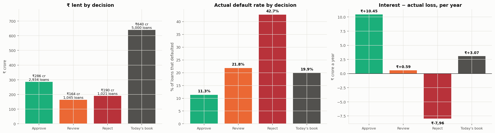

**The five findings behind the answer:**
1. **The bank's pricing barely covers its risk.** Today's book earns only ₹3.07 crore a year above its credit losses on ₹639.7 crore. It breaks even at a cost of funds of just **0.48% a year**: at any realistic cost, the book loses money (§5, §6.1).
2. **A fifth of the loans cause half the expected loss.** Very High-risk loans (PD above 30%) are 20% of loans but carry **52% of the expected loss**, and lose ₹8 crore a year on their own (§4).
3. **The bank's price gets risk backwards in places.** Loans the scorecard calls safer are charged **9.45%** and default 11.4%. Loans it calls riskier are charged only **9.05%** and default 22.8%. The bank's price never identifies a truly low-risk borrower; the scorecard finds 220 that default only 3.2% (§4, §6.1).
4. **Machine learning adds real but modest value, mostly through pricing and mostly in Retail.** The scorecard ranks risk better than the bank's price (ROC-AUC 0.731 vs 0.702 over 25 rounds) and is well calibrated (₹63.0 crore loss predicted, ₹62.7 crore actual). In the decision, the same rule driven by the bank's own price earns **₹3.09 crore a year less** at a higher default rate (§3, §6.2).
5. **The recommendation holds under every assumption tested.** For cost of funds 0–3%, LGD 30–60% and collateral recovery 50–70%, Reject never changes and the approved loans stay profitable (§5).

### 1.1 What we recommend the Board does

1. **Adopt the decision rule now** (§5): approve 2,934 loans (₹285.9 crore) and reject 1,021, using the scorecard's PD and a 6% risk-appetite cap. Approved loans default 11.3% against 19.9% today, and earn more than three times what today's whole book earns.
2. **Work the Review queue (₹163.9 crore) to lend more.** Each loan in the decision file carries its action:
   - 301 under-priced loans (₹38.1 crore) need at most 1 point more interest;
   - weakly secured loans typically need about 27% of the loan in extra collateral;
   - 76 loans (₹32.2 crore) need only a credit committee check because of their size.
3. **Re-price the whole book by scorecard band, not the current rate grid, starting with Retail.** Today's pricing loses money at any cost of funds above 0.48%, and charges safer borrowers more than riskier ones. The scorecard's ranking gain over the bank's price is largest in Retail (+0.035 to +0.038 ROC-AUC); in Corporate the bank's price already ranks about as well (§3.7).
4. **Win the safe borrowers the bank's price can't see.** The 220 Low-risk loans (3.2% default) are charged about 7.5%. Offering them sharper rates is the safest growth available.
5. **Keep approval below about 73%** unless the scorecard is re-checked. Above that level, the bank's own price ranks applicants slightly better (§6.3).
6. **Choose the risk appetite knowingly.** Tightening the cap from 6% to 4% cuts defaults to 8.7%, but lends ₹103.6 crore less and earns ₹2.34 crore a year less (§5.3).
7. **Collect the missing data:**
   - recovery amounts on defaulted loans, so LGD can be measured instead of assumed;
   - the bank's actual cost of funds;
   - outcomes for a small sample of loans the rule would reject, to test it on applicants the bank normally turns down.
8. **Re-check the model regularly.** Each quarter, re-check calibration and the cap on new loans. Watch the very largest loans, which the model under-predicts (§5.2).

### 1.2 Conclusions for the evaluator

**Machine learning.**
- A champion vs challenger design tested whether borrower fundamentals predict default better than the bank's own price.
- A 7-input lasso scorecard won all 25 cross-validation rounds on ROC-AUC. On 1,000 untouched test loans the ranking, probability and recall measures improve (ROC-AUC +0.023), precision is 2.1 points lower and the loss at 70% approval ₹0.26 crore higher (both within the noise), and the gain is **not proven at the 95% level** (DeLong p = 0.065). We report it as real but modest.
- Random forest and LightGBM were ruled out for overfitting.
- The PDs pass four calibration checks on all loans and on the test loans, so no correction was needed.
- The brief's four bands pass four evidence tests with no merges.
- Every threshold was agreed before the result was seen, tested on the data, and has its source and check recorded.

**Finance.**
- ECL is right in rupees (₹63.04 crore expected, ₹62.72 crore actual).
- The bank's pricing is the core problem: it breaks even at a 0.48% cost of funds and misprices risk in both directions.
- The rule turns PD into a money decision with every brief factor: PD, ECL, borrower characteristics (through the PD), loan size, collateral and risk appetite.
- It gives the Board a trade-off table instead of one number, and an action for every Review loan.

---

## 2. The chain: how the three tasks fit together

```text
nova_loans.csv ──► Task 1: PD model ──► Task 2: PD per loan + bands ──► Task 3: ECL + Approve / Review / Reject
                   champion vs 6 others   calibration + 4 band tests     the rule, sensitivities, ₹ result
```

| Hand-off | What passes | The number that makes it safe to use |
| --- | --- | --- |
| Data → Task 1 | 5,000 loans, 15 inputs (11 given + 4 ratios); the interest rate kept out of the inputs and used as the champion | No missing values or duplicates; 80/20 split balanced on default and Retail/Corporate |
| Task 1 → Task 2 | An honest PD for every loan: out-of-fold for the 4,000 training loans, from the final model for the 1,000 test loans | No loan is scored by a model that learned from it |
| Task 2 → Task 3 | Predicted_PD and Risk_Category for every loan; the champion's PD for comparison | Calibrated: ₹63.0 crore predicted vs ₹62.7 crore actual, so PD × money can be trusted |
| Task 1 → Task 3 | The ₹ turning point: the scorecard beats the bank's price only below about 73% approval | The rule approves 58.7%, well inside the range where it wins |
| Task 3 → Module 9 | Approved volume, ECL rate and expected return, Retail and Corporate (§8) | The decision file keeps every number complete |

---

## 3. Data and prediction (Task 1)

**Conclusion:** borrower fundamentals predict default a little better than the bank's own price. The best model is simple (lasso), explainable, and its gain is real but modest.

### 3.1 The data and the loan book in ₹

- **Quality:** 5,000 loans, no missing values, no duplicates, every value plausible.
- **The book:** ₹639.7 crore lent; 19.9% of loans defaulted, but **24.5% of the ₹**, because defaulted loans are 30% larger on average. At 40% LGD that is **₹62.7 crore of losses (9.8% of the book)**.
- **What separates default:**
  - credit score: 31.8% default in the lowest fifth, 10.0% in the highest;
  - debt-to-income;
  - past default;
  - loan size: 13.3% in the smallest fifth, 31.0% in the largest.
- **What doesn't:**
  - Retail and Corporate default alike;
  - loan term (19.1–20.8%);
  - collateral cover: 1,665 loans (₹212.7 crore) are bigger than their collateral, but cover isn't linked to default.

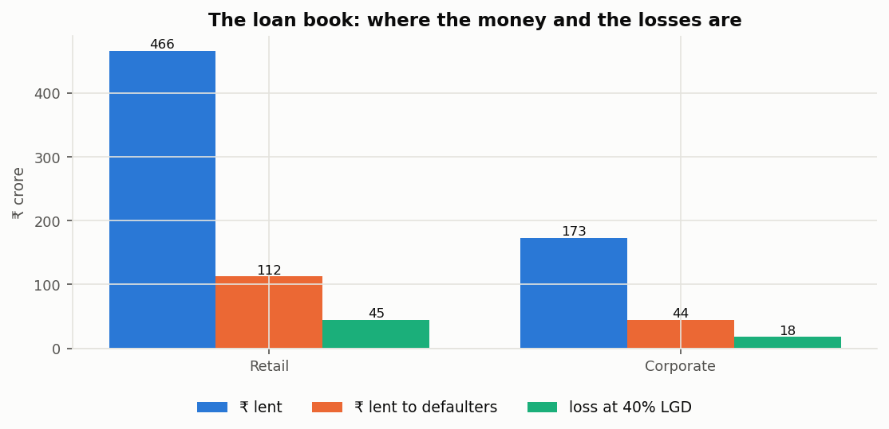

### 3.2 Why the interest rate is the champion, not an input

The bank sets its rate from its own view of risk, so the rate *is* the bank's PD model. Using it as an input would be circular. So:
- **Champion:** the interest rate alone, turned into a PD.
- **Challengers:** five models on 15 borrower fundamentals that never see the rate.

The fundamentals explain 72.2% of the rate (R²). So the bank's price already captures most of what the data says, and any gain has to come from the remaining 28%.

### 3.3 How models were tested

```text
80% / 20% split (4,000 / 1,000 loans), balanced on Default_Flag × Customer_Type, seed 42
On the 4,000: repeated stratified 5-fold cross-validation, 5 repeats = 25 rounds
Test set (1,000) used once, at the end, with 1,000-resample bootstrap ranges and the DeLong test
```

- Brier score first, because Task 3 multiplies PD by money and needs true probabilities.
- Then ROC-AUC, Gini and KS for ranking; precision and recall at 30% PD.
- No rebalancing of the 19.9% default rate: rebalancing would have doubled every PD and every ECL.

### 3.4 Results

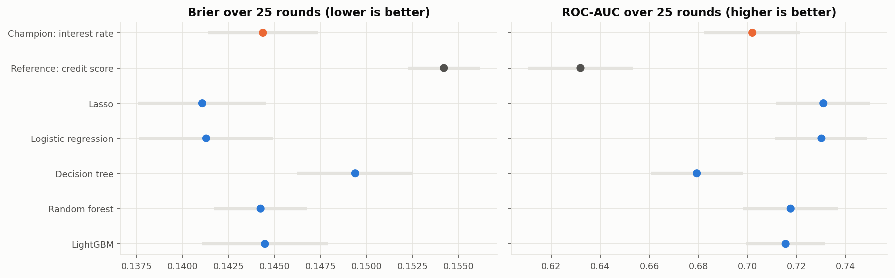

| 25 rounds | Brier (lower is better) | ROC-AUC (higher is better) |
| --- | --- | --- |
| Champion: interest rate | 0.1444 | 0.702 |
| Reference: credit score alone | 0.1542 | 0.632 |
| **Lasso (chosen)** | **0.1411** | **0.731** |
| Logistic regression | 0.1413 | 0.730 |
| Random forest (ruled out) | 0.1442 | 0.718 |
| LightGBM (ruled out) | 0.1445 | 0.716 |

- **Random forest and LightGBM memorise.** Training ROC-AUC 0.85 / 0.83 against 0.72 on unseen loans: gaps of 0.133 and 0.109, above the 0.05 limit. They also lose to lasso on unseen loans.
- **Lasso shows no overfitting:** 0.737 on training, 0.731 in cross-validation, 0.741 on test.
- **Test loans:** ROC-AUC 0.741 vs 0.719 (+0.023, range −0.002 to +0.047), DeLong p = 0.065. The same direction as cross-validation, but not proven on 199 defaults.

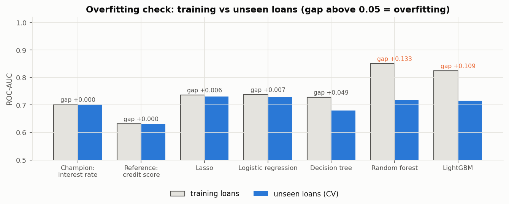

### 3.5 What drives default

The lasso keeps 7 of 15 inputs. It reads like a credit officer's checklist: **score, debt burden, history, size**.

| Input | Odds ratio per standard deviation | Meaning |
| --- | --- | --- |
| Credit_Score | 0.64 (odds 36% lower) | Better repayment record, less risk |
| Debt_to_Income | 1.53 (53% higher) | Income already committed to debt |
| Past_Default | 1.40 (40% higher) | Has defaulted before |
| Loan_Amount | 1.17 (17% higher) | Bigger loans are harder to repay |
| Loan_to_Income, Total_Debt_to_Income | 1.13, 1.12 | Loan and total debt large for the income |
| Collateral_Value | 1.04 | Comes with bigger loans |

Switched off (no information beyond the inputs above): Annual_Income, Employment_Length, Existing_Loan, Loan_Term_Months, Sector_Risk, Loan_to_Value, Principal_to_Income and Customer_Type.

### 3.6 The ₹ case and the turning point

- **Selective lending:** at 50% approval the scorecard lets through 37 fewer defaulters and **₹2.08 crore less loss** than the bank's price.
- **Growth:** held to the bank's default rate, it can approve **₹60.0 crore more lending**.
- **The turning point:** comparing every approval level from 30% to 100%, the scorecard loses less at every level up to 72%, and more from 73% upward.

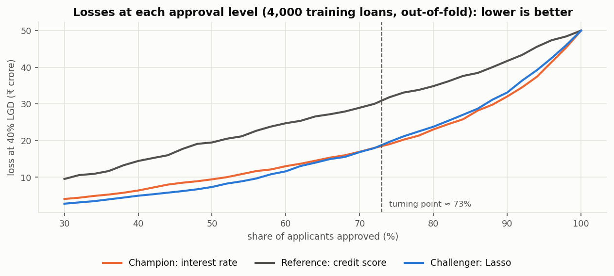

---

### 3.7 Segments: Retail vs Corporate, and sector risk (decision M2-22)

**Conclusion:** the segments behave alike, the model works in both, and one model beats a model per segment. The ML gain is mostly in Retail.

- **No difference in default:** Retail 19.9%, Corporate 20.0% (chi-square p = 0.995), with nearly identical borrower profiles (credit score 689 vs 688; debt-to-income 0.39 vs 0.38; past default 11.1% vs 11.2%).
- **Sector risk** (a 0–100 score; the data has no sector names): default rises only from 18.2% to about 21% across fifths. The fifths don't differ significantly (p = 0.47), but there is a weak trend (p = 0.04). The lasso judged it redundant.
- **The model works in both segments:** calibrated in each (predicted vs actual loss within ₹0.4 crore), with better Brier than the bank's price in each.
- **The ranking gain is mostly Retail:** ROC-AUC +0.035 out-of-fold and +0.038 on test loans. In Corporate it is +0.013 out-of-fold and −0.017 on only 261 test loans: the bank's price ranks Corporate risk about as well.
- **One model is right:** a separate model per segment is worse beyond chance (Brier +0.0005, range +0.0001 to +0.0009); a model with segment-specific weights gains nothing.

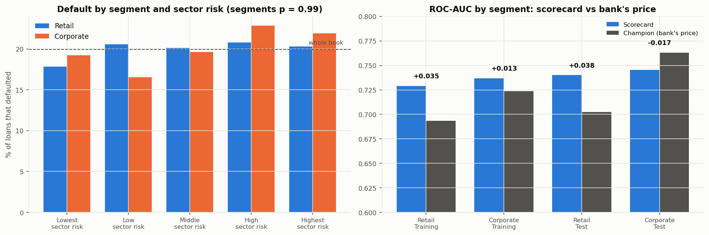

---

## 4. PD per loan and the risk bands (Task 2)

**Conclusion:** the PDs can be trusted as probabilities, and the brief's four bands are justified by evidence, not copied.

### 4.1 Calibration: does a 20% PD mean 20%?

Four checks, with pass lines agreed before building, run on all 5,000 loans and on the 1,000 test loans:

| Check (pass line) | All 5,000 | 1,000 test loans |
| --- | --- | --- |
| Intercept (95% range includes 0) | −0.03 ✓ | −0.09 ✓ |
| Slope (95% range includes 1) | 1.04 ✓ | 1.13 ✓ |
| Hosmer–Lemeshow (p > 0.05) | p = 0.34 ✓ | p = 0.79 ✓ |
| Predicted vs actual loss (range of the difference includes 0) | ₹63.0 vs ₹62.7 crore ✓ | ₹12.9 vs ₹12.7 crore ✓ |

All pass, so no correction (Platt scaling) was needed.

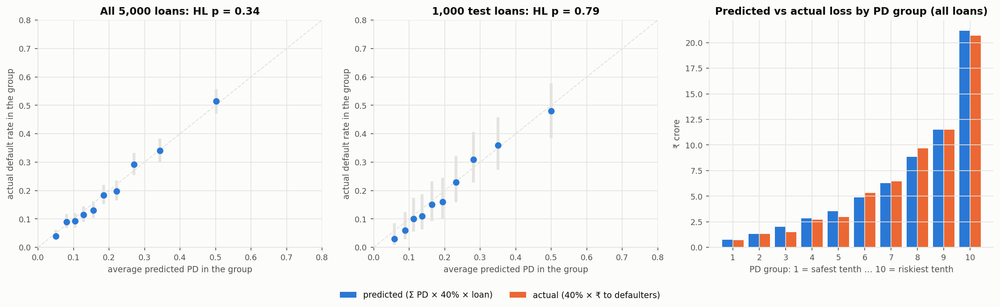

### 4.2 The bands

| Band | Loans | Actual default | Interest − expected loss (% of loan a year) | Interest − expected loss (₹ a year) |
| --- | --- | --- | --- | --- |
| Low (< 5%) | 220 | 3.2% | +6.0% | +₹0.80 crore |
| Medium (5–15%) | 1,935 | 9.3% | +4.1% | +₹7.25 crore |
| High (15–30%) | 1,824 | 20.5% | +1.1% | +₹2.97 crore |
| Very High (≥ 30%) | 1,021 | 42.7% | −4.3% | **−₹8.25 crore** |

- **ML tests:**
  - each band's actual rate is inside its range;
  - the rates rise clearly from band to band (chi-square p ≈ 10⁻¹⁰⁹);
  - every band is big enough to measure.
- **Caveat:** the Low band passes the "big enough" test only narrowly (220 loans).
- **Finance test:** each cut-off marks a change in profitability: comfortably profitable, profitable, borderline, loss-making.

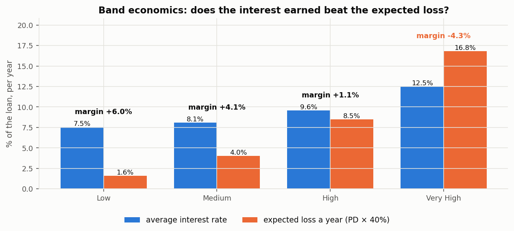

---

## 5. ECL and the decision (Task 3)

**Conclusion:** a rule using every factor the brief lists approves 59% of loans at 11.3% default. It earns more than three times today's book and holds under every assumption tested.

### 5.1 The rule and where each threshold comes from

| Step | Rule | Brief factor | Source and check |
| --- | --- | --- | --- |
| 1 | PD > 30% → **Reject** | PD, risk appetite | The brief's Very High band; it loses 4.3% of the loan a year (Task 2) |
| 2 | Interest rate ≤ PD × 40% → **Review** with a required rate | ECL | Interest must cover expected loss (the assignment guide's worked example) |
| 3a | Loan ≥ ₹33.3 lakh (largest 5%) → **Review** | Loan size | Concentration: one default loses up to ₹28.9 lakh. 24.3% default vs 12.5% |
| 3b | Interest ≤ PD × collateral-aware LGD → **Review** | Collateral | 50% recovery makes the average LGD 37.4%, close to the brief's 40% |
| 3c | No separate override | Borrower characteristics | They act through the PD: no gap beyond chance in 24 groups |
| 4 | Approved expected loss > 6% → highest PD to **Review** | Risk appetite | 9.1% typical rate − 3% top cost of funds = 6.1% → 6% |

```text
ECL (₹ a year)          = Predicted_PD × 0.40 × Loan_Amount
Collateral-aware LGD    = max(0, 1 − 50% × Collateral_Value ÷ Loan_Amount)
Required rate           = cost of funds + PD × max(40%, collateral-aware LGD)
```

The flags only send loans to a person; they never approve or reject on their own, because the 5% cut-off and the 50% recovery are judgements the data can't test directly.

### 5.2 Results and validation

- **ECL in ₹:** ₹63.04 crore expected vs ₹62.72 crore actual. Each decision group's expected loss rate is close to its actual one (Approve 5.45% vs 5.10%).
- **Significance:** Approve 11.3% default vs 19.9% today, one-sided z test, p ≈ 10⁻²³. A 1,000-resample bootstrap puts the Approve group's earnings at ₹8.62–₹12.11 crore a year.
- **Test loans (never used to choose anything):** Approve 11.3%, Review 21.1%, Reject 40.1%, against 19.9% for the test book.
- **Model watch-point:** the largest 2% of loans default 33.3% against 20.1% predicted (p = 0.046). The model under-predicts the biggest loans, and the size flag already sends all of them to a person.

### 5.3 Risk appetite, cost of funds and LGD

| Setting | ₹ approved | Approved default | Interest − actual loss |
| --- | --- | --- | --- |
| **Cap 6% (agreed; it doesn't bind)** | **₹285.9 crore** | **11.3%** | **+₹10.45 crore** |
| Cap 5% | ₹260.1 crore | 10.5% | +₹10.23 crore |
| Cap 4% | ₹182.3 crore | 8.7% | +₹8.11 crore |
| Cap 3% | ₹97.3 crore | 7.0% | +₹4.86 crore |

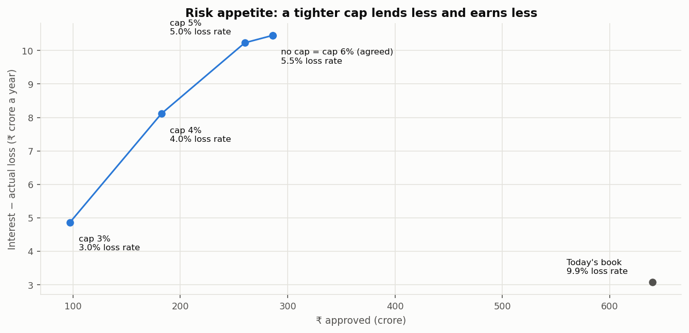

| Cost of funds | 0% | 1% | 2% | 3% |
| --- | --- | --- | --- | --- |
| Approve / Review / Reject | 2,934 / 1,045 / 1,021 | 2,521 / 1,458 / 1,021 | 2,006 / 1,973 / 1,021 | 1,432 / 2,547 / 1,021 |
| Approved: interest − actual loss − cost | +₹10.45 cr | +₹6.85 cr | +₹4.40 cr | +₹2.16 cr |
| Today's book, same measure | +₹3.07 cr | −₹3.32 cr | −₹9.72 cr | −₹16.11 cr |

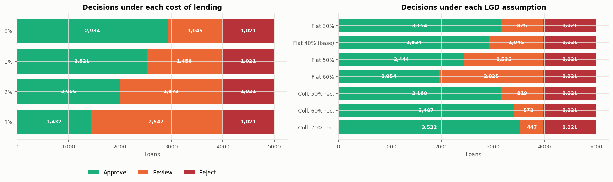

- **LGD sensitivity:**
  - flat 30% to 60%: Approve 3,154 → 1,954;
  - collateral-aware at 50% to 70% recovery: Approve 3,160 → 3,532.
- **Across every case:** Reject is unchanged, the approved loans stay profitable, and ECL matches the actual loss at that LGD.

### 5.4 Results by segment

| Segment | Default today → approved | Earned per ₹100 lent today | Earned per ₹100, approved |
| --- | --- | --- | --- |
| Retail | 19.9% → 11.3% | ₹0.61 | ₹3.64 |
| Corporate | 20.0% → 11.4% | ₹0.14 | ₹3.70 |
| Sector-risk fifths | 18.2–21.3% → 9.9–13.2% | ₹0.05–₹0.93 | ₹3.15–₹3.95 |

- **Every segment earns thinly today and well under the rule.**
- Corporate earns less than Retail today, but the gap is within chance (bootstrap 95% range of the difference −₹0.90 to +₹1.91 per ₹100). Under the rule the two are indistinguishable (approved default 11.3% vs 11.4%, p = 0.98).
- The riskiest sector fifths keep slightly higher approved default (12.8–13.2%): worth watching, not acting on.

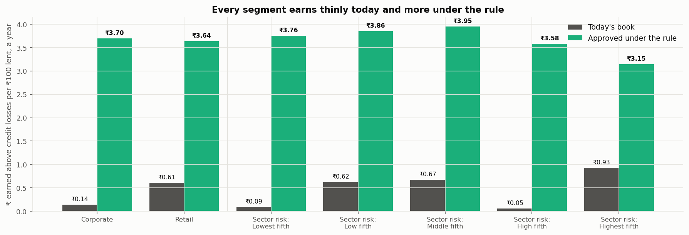

### 5.5 The decision file

`outputs/task3/FINAL_M2_T3_loan_decisions.csv` has one row per loan, with no blank cells and no codes. It serves three readers:
- **Later modules and analysis:** the numbers, including Customer_Type, loan and collateral, ECL, expected return and required rate.
- **The credit team:** every check in words, and an action for each Review loan. For example: "Offer at least 13.27% (now 10.40%) or raise collateral to ₹16.0 lakh (+₹5.5 lakh)".
- **An evaluator or regulator:** the full reason for each decision.

The column guide is in `task3_report.md` §5.1.

---

## 6. How the pieces connect: cross-task conclusions

### 6.1 The bank's mispricing, traced through all three tasks

| Task | What it showed |
| --- | --- |
| 1 | Fundamentals explain 72% of the rate, so 28% of pricing is unexplained by risk. 95 loans (₹8.2 crore) priced as risky score under 10% PD and default only 5.3%: good customers overcharged |
| 2 | The bank's price never signals Low risk (lowest PD 6.1%, at its 6.0% floor rate). Safer-by-scorecard loans are charged 9.45% (11.4% default); riskier ones 9.05% (22.8% default). One exception goes the bank's way: 142 loans it priced Very High defaulted 32.4% |
| 3 | Today's book breaks even at a 0.48% cost of funds. The same rule on the bank's price earns ₹3.09 crore a year less than on the scorecard |

**Conclusion:** the bank's risk *ranking* is decent, but its risk *pricing* is too flat. Risky loans are not charged enough, and the safest loans can't get a sharper rate. Re-pricing by scorecard band is the single biggest lever (§1.1, items 3–4).

### 6.2 What the machine learning actually changed, in ₹

| Where | Ranking alone | Through pricing and decisions |
| --- | --- | --- |
| Task 1 | ₹2.08 crore less loss at 50% approval; a tie near 71% | 95 overcharged good customers found |
| Task 2 | — | 220 Low-risk loans the bank can't see; mispricing quantified by band |
| Task 3 | +₹1.93 crore at the rule's 58.7% approval | **+₹3.09 crore a year**: the same rule on the scorecard vs the bank's price, at 11.3% vs 14.0% default |

**Conclusion:** on ranking alone, the ML gain is modest and depends on how selective the bank is. Its larger value is measuring risk **independently of price**. The bank's own PD is built from its rate, so it can never tell whether a rate covers the risk: it finds 116 under-priced loans where the scorecard finds 437.

### 6.3 The 73% turning point, from discovery to decision

- **Task 1:** the scorecard loses less than the bank's price at every approval level up to 72%, and more from 73% upward.
- **Task 3:** decision 3 was agreed knowing the simple rule (steps 1–2) would approve 70.8%, close to the turning point, where ranking alone is a tie.
- **What changed it:** the size and collateral checks lowered approval to **58.7%**, where the scorecard saves +₹1.93 crore on ranking alone (+₹0.40 crore on the test loans).
- **Board warning:** if the bank widens approval above about 73%, it should re-check before relying on the scorecard to choose who gets a loan.

### 6.4 Collateral: it changes the size of the loss, not whether default happens

- **Task 1:** collateral cover is not linked to default (17.6–21.9% across fifths of cover).
- **Task 3:** among loans passing steps 1–2, default is 12.6% when the loan exceeds its collateral and 13.0% when within it (p = 0.77).
- **So collateral is not in the PD.** It enters the decision through the loss size (collateral-aware LGD).
- The 532 loans it flags (₹72.9 crore) earn only +₹0.74 crore a year. Each carries an action: a higher rate, or the extra collateral that would pass at today's rate.

---

### 6.5 Segments across the three tasks

| Task | Retail vs Corporate | Sector risk |
| --- | --- | --- |
| 1 | Same default rate and profile; one model beats a model per segment; ML ranking gain mostly in Retail | Weak trend (18.2% → about 21%), judged redundant by the lasso |
| 2 | Each band behaves alike in both (e.g. Very High 42.2% vs 44.2%), so one set of bands serves both | — |
| 3 | Same decisions and results under the rule (approved default 11.3% vs 11.4%); Corporate's lower earning today is within chance | Riskiest fifths keep slightly higher approved default |

**Conclusion and how we defend it:** the Board will ask whether Retail and Corporate need different treatment. The evidence says not in this book: they default alike, the single model is calibrated in each, and a model per segment is measurably worse. The one place they differ is where the ML adds value: in Retail the scorecard clearly out-ranks the bank's price, while in Corporate the bank already prices risk about as well. That is why re-pricing should start with Retail. On real data, where segments usually differ, these tests are the first thing to re-run.

---

## 7. Key decisions

Every decision was agreed one at a time before building, with its options, evidence and date (`docs/decisions.md`).

| ID | Decision | Choice and reason |
| --- | --- | --- |
| M2-01, 02 | Identifier, money units | Loan_ID everywhere; plain rupees |
| M2-03 | LGD and EAD | Flat 40% (brief; Basel III supervisory value), EAD = loan amount; collateral-aware and flat sensitivities |
| M2-04, 18 | Risk bands | Keep the brief's cut-offs only if four tests pass; merge with a neighbour if not. All passed |
| M2-05 | Decision test, cost, horizon | Interest > ECL on a one-year view; cost of funds 1–3% as a sensitivity. **Revised:** an earlier 6% all-in cost made 93% of loans loss-making even on actual outcomes, so it couldn't separate good loans from bad |
| M2-06 | Risk appetite | Two layers; cap **re-anchored** from 3% (tied to the dropped 6% cost) to 6% after testing on Task 2 PDs |
| M2-07 | Validation | 80/20 split, 25-round cross-validation, test set used once, bootstrap and DeLong |
| M2-09, 11, 13 | Modelling approach | Champion vs challenger; 15 fundamentals without the rate; selection rule fixed before results |
| M2-12 | Imbalance | No rebalancing: it would have doubled every PD and ECL |
| M2-14, 16, 17 | Calibration | Honest PDs only; four checks with pass lines; Platt only if a check fails (not needed) |
| M2-15 | Task 1 thresholds | Overfitting limit 0.05 justified and checked; ₹ check reported as a full sweep, which revealed the turning point |
| M2-19 | Which PD in Task 3 | The scorecard's; the champion run alongside |
| M2-20 | The decision rule | Six brief factors; flags send to Review only |
| M2-21 | Decision file | One readable file: numbers for Module 9, words for staff and evaluators |
| M2-22 | Segments | Retail vs Corporate and sector risk tested in Task 1 (profiles, performance in each, one vs separate models) and Task 3 (results by segment); one model kept on evidence |

### 7.1 Agreed numbers against the final run

The decisions on cost of funds, risk appetite and which PD (M2-05, M2-06, M2-19) were tested on the simple rule (steps 1–2) before the size and collateral checks existed. The full rule (M2-20) was tested before it was agreed, and the final run matched it exactly.

| Measure | Simple rule (when M2-05/06/19 were agreed) | Full rule (final run) | Better or worse |
| --- | --- | --- | --- |
| Approved | 3,542 loans, ₹391.1 crore | 2,934 loans, ₹285.9 crore | 608 loans (₹105.2 crore) moved to Review, not lost |
| Approved default | 12.9% | **11.3%** | Better |
| Interest − actual loss, no cost of funds | +₹11.40 crore | +₹10.45 crore | ₹0.95 crore a year less |
| Per ₹100 lent | ₹2.92 | **₹3.66** | Better |
| Same loans at 1% / 2% / 3% cost of funds | +₹7.49 / +₹3.58 / −₹0.33 crore | **+₹7.59 / +₹4.73 / +₹1.87 crore** | Better at every realistic cost |
| Scorecard's ranking gain over the bank's price | Tie (+₹0.23 crore) | **+₹1.93 crore** | Better |
| Loans moved by the 6% cap | 37 | 0 | The cap became a pure guardrail |

**Conclusion:** the only cost is ₹0.95 crore a year, and only if the bank's money were free. The 608 moved loans earn just ₹0.90 per ₹100 above their losses, so above about a 0.9% cost of funds they lose money. Moving them to Review saves money rather than costing it, and each can still be lent once its action is taken.

### 7.2 What the two reversals taught

- **The 6% cost (M2-05)** looked reasonable on paper but made 93% of the book loss-making, even on actual outcomes. **Lesson:** test every assumption's effect on the data before fixing a rule.
- **The 3% cap (M2-06)** was anchored on that cost, so it fell with it. It was re-anchored only after Task 2's PDs existed. **Lesson:** build each task before fixing the next task's rules.

---

## 8. Hand-off to Module 9 (the ₹1,000 crore allocation)

Module 9 allocates ₹1,000 crore across categories that include **Corporate lending** and **Retail lending**. The assignment guide defines lending's expected return as interest rate − ECL rate. Module 2 provides:

| Segment | ₹ approved | Average rate | ECL rate | Expected return a year | Today's book: expected return |
| --- | --- | --- | --- | --- | --- |
| Retail lending | ₹210.5 crore | 8.73% | 5.44% | **3.30%** | 0.50% (on ₹466.4 crore) |
| Corporate lending | ₹75.4 crore | 8.81% | 5.50% | **3.31%** | 0.24% (on ₹173.2 crore) |
| All lending | ₹285.9 crore | 8.75% | 5.45% | **3.30%** | 0.43% (on ₹639.7 crore) |

- **Expected return** = interest rate − ECL rate, **before the cost of funds and running costs**. At a 2% cost of funds, approved lending returns about 1.3% a year; today's book would lose about 1.6%.
- **Capacity:** the rule approves ₹285.9 crore of this book outright. A further ₹163.9 crore in Review is lendable on revised terms. Re-priced to its required rate, each Review loan covers its expected loss plus whatever cost of funds is built into that rate, so it adds volume rather than margin.
- **Files:** `outputs/task3/FINAL_M2_T3_loan_decisions.csv` (every loan, with Customer_Type and all money columns as numbers) and `outputs/task3/key_numbers.json` (the figures above, under `module9`).
- **How Module 9 used them:** lending at today's prices earns less than the 6.8% risk-free rate, so the ₹285.9 crore of approved loans (and then the ₹163.9 crore in Review) wait in the reserve until they are re-priced and pass the release test.

---

### Module 9 inputs: lending return and risk per ₹ (decision M2-23; Task 3 notebook step 11b)

**Why:** Module 9 compares every business on the same fields. The hand-off gave lending's return but not its risk; the loan file allows both.

**How:** return per ₹ lent = (interest − ECL) ÷ ₹ lent, a year, before cost of funds. Bad year: every PD doubled (a recession), LGD 40%. Severe: PD doubled and LGD 60%. 1-in-100 year from luck alone: 3,000 random draws of which loans default (seed 42); defaults independent, so it understates a real recession.

| Group | Loan type | ₹ lent (crore) | Interest rate | Expected loss | **Return per ₹ lent** | What it really earned | **Bad year (PD × 2)** | Severe (PD × 2, LGD 60%) | 1-in-100 year, luck alone |
| --- | --- | --- | --- | --- | --- | --- | --- | --- | --- |
| Approve | Retail | 210.5 | 8.73% | 5.44% | **3.30%** | 3.64% | **-2.14%** | -7.58% | 2.45% |
| Approve | Corporate | 75.4 | 8.81% | 5.50% | **3.31%** | 3.70% | **-2.19%** | -7.68% | 1.80% |
| Approve | All | 285.9 | 8.75% | 5.45% | **3.30%** | 3.66% | **-2.15%** | -7.61% | 2.60% |
| Review | Retail | 120.3 | 9.80% | 8.84% | **0.96%** | 0.08% | **-7.88%** | -16.73% | -0.81% |
| Review | Corporate | 43.6 | 9.63% | 8.65% | **0.97%** | 1.12% | **-7.68%** | -16.34% | -2.05% |
| Review | All | 163.9 | 9.76% | 8.79% | **0.96%** | 0.36% | **-7.83%** | -16.62% | -0.51% |

- **Approved loans earn 3.3% a year** above expected losses (they really earned 3.7%), but **a recession year turns that into -2.2%** (-7.6% if collateral fetches less).
- **The Review queue earns about 1%** even in a normal year and loses about 8% in a recession: it adds volume only once re-priced.
- **Retail and Corporate behave alike** (same return and bad year), as found in Tasks 1–3.
- **All before the cost of funds**, which the data doesn't have; Module 9 applies it as a stated assumption.

## 9. Limitations

- **LGD and recovery are assumed, not measured.** The data has no recovery amounts. The rule holds across flat LGD of 30–60% and recovery of 50–70%, but the size of every rupee figure depends on it.
- **The ML gain is not proven at 95%** on the 1,000 test loans (DeLong p = 0.065). It should be confirmed on new applications before the scorecard carries weight on its own.
- **One-year view.** PD and interest are both yearly, and default does not rise with loan term in this data. Longer loans may behave differently in reality.
- **No cost-of-funds figure in the data.** The base uses none; 1–3% is shown.
- **Outcomes are seen only for loans the bank made.** How applicants it turned down would have behaved is unknown (the reject-inference problem).
- **Judgement thresholds:** the 5% size cut-off and 50% recovery send loans to a person only; they never decide on their own.
- **Synthetic data.** Retail and Corporate behave identically and sector risk has only a weak effect, so one model serves both and Customer_Type carries no information (§3.7). Real portfolios usually differ; the segment tests should be re-run on real data.
- **The model under-predicts the largest loans** (top 2%). The size flag covers this, but it is a known weakness to monitor.

---

## Glossary

| Term | Meaning |
| --- | --- |
| **Approve / Review / Reject** | Lend as priced / send to a person to fix price, security or exposure / decline |
| **Bootstrap** | Re-drawing the loans with replacement 1,000 times to see how much a result could vary by chance |
| **Brier score** | Average of (PD − actual outcome)²; lower means truer probabilities |
| **Calibration** | Whether predicted PDs match actual default rates (a 20% PD should default about 20% of the time) |
| **Champion / challenger** | The bank's current method (its interest rate) against new models |
| **Collateral-aware LGD** | max(0, 1 − 50% × collateral ÷ loan): the share lost after selling the collateral at half its value |
| **Cost of funds** | What the bank pays for the money it lends (deposits, borrowing) plus running costs, as % a year |
| **Cross-validation (repeated stratified 5-fold)** | Train on 4/5 of the loans, test on the other 1/5, rotate, repeat with 5 shuffles: 25 honest scores |
| **DeLong test** | A formula test of whether two ROC-AUCs on the same loans differ by more than chance |
| **EAD** (exposure at default) | What is owed when the borrower defaults; here, the loan amount |
| **ECL** (expected credit loss) | PD × LGD × EAD: the average loss to expect in a year, in ₹ |
| **Expected loss rate / ECL rate** | ECL ÷ loan amount = PD × LGD |
| **Expected return** | Interest rate − ECL rate: what a loan earns above its expected loss, before cost of funds |
| **Gini** | 2 × ROC-AUC − 1 |
| **Hosmer–Lemeshow test** | Compares predicted and actual defaults in 10 PD groups; p > 0.05 means no evidence of mis-calibration |
| **KS statistic** | Largest gap between the shares of defaulters and repayers below any PD cut-off |
| **Lasso** | Logistic regression with a penalty that switches off inputs carrying no extra information |
| **LGD** (loss given default) | Share of the loan lost if the borrower defaults, after recoveries (40% base) |
| **Odds ratio** | How the odds of default multiply when an input rises by one standard deviation |
| **Out-of-fold PD** | A loan's PD from models that never saw that loan |
| **Overfitting** | A model memorising its training loans: much better on them than on new loans |
| **PD** (probability of default) | Chance the borrower fails to repay within the year |
| **Platt scaling** | A correction that re-maps PDs to fix calibration; not needed here |
| **Required rate** | Lowest interest rate that covers a loan's expected loss (plus cost of funds, where assumed) |
| **Risk appetite** | How much loss the Board accepts for its income; here, a cap on the approved book's expected loss rate |
| **ROC-AUC** | Chance the model gives a random defaulter a higher PD than a random repayer (0.5 = guessing, 1 = perfect) |
| **SHAP** | Splits each loan's prediction into a push from each input |
| **Turning point** | The approval level (about 73%) above which the bank's price ranks applicants slightly better than the scorecard |
| **Wilson range** | A 95% range for a default rate that stays sensible for small groups |
