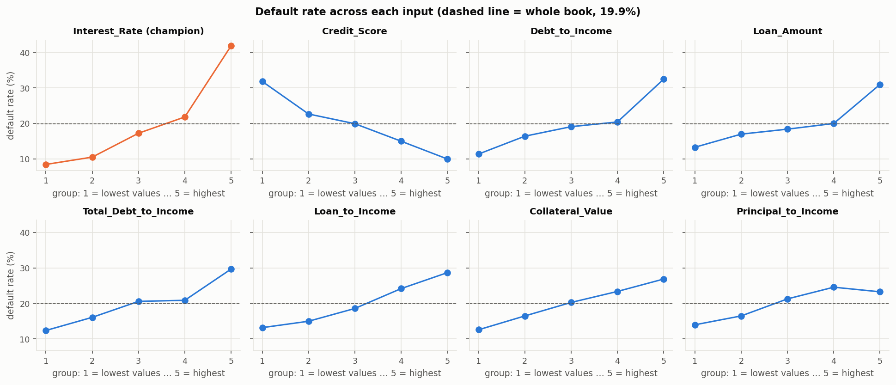
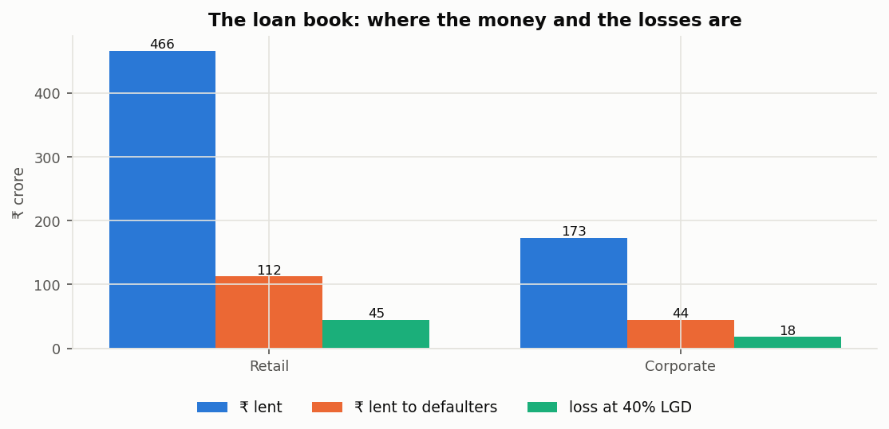
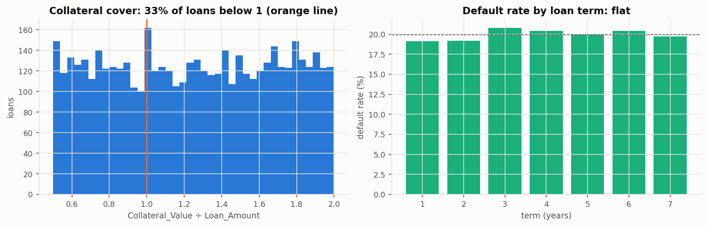
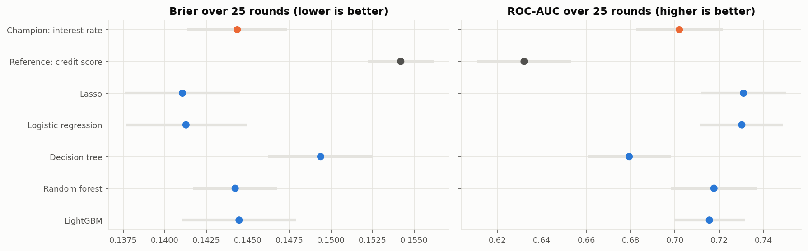
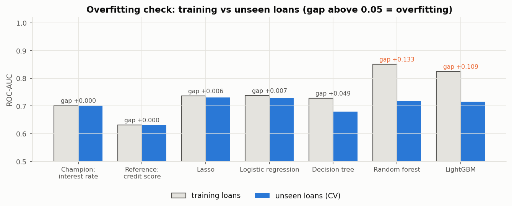
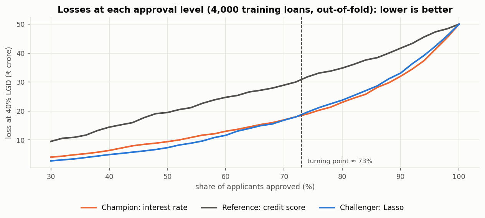
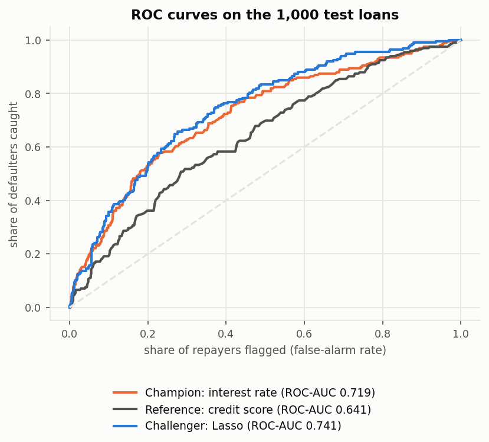
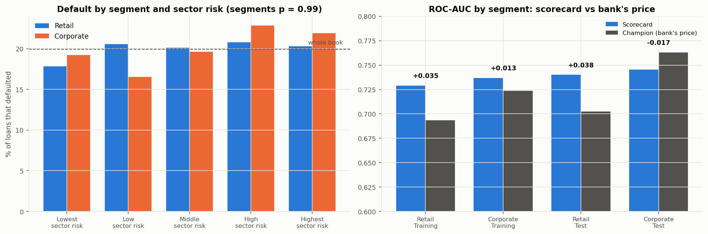
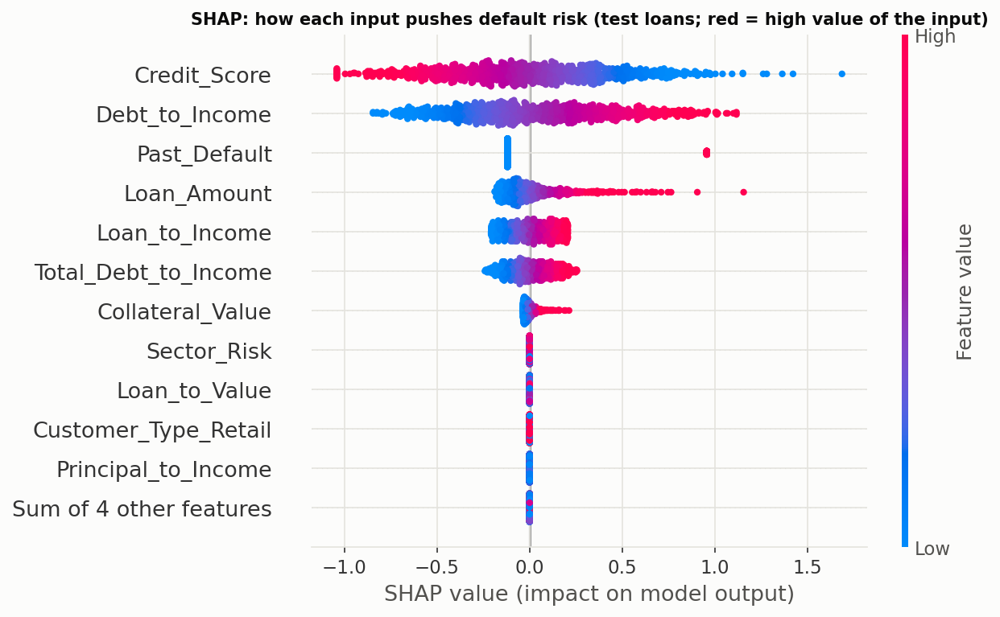
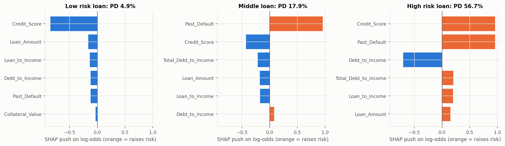

# Module 2 — Task 1 Report: Predicting the Probability of Default

**Brief (verbatim):**
> **Task 1: Predict Probability of Default**
> Target: Default_Flag
> Build models, evaluate performance

**The business problem (brief):** *"NovaFin wants to increase lending while reducing defaults."* Management asks which loans to approve, reject or send for manual review.

**Where this sits in the chain:** Data → **PD model (this task)** → PD per loan and risk bands (Task 2) → Expected Credit Loss and the Approve / Review / Reject decision (Task 3).
- **PD (Probability of Default):** the chance, from 0 to 1, that a borrower fails to repay.
- **Default_Flag:** 1 = defaulted, 0 = repaid.

| Item | Where |
| --- | --- |
| Code and outputs | `notebooks/m02_task1_pd_model.ipynb`: runs on its own (locally or in Colab) or from `run_module_2.ipynb` |
| Helpers used | `helpers/m02_data.py` (data, the four lending ratios, the input list), `helpers/m02_style.py` (chart style) |
| Tables and charts | `outputs/task1/` |
| Output for Task 2 | `outputs/task1/FINAL_M2_T1_default_predictions.csv` (Loan_ID, set, Default_Flag, champion PD, challenger PD), `chosen_model.joblib`, `chosen_model.json` |
| Decisions | M2-01, M2-07, M2-09 to M2-13, in `docs/decisions.md` |

---

## 1. Summary for management

**The question:** can a model built on borrower fundamentals predict default better than the bank already does?

The bank already has a risk view: **the interest rate it charges**, since riskier borrowers pay more. So we ran a **champion vs challenger** test:
- **Champion:** the interest rate alone.
- **Challengers:** five models built only on fundamentals, never seeing the rate.

**The ML case**
1. **A 7-input lasso scorecard beats the bank's pricing at ranking risk**: ROC-AUC 0.731 vs 0.702, Brier 0.1411 vs 0.1444. It won **all 25 cross-validation rounds** on ROC-AUC and 24 of 25 on Brier.
2. **Simple beats complex.** Random forest and LightGBM memorise their training loans (training ROC-AUC 0.85 / 0.83 against 0.72 on unseen loans), so they were ruled out. Lasso shows no overfitting: ROC-AUC 0.737 training, 0.731 cross-validated, 0.741 on test.
3. **On the 1,000 untouched test loans the ranking, probability and recall measures improve** (ROC-AUC +0.023, Brier −0.0025, recall +5.5 points); precision is 2.1 points lower and the loss at 70% approval ₹0.26 crore higher, both within the noise. But with only 199 defaults the gain **is not proven at the 95% level**: the 95% ranges include zero, and the DeLong test gives p = 0.065.
4. **It's explainable.** Credit score, debt-to-income and past default drive most of the risk. Eight inputs are switched off.
5. **One model serves both Retail and Corporate** (§8b). The segments default alike (19.9% vs 20.0%), the model is calibrated in each, and a separate model per segment does worse. The ranking gain over the bank's price is mostly in Retail.

**The finance case**
1. **Today's book loses money to defaults:**
   - ₹639.7 crore lent, 19.9% of loans defaulted;
   - by money, **24.5%** of the ₹ went to defaulters, because defaulted loans are 30% larger on average;
   - at 40% LGD (the share of a loan lost after a default), that is **₹62.7 crore of losses (9.8% of the book)**.
2. **When the bank lends selectively, the scorecard saves money.** Approving the safest half of 4,000 applicants, it lets through **37 fewer defaulters and ₹2.1 crore less loss** than the bank's pricing. Holding the bank's default rate fixed, it can approve **465 more loans, ₹60 crore more lending**.
3. **It finds mispriced loans.** **95 loans (₹8.2 crore) are priced as risky but score under 10% PD, and only 5.3% defaulted**: good customers being overcharged. 14 others (₹1.6 crore) are priced as safe but 35.7% defaulted.
4. **The ₹ gain has a turning point at about 73% approval.** Testing every approval level from 30% to 100%:
   - up to 72% of applicants approved, the scorecard loses less money at **every** level (₹1.37 crore less on average per 4,000 applicants);
   - from 73% upward, the bank's pricing loses less.

   Which approval level the bank uses is decided in Task 3, so this turning point is carried there.

**Decision:** use the **lasso scorecard** as the PD model for Tasks 2 and 3, and present its gain honestly as **real but modest**. The bank's rate already reflects 72% of what the fundamentals say. The scorecard's main value is **selective lending and finding mispriced loans**, and it should be confirmed on new applications before it carries weight on its own.

---

## 2. Know the data (notebook step 1)

**Quality.** 5,000 loans, no missing values, no duplicates. Every value is plausible:
- Credit_Score 406–850;
- Debt_to_Income 0.03–0.85;
- rates 6.0%–19.4%;
- terms of 1–7 whole years;
- all money values positive.

**Default rate across each input.** Each number input is cut into five equal groups, from lowest to highest values:

```text
Default rate = defaulted loans in the group ÷ loans in the group      (whole book: 19.9%)
```



| Input | Lowest → highest group | What it means |
| --- | --- | --- |
| Interest_Rate (champion) | 8.5% → 41.9% | The bank's pricing already separates risk strongly |
| Credit_Score | 31.8% → 10.0% | A better bureau score means less default |
| Debt_to_Income | 11.4% → 32.5% | More of income already committed means more default |
| Past_Default | 17.7% (no) vs 37.8% (yes) | History repeats: twice the risk |
| Loan_Amount | 13.3% → 31.0% | Bigger loans default more |
| Total_Debt_to_Income, Loan_to_Income | 12.4% → 29.7%, 13.2% → 28.7% | Debt load relative to income |
| Sector_Risk, Employment_Length, Loan_Term, Customer_Type, Loan_to_Value | flat (within about 3 points) | Little or no link |

This look was for understanding only. The inputs had already been fixed from credit reasoning (section 3), so the model wasn't built around the strongest links seen here.

**The loan book in rupees (Board view).**

| | Retail | Corporate | Whole book |
| --- | --- | --- | --- |
| Loans | 3,694 | 1,306 | 5,000 |
| ₹ lent | ₹466.4 crore | ₹173.2 crore | ₹639.7 crore |
| Default rate, by count | 19.9% | 20.0% | 19.9% |
| Default rate, by money | 24.1% | 25.6% | 24.5% |
| ₹ lent to defaulters | ₹112.5 crore | ₹44.3 crore | ₹156.8 crore |
| **Loss at 40% LGD** | **₹45.0 crore** | **₹17.7 crore** | **₹62.7 crore** |



- **Retail and Corporate default at the same rate**, so Customer_Type tells the model little.
- **Money default exceeds count default** because defaulted loans average ₹15.7 lakh against ₹12.1 lakh for repaid ones. The money at risk is larger than the headcount suggests.

**Collateral and loan term.**

```text
Collateral cover = Collateral_Value ÷ Loan_Amount   (below 1 = loan larger than the asset pledged)
```



- **A third of loans (1,665, ₹212.7 crore) are under-collateralised**, but cover **does not predict default**: 17.6%–21.9% across the cover fifths. The under-collateralised loans actually default slightly *less* (18.5% vs 20.7%).
  - Collateral matters for **how much is lost** after a default, not **whether** it happens.
  - That's a Task 3 matter (LGD).
- **Default doesn't rise with term** (19.1%–20.8% for 1–7 years). If Default_Flag counted defaults over a loan's whole life, long loans would default far more often. So it behaves like a **one-year** measure, which supports the one-year view planned for Task 3.

---

## 3. The inputs, the leakage check, and why Interest_Rate is not an input (step 2, decision M2-11)

**15 inputs, fixed before any model was trained:**
- **Given (11):** Annual_Income, Employment_Length, Debt_to_Income, Credit_Score, Existing_Loan, Loan_Amount, Loan_Term_Months, Collateral_Value, Past_Default, Sector_Risk, Customer_Type.
- **Derived (4):** standard lending ratios, each from the loan's own numbers:

```text
Loan_to_Value        = Loan_Amount ÷ Collateral_Value                      above 1 = loan larger than the asset
Loan_to_Income       = Loan_Amount ÷ Annual_Income                         loan size against yearly income
Total_Debt_to_Income = (Existing_Loan + Loan_Amount) ÷ Annual_Income       all debt after this loan
Principal_to_Income  = (Loan_Amount ÷ (Loan_Term_Months ÷ 12)) ÷ Annual_Income
                       share of yearly income needed just to repay the principal
```

An instalment (EMI) ratio was left out, because an EMI needs the interest rate.

**Leakage check.**
- All 15 inputs are known when the application is made.
- Past_Default is history before this loan.
- Default_Flag (the outcome) is never an input.

**Why the challengers don't see Interest_Rate:**

| Reason | Explanation |
| --- | --- |
| Circular | The bank sets the rate from its own view of the borrower's risk; a model using it would learn that view back |
| Finds mispricing | Without the rate, the model can spot loans priced too high or too low for their risk (section 7.3) |
| Works before pricing | The model can score an applicant before a rate is quoted |
| Possible leakage | Rates raised after a borrower struggled (penalty pricing) would carry information from after the loan started |

**How much do the fundamentals already explain the rate?** A straight-line fit of the rate on the 15 inputs explains **72.2%** of its variation (R²). So the bank's price already reflects most of the fundamentals, and a challenger is competing for the remaining slice.

---

## 4. How the models were trained and tested (steps 3–5, decision M2-07)

**Split: 80% / 20%, stratified on Default_Flag × Customer_Type, seed 42.**

| | Loans | Defaults | Default rate | Retail share | ₹ lent |
| --- | --- | --- | --- | --- | --- |
| Training set | 4,000 | 798 | 19.95% | 73.9% | ₹511.8 crore |
| Test set | 1,000 | 199 | 19.90% | 73.9% | ₹127.9 crore |

- The **training set** is used for all building and comparison, through cross-validation.
- The **test set** stayed locked away until the final exam (section 6). It is the closest thing to "next year's applicants".

**Repeated stratified 5-fold cross-validation (25 rounds):**

```text
4,000 training loans → 5 parts of 800
Each round: train on 4 parts (3,200 loans), score the 5th (800 loans it never saw)
5 rounds × 5 different shuffles = 25 scores per model, all models on the same 25 sets of loans
```

- One set of 800 loans holds only about 160 defaults, so a single score can move by about ±0.02 ROC-AUC on luck alone. Twenty-five rounds give a reliable average and its spread.
- Every data step (scaling, one-hot columns, tuned settings) is fitted inside each round on its training part only, so nothing leaks.
- **Out-of-fold PD:** each training loan is scored once per shuffle by a model that didn't see it. The average of those 5 scores is its honest PD, used in sections 7 and 8.

**The models (decision M2-13).**

| Role | Model | What it is |
| --- | --- | --- |
| **Champion** | Interest rate alone | The bank's risk view, turned into a PD by a one-input logistic regression: PD = 1 ÷ (1 + e^−(b0 + b1 × rate)) |
| Reference | Credit score alone | The bureau's view, same method |
| Challenger | **Lasso logistic regression** | PD = 1 ÷ (1 + e^−(b0 + b1·x1 + … + bk·xk)), with a penalty λ × Σ\|b\| that sets weak weights to exactly 0; λ tuned by an inner 5-fold CV |
| Challenger | Logistic regression | The same, with a small ridge penalty; the industry-standard scorecard |
| Challenger | Decision tree | Yes/no rules; depth tuned 2–6 by inner CV, at least 50 loans per final box |
| Challenger | Random forest | 300 trees on random resamples, averaged; depth ≤ 8 |
| Challenger | LightGBM | 300 small trees built one after another, each correcting the last; tree size tuned by inner CV |

**Not rebalanced** (decision M2-12). Every loan counts once; section 5.2 shows why.

**Measures** (a default is the "positive" case):

| Measure | Formula / meaning | Better |
| --- | --- | --- |
| **Brier score (primary)** | average of (PD − actual 0/1)² | Lower |
| ROC-AUC | chance a random defaulter gets a higher PD than a random repayer (0.5 = coin toss) | Higher |
| Gini | 2 × ROC-AUC − 1 (bank convention) | Higher |
| KS | largest gap between the shares of defaulters and repayers below any PD line | Higher |
| Log loss | average of −[y × ln(PD) + (1 − y) × ln(1 − PD)] | Lower |
| Calibration slope | b in logit(actual) ≈ a + b × logit(PD); 1 = right | Close to 1 |
| Precision / recall / F1 at 30% PD | of loans flagged above 30%, the share that defaulted / of defaulters, the share flagged / their balance | Higher |

**Accuracy is not used:** saying "nobody defaults" would score 80%.

---

## 5. Model comparison (steps 5–5c)



| 25-round CV, 4,000 loans | Brier ↓ | ROC-AUC ↑ | Gini | KS ↑ | Avg PD (actual 20.0%) | Calibration slope | Recall at 30% |
| --- | --- | --- | --- | --- | --- | --- | --- |
| Champion: interest rate | 0.1444 | 0.702 | 0.404 | 0.322 | 20.0% | 1.01 | 36.6% |
| Reference: credit score | 0.1542 | 0.632 | 0.264 | 0.213 | 20.0% | 1.02 | 19.1% |
| **Lasso** | **0.1411** | **0.731** | **0.462** | **0.363** | 20.2% | 1.03 | 43.6% |
| Logistic regression | 0.1413 | 0.730 | 0.460 | 0.363 | 20.0% | 0.96 | 43.7% |
| Decision tree | 0.1494 | 0.679 | 0.359 | 0.289 | 19.9% | 0.75 | 38.0% |
| Random forest | 0.1442 | 0.718 | 0.435 | 0.344 | 19.9% | 1.27 | 38.1% |
| LightGBM | 0.1445 | 0.716 | 0.431 | 0.341 | 19.8% | 0.84 | 42.0% |

- **Both logistic scorecards beat the champion; the tree models don't.**
  - Random forest and LightGBM rank slightly better than the champion but have no better PDs.
  - The single decision tree is worse than the champion.
- **The credit score alone is clearly weaker than the bank's rate** (0.632 vs 0.702). The bank's price already contains more than the bureau score.

### 5.1 Overfitting check (step 5c)

```text
Gap = ROC-AUC on the loans a model trained on − ROC-AUC on unseen loans      (limit set in advance: 0.05)
```



| Model | Training | Unseen (CV) | Gap | |
| --- | --- | --- | --- | --- |
| Lasso | 0.737 | 0.731 | 0.006 | OK |
| Logistic regression | 0.737 | 0.730 | 0.007 | OK |
| Decision tree | 0.729 | 0.679 | 0.049 | OK (just under the limit) |
| Random forest | 0.851 | 0.718 | **0.133** | **Overfits: ruled out** |
| LightGBM | 0.825 | 0.716 | **0.109** | **Overfits: ruled out** |

The complex models learn patterns that exist only in their training loans. That's the same lesson as Module 1: with this kind of data, more complexity buys memorisation, not insight.

**Where the 0.05 limit comes from, and how it was checked.**
- **Source:** a judgement fixed before the results. There is no single industry standard; banks use various rules, often a drop in Gini between development and validation data.
- **Why 0.05 is a fair line:** from round to round, a model's unseen ROC-AUC moves by about 0.02 just from which loans land in the fold. So even the one-input champion, which can't memorise, shows single-round gaps from −0.055 to +0.038. Averaged over 25 rounds, an honest model's gap is close to zero (lasso 0.006), so an average above 0.05 is far beyond luck.
- **Robustness:** any limit from 0.05 to 0.10 rules out exactly the same two models. Even with no limit at all, both still lose to lasso on unseen loans (section 6.1). **The model choice does not depend on this threshold.**

### 5.2 Why the defaults were not rebalanced (step 5b, decision M2-12)

Plain logistic regression, run with and without class weights (each default counted about 4× in training):

| Training | ROC-AUC | Brier | Average PD | Expected loss = Σ PD × 40% × loan |
| --- | --- | --- | --- | --- |
| As the data is (used) | 0.730 | 0.1413 | 20.0% | ₹50.1 crore |
| Class-weighted | 0.730 | 0.2089 | 44.9% | ₹105.2 crore |
| What actually happened | | | 20.0% | ₹50.0 crore |

Rebalancing doesn't improve ranking at all, but it **more than doubles every PD**. In Task 3 that would double the expected loss to ₹105 crore against the ₹50 crore that actually happened, and wrongly reject good loans. The imbalance is handled instead by measures that aren't fooled by it, by stratified splits, and by ₹-based cut-offs.

---

## 6. Choosing the challenger: the agreed rule (step 6, decision M2-13)

The rule was fixed before any results:

| Rule | Result |
| --- | --- |
| 1. Rule out overfitting (gap > 0.05) | Random forest and LightGBM out |
| 2. Best mean Brier among the rest | **Lasso** (0.1411) |
| 3. Simplest wins if within the noise of the best | Logistic regression is 0.0002 worse, with a range of +0.0001 to +0.0004 that excludes 0: tiny but consistent, so no tie. **Lasso stays** |
| 4. The ₹ check: at which approval levels does lasso save money? | A **finding**, not a pass/fail: it saves money at every approval level up to 72%; from about 73% the bank's pricing loses less (section 7.1). Carried to Task 3, where the approval level is set |
| 5. Test set used once | Section 8 |

**The paired 95% range.** Every model was scored on the same 25 sets of loans, so models are compared round by round:

```text
d = score of A − score of B in each round;  95% range = mean(d) ± 2.064 × sd(d) ÷ √25
```

2.064 is the t-value for 24 degrees of freedom. If the whole range is on one side of 0, the difference is real. (The rounds reuse the same loans, so this range is slightly too narrow; that's why the test set gives the final verdict.)

| Lasso − champion (25 rounds) | Mean | 95% range | Lasso better in |
| --- | --- | --- | --- |
| Brier | −0.0033 | −0.0040 to −0.0026 | 24 of 25 rounds |
| ROC-AUC | +0.029 | +0.024 to +0.034 | 25 of 25 |
| KS | +0.041 | +0.030 to +0.052 | 22 of 25 |

### 6.1 Every model against lasso, on unseen loans only

The rejection of random forest and LightGBM does **not** rest on the overfitting check alone. Judged only on the loans they never saw, ignoring training scores completely, they still lose to lasso.

**Brier score** (accuracy of the probabilities, lower is better):

| Model | Brier on training loans | **Brier on unseen loans** | Worse than lasso by (95% range) | Lasso better in |
| --- | --- | --- | --- | --- |
| **Lasso** | 0.1398 | **0.1411** | — | — |
| Logistic regression | 0.1397 | 0.1413 | +0.0002 (+0.0001 to +0.0004) | 20 of 25 rounds |
| Random forest | 0.1249 | 0.1442 | **+0.0032** (+0.0024 to +0.0039) | **25 of 25** |
| LightGBM | 0.1220 | 0.1445 | **+0.0034** (+0.0028 to +0.0040) | **24 of 25** |
| Decision tree | 0.1387 | 0.1494 | +0.0083 (+0.0069 to +0.0097) | 25 of 25 |
| Champion (interest rate) | 0.1443 | 0.1444 | +0.0033 (+0.0026 to +0.0040) | 24 of 25 |

**ROC-AUC on unseen loans** (ranking, higher is better):

| Model | ROC-AUC | Behind lasso by (95% range) | Lasso better in |
| --- | --- | --- | --- |
| **Lasso** | **0.731** | — | — |
| Logistic regression | 0.730 | −0.001 (−0.001 to −0.000) | 17 of 25 rounds |
| Random forest | 0.718 | −0.013 (−0.017 to −0.009) | 22 of 25 |
| LightGBM | 0.716 | −0.015 (−0.019 to −0.012) | 24 of 25 |
| Decision tree | 0.679 | −0.052 (−0.060 to −0.044) | 25 of 25 |

- **The training columns show the memorising.** Random forest and LightGBM have the *best* Brier on the loans they learned from (0.125 / 0.122), then fall behind on new loans.
- **Their probabilities are also off on new loans.** The calibration slope should be 1: random forest is 1.27 (PDs too timid, so risky loans look safer than they are) and LightGBM is 0.84 (too extreme), against lasso's 1.03. Task 3 multiplies PD by money, so this matters in ₹.

---

## 7. The ₹ case (step 7, out-of-fold on the 4,000 training loans)

### 7.1 Same approval level: fewer defaults, less loss

Approve the safest X% of applicants, ranked by each model's PD, and look at who actually defaulted:

```text
Loss at 40% LGD = 40% × ₹ lent to approved loans that defaulted
```



| Approve the safest | Champion: defaults / loss | Lasso: defaults / loss | Lasso vs champion |
| --- | --- | --- | --- |
| 50% (2,000 loans) | 225 / ₹9.42 crore | 188 / ₹7.33 crore | **37 fewer defaults, ₹2.08 crore saved** |
| 60% | 294 / ₹13.01 crore | 262 / ₹11.60 crore | **32 fewer, ₹1.41 crore saved** |
| 70% | 367 / ₹16.94 crore | 342 / ₹16.84 crore | 25 fewer, ₹0.09 crore saved |
| 80% | 465 / ₹23.04 crore | 451 / ₹23.77 crore | 14 fewer, but ₹0.74 crore more loss |
| 90% | 595 / ₹32.03 crore | 590 / ₹33.11 crore | 5 fewer, but ₹1.08 crore more loss |

**Why five levels are not enough: the full sweep.** A pass/fail on a few hand-picked levels would depend on which levels were picked. So the comparison was repeated at **every approval level from 30% to 100%, in 1% steps** (71 levels):

| When the bank approves | Does lasso lose less money? | Average saving per 4,000 applicants |
| --- | --- | --- |
| 30% to 72% of applicants | **Yes, at all 43 levels** | **+₹1.37 crore** |
| 73% to 79% | No, at all 7 levels | −₹0.88 crore |
| 80% to 100% | **No, at all 21 levels** | −₹1.08 crore |

- The scorecard's value is **concentrated where the bank is selective**, with a clear **turning point at about 73% approval** (the dashed line in the chart).
- Above it, lasso still lets through fewer defaulters, but it approves a larger book in ₹ (₹361 vs ₹352 crore at 80%). The defaults it lets through are therefore bigger loans, and the ₹ loss is slightly higher.
- **Why this matters for Task 3:** the approval level is set there. A planning check of the brief's decision test approved about 72% of loans, right at the turning point. So Task 3 will check which side of 73% it lands on and choose the PD to use with that evidence.

### 7.2 Same default rate: more lending

Holding the champion's default rate fixed, how many more loans can the scorecard approve?

| Champion approves | Its default rate | Lasso approves at that rate | Extra loans | Extra ₹ lent |
| --- | --- | --- | --- | --- |
| 50% (2,000) | 11.25% | 2,465 | +465 | **+₹60.0 crore** |
| 60% (2,400) | 12.3% | 2,812 | +412 | +₹59.8 crore |
| 70% (2,800) | 13.1% | 3,015 | +215 | +₹38.1 crore |
| 80% (3,200) | 14.5% | 3,297 | +97 | +₹26.6 crore |
| 90% (3,600) | 16.5% | 3,607 | +7 | +₹8.9 crore |

This is the brief's goal, **"increase lending while reducing defaults"**, in rupees: at a selective lending level, the same risk buys ₹38–60 crore more lending per 4,000 applicants.

### 7.3 Mispriced loans

| Group | Loans | Actual default rate | Average rate charged | ₹ lent |
| --- | --- | --- | --- | --- |
| Priced as risky (rate ≥ 9.15% median) but lasso PD < 10% | 95 | **5.3%** | 9.6% | ₹8.2 crore |
| Priced as safe (rate < median) but lasso PD > 30% | 14 | **35.7%** | 8.8% | ₹1.6 crore |
| All training loans | 4,000 | 20.0% | 9.5% | ₹511.8 crore |

- The first group is **good customers being overcharged**. They are at risk of leaving for a cheaper lender, and are worth winning at a fair price.
- The second group is **underpriced risk**.

Because the scorecard is independent of the rate, it can see both.

---

## 8. The final exam: 1,000 test loans (step 8)

Lasso and the champion were trained **once** on all 4,000 training loans and scored the 1,000 test loans **once**.

**Bootstrap 95% range:**

```text
Repeat 1,000 times: resample the 1,000 test loans with replacement, recompute the measure and the
lasso − champion difference.  95% range = 2.5th to 97.5th percentile of the 1,000 results.
```

The **DeLong test** checks whether two ROC-AUCs on the same loans differ.

| Test set (1,000 loans, 199 defaults) | Champion | Lasso | Lasso − champion | 95% range |
| --- | --- | --- | --- | --- |
| ROC-AUC | 0.719 | 0.741 | +0.023 | −0.002 to +0.047 |
| Brier | 0.1432 | 0.1406 | −0.0025 | −0.0063 to +0.0010 |
| KS | 0.347 | 0.382 | +0.036 | −0.022 to +0.083 |
| Recall at 30% PD | 38.2% | 43.7% | +5.5 points | 0.0 to +11.5 points |
| Precision at 30% PD | 42.2% | 40.1% | −2.1 points | −6.8 to +2.8 points |
| Loss at 70% approval | ₹4.03 crore | ₹4.29 crore | +₹0.26 crore | −₹0.76 to +₹0.99 crore |

DeLong test: ROC-AUC 0.741 vs 0.719, **p = 0.065**.



**How to read it:**
- Every ranking and PD-quality measure points **the same way as in cross-validation**.
- With 199 test defaults, though, the gain is **just short of proof** at the 95% level. Each range reaches zero, and p = 0.065 is just above 0.05.
- The ₹ loss at 70% approval is within the noise either way.

This is the honest result: a consistent advantage seen across 25 rounds and the test set, but not large enough to be proven on 1,000 loans alone.

---

## 8b. Segments: one model for both Retail and Corporate? (step 8b, decision M2-22)

**(a) The segments don't differ.**

| | Retail | Corporate |
| --- | --- | --- |
| Loans, ₹ lent | 3,694, ₹466.4 crore | 1,306, ₹173.2 crore |
| Default rate (by count / by money) | 19.9% / 24.1% | 20.0% / 25.6% |
| Average credit score, debt-to-income, past default | 689, 0.39, 11.1% | 688, 0.38, 11.2% |
| Interest rate (₹-weighted) | 10.25% | 10.37% |

- Default rate: chi-square p = 0.995, no difference. The borrower profiles are nearly identical.
- **Sector risk** (a 0–100 score; the data has no sector names): default rises only from 18.2% (lowest fifth) to 20.7–21.3% (two highest). The fifths don't differ significantly (p = 0.47), though there is a weak steady trend (p = 0.04). The lasso judged it adds nothing beyond credit score and debt-to-income.



**(b) The model works in both segments.**

| | ROC-AUC scorecard | ROC-AUC bank's price | Brier scorecard vs bank's price | Predicted vs actual loss |
| --- | --- | --- | --- | --- |
| Retail, out-of-fold (2,955) | **0.729** | 0.693 | 0.1406 vs 0.1450 | ₹36.0 vs ₹35.7 crore |
| Corporate, out-of-fold (1,045) | 0.737 | 0.724 | 0.1419 vs 0.1425 | ₹14.2 vs ₹14.3 crore |
| Retail, test (739) | **0.740** | 0.702 | 0.1401 vs 0.1431 | ₹9.5 vs ₹9.3 crore |
| Corporate, test (261) | 0.746 | **0.763** | 0.1422 vs 0.1435 | ₹3.4 vs ₹3.4 crore |

- **Calibrated in both segments:** predicted loss matches actual within ₹0.4 crore everywhere.
- **The ranking gain comes mostly from Retail** (+0.035 out-of-fold, +0.038 test). In Corporate the bank's price ranks about as well (+0.013 out-of-fold, −0.017 on only 261 test loans). The scorecard's Brier is still better in every segment, because its PDs are better calibrated.

**(c) A separate model per segment does worse.**

| Approach (same 25 rounds) | Brier | ROC-AUC | Brier vs one model (95% range) | Rounds worse |
| --- | --- | --- | --- | --- |
| **One model for both (chosen)** | **0.1411** | **0.731** | — | — |
| Separate model per segment | 0.1415 | 0.727 | +0.0005 (+0.0001 to +0.0009) | 15 of 25 |
| One model with segment interactions | 0.1412 | 0.731 | +0.0001 (−0.0002 to +0.0004) | 12 of 25 |

- A model per segment is **worse beyond chance** (the whole range is above 0): each half has fewer loans to learn from, and there is no segment difference to gain.
- Letting one model weigh each input differently for Corporate gains nothing (a tie).
- **So one model for both segments is the right choice, on evidence.** Customer_Type stays an input; the lasso switches it off because it carries no information here.

---

## 9. What drives default (step 9)

### 9.1 The lasso scorecard: weights and odds ratios

All inputs are standardised (z = (x − mean) ÷ standard deviation). So each weight b says how the log-odds of default move when the input rises by one standard deviation:

```text
Odds ratio = e^b     b = +0.42 → odds × 1.53 (53% higher);  b = −0.45 → odds × 0.64 (36% lower);  b = 0 → switched off
```

The penalty was chosen by inner cross-validation on the 4,000 loans: C = 0.046 (λ = 1 ÷ C ≈ 21.5).

| Input | Weight b | Odds ratio | Effect per 1 std | Credit meaning |
| --- | --- | --- | --- | --- |
| Credit_Score | −0.451 | 0.64 | odds 36% lower | Better repayment record means less risk |
| Debt_to_Income | +0.424 | 1.53 | odds 53% higher | Income already committed to debt |
| Past_Default | +0.338 | 1.40 | odds 40% higher | Has defaulted before |
| Loan_Amount | +0.159 | 1.17 | odds 17% higher | Bigger loans are harder to repay |
| Loan_to_Income | +0.121 | 1.13 | odds 13% higher | Loan large for the income |
| Total_Debt_to_Income | +0.111 | 1.12 | odds 12% higher | All debt after this loan |
| Collateral_Value | +0.037 | 1.04 | odds 4% higher | Comes with bigger loans (correlation, not cause) |
| Annual_Income, Employment_Length, Existing_Loan, Loan_Term_Months, Sector_Risk, Loan_to_Value, Principal_to_Income, Customer_Type | 0 | 1.00 | switched off | No information beyond the inputs kept |

The scorecard reads like a credit officer's checklist: **score, debt burden, history, size.** The switched-off inputs match section 2, where their default rates were flat.

### 9.2 SHAP: how each input pushes each loan

SHAP splits each loan's predicted risk into a push from each input. The pushes add up to the loan's prediction (on the log-odds scale).



| Input | Average size of push |
| --- | --- |
| Credit_Score | 0.37 |
| Debt_to_Income | 0.35 |
| Past_Default | 0.23 |
| Loan_Amount | 0.12 |
| Loan_to_Income | 0.10 |
| Total_Debt_to_Income | 0.09 |
| Collateral_Value | 0.02 |

### 9.3 Three example loans, in ₹

```text
Expected loss (₹) = PD × 40% × Loan_Amount
```

| | Low risk | Middle | High risk |
| --- | --- | --- | --- |
| Loan_ID | 200656 (Retail) | 201102 (Corporate) | 201025 (Retail) |
| Loan | ₹1.97 lakh | ₹1.06 lakh | ₹22.84 lakh |
| Credit score / debt-to-income / past default | 820 / 0.33 / no | 755 / 0.42 / yes | 540 / 0.09 / yes |
| Rate charged | 7.56% | 9.89% | 15.38% |
| Champion PD | 10.1% | 19.8% | 61.0% |
| **Lasso PD** | **4.9%** | **17.9%** | **56.7%** |
| Expected loss | ₹0.04 lakh | ₹0.08 lakh | **₹5.18 lakh** |
| Actually defaulted? | No | No | Yes |
| Top drivers | excellent score; small loan | past default (up); good score (down) | past default and poor score (up); low debt-to-income (down) |



**The low-risk loan** shows the mispricing idea. The bank charged 7.56%, consistent with about a 10% PD, but the scorecard puts it at 4.9%. **The high-risk loan** is ₹22.8 lakh with an expected loss of ₹5.2 lakh. One such loan carries more expected loss than 100 small, safe ones.

---

## 10. What goes to Task 2

- `outputs/task1/FINAL_M2_T1_default_predictions.csv`: for every Loan_ID, its set, Default_Flag, the champion PD and the lasso PD.
  - Training loans carry their **out-of-fold** PD, and test loans their **test** PD, so no loan is scored by a model that saw it.
  - Task 2 decides how to turn these into the final `Predicted_PD` per loan.
- `outputs/task1/chosen_model.joblib` and `chosen_model.json`: the lasso scorecard (C = 0.046, 7 active inputs, no Interest_Rate).
- **Task 2 next:** check whether these PDs can be trusted as probabilities (calibration), then test the brief's risk bands.

---

## 11. Risks and limitations

- **Modest, not decisive, advantage.**
  - The gain over the bank's pricing is consistent (25 of 25 rounds), but on the 1,000 test loans it is just short of proof (p = 0.065).
  - The scorecard should be monitored on new applications before it carries weight on its own.
- **The bank's rate is a strong champion.** It reflects 72% of the fundamentals. More data of the same kind would sharpen the estimate, but a bigger gain would need **new kinds of information**, such as repayment behaviour on existing accounts, bank-statement cash flows or bureau enquiries.
- **Value depends on how selective the bank is.** Lasso saves money at every approval level up to 72% and not from about 73%. The approval level is a Task 3 decision.
- **Two thresholds were set by judgement, before the results.** The overfitting limit (0.05) was checked and does not decide anything (section 5.1). The ₹ comparison is reported as a sweep with its turning point rather than a pass/fail, because a pass/fail depended on which levels were picked.
- **No dates in the data.** The split is random, not by time, so the test can't show how the model holds up as the economy changes.
- **Synthetic data.** Some patterns are cleaner than in real life: Retail and Corporate default identically, term has no effect and sector risk only a weak one. One model serves both segments here (§8b); on real data, where segments usually differ, the segment tests should be re-run.
- **Correlation, not causation.** Collateral_Value "raising" risk reflects that bigger collateral comes with bigger loans. Pledging more collateral would not make a borrower riskier.
- **LGD of 40% is the brief's assumption**, used here only to put PDs in rupees. Task 3 tests it.
