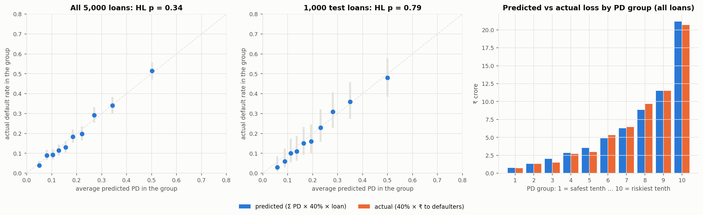
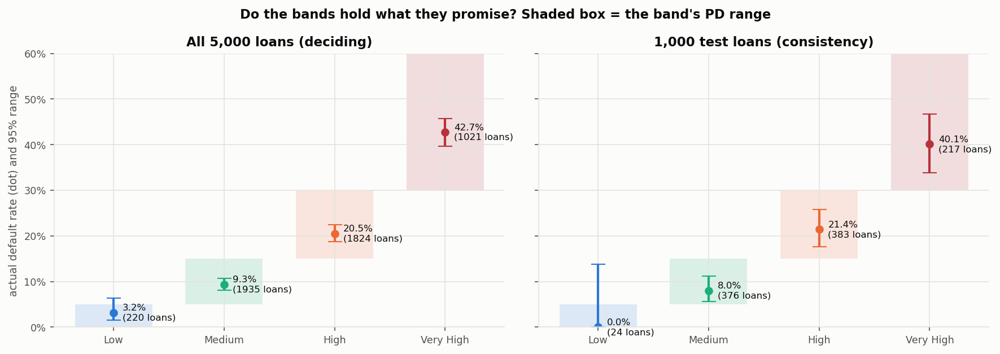
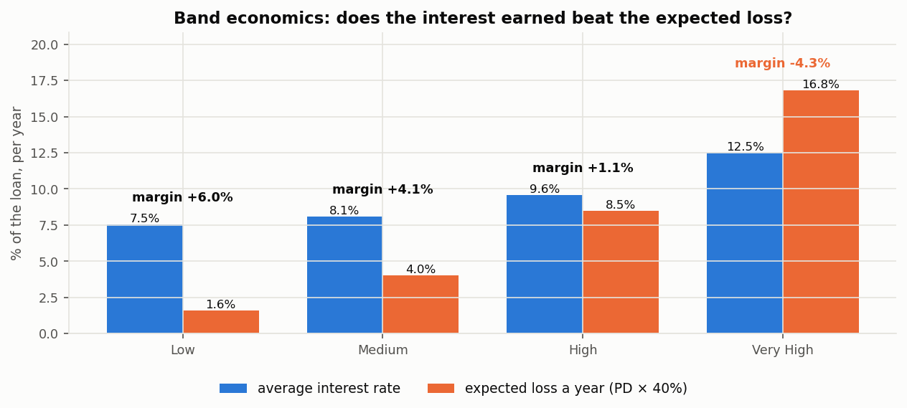
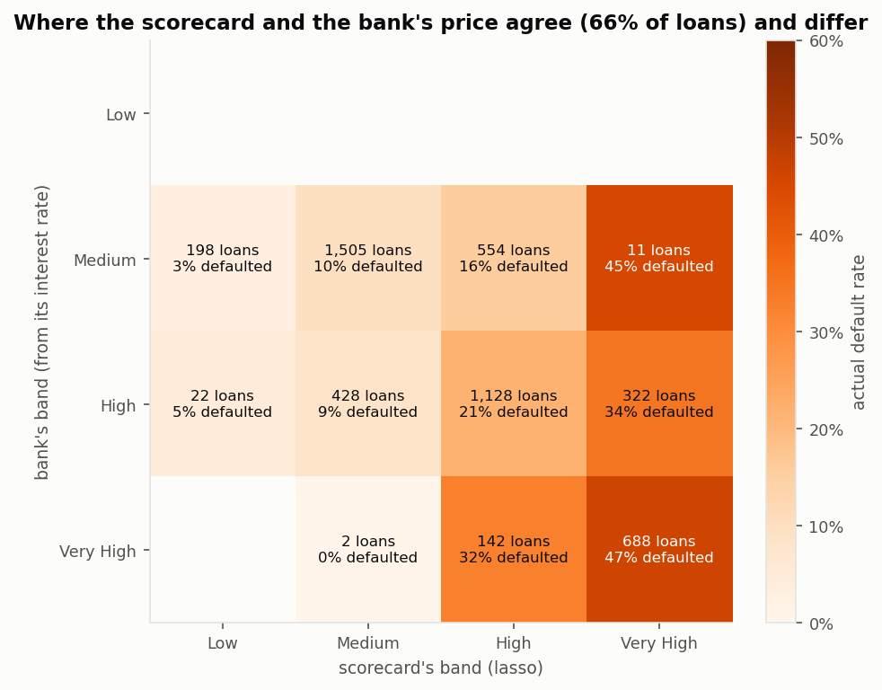

# Module 2 — Task 2 Report: PD per loan and the risk categories

**Brief (verbatim):**
> **Task 2: Estimate PD**
> For every borrower: PD = P(Default = 1 ∣ X)
> Generate: Loan_ID · Predicted_PD · Risk_Category
> Suggested categories: <5% Low · 5–15% Medium · 15–30% High · >30% Very High
> These thresholds are illustrative and should be justified rather than blindly adopted.

"PD = P(Default = 1 ∣ X)" reads: *the probability that the borrower defaults, given their details X.*

**Where this sits in the chain:** Data → PD model (Task 1) → **PD per loan and risk bands (Task 2)** → Expected Credit Loss and the Approve / Review / Reject decision (Task 3).

| Item | Where |
| --- | --- |
| Code and outputs | `notebooks/m02_task2_pd_bands.ipynb`: runs on its own (locally or in Colab) or from `run_module_2.ipynb` |
| Input from Task 1 | `outputs/task1/FINAL_M2_T1_default_predictions.csv` (the lasso PD and the champion PD for every loan) |
| Helpers used | `helpers/m02_data.py` (data), `helpers/m02_style.py` (chart style) |
| Tables and charts | `outputs/task2/` |
| **The brief's deliverable** | **`outputs/task2/loan_pd.csv`: Loan_ID · Predicted_PD · Risk_Category, all 5,000 loans** |
| Output for Task 3 | `outputs/task2/FINAL_M2_T2_risk_categories.csv` (adds Set, champion PD and champion band) |
| Decisions | M2-04, M2-14, M2-16, M2-17, M2-18, in `docs/decisions.md` |

---

## 1. Summary for management

**The ML case**
1. **The PDs can be trusted as probabilities.** Four calibration checks, with pass lines agreed before building, pass on all 5,000 loans **and** on the 1,000 test loans. For example, the PDs predict ₹63.0 crore of loss against ₹62.7 crore that actually happened. **No correction (Platt scaling) is needed.**
2. **The brief's four bands are justified by evidence, not copied.** Each band's loans default inside its range: 3.2% / 9.3% / 20.5% / 42.7%. The rates rise clearly from band to band, every band is big enough to measure, and the economics line up. No band needed merging.
3. **One honest caveat:** genuinely Low-risk borrowers are rare: 220 loans (4.4%). The Low band passes the size test only narrowly. On the 1,000 test loans it holds just 24, too few to test on their own.

**The finance case**
1. **Each cut-off marks a real change in profitability.** Interest minus expected loss (PD × 40%) a year:
   - Low: **+6.0%** of the loan;
   - Medium: **+4.1%**;
   - High: **+1.1%**, barely covering expected loss before any cost of funds or operations;
   - Very High: **−4.3%**, losing money.
2. **The whole ₹639.7 crore book earns only ₹2.76 crore a year more in interest than it is expected to lose.**
   - **Very High loans** (20% of loans, 30% of the ₹) carry **52% of the expected loss** and lose **₹8.25 crore a year** on their own.
   - **Medium loans** earn the most after expected loss (**+₹7.25 crore**).
3. **The scorecard sees risk the bank's price misses.**
   - The bank's price never signals Low risk: its lowest PD is 6.1%, at the 6.0% floor rate. The scorecard finds 220 Low-risk borrowers who default only 3.2%.
   - Where the two views disagree, the actual default rate almost always lands in the **scorecard's** band.
   - The bank charges the loans the scorecard calls safer (11.4% default) **more** (9.45%) than the loans it calls riskier (22.8% default, charged 9.05%).

**Decision:**
- Use the lasso PD as Predicted_PD, unchanged.
- Keep the brief's four bands, now justified.
- Pass both to Task 3 for the ECL and the Approve / Review / Reject decision.

---

## 2. Which PD each loan gets (decision M2-16)

A PD is only honest if it comes from a model that **didn't learn from that loan**. A model scoring its own training loans flatters itself. Task 1 already produced an honest PD for every loan:

| Loans | PD comes from | Count | Actual default rate | Average PD |
| --- | --- | --- | --- | --- |
| Training | **Out-of-fold**: each scored by cross-validation models trained on the other loans (average of 5 such scores) | 4,000 | 19.95% | 20.22% |
| Test | The final lasso (trained on the 4,000), scoring loans it never saw | 1,000 | 19.90% | 21.16% |

- Retraining on all 5,000 and scoring them was rejected, because every PD would then be flattered.
- To score **new applicants**, the bank would use `outputs/task1/chosen_model.joblib`.
- The **champion's PD** (the bank's interest rate turned into a probability) is carried alongside for Task 3.

---

## 3. Can a 20% PD be trusted as 20%? Calibration (decisions M2-14, M2-17)

**Calibration** means the PD *level* is right: among loans given about 20%, about 20 in 100 really default. A model can rank borrowers well and still have PDs that are all too high or too low. Task 3 multiplies PD by money, so the level matters in ₹.

**The four checks and their pass lines (agreed before building):**

| # | Check | Measured as | Pass if |
| --- | --- | --- | --- |
| 1 | Overall level | **Calibration intercept** a, in logit(actual) = a + 1 × logit(PD); 0 = no overall bias | 95% range includes 0 |
| 2 | Spread | **Calibration slope** b, in logit(actual) = a + b × logit(PD); 1 = right; < 1 too extreme; > 1 too timid | 95% range includes 1 |
| 3 | Group by group | **Hosmer–Lemeshow** test over 10 PD groups | p > 0.05 |
| 4 | In rupees | Predicted loss (Σ PD × 40% × loan) vs actual loss (40% × ₹ lent to defaulters); bootstrap 95% range of the difference | Range includes 0 |

```text
logit(PD) = ln(PD ÷ (1 − PD))                       e.g. PD 20% → ln(0.25) = −1.39

Hosmer–Lemeshow: sort loans by PD into 10 equal groups; in each, O = actual defaults, E = Σ PD, n = loans
    HL = Σ (O − E)² ÷ (E × (1 − E ÷ n));   compare with chi-square, 8 degrees of freedom → p-value
```

HL is sensitive to sample size, so it sits alongside checks 1, 2 and 4 rather than deciding alone.

**Results:**

| Check | All 5,000 loans | 1,000 test loans |
| --- | --- | --- |
| Average PD vs actual | 20.4% vs 19.9% | 21.2% vs 19.9% |
| 1. Intercept | −0.03 (−0.11 to +0.04) ✓ | −0.09 (−0.25 to +0.08) ✓ |
| 2. Slope | 1.04 (0.95 to 1.14) ✓ | 1.13 (0.90 to 1.35) ✓ |
| 3. Hosmer–Lemeshow | 9.1, p = 0.34 ✓ | 4.7, p = 0.79 ✓ |
| 4. Predicted vs actual loss | ₹63.0 vs ₹62.7 crore; difference −₹3.8 to +₹4.2 crore ✓ | ₹12.9 vs ₹12.7 crore; −₹1.6 to +₹1.9 crore ✓ |



- **All checks pass on both sets.**
- On the test loans, PDs run about 1.3 points high on average, which is within chance.
- The ₹ chart shows predicted and actual loss matching group by group, from the safest tenth (under ₹1 crore) to the riskiest (about ₹21 crore).

### 3.1 Platt scaling: not needed

Platt scaling is a one-input logistic regression on the model's own output, used to correct PDs that fail calibration:

```text
corrected PD = 1 ÷ (1 + e^−(a + b × logit(PD)))     a shifts all PDs, b stretches or squeezes them
```

It never changes the ranking, only the PD level. The rule was to apply it only if a check failed. None did, so **Predicted_PD is the lasso PD, unchanged**. The code remains in the notebook and would act automatically if the checks failed on new data.

---

## 4. Are the brief's bands justified? The four tests (decisions M2-04, M2-18)

**Bands:** Low under 5% · Medium 5% to under 15% · High 15% to under 30% · Very High 30% and above. A PD exactly on a cut-off goes to the higher band (the cautious side).

**The four tests and their pass lines (agreed before building):**

| # | Test | Pass line |
| --- | --- | --- |
| ① | Inside its range: do the band's loans default at a rate inside its PD range? | Actual rate inside the range |
| ② | Rising clearly: does each band default clearly more than the one below? | Chi-square across bands p < 0.05, **and** each step up p < 0.05 |
| ③ | Enough loans: can the band's rate be measured reliably? | 95% range of the actual rate narrower than the band (Low 5, Medium 10, High 15, Very High 15 points) |
| ④ | Economics: does the margin fall as risk rises? | Margin = average interest − average PD × 40% falls band to band, and is negative for Very High |

- **They decide on all 5,000 loans** (every PD honest).
- **On the 1,000 test loans** they act as a consistency check: ① and the rising order decide, while ② and ③ are reported only.
- **Fallback:** a failing band would be merged with its neighbour. Cut-offs are never moved to make a test pass.

```text
Wilson 95% range (d defaults of n loans, r = d ÷ n, z = 1.96):
    centre = (r + z² ÷ 2n) ÷ (1 + z² ÷ n);   half = z × √( r(1 − r) ÷ n + z² ÷ 4n² ) ÷ (1 + z² ÷ n)
Chi-square: χ² = Σ (actual − expected)² ÷ expected, where expected = loans in band × overall default rate
Step-up test: z = (r_upper − r_lower) ÷ √( r̄(1 − r̄)(1/n_upper + 1/n_lower) ),  r̄ = pooled rate of both bands
```

### 4.1 Results on all 5,000 loans (deciding)

| Band | Loans | Defaults | Actual default (95% range) | ① Inside | Range width vs band | ③ | Average interest | Expected loss a year | ④ Margin |
| --- | --- | --- | --- | --- | --- | --- | --- | --- | --- |
| Low | 220 (4.4%) | 7 | 3.2% (1.6–6.4%) | ✓ | 4.9 vs 5 points | ✓ | 7.5% | 1.6% | **+6.0%** |
| Medium | 1,935 (38.7%) | 180 | 9.3% (8.1–10.7%) | ✓ | 2.6 vs 10 | ✓ | 8.1% | 4.0% | **+4.1%** |
| High | 1,824 (36.5%) | 374 | 20.5% (18.7–22.4%) | ✓ | 3.7 vs 15 | ✓ | 9.6% | 8.5% | **+1.1%** |
| Very High | 1,021 (20.4%) | 436 | 42.7% (39.7–45.8%) | ✓ | 6.1 vs 15 | ✓ | 12.5% | 16.8% | **−4.3%** |

| ② Step up | Lower → upper rate | p-value |
| --- | --- | --- |
| Low → Medium | 3.2% → 9.3% | 0.001 ✓ |
| Medium → High | 9.3% → 20.5% | < 0.0001 ✓ |
| High → Very High | 20.5% → 42.7% | < 0.0001 ✓ |
| All bands (chi-square = 507.6, 3 degrees of freedom) | | ≈ 10⁻¹⁰⁹ ✓ |

**④:** the margin falls 6.0 → 4.1 → 1.1 → −4.3, negative for Very High ✓.

**Verdict: all four tests pass; no merges; the brief's four bands are kept.**

### 4.2 Consistency on the 1,000 test loans

| Band | Test loans | Actual default (95% range) | ① Inside | Step up from the band below |
| --- | --- | --- | --- | --- |
| Low | 24 | 0.0% (0.0–13.8%) | ✓ | — |
| Medium | 376 | 8.0% (5.7–11.2%) | ✓ | p = 0.075 (reported only) |
| High | 383 | 21.4% (17.6–25.8%) | ✓ | p < 0.0001 |
| Very High | 217 | 40.1% (33.8–46.7%) | ✓ | p < 0.0001 |

- Every band is inside its range, and the rates rise in order ✓.
- The Low band's 24 test loans are too few for its significance and size tests, as expected when a band holds about 2–4% of loans. This is reported, not deciding (M2-18).



**How the cut-offs are justified, in short:**
- **ML:** each band holds what it promises (①), the bands separate risk clearly (②), and each is measurable (③).
- **Finance:** each cut-off marks a step in profitability (④). Below 5%, a loan earns about 6% a year above its expected loss. At 15–30%, the margin is nearly gone. From 30%, the expected loss exceeds the interest.

---

## 5. The bands in rupees (Board view)

```text
Interest a year        = Σ Interest_Rate × Loan_Amount
Expected loss a year   = Σ Predicted_PD × 40% × Loan_Amount         (the brief's ECL, one-year view)
Actual loss            = 40% × ₹ lent to borrowers who defaulted
```

| Band | ₹ lent | Interest a year | Expected loss a year | Actual loss at 40% | **Interest − expected loss** | Share of ₹ lent | Share of expected loss |
| --- | --- | --- | --- | --- | --- | --- | --- |
| Low | ₹13.3 crore | ₹1.01 crore | ₹0.21 crore | ₹0.15 crore | **+₹0.80 crore** | 2.1% | 0.3% |
| Medium | ₹180.5 crore | ₹14.81 crore | ₹7.56 crore | ₹6.84 crore | **+₹7.25 crore** | 28.2% | 12.0% |
| High | ₹256.1 crore | ₹25.20 crore | ₹22.23 crore | ₹23.00 crore | **+₹2.97 crore** | 40.0% | 35.3% |
| Very High | ₹189.8 crore | ₹24.78 crore | ₹33.03 crore | ₹32.74 crore | **−₹8.25 crore** | 29.7% | **52.4%** |
| **Whole book** | **₹639.7 crore** | **₹65.80 crore** | **₹63.04 crore** | **₹62.72 crore** | **+₹2.76 crore** | 100% | 100% |



**What it means for the Board:**
- **"Fewer defaults":** Very High loans are the problem. They are a fifth of loans but half the expected loss, and lose ₹8.25 crore a year after expected defaults.
- **"Lend more":** Medium loans are the profitable core (+₹7.25 crore a year on ₹180 crore). Low loans earn the highest margin but are scarce.
- **High loans are borderline.** They earn ₹2.97 crore above expected loss on ₹256 crore, about 1.2%. Any cost of funding or running the loans eats most of that. Task 3's decision rule and cost sensitivity settle how much of High is worth keeping.
- **The whole book barely covers its expected loss** (+₹2.76 crore a year). The interest earned is low for the risk taken, consistent with the mispricing found in Task 1.
- **Retail and Corporate behave alike** in every band (Medium 9.5% vs 8.8%, Very High 42.2% vs 44.2% default), so one set of bands serves both.

---

## 6. The scorecard's bands against the bank's own view

The bank's interest rate, turned into a PD in Task 1 (the champion), is placed in the **same bands**. The cross-table shows where the two views agree and who is right when they differ.



- **The bank's price never signals Low risk.** Its lowest PD is 6.1%, at the 6.0% floor rate. The scorecard finds **220 Low-risk loans that default 3.2%**.
- **The two views put 66% of loans in the same band.** Where they disagree, the actual default rate lands in the **scorecard's** band:

| Bank's band | Scorecard's band | Loans | ₹ lent | Actual default |
| --- | --- | --- | --- | --- |
| Medium | **Low** | 198 | ₹11.5 crore | **3.0%** |
| High | **Medium** | 428 | ₹44.1 crore | **8.6%** |
| Medium | **High** | 554 | ₹64.6 crore | **15.5%** |
| High | **Very High** | 322 | ₹45.7 crore | **34.5%** |
| Very High | High | 142 | ₹32.2 crore | 32.4%: **here the bank is right** |

| Summary | Loans | ₹ lent | Actual default | Average rate charged |
| --- | --- | --- | --- | --- |
| Scorecard puts in a **safer** band | 792 | ₹89.9 crore | **11.4%** | **9.45%** |
| Same band | 3,321 | ₹438.0 crore | 21.2% | 9.67% |
| Scorecard puts in a **riskier** band | 887 | ₹111.8 crore | **22.8%** | **9.05%** |

**The bank charges the loans the scorecard calls safer more than those it calls riskier**, although the safer group defaults half as often. This is the mispricing from Task 1, now by band and in rupees:
- the 428 "High-priced but Medium-risk" loans (₹44.1 crore) are good customers being overcharged;
- the 322 "High-priced but Very-High-risk" loans (₹45.7 crore) are underpriced risk.

---

## 7. What goes to Task 3

- **`loan_pd.csv`**: the brief's deliverable (Loan_ID, Predicted_PD, Risk_Category).
- **`FINAL_M2_T2_risk_categories.csv`**: the same, plus Set, PD_champion and Champion_Category.
- **Calibrated PDs**, so ECL = Predicted_PD × 40% × Loan_Amount can be computed directly.
- **For Task 3 to decide:**
  - Very High loses money on average;
  - High barely pays before costs;
  - the approval level must be checked against Task 1's 73% turning point;
  - the cost-of-lending sensitivity decides how much of High is worth keeping.

---

## 8. Risks and limitations

- **The Low band is thin**: 220 loans and 7 defaults. It passes the size test narrowly (a 4.9-point range against a 5-point band). Its 3.2% rate is clearly below Medium's 9.3%, but more data would firm it up.
- **The test set is small for the smallest band** (24 Low loans), so significance and size are judged on all 5,000 loans, where every PD is honest.
- **Two PD sources** (out-of-fold for training loans, the 4,000-loan model for test loans) differ slightly in how they were trained. Calibration passes on both, so the difference does not matter in practice.
- **Calibrated on this book.** If the applicant mix or the economy changes, the PD levels can drift. Calibration should be re-checked on new loans, and Platt scaling is ready in the code if needed.
- **One-year view, 40% LGD.** The band economics use the brief's assumptions. Task 3 tests costs and LGD.
- **Synthetic data.** Retail and Corporate behave identically, which is unlikely in real lending.
