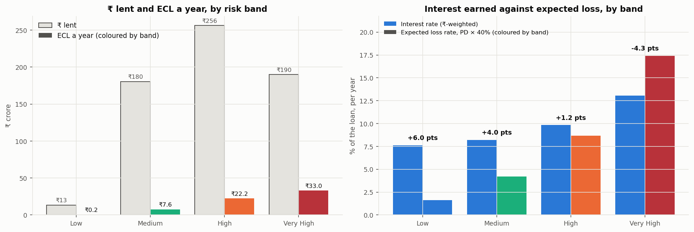
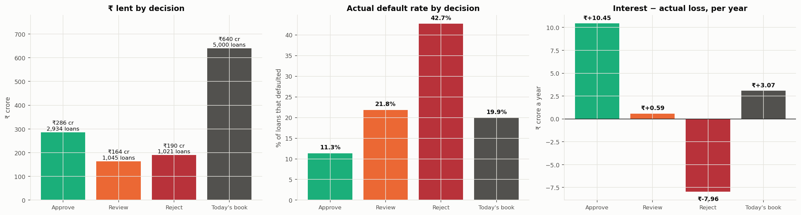
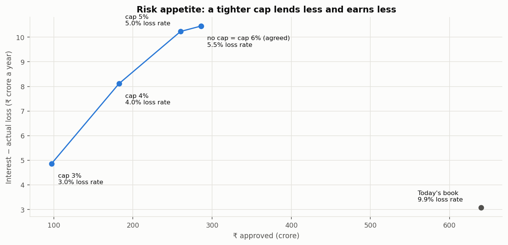
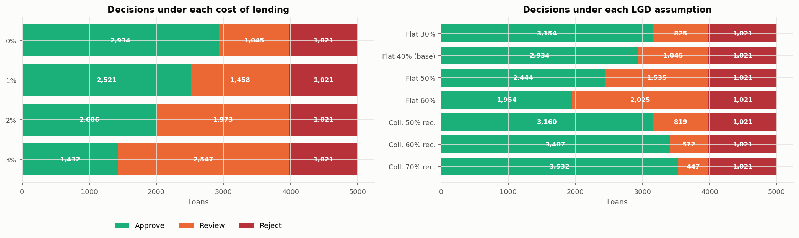
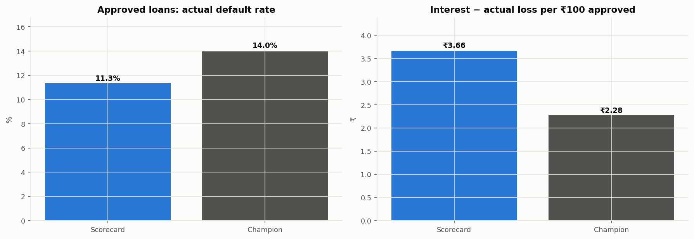
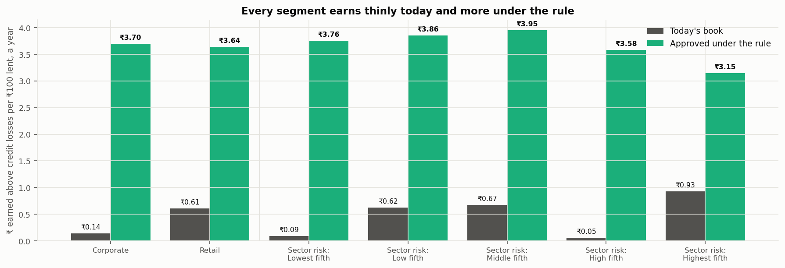

# Module 2 — Task 3 Report: Expected Credit Loss and the Approve / Review / Reject decision

**Brief (verbatim):**
> **Task 3: Expected Credit Loss**
> Assume: ECL = PD × LGD × EAD
> For example, students may assume: LGD = 40% and: EAD = Loan Amount
> Then calculate: ECLᵢ = PDᵢ × 0.40 × LoanAmountᵢ
>
> **Final decision**
> Recommend: Approve / Review / Reject
> based on: PD · ECL · borrower characteristics · loan size · collateral · risk appetite

**Business problem (brief):** *NovaFin wants to increase lending while reducing defaults. Management asks: which loans should we approve, reject or send for manual review?*

**Terms used in this report:**
- **PD** (probability of default): the chance the borrower fails to repay within the year.
- **LGD** (loss given default): the share of the loan lost if the borrower defaults, after recoveries.
- **EAD** (exposure at default): what is owed when the borrower defaults; here, the loan amount.
- **ECL** (expected credit loss): the loss to expect on average over one year, in ₹ = PD × LGD × EAD.
- **Required rate**: the lowest interest rate at which a loan's interest would cover its expected loss.
- **Risk appetite**: how much loss the Board accepts in return for income.

**Where this sits in the chain:** Data → PD model (Task 1) → PD per loan and risk bands (Task 2) → **ECL and the decision (Task 3)**.

| Item | Where |
| --- | --- |
| Code and outputs | `notebooks/m02_task3_ecl_decision.ipynb`: runs on its own (locally or in Colab) or from `run_module_2.ipynb` |
| Input from Task 2 | `outputs/task2/FINAL_M2_T2_risk_categories.csv` (Predicted_PD, Risk_Category and the champion PD for every loan) |
| Helpers used | `helpers/m02_data.py` (data and ratios), `helpers/m02_style.py` (chart style) |
| Tables and charts | `outputs/task3/` |
| **The decision file** | **`outputs/task3/FINAL_M2_T3_loan_decisions.csv`: one row per loan, no blank cells, no codes: the numbers (for analysis and Module 9), every check in words, the decision, an action for each Review loan, and the full reason. Column guide in §5.1** |
| Decisions | M2-03, M2-05, M2-06, M2-19, M2-20, in `docs/decisions.md` |

---

## 1. Summary for management

**The answer**

| Decision | Loans | ₹ lent | Actual default | Interest − actual loss, per year |
| --- | --- | --- | --- | --- |
| **Approve** | 2,934 (59%) | ₹285.9 crore | **11.3%** | **+₹10.45 crore** |
| **Review** | 1,045 (21%) | ₹163.9 crore | 21.8% | +₹0.59 crore |
| **Reject** | 1,021 (20%) | ₹189.8 crore | 42.7% | **−₹7.96 crore** |
| *Today's book* | *5,000* | *₹639.7 crore* | *19.9%* | *+₹3.07 crore* |

**The finance case**
1. **Fewer defaults:** approved loans default 11.3%, against 19.9% for the loans the bank actually made.
2. **More earned on less risk:** the approved loans earn ₹10.45 crore a year above their credit losses, more than three times today's whole book (₹3.07 crore), on less than half the money.
3. **Losses avoided:** the rejected loans lose ₹7.96 crore a year on their own.
4. **"Lend more" comes through Review:** ₹163.9 crore of loans that are not bad, but are under-priced, weakly secured or very large. Each carries a required rate. Re-priced, or with more collateral, they can be lent safely.
5. **Today's pricing barely covers risk.** The whole book breaks even at a cost of funds of just 0.48% a year. Under the rule, the approved book stays profitable at every cost tested (up to 3%).

**The ML case**
1. **The ECL is right in ₹:** ₹63.04 crore expected against ₹62.72 crore actually lost at 40%. Each decision group's expected loss rate sits close to its actual loss rate.
2. **The drop in defaults is real:** one-sided z test, p ≈ 10⁻²³. It holds on the 1,000 test loans that were never used to choose anything (Approve 11.3%, Review 21.1%, Reject 40.1%).
3. **The rule is robust:** Reject never changes under any cost or LGD assumption tested, and the approved book stays profitable in every case.
4. **The scorecard beats the bank's own pricing in the decision:** the same rule driven by the bank's price earns ₹3.09 crore a year less, at a higher default rate (14.0%).

**Recommendation to the Board:** adopt the rule (section 3) with the 6% risk-appetite cap. Send Review loans for re-pricing at their required rate, or for more collateral. Reprice the business the scorecard shows is under-charged. Do not widen approval above about 73% without re-checking, because the scorecard's ranking advantage reverses there.

---

## 2. ECL for every loan (the brief's formula)

```text
ECL (₹, one year)          = Predicted_PD × 0.40 × Loan_Amount
Expected loss rate         = PD × 0.40                          (a % of the loan, per year)
Interest a year (₹)        = Interest_Rate × Loan_Amount
Interest − expected loss   = Interest a year − ECL
```

- **PD** comes from Task 2. It is calibrated: it predicted ₹63.0 crore of loss against ₹62.7 crore actual.
- **LGD = 40%** is the brief's assumption. It is also the Basel III supervisory value for senior unsecured loans to companies. The data has no recovery amounts, so LGD cannot be measured; section 8 tests other values.
- **One-year view:** PD and interest rate are both yearly. Default does not rise with loan term in this data (Task 1: 19.1% to 20.8% across terms).

| Band | Loans | ₹ lent | ECL a year | Share of ECL | Interest − ECL |
| --- | --- | --- | --- | --- | --- |
| Low | 220 | ₹13.3 crore | ₹0.21 crore | 0.3% | +₹0.80 crore |
| Medium | 1,935 | ₹180.5 crore | ₹7.56 crore | 12.0% | +₹7.25 crore |
| High | 1,824 | ₹256.1 crore | ₹22.23 crore | 35.3% | +₹2.97 crore |
| Very High | 1,021 | ₹189.8 crore | ₹33.03 crore | **52.4%** | **−₹8.25 crore** |
| **Whole book** | **5,000** | **₹639.7 crore** | **₹63.04 crore** | 100% | **+₹2.76 crore** |



The largest single ECL is ₹37.6 lakh a year; the median is ₹0.67 lakh.

---

## 3. The decision rule (decisions M2-05, M2-06, M2-20)

Every loan goes through the steps in order. Every factor the brief lists is used.

| Step | Rule | Brief factor |
| --- | --- | --- |
| 1 | PD > 30% → **Reject** | PD, risk appetite |
| 2 | Interest rate ≤ PD × 40% → **Review**, with a required rate | ECL |
| 3a | Loan in the largest 5% of the book (₹33.3 lakh or more) → **Review** | Loan size |
| 3b | Interest rate ≤ PD × collateral-aware LGD → **Review** | Collateral |
| 3c | No separate override: they act through the PD | Borrower characteristics |
| 4 | Approved book's expected loss rate > 6% → highest-PD Approves move to **Review** | Risk appetite |
| — | Otherwise → **Approve** | |

```text
Collateral-aware LGD   = max(0, 1 − 50% × Collateral_Value ÷ Loan_Amount)
Required rate          = cost + PD × max(40%, collateral-aware LGD)      (cost = 0 in the base)
Expected loss rate of the approved book = total ECL ÷ total ₹ approved
```

### 3.1 Where each threshold comes from, and how it was checked

| Threshold | Where it comes from | Why | How it was checked |
| --- | --- | --- | --- |
| **PD 30%** (Reject) | The brief's Very High band | Above 30%, expected loss (12% of the loan or more) beats the interest the bank charges there | Task 2: Very High loans default 42.7% and lose 4.3% of the loan a year on average |
| **Interest > PD × 40%** (Approve test) | The brief's ECL, compared with what the loan earns (the assignment guide's worked example) | A loan whose interest does not cover its expected loss loses money on average | The agreed test, applied with no cost of funds (section 7 adds 1–3%) |
| **Largest 5%** (₹33.3 lakh) | Judgement, chosen from three tested cut-offs | One default among these loses up to ₹28.9 lakh, so a person should check them (concentration) | Section 4.2: they default 24.3% vs 12.5%. Largest 10% doubles the queue; largest 2% catches only 39 loans |
| **50% recovery** (collateral) | Chosen so the book's average LGD matches the brief | At 50%, the average collateral-aware LGD is 37.4%, close to 40%: total loss unchanged, only spread by cover | Section 4.3. Not verifiable (no recovery data), so the flag only sends loans to Review |
| **6% cap** (risk appetite) | 9.1% typical (median) interest − 3% top cost of funds = 6.1%, rounded to 6% | Even at the highest cost assumed, expected loss must not use up all the interest | Section 6: the rule's approved book sits at 5.45%, so the cap is a guardrail and moves no loan |

**Flags only send loans to Review.** They never approve or reject on their own, because the 5% cut-off and the 50% recovery are judgements the data cannot test directly.

### 3.2 How many loans each step catches

| Step | Loans caught | Caught only by this step |
| --- | --- | --- |
| 1. PD over 30% → Reject | 1,021 | 1,021 |
| 2. Interest below expected loss → Review | 437 | 226 |
| 3a. Large loan → Review | 125 | 76 |
| 3b. Weak collateral → Review | 736 | 497 |
| 4. Over the 6% cap → Review | 0 | 0 |

The counts cover every loan not rejected, and a loan can be caught by more than one step. Every loan's reasons are recorded in `FINAL_M2_T3_loan_decisions.csv`.

---

## 4. The evidence behind each part of the rule

These tables use the 3,542 loans that pass steps 1 and 2, the ones the flags act on.

### 4.1 Borrower characteristics: already in the PD

| Characteristic (lowest fifth → highest fifth) | Actual default | Predicted PD |
| --- | --- | --- |
| Debt-to-income | 9.1% → 18.5% | 10.1% → 17.8% |
| Credit score | 16.8% → 8.8% | 17.4% → 9.5% |
| Sector risk | 11.7% → 15.0% | 13.0% → 13.8% |
| Past default (no / yes) | 12.8% / 14.7% | 13.4% / 19.2% |
| Retail / Corporate | 13.1% / 12.4% | 13.5% / 13.6% |

- Across all 24 groups tested (the above, plus employment length), **no gap between predicted and actual is bigger than chance** (every p > 0.05, exact binomial test).
- **So a separate characteristics rule would count the same risk twice.** Characteristics still explain each decision: credit score and debt-to-income are the main drivers of the PD (Task 1).

### 4.2 Loan size

| Largest | Cut-off | Loans | ₹ | Actual default | Predicted PD | Rest of loans | p (model under-predicts?) |
| --- | --- | --- | --- | --- | --- | --- | --- |
| 10% | ₹25.7 lakh | 239 | ₹83.5 crore | 22.2% | 19.4% | 12.2% | 0.29 |
| **5% (agreed)** | **₹33.3 lakh** | **111** | **₹46.4 crore** | **24.3%** | 20.2% | 12.5% | 0.29 |
| 2% | ₹43.0 lakh | 39 | ₹20.0 crore | 33.3% | 20.1% | 12.6% | **0.046** |

- Large loans default more. For the largest 5%, the model sees most of it, and the remaining gap could be chance.
- **For the very largest loans (2%), the model under-predicts by more than chance.** The 5% flag already sends all of them to a person.

### 4.3 Collateral

- **Collateral does not predict default:** 12.6% when the loan is above its collateral, 13.0% when within (p = 0.77).
- **It changes how much is lost.** Counting it at 50% recovery gives an average LGD of 37.4%, close to the brief's 40%.
- **The 532 loans flagged for weak collateral** hold ₹72.9 crore and are typically 1.38× their collateral. They default 19.7% and earn only +₹0.74 crore a year. The rest default 11.7% and earn +₹10.67 crore.

---

## 5. The result in ₹

| Group | Loans | ₹ lent | Actual default (95% range) | Expected loss rate | Actual loss rate | Interest − actual loss |
| --- | --- | --- | --- | --- | --- | --- |
| **Approve** | 2,934 (59%) | ₹285.9 crore (45%) | 11.3% (10.3–12.5%) | 5.45% | 5.10% | **+₹10.45 crore** |
| Review | 1,045 (21%) | ₹163.9 crore (26%) | 21.8% (19.4–24.4%) | 8.79% | 9.40% | +₹0.59 crore |
| Reject | 1,021 (20%) | ₹189.8 crore (30%) | 42.7% (39.7–45.8%) | 17.41% | 17.25% | −₹7.96 crore |
| *Today's book* | *5,000* | *₹639.7 crore* | *19.9% (18.9–21.1%)* | *9.86%* | *9.81%* | *+₹3.07 crore* |



- **How sure are we?** A bootstrap with 1,000 resamples puts what the approved loans earn at ₹8.62 to ₹12.11 crore a year. The difference in default rate from today's book is far beyond chance (p ≈ 10⁻²³).
- **Test loans (1,000, never used to choose anything):**

| Group | Loans | Actual default | Interest − actual loss |
| --- | --- | --- | --- |
| Approve | 541 | 11.3% | +₹1.70 crore |
| Review | 242 | 21.1% | +₹0.16 crore |
| Reject | 217 | 40.1% | −₹1.30 crore |
| Test book | 1,000 | 19.9% | +₹0.55 crore |

The pattern holds: default rises from Approve to Review to Reject, and Approve sits well below the book.

**Example loans** (each the loan closest to its group's median PD):

| Example | Loan | Collateral | Credit score | PD | Rate charged | Required rate | Decision | Defaulted? |
| --- | --- | --- | --- | --- | --- | --- | --- | --- |
| Approve | ₹2.6 lakh | ₹3.9 lakh | 684 | 11.5% | 9.99% | 4.60% | Approve: passes every test | No |
| Under-priced | ₹15.2 lakh | ₹27.6 lakh | 671 | 25.6% | 9.84% | 10.23% | Review: interest below expected loss | No |
| Weak collateral | ₹18.1 lakh | ₹10.5 lakh | 630 | 18.7% | 10.40% | 13.27% | Review: weak collateral | No |
| Large loan | ₹35.0 lakh | ₹68.9 lakh | 759 | 18.6% | 9.50% | 7.44% | Review: large loan | No |
| Reject | ₹21.0 lakh | ₹26.1 lakh | 681 | 39.1% | 10.13% | — | Reject: PD over 30% | Yes |

- **The under-priced loan** needs 10.23% to cover its expected loss, against the 9.84% charged.
- **The weak-collateral loan** is 1.7× its collateral, so it needs 13.27% to cover its loss.
- **The large loan** is priced well enough, but a single default would cost about ₹14 lakh, so a person checks it.

### 5.1 The decision file: `outputs/task3/FINAL_M2_T3_loan_decisions.csv`

One row per loan, **no blank cells and no codes**. It serves three readers: later modules and analysis (the numbers), the credit team (each check and an action), and an evaluator or regulator (the full reason).

| Column | What it shows | Example (loan 201320, Review) |
| --- | --- | --- |
| Loan_ID, Customer_Type | Who it is | 201320, Retail |
| Loan_Amount (₹), Collateral_Value (₹) | Loan and security, in rupees | 18,06,709 · 10,49,961 |
| Predicted_PD, Risk_Category | The scorecard's probability of default and its band (Task 2) | 0.187 · High |
| ECL a year (₹), Interest a year (₹) | Expected loss (PD × 40% × loan) and what the loan earns | 1,35,132 · 1,87,898 |
| Rate charged (%), Expected loss rate (%), Expected return (%) | The rate, PD × 40%, and the difference (the return Module 9 uses) | 10.40 · 7.48 · 2.92 |
| Required rate (%) | Lowest rate that covers expected loss, with collateral counted (filled for every loan; for a rejected loan it is the break-even rate) | 13.27 |
| Decision | Approve / Review / Reject | Review |
| Check: PD | Step 1, in words with its number | Pass: PD 18.7% is at or below 30% (High) |
| Check: interest covers expected loss | Step 2 | Pass: charges 10.40%, expected loss 7.48% a year |
| Check: loan size | Step 3a | Pass: ₹18.1 lakh, below ₹33.3 lakh |
| Check: collateral | Step 3b | Flag: loan is 1.72× collateral; with collateral counted, expected loss 13.27% a year vs 10.40% charged |
| Check: risk appetite | Step 4 | Not applicable: not approved |
| Decision path | Which route of the rule it took | Review: weak collateral |
| **Action** | What the credit team should do | **Offer at least 13.27% (now 10.40%) or raise collateral to ₹16.0 lakh (+₹5.5 lakh)** |
| Full reason | The deciding factor first, then every other check | Review: Weak collateral. Other checks: … |

**Actions in the file:**
- Approve: lend at the rate charged.
- Review, under-priced: the rate to offer.
- Review, weak collateral: the rate to offer, or the collateral that would pass at today's rate.
- Review, large loan: a credit committee check of the exposure.
- Reject: decline, with the break-even rate the risk would need.

**Module 9 (capital allocation):** the money and rate columns stay numeric and complete, and Customer_Type is included, so approved volume, ECL rate and expected return can be added up for Retail and Corporate lending separately. The totals are also saved in `key_numbers.json`.

---

## 6. Risk appetite: the trade-off (decision M2-06)

| Setting | Loans approved | ₹ approved | Expected loss rate | Actual default | Interest − actual loss |
| --- | --- | --- | --- | --- | --- |
| Today's book | 5,000 | ₹639.7 crore | 9.86% | 19.9% | +₹3.07 crore |
| **Rule, no cap = cap 6% (agreed)** | **2,934** | **₹285.9 crore** | **5.45%** | **11.3%** | **+₹10.45 crore** |
| Rule, cap 5% | 2,755 | ₹260.1 crore | 5.00% | 10.5% | +₹10.23 crore |
| Rule, cap 4% | 2,106 | ₹182.3 crore | 4.00% | 8.7% | +₹8.11 crore |
| Rule, cap 3% | 1,252 | ₹97.3 crore | 3.00% | 7.0% | +₹4.86 crore |



- **The 6% cap does not bind:** the approved book is at 5.45%. It is a guardrail that would act only if PDs or the mix of applicants shifted.
- **A tighter cap trades income for safety.** Going from 6% to 4% cuts defaults from 11.3% to 8.7%, but lends ₹103.6 crore less and earns ₹2.34 crore a year less. Every loan it removes still earns more than its expected loss. When a cap is hit, the highest-PD loans move to Review first.

---

## 7. Cost of lending (decision M2-05)

The bank pays for its money and for running each loan. The data gives no figure, so the base uses none, and 1–3% is tested.

| Cost | Approve / Review / Reject | ₹ approved | Approved default | Median rate rise for under-priced Review loans | Approved: interest − actual loss − cost | Today's book, same measure |
| --- | --- | --- | --- | --- | --- | --- |
| **0% (base)** | 2,934 / 1,045 / 1,021 | ₹285.9 crore | 11.3% | +1.64 points | **+₹10.45 crore** | +₹3.07 crore |
| 1% | 2,521 / 1,458 / 1,021 | ₹236.1 crore | 10.6% | +2.10 | +₹6.85 crore | −₹3.32 crore |
| 2% | 2,006 / 1,973 / 1,021 | ₹179.0 crore | 9.1% | +2.38 | +₹4.40 crore | −₹9.72 crore |
| 3% | 1,432 / 2,547 / 1,021 | ₹120.5 crore | 8.8% | +2.70 | +₹2.16 crore | −₹16.11 crore |

- **Today's book breaks even at a cost of 0.48% a year:** at any realistic cost of funds it loses money. This is the clearest sign that the bank's pricing does not reflect risk.
- **The rule's approved book stays profitable at every cost.**
- Cost only moves loans between Approve and Review: Reject depends on PD alone.

---

## 8. LGD (decision M2-03)

| LGD | Approve / Review / Reject | Decisions changed | Approved default | Approved: interest − actual loss at this LGD |
| --- | --- | --- | --- | --- |
| Flat 30% | 3,154 / 825 / 1,021 | 220 | 12.6% | +₹14.27 crore |
| **Flat 40% (base)** | **2,934 / 1,045 / 1,021** | — | **11.3%** | **+₹10.45 crore** |
| Flat 50% | 2,444 / 1,535 / 1,021 | 490 | 9.9% | +₹6.74 crore |
| Flat 60% | 1,954 / 2,025 / 1,021 | 980 | 8.7% | +₹4.81 crore |
| Collateral-aware, 50% recovery | 3,160 / 819 / 1,021 | 226 | 12.5% | +₹14.91 crore |
| Collateral-aware, 60% recovery | 3,407 / 572 / 1,021 | 473 | 13.4% | +₹19.87 crore |
| Collateral-aware, 70% recovery | 3,532 / 447 / 1,021 | 598 | 13.4% | +₹24.01 crore |



- **Reject never changes, and the approved book stays profitable under every LGD tested.**
- A higher flat LGD makes the rule stricter. Counting collateral approves more, because well-covered loans lose little on default.
- In every row, total ECL matches the actual loss at that LGD (for example, at flat 50%, ₹78.8 crore against ₹78.4 crore), because the PDs are calibrated.
- 1,665 loans (₹212.7 crore) are bigger than their collateral. These are where the recovery assumption matters most.

---

## 9. Scorecard against the bank's own view (decision M2-19)

| PD used in the same rule | Approve / Review / Reject | ₹ approved | Approved default | Interest − actual loss | Per ₹100 approved |
| --- | --- | --- | --- | --- | --- |
| **Scorecard (used)** | 2,934 / 1,045 / 1,021 | ₹285.9 crore | **11.3%** | **+₹10.45 crore** | **₹3.66** |
| Champion (the bank's price) | 3,210 / 958 / 832 | ₹322.4 crore | 14.0% | +₹7.36 crore | ₹2.28 |



- **With the scorecard, the rule earns ₹3.09 crore a year more while lending ₹36.5 crore less.**
- **Ranking alone, at equal approval levels** (the champion's actual loss minus the scorecard's):

| Approval level | All 5,000 loans | 1,000 test loans | Note |
| --- | --- | --- | --- |
| 58.7% | +₹1.93 crore | +₹0.40 crore | the rule's approval level |
| 70.8% | +₹0.23 crore | −₹0.21 crore | steps 1–2 alone, before the flags |
| 73.0% | −₹0.65 crore | −₹0.04 crore | Task 1's turning point |
| 80.0% | −₹1.23 crore | −₹0.17 crore | |

- **The rule sits well below Task 1's 73% turning point,** where the scorecard is clearly better at choosing who gets a loan. Steps 1–2 alone would have landed near the turning point (a tie); the size and collateral flags moved it into the range where the scorecard wins.
- **Board warning:** above about 73% approval the scorecard's ranking advantage reverses. Its value there would come from pricing, not from choosing who gets a loan.

---

## 10. Concentration and segments

| Group | Share of today's ₹ | Share of approved ₹ | Approval rate | Approved default |
| --- | --- | --- | --- | --- |
| Corporate | 27.1% | 26.4% | 58.6% | 11.4% |
| Retail | 72.9% | 73.6% | 58.7% | 11.3% |
| Sector risk, safest fifth | 19.1% | 20.0% | 60.3% | 10.1% |
| Sector risk, riskiest fifth | 20.7% | 20.1% | 57.8% | 12.8% |

- The approved book keeps today's mix. Retail and Corporate are treated alike.
- Each fifth of sector risk holds 19–21% of approved ₹. Approved default is slightly higher in the two riskiest fifths (13.2%, 12.8%), but no fifth dominates.
- **No concentration limit is set:** the data gives no basis for one. This is reported for the Board to watch.

### 10.1 Results by segment (decision M2-22)

| Segment | ₹ lent today | Default today → approved | Earned per ₹100 lent today | Earned per ₹100, approved | Expected return, approved |
| --- | --- | --- | --- | --- | --- |
| Retail | ₹466.4 crore | 19.9% → 11.3% | ₹0.61 | ₹3.64 | 3.30% |
| Corporate | ₹173.2 crore | 20.0% → 11.4% | ₹0.14 | ₹3.70 | 3.31% |
| Sector risk, lowest fifth | ₹122.1 crore | 18.2% → 10.1% | ₹0.09 | ₹3.76 | 3.35% |
| Sector risk, low fifth | ₹130.5 crore | 19.5% → 10.7% | ₹0.62 | ₹3.86 | 3.19% |
| Sector risk, middle fifth | ₹127.5 crore | 20.0% → 9.9% | ₹0.67 | ₹3.95 | 3.25% |
| Sector risk, high fifth | ₹127.3 crore | 21.3% → 13.2% | ₹0.05 | ₹3.58 | 3.31% |
| Sector risk, highest fifth | ₹132.3 crore | 20.7% → 12.8% | ₹0.93 | ₹3.15 | 3.40% |

"Earned" = interest − actual loss at 40%, before the cost of funds. "Expected return" = interest rate − ECL rate.



- **Every segment earns thinly today, and every segment earns ₹3.15–₹3.95 per ₹100 under the rule.** The rule works the same way across the book.
- **Corporate earns less than Retail today (₹0.14 vs ₹0.61 per ₹100), but the gap is within chance:** the bootstrap 95% range of the difference is −₹0.90 to +₹1.91. It is not evidence that Corporate lending is worse; both segments are thin, and Corporate's own range includes losing money.
- **Under the rule the two segments are indistinguishable:** approved default 11.3% vs 11.4% (p = 0.98).
- **Sector risk:** the two riskiest fifths keep a slightly higher approved default (13.2%, 12.8% against 9.9–10.7%), and the riskiest earns the least under the rule (₹3.15). A weak pattern, matching Task 1 (default rises only from 18.2% to 20.7% across fifths): worth watching, not acting on.

---

## 11. Recommendation to the Board

1. **Adopt the rule** in section 3, driven by the scorecard's PD, with the 6% risk-appetite cap.
   - Approve 2,934 loans (₹285.9 crore) at 11.3% default.
   - Reject 1,021 loans that lose ₹7.96 crore a year.
2. **Work the Review queue (1,045 loans, ₹163.9 crore)** for "lend more":
   - offer under-priced loans their required rate (a median of 1.64 points more);
   - ask for more collateral on weakly secured loans;
   - have a person check the largest loans.
3. **Re-price the book.** Today's pricing breaks even at a cost of funds of only 0.48%. The scorecard shows where the bank charges safer borrowers more than riskier ones (Task 2).
4. **Keep approval below about 73%** unless the scorecard is re-checked. Above it, the bank's own price ranks applicants slightly better.
5. **Collect recovery data** on defaulted loans, so that LGD can be measured rather than assumed.

---

### Module 9 inputs: lending return and risk per ₹ (decision M2-23; Task 3 notebook step 11b)

**Why:** Module 9 compares every business on the same fields. The hand-off gave lending's return but not its risk; the loan file allows both.

**How:** return per ₹ lent = (interest − ECL) ÷ ₹ lent, a year, before cost of funds. Bad year: every PD doubled (a recession), LGD 40%. Severe: PD doubled and LGD 60%. 1-in-100 year from luck alone: 3,000 random draws of which loans default (seed 42); defaults independent, so it understates a real recession.

| Group | Loan type | ₹ lent (crore) | Interest rate | Expected loss | **Return per ₹ lent** | What it really earned | **Bad year (PD × 2)** | Severe (PD × 2, LGD 60%) | 1-in-100 year, luck alone |
| --- | --- | --- | --- | --- | --- | --- | --- | --- | --- |
| Approve | Retail | 210.5 | 8.73% | 5.44% | **3.30%** | 3.64% | **-2.14%** | -7.58% | 2.45% |
| Approve | Corporate | 75.4 | 8.81% | 5.50% | **3.31%** | 3.70% | **-2.19%** | -7.68% | 1.80% |
| Approve | All | 285.9 | 8.75% | 5.45% | **3.30%** | 3.66% | **-2.15%** | -7.61% | 2.60% |
| Review | Retail | 120.3 | 9.80% | 8.84% | **0.96%** | 0.08% | **-7.88%** | -16.73% | -0.81% |
| Review | Corporate | 43.6 | 9.63% | 8.65% | **0.97%** | 1.12% | **-7.68%** | -16.34% | -2.05% |
| Review | All | 163.9 | 9.76% | 8.79% | **0.96%** | 0.36% | **-7.83%** | -16.62% | -0.51% |

- **Approved loans earn 3.3% a year** above expected losses (they really earned 3.7%), but **a recession year turns that into -2.2%** (-7.6% if collateral fetches less).
- **The Review queue earns about 1%** even in a normal year and loses about 8% in a recession: it adds volume only once re-priced.
- **Retail and Corporate behave alike** (same return and bad year), as found in Tasks 1–3.
- **All before the cost of funds**, which the data doesn't have; Module 9 applies it as a stated assumption.

## 12. Risks and limitations

- **LGD and recovery are assumed, not measured.** The data has no recovery amounts. The rule holds across flat LGD of 30–60% and recovery of 50–70%.
- **The 5% size cut-off and the 50% recovery are judgements.** That is why they only send loans to a person, never approve or reject on their own.
- **One-year view.** PD and interest are both yearly, and default does not rise with loan term in this data.
- **No cost-of-funds figure in the data.** The base uses none, and 1–3% is shown.
- **Outcomes are only seen for loans the bank made.** How applicants the bank turned down would have behaved is unknown, a standard limit of credit data ("reject inference").
- **The rule is tuned to this book.** If applicants change, the PDs and the cap should be re-checked: the cap is built to react if the approved book's expected loss rises.
