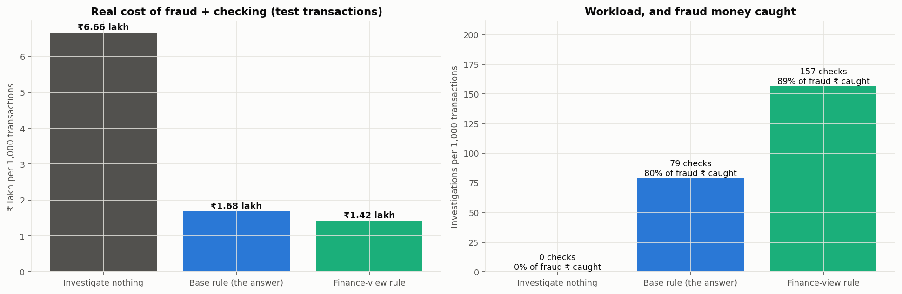
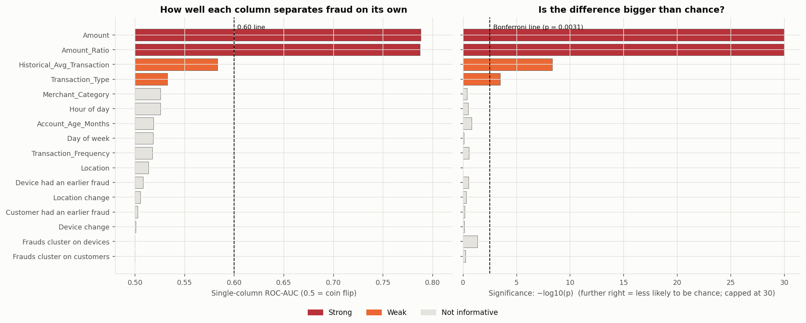
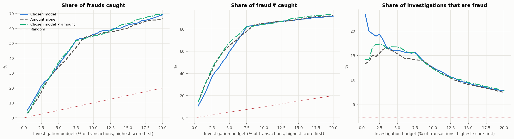
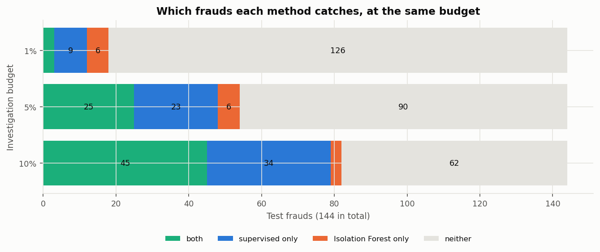
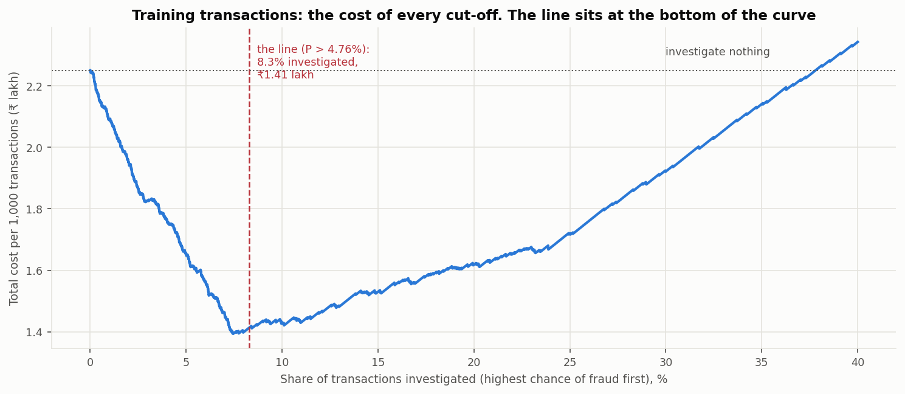

# Module 3 — Fraud Detection

## Final report

**The business problem (brief, verbatim):**
> NovaFin processes thousands of transactions every day.
> Management wants to identify suspicious transactions while minimizing unnecessary investigation.

**The four tasks (brief, verbatim):**
> **Task 1 — Exploratory analysis.** Investigate: Fraud rate · Fraud by transaction type · Fraud by amount · Fraud by location · Fraud by customer behaviour
>
> **Task 2 — Supervised fraud model.** Target: Fraud_Flag. Build model and compare performance
>
> **Task 3 — Unsupervised detection.** Use: Isolation Forest. The objective is to identify transactions that appear unusual even without relying directly on the fraud label. Compare: Supervised detection vs anomaly detection.
>
> **Task 4 — Cost-based threshold.** Assume: Missed fraud cost ₹10,000 · False-positive investigation cost ₹500. Then find a threshold that minimizes expected operational cost.

**Data:** `nova_transactions.csv`: 30,000 transactions from 2,500 customers, January 2025 to August 2026. That is about 49 a day, a sample of the "thousands every day" in the brief, so results are given per 1,000 transactions. Money is in plain rupees (1 lakh = ₹1,00,000).

**How to read this report.** Each section opens with its conclusion. Every number comes from a notebook output in `outputs/`. Every term is defined where it is first used, and the glossary at the end collects them.

| Item | Where |
| --- | --- |
| **Final output (open this first)** | **`outputs/FINAL_M3_module_output.xlsx`**: Read me · Key numbers · Board actions · every task's final file · Hand-off · Decisions · Evidence index (project decision P-21) |
| Run everything | `run_module_3.ipynb` (Run all, about 13 minutes) |
| Task notebooks | `notebooks/m03_task1_eda.ipynb`, `m03_task2_supervised.ipynb`, `m03_task3_isolation_forest.ipynb`, `m03_task4_cost_threshold.ipynb` |
| Task reports | `reports/task1_report.md` to `task4_report.md` |
| Decisions and their evidence | `docs/decisions.md` (M3-01 to M3-20) |
| **Deliverables** | `outputs/task1/FINAL_M3_T1_fraud_evidence.csv` · `outputs/task2/FINAL_M3_T2_fraud_scores.csv` · **`outputs/task3/unusual_transactions.csv`** · **`outputs/task4/FINAL_M3_T4_transaction_decisions.csv`** |

---

## 1. The answer in brief

**Investigate a transaction when the fraud model's chance of fraud is above 4.76%.** On 6,000 later transactions that the model never learned from, per 1,000 transactions:

| Rule | Investigations | Frauds caught | Fraud ₹ caught | Cost, brief's costs | Real cost (fraud at its actual amount) |
| --- | --- | --- | --- | --- | --- |
| Investigate nothing | 0 | 0% | 0% | ₹2.40 lakh | ₹6.66 lakh |
| **Investigate if chance of fraud > 4.76%** | **79** | **52%** | **80%** | **₹1.48 lakh (−38%)** | **₹1.68 lakh (−75%)** |
| Investigate if chance × amount is large enough (finance view) | 157 | 63% | 89% | — | ₹1.42 lakh (−79%) |
| Investigate everything | 1,000 | 100% | 100% | ₹4.88 lakh | ₹4.88 lakh |

**Terms:**
- **Chance of fraud (P(fraud)):** the supervised model's probability that a transaction is fraud.
- **4.76%:** the brief's ₹500 investigation cost ÷ (₹10,000 missed-fraud cost + ₹500). Above it, the expected loss from letting a transaction through beats the cost of checking it.



**The five findings behind the answer:**
1. **Fraud is rare by count but large by money.** 2.28% of transactions, but 6.2% of the money moved: ₹2.01 crore. The average fraud is ₹29,380, against ₹10,327 for a normal transaction (§3).
2. **Amount carries almost all the signal.** Of 16 columns tested, only the amount and the amount against the customer's usual amount separate fraud. Transactions of ₹25,000 and over are 9% of transactions but hold 84% of the money lost. City, merchant, time, device and history carry nothing in this data (§3).
3. **There are two kinds of fraud.** Large, unusual frauds hold most of the money, and every method finds them. A third of frauds look ordinary, carry about 8% of the money, and no method finds them (§3, §5, §7).
4. **Machine learning helps modestly, and most in combination with amount.** The supervised model beats "largest amount first" beyond chance. On its own it finds more frauds but fewer rupees; combined with the amount it finds more of both. Anomaly detection, without labels, does worse than either (§4, §5).
5. **The cost-based threshold saves 38% under the brief's costs, and 75% in real money.** The brief's flat ₹10,000 understates what fraud costs, by about three times (§6).

### 1.1 What we recommend the Board does

1. **Adopt the rule: investigate when the chance of fraud is above 4.76%.** That is about 79 checks per 1,000 transactions, catching half the frauds and 80% of the fraud money. Real saving: ₹4.98 lakh per 1,000 transactions.
2. **Settle the two cost assumptions before staffing the team.** If a missed fraud costs 40 times a check (not 20), investigations nearly triple, to 223 per 1,000.
3. **Consider the finance-view rule if investigators can be added.** Ranking by chance × amount saves ₹26,000 more per 1,000 transactions, but doubles the checks (157 per 1,000).
4. **Don't run anomaly detection as the main screen.** It saves only 13% and adds 3–6 frauds the model misses. Keep it, if at all, as a watch for new fraud patterns.
5. **Collect the data that would find the ordinary-looking frauds.** Real device fingerprints, login and location history, and payee details. In this file, device and customer columns behave like random labels.
6. **Re-check the model and the line regularly.** The chances were honest around the 4.76% line on these 20 months. Fraud patterns change, so check every quarter.

### 1.2 Conclusions for the evaluator

**Machine learning.**
- Every column was tested on one agreed rule: significant after adjusting for 16 tests, and able to separate fraud on its own (single-column ROC-AUC of at least 0.60). Only amount and the amount ratio passed.
- Eleven model set-ups were compared over 25 cross-validation rounds against an "amount alone" benchmark, with an overfitting limit and a "simplest wins when within chance" rule fixed before results. A small LightGBM model was chosen: PR-AUC 0.132 vs 0.116 for amount alone. On the time-ordered test set, its ranking and probability gains are proven; its PR-AUC gain just touches zero.
- Isolation Forest, fitted without the label, flags transactions six times riskier than average but ranks worse than both, beyond chance.
- The threshold comes from the costs, and was checked against trying every cut-off and against calibration on both sides of the line.

**Finance.**
- Fraud costs 6.1% of money moved with no screening, and 1.55% with the rule (1.24% lost, 0.31% investigating).
- The brief's flat ₹10,000 understates real losses about three times. Counted in real money, the rule saves 75%.
- Workload, not model accuracy, is the main lever the Board controls.

---

## 2. The chain: how the four tasks fit together

```text
nova_transactions.csv → Task 1: what drives fraud → Task 2: P(fraud) per transaction → Task 3: unusual without labels → Task 4: the cost threshold
                         evidence for 16 columns     supervised, 25 rounds, test once    Isolation Forest, compared       4.76% line, ₹ saving
```

| Hand-off | What passes | Why it can be trusted |
| --- | --- | --- |
| Task 1 → Task 2 | The evidence table: 2 strong, 2 weak, 12 not-informative columns | Every column tested the same way, with a rule agreed before results |
| Task 2 → Tasks 3, 4 | `FINAL_M3_T2_fraud_scores.csv`: P(fraud) for every transaction | Training transactions scored out-of-fold; test transactions by the final model; no leakage (four checks) |
| Task 3 → Task 4 | `FINAL_M3_T3_anomaly_scores.csv`: anomaly score for every transaction | Fitted without the label; compared on the same test transactions |
| Task 4 → Board, Module 9 | `FINAL_M3_T4_transaction_decisions.csv`, the rule, its cost per 1,000 transactions | The line comes from the brief's costs; calibration checked on both sides of it |

---

## 3. What drives fraud (Task 1)

**Conclusion:** fraud is large and unusual for the customer, and nothing else in this file marks it.

| Measure | Value |
| --- | --- |
| Frauds | 684 of 30,000 (2.28%), stable over time (months don't differ, p = 0.65) |
| ₹ lost to fraud | ₹2.01 crore of ₹32.28 crore moved (6.2%) |
| Average / median fraud | ₹29,380 / ₹26,438 (normal: ₹10,327 / ₹6,411) |

**The evidence rule:** a column is **strong** if its differences are significant after adjusting for 16 tests (p < 0.0031) *and* it separates fraud on its own (ROC-AUC ≥ 0.60).

| Verdict | Columns |
| --- | --- |
| **Strong** | Amount (fraud 0.6% → 12.7% from the smallest to the largest tenth; ROC-AUC 0.788); amount ÷ the customer's usual amount (typical fraud 5.0× usual vs 1.2×; 0.787) |
| Weak | Usual transaction size (0.583); transaction type (Transfer 3.0% vs 2.1–2.2%; 0.533) |
| Not informative | City, merchant category, account age, frequency, hour, weekday, device and city change, device and customer history |



**Two kinds of fraud:**

| Amount band | Fraud rate | Share of frauds | Share of ₹ lost |
| --- | --- | --- | --- |
| Under ₹10,000 | 0.7–1.1% | 25% | 4% |
| ₹10,000–25,000 | 1.9% | 20% | 11% |
| **₹25,000 and over** | **14%** | **55%** | **84%** |

**A data finding:** the "customer" columns (usual amount, account age, frequency) change on every transaction of the same customer. Device_ID behaves like a random label: each device is used by about 20 customers. No real customer history can be built from this file.

---

## 4. The supervised model (Task 2)

**Conclusion:** a small LightGBM model beats "largest amount first" in ranking, modestly. In rupees, it beats amount alone only when combined with it.

| Set-up (25 rounds) | PR-AUC | Verdict |
| --- | --- | --- |
| Amount alone (benchmark) | 0.116 | Beaten beyond chance |
| Logistic / lasso | 0.125–0.127 | Below the best beyond chance |
| Random forest | 0.124–0.134 | Ruled out: overfits (training-vs-unseen gap 0.13–0.14, limit 0.10) |
| **LightGBM, 5 inputs** (amount, ratio, usual amount, type) | **0.132** | **Chosen:** simplest within chance of the best (0.135, all columns) |

- **Test set** (6,000 later transactions): ROC-AUC 0.815 vs 0.787 for amount alone, gain proven; probabilities better (Brier), proven. PR-AUC 0.124 vs 0.103, gain just touching zero.
- **What it relies on:** 88% on amount and the amount ratio (SHAP).
- **In rupees,** at a 5% investigation budget:

| Ranking | Frauds caught | Fraud ₹ caught |
| --- | --- | --- |
| Model alone | 35.7% | 59.5% |
| Amount alone | 34.1% | 64.9% |
| **Model × amount** | **37.2%** | **67.6%** |



---

## 5. Anomaly detection without labels (Task 3)

**Conclusion:** Isolation Forest finds risky transactions without ever seeing a label, but worse than both alternatives. "Unusual" isn't "fraud".

- **What it flags:** 680 transactions (2.25%) as unusual. 13.8% of them were fraud, against 2.0% for the rest.
- **Harmless oddities:** 9% of its flags are big spenders' ordinary payments, and none was fraud.
- **Every flag comes with reasons in words,** in `unusual_transactions.csv`.

| On 6,000 test transactions | Amount alone | Supervised | Isolation Forest |
| --- | --- | --- | --- |
| PR-AUC | 0.103 | **0.124** | 0.075 |
| Fraud ₹ caught, top 10% | **85%** | 82% | 60% |

- **These gaps are beyond chance** (at tighter budgets, 1% and 5%, some are within chance).
- **It adds only 3–6 frauds** the supervised model misses (of 144). Combining the two doesn't help.



---

## 6. The cost-based threshold (Task 4)

**Conclusion:** investigate when the chance of fraud is above 4.76%. It comes from the brief's costs alone, and the data confirms it.

```text
Investigate when P × ₹10,000 > (1 − P) × ₹500   ⇔   P > 500 ÷ 10,500 = 4.76%
```

- **Trying every cut-off on past transactions** finds the cheapest at 7.10%. It costs the same as the line on new data (₹1.48 lakh per 1,000 transactions).
- **The model's chances are honest on both sides of the line,** on training and test. Above the line on test: 14.75% predicted, 15.82% actual, inside the 95% range.



| How the line moves if the costs change | Line | Checks per 1,000 | Frauds caught |
| --- | --- | --- | --- |
| **₹10,000 / ₹500 (brief)** | **4.76%** | **79** | **52%** |
| ₹5,000 / ₹500 | 9.09% | 74 | 51% |
| ₹20,000 / ₹500 (or ₹10,000 / ₹250) | 2.44% | 223 | 74% |

---

## 7. How the pieces connect: cross-task conclusions

### 7.1 Amount, from Task 1 to Task 4
Task 1 found amount and the amount ratio were the only strong columns. Every later stage confirms it:
- the chosen model leans 88% on them;
- Isolation Forest's top reasons are the same two;
- the threshold works because the model's chances rise steeply with amount.

**On this data, fraud detection is mostly "large, and large for this customer".**

### 7.2 Two kinds of fraud, seen four times

| Task | Large, unusual frauds | Ordinary-looking frauds |
| --- | --- | --- |
| 1 | ₹25,000 and over: 55% of frauds, 84% of the ₹ | A third of frauds, about 8% of the ₹, with no marker |
| 2 | Found well: any sensible ranking reaches about 85% of fraud ₹ by a 10% budget | Not found |
| 3 | Isolation Forest's top flags | 0–1 of 51 found |
| 4 | Caught by the rule (80% of fraud ₹) | Missed (half the frauds by count) |

**Conclusion:** the money is protected; the remaining frauds by count need data this file doesn't have.

### 7.3 What the machine learning changed, in ₹

| Step | Against "largest amount first" |
| --- | --- |
| Model alone | More frauds, fewer rupees at tight budgets (top 5%: −6 points of fraud ₹) |
| Model × amount | More of both (top 5%: +3 points frauds, +3 points ₹) |
| Model as the threshold's input | The cost rule needs a probability, and amount alone can't give one. The threshold exists because of the model |
| Anomaly detection | Worse than both: a threshold on it saves 13% vs 38% |

### 7.4 Flat cost vs real money
The brief's ₹10,000 per missed fraud puts the cost of doing nothing at ₹2.40 lakh per 1,000 transactions; real fraud amounts put it at ₹6.66 lakh. The threshold is right under either, but the value of fraud screening is about three times larger than the brief's costs show.

---

## 8. Key decisions

Every decision was agreed one at a time and tested on this module's data before building (`docs/decisions.md`).

| ID | Decision | Choice and reason |
| --- | --- | --- |
| M3-06 to M3-10 | Task 1 layout, behaviour columns, presentation, rows, evidence rule | One rule for every column: Bonferroni-adjusted significance and ROC-AUC ≥ 0.60. Identifier columns tested for clustering and earlier fraud, not as numbers |
| M3-01 | Split | Time-ordered: train on the first 80%, test once on the last 20%. Tested: same results as random splits |
| M3-02 | Measures | PR-AUC decides. Accuracy is useless: the model flags nothing at 50% and scores 97.6% |
| M3-11, M3-12 | Inputs, models, rule | Two input sets; six models incl. an amount-alone benchmark; no class weights (they inflate P to 27–37%); overfitting limit 0.10 (set from this data's round-to-round noise: even logistic regression shows single-round gaps up to +0.08) |
| M3-13 | Calibration in Task 2 | Reported, not pass/fail; decided at Task 4, where the threshold uses it |
| M3-14, M3-16 | Hand-offs and files | Scores handed on; only deliverables and hand-offs saved as files |
| M3-15, M3-17 | Isolation Forest | Inputs chosen without fraud information (raw ₹); 500 trees of 256; flags 2.25% (the training fraud rate); SHAP reasons |
| M3-18 to M3-20 | Threshold | Brief's costs as the base; real amounts alongside; the 4.76% line from the costs, checked by sweep and calibration |

### 8.1 Where the evidence changed the plan
- **The planned device-change and location-change inputs were dropped.** A first look showed the device changes on 99.95% of a customer's transactions; testing confirmed no signal.
- **The 16 Nov planning decisions (split, measure, contamination, costs) were reopened** and each re-decided at its task with evidence. The time split was kept after testing against random splits. The contamination moved from 2.3% to 2.25% so the test period stays untouched.
- **Calibration pass lines were derived from this brief's needs:** Task 2 asks only to build and compare, so calibration was reported there; Task 4's threshold uses the probabilities, so the pass line was set and checked there.
- **Task 3's unusual list was checked by direction, not just by count.** 9% of its flags turned out to be big spenders' ordinary payments, none fraud. This is reported as a finding about what "unusual" means, and the chart was relabelled to show it.

---

## 9. Hand-off to Module 9 (the ₹1,000 crore allocation)

Module 9 allocates capital across categories that include **Digital banking**. Fraud is an operating cost of moving money, so Module 3 provides it as a share of money moved (6,000 test transactions):

| Measure | No screening | With the 4.76% rule |
| --- | --- | --- |
| Money moved per 1,000 transactions | ₹108.68 lakh | ₹108.68 lakh |
| Fraud lost | ₹6.66 lakh (**6.13%** of money moved) | ₹1.35 lakh (**1.24%**) |
| Investigation cost | ₹0 | ₹0.33 lakh (0.31%) |
| **Total cost of fraud risk** | **6.13%** | **1.55%** |

- **For Module 9:** the cost of fraud risk to set against Digital banking's return is about **1.55% of transaction value** with screening, against 6.1% without.
- **Files:** `outputs/task4/FINAL_M3_T4_transaction_decisions.csv` and `threshold_summary.csv`.
- **How Module 9 used it:** the ML fraud rule is the condition for any Digital banking money, and its cost of fraud risk must stay at or below 2% of money moved. The fraud cost isn't subtracted again from the initiatives' return (M9-08).

---

### Module 9 inputs: Digital banking's cost of fraud risk in the standard fields (decision M3-21; final notebook step "What goes to Module 9")

**Why:** Module 9 compares every business on the same fields: return per ₹, bad-year result, capacity, evidence, how fast money comes back, gaps and controls. This module gives Digital banking's cost side: the cost of fraud risk per ₹ moved, with and without the ML rule, and a bad year (fraud three times as common). Its revenue is not in the data; its return per ₹ of capital comes from Module 1's Digital Banking and Payments units.

| Category | Return per ₹ (% a year) | Range | Bad year per ₹ | Bad year means | Capacity | Gap / assumption |
| --- | --- | --- | --- | --- | --- | --- |
| Digital banking: cost of fraud risk | -1.55 | −1.55% with the rule vs −6.13% with no screening (per ₹ of money moved) | -4.03 | Fraud three times as common (missed fraud × 3); no screening: −18.38% | Scales with the money moved | No fee revenue in the data: Digital banking's return per ₹ of capital comes from Module 1 (Digital Banking 13.2%, Payments 13.0%) |

## 10. Limitations

- **The data looks synthetic.** Device, city, merchant and customer history carry no signal, unlike real fraud data. The customer columns change on every transaction. Results here would be the first to re-test on real data.
- **A sample:** about 49 transactions a day, against "thousands" in the brief. Rates and per-1,000 figures carry over; daily totals must be scaled.
- **Small test set:** 144 test frauds. Ranges are wide, and some gains (PR-AUC) are not proven on the test set alone.
- **The two costs are assumptions,** and the workload depends heavily on their ratio. Missed frauds are assumed fully lost.
- **No new fraud types can appear in a fixed file,** so anomaly detection's main real-world value couldn't be tested.
- **Fraud_Flag is taken as correct.** Undetected fraud among "honest" transactions would understate every catch rate.

---

## Glossary

| Term | Meaning |
| --- | --- |
| **Anomaly detection** | Finding transactions unlike the rest, without using fraud labels |
| **Anomaly score** | Isolation Forest's score: near 1 = isolated quickly = unusual; about 0.5 or below = normal |
| **Bonferroni adjustment** | Dividing the significance line (0.05) by the number of tests, so chance "findings" aren't counted |
| **Bootstrap 95% range** | Re-drawing the transactions 1,000 times to see how much a result could vary by chance |
| **Brier score** | Average of (P(fraud) − actual outcome)²; lower = more honest probabilities |
| **Calibration** | Whether a stated chance is honest: of transactions given 5%, do about 5 in 100 turn out fraud? |
| **Catch curve** | Share of frauds (or fraud ₹) caught at each investigation budget |
| **Chi-square test** | Tests whether fraud rates differ across groups by more than chance |
| **Cross-validation (25 rounds)** | Train on 4/5 of the training transactions, test on the other 1/5, rotate, repeat with 5 shuffles |
| **Expected ₹ loss** | P(fraud) × amount: the average loss from letting a transaction through |
| **Investigation budget** | Share of transactions investigated, highest-scored first |
| **Isolation Forest** | Random trees that isolate each transaction; unusual ones are isolated in few cuts |
| **LightGBM** | Small decision trees built one after another, each correcting the last |
| **Out-of-fold score** | A transaction's score from models that never saw it |
| **Overfitting** | Memorising training data: much better on it than on new data |
| **P(fraud)** | The supervised model's chance that a transaction is fraud |
| **PR-AUC** | How well a ranking puts frauds at the top, averaged over every budget; guessing scores the fraud rate |
| **Precision / recall** | Share of investigations that find fraud / share of all frauds caught |
| **ROC-AUC** | Chance a random fraud ranks above a random honest transaction (0.5 = coin flip) |
| **SHAP** | Splits one prediction (or anomaly score) among the inputs; the pushes add up to it |
| **Supervised model** | Learns from past transactions whose answer (fraud or not) is known |
| **Sweep** | Trying every cut-off on past data and keeping the cheapest |
| **The line (4.76%)** | The chance of fraud above which checking costs less than the expected loss: 500 ÷ 10,500 |
| **Wilson range** | A 95% range for a rate that stays sensible for small groups |
