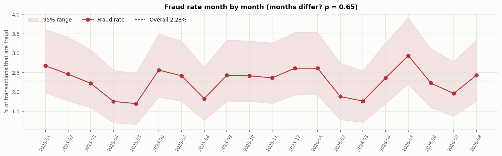
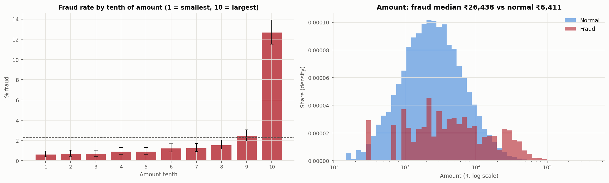
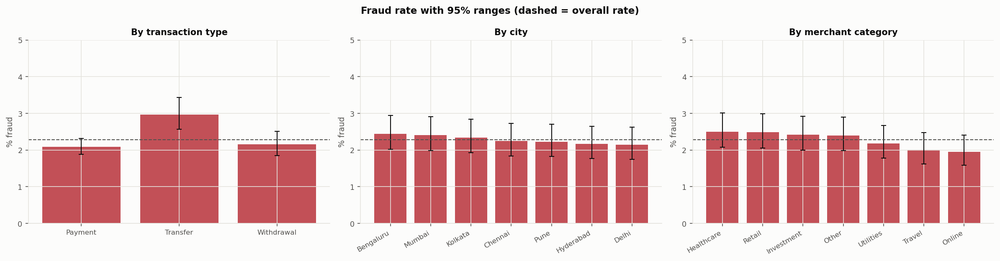
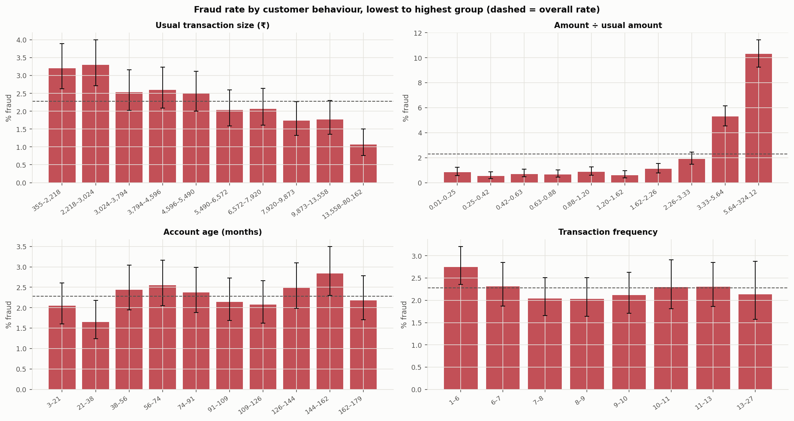
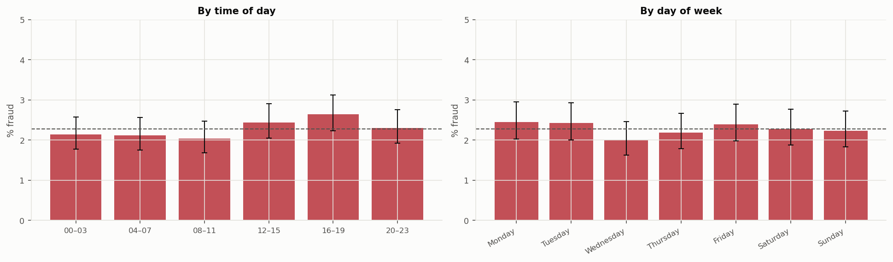
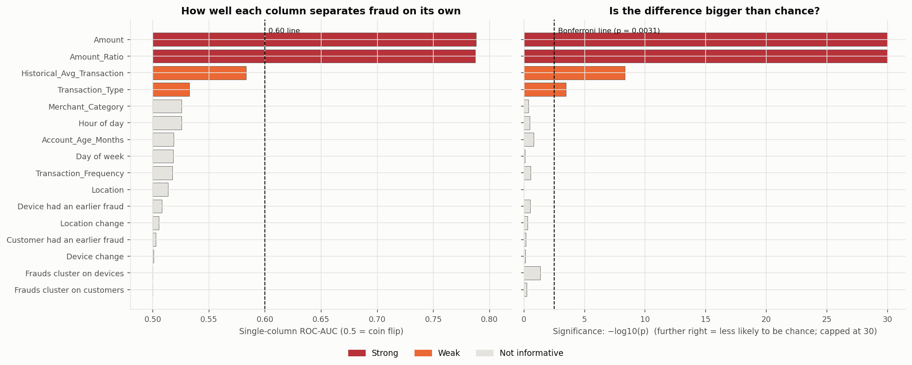
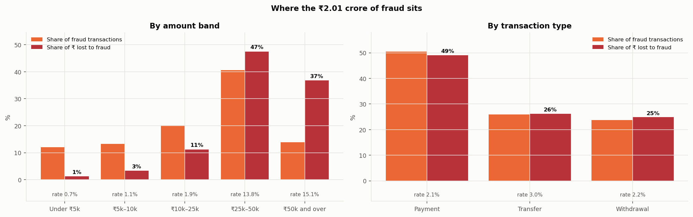

# Module 3 — Task 1 Report: Exploratory analysis of fraud

**Business problem (brief, verbatim):**
> NovaFin processes thousands of transactions every day. Management wants to identify suspicious transactions while minimizing unnecessary investigation.

**Task 1 (brief, verbatim):**
> **Task 1 — Exploratory analysis.** Investigate: Fraud rate · Fraud by transaction type · Fraud by amount · Fraud by location · Fraud by customer behaviour

**Where this sits in the chain:** **Data and what drives fraud (Task 1)** → supervised fraud model (Task 2) → anomaly detection with Isolation Forest (Task 3) → cost-based threshold (Task 4).

| Item | Where |
| --- | --- |
| Code and outputs | `notebooks/m03_task1_eda.ipynb`: runs on its own (locally or in Colab) or from `run_module_3.ipynb` |
| Helpers used | `helpers/m03_data.py` (load, checks, derived columns), `helpers/m03_style.py` (chart style) |
| Charts | `outputs/task1/` (tables are in this report and the notebook; decision M3-16) |
| **Evidence table for Task 2** | **`outputs/task1/FINAL_M3_T1_fraud_evidence.csv`**: every column's test, ROC-AUC and verdict |
| Decisions | M3-06 to M3-10, in `docs/decisions.md` |

**Terms used in this report:**
- **Fraud rate:** fraud transactions ÷ all transactions in a group.
- **95% Wilson range:** the range the true fraud rate is likely to sit in, given how many transactions the group has.
- **Chi-square test (p):** do the groups' fraud rates differ by more than chance? A small p means yes.
- **Single-column ROC-AUC:** if transactions were ranked by this column alone, the chance a random fraud ranks above a random normal transaction. 0.5 = coin flip, 1 = perfect.

---

## 1. Summary for management

**The finance case**
1. **Fraud is rare by count but large by money.** 684 of 30,000 transactions (2.28%) are fraud, but they hold **₹2.01 crore, 6.2% of all money moved**. The average fraud is ₹29,380 against ₹10,327 for a normal transaction.
2. **The money is concentrated in large transactions.** Transactions of ₹25,000 and over are 9% of all transactions but hold **55% of frauds and 84% of the ₹ lost**, at a fraud rate of about 14%.
3. **A third of frauds look like ordinary transactions.** They sit at normal amounts, nothing else in the data marks them out, and they carry only about 8% of the ₹ lost.
4. **Fraud is steady over time:** no month differs from the others (p = 0.65), and there is no rising or falling trend.

**The ML case**
1. **Every column was tested the same way**, with a rule agreed before results (decision M3-10): significant after adjusting for 16 tests, *and* able to separate fraud on its own (single-column ROC-AUC ≥ 0.60).
2. **Two columns are strong:**
   - **Amount** (fraud 0.6% → 12.7% from smallest to largest tenth; ROC-AUC 0.788);
   - **Amount ÷ the customer's usual amount** (typical fraud 5.0× usual, normal 1.2×; ROC-AUC 0.787).
3. **Two are weak:** real but small effects.
   - **Usual transaction size** (ROC-AUC 0.583): smaller usual amount, more fraud.
   - **Transaction type** (ROC-AUC 0.533): Transfers 3.0%, Payments and Withdrawals 2.1–2.2%.
4. **Twelve are not informative.** City, merchant category, account age, transaction frequency, hour, weekday, device or city change, and any device or customer history all sit within chance.
5. **A data finding:** Device_ID behaves like a random label. Each device is used by about 20 customers, and a customer's device changes on 99.95% of their transactions. The "customer" columns also change on every transaction. So no customer history can be built from this file.

**What it means for the next tasks:** a model will mostly be learning "is this amount large, especially for this customer". It should catch the large frauds well and the ordinary-looking ones poorly.

---

## 2. Know the data (notebook step 1)

- **Quality:** 30,000 transactions, no missing values, no duplicates, no zero or negative amounts. Amount ranges from ₹148 to ₹4,34,340.
- **Size and volume:** 2,500 customers (about 12 transactions each), January 2025 to August 2026. That is **about 49 transactions a day**: the brief says "thousands every day", so this file is a sample. Any daily figures in later tasks are scaled and say so.
- **Three columns the brief doesn't list:** Transaction_ID, Customer_ID and Timestamp. They make the history checks in §8 possible.

**The "customer" columns describe the transaction, not the customer:**

| Column | Customers whose value changes between their transactions | Distinct values per customer (median, of about 12 transactions) |
| --- | --- | --- |
| Historical_Avg_Transaction | 100% | 12 |
| Account_Age_Months | 100% | 11 |
| Transaction_Frequency | 100% | 7 |
| Location | 99.96% | 6 |
| Device_ID | 100% | 12 |

Account age would normally only grow, and a customer's usual amount would change slowly. Here they change on almost every transaction. They are still analysed as recorded, as the brief asks, but they can't be treated as a stable customer history.

---

## 3. Fraud rate (step 2)

| Measure | Value |
| --- | --- |
| Fraud transactions | **684 of 30,000 = 2.28%** (95% range 2.12–2.46%) |
| ₹ in fraud / in all transactions | **₹2.01 crore of ₹32.28 crore = 6.2%** |
| Average fraud / normal transaction | ₹29,380 / ₹10,327 |
| Median fraud / normal transaction | ₹26,438 / ₹6,411 |



**Stable over time:** the 20 months don't differ by more than chance (chi-square p = 0.65). There is no steady rise or fall either (correlation +0.04, p = 0.87). This matters for Task 2: a model trained on earlier months should suit later ones.

---

## 4. Fraud by transaction type (step 3)

| Type | Transactions | Frauds | Fraud rate (95% range) | Share of fraud ₹ |
| --- | --- | --- | --- | --- |
| Payment | 16,515 | 345 | 2.09% (1.88–2.32%) | 49% |
| **Transfer** | 5,961 | 177 | **2.97% (2.57–3.43%)** | 26% |
| Withdrawal | 7,524 | 162 | 2.15% (1.85–2.51%) | 25% |

- **The types differ** (chi-square p = 0.0003). **Transfers are riskier:** 3.0% against 2.1% for the rest (p = 0.0001).
- The effect is real but small: ranking by type alone gives ROC-AUC 0.533, barely above a coin flip. **Verdict: Weak.**
- In ₹, each type's share of fraud money matches its share of fraud count. Frauds are about the same size whatever the type.

---

## 5. Fraud by amount (step 4)

| Amount tenth | ₹ range | Fraud rate | Share of frauds |
| --- | --- | --- | --- |
| 1 (smallest) | ₹148–₹1,811 | 0.6% | 3% |
| 2–5 | ₹1,811–₹6,540 | 0.7–0.9% | 14% |
| 6–8 | ₹6,540–₹15,118 | 1.2–1.5% | 17% |
| 9 | ₹15,118–₹23,330 | 2.4% | 11% |
| **10 (largest)** | **₹23,330–₹4,34,340** | **12.7%** | **56%** |



- **The strongest signal in the data:** chi-square p < 10⁻³⁰, ROC-AUC 0.788. **Verdict: Strong.**
- **Two kinds of fraud** (right-hand chart):
  - a cluster of **large frauds** around ₹25,000–₹50,000 and above, where normal transactions are rare;
  - **ordinary-looking frauds** spread across the same amounts as normal transactions.

**Concentration:**

| Largest transactions | From | Fraud rate | Share of all frauds | Share of fraud ₹ |
| --- | --- | --- | --- | --- |
| 1% | ₹67,733 | 13.7% | 6% | 21% |
| 5% | ₹33,738 | 15.2% | 33% | 64% |
| 10% | ₹23,331 | 12.7% | **56%** | **85%** |
| 20% | ₹15,118 | 7.6% | 66% | 92% |

---

## 6. Fraud by location (step 5)

| City | Transactions | Fraud rate (95% range) | Share of fraud ₹ |
| --- | --- | --- | --- |
| Bengaluru | 4,307 | 2.44% (2.02–2.94%) | 15% |
| Mumbai | 4,282 | 2.41% (1.99–2.91%) | 18% |
| Kolkata | 4,233 | 2.34% (1.92–2.84%) | 13% |
| Chennai | 4,278 | 2.24% (1.84–2.73%) | 13% |
| Pune | 4,368 | 2.22% (1.82–2.70%) | 14% |
| Hyderabad | 4,292 | 2.17% (1.77–2.65%) | 13% |
| Delhi | 4,240 | 2.15% (1.75–2.63%) | 14% |

- **No city differs:** all seven 95% ranges overlap, chi-square p = 0.96, ROC-AUC 0.513. **Verdict: Not informative.**
- Mumbai holds the most fraud ₹ (18%) only because its frauds happen to be a little larger, not because they are more frequent.

---

## 7. Fraud by merchant category, and by customer behaviour (steps 6–7)

**Merchant category** (in the file, so tested too): fraud 1.96% (Online) to 2.50% (Healthcare), all ranges overlapping, p = 0.43, ROC-AUC 0.526. **Verdict: Not informative.**



**Customer behaviour** (decision M3-07: the brief's three behaviour columns, plus the amount against the customer's usual amount):

```text
Amount_Ratio = Amount ÷ Historical_Avg_Transaction      1 = the customer's usual amount; 5 = five times it
```

| Column | Fraud rate, lowest → highest tenth | p | ROC-AUC | Verdict |
| --- | --- | --- | --- | --- |
| **Amount ÷ usual amount** | 0.5% → **10.3%** (5.6× usual and above) | < 10⁻³⁰ | **0.787** | **Strong** |
| Usual transaction size | **3.2%** (₹355–₹2,218) → 1.1% (₹13,558 and over) | 5 × 10⁻⁹ | 0.583 | Weak |
| Account age | 1.6% → 2.8%, no pattern | 0.16 | 0.519 | Not informative |
| Transaction frequency | 2.0% → 2.7%, no pattern | 0.29 | 0.517 | Not informative |



- **The jump against the usual amount is what matters.** A typical fraud is 5.0× the customer's usual amount; a normal transaction 1.2×. Transactions at 3.3× usual and above hold 68% of frauds (159 + 309 of 684).
- **Why a smaller usual amount means more fraud:** amount and usual amount are unrelated (correlation 0.00). In a two-input logistic check, holding the amount fixed, a smaller usual amount still raises the risk: weight −0.45 on ln(usual amount), p < 0.001. The same amount is a bigger jump for a customer who usually spends little.
- **Amount and the amount ratio overlap heavily** (correlation 0.71). Task 2 decides whether a model needs both.

---

## 8. Time, device and customer history (steps 8–9)

| Column | Result | p | ROC-AUC | Verdict |
| --- | --- | --- | --- | --- |
| Hour of day (six 4-hour blocks) | 2.0% (08–11) → 2.6% (16–19) | 0.33 | 0.526 | Not informative |
| Day of week | 2.0% (Wednesday) → 2.4% (Monday) | 0.82 | 0.518 | Not informative |
| Device change since the customer's previous transaction | Changes on 99.95%; only 14 transactions keep the same device | 0.74 | 0.501 | Not informative |
| City change since the previous transaction | 2.2% (changed) vs 2.4% (same) | 0.49 | 0.505 | Not informative |
| Frauds cluster on devices | 0–4 frauds per device, close to chance | 0.046 | — | Not informative after adjustment |
| Device had an earlier fraud | 2.5% vs 2.2% | 0.31 | 0.508 | Not informative |
| Frauds cluster on customers | 0–3 frauds per customer, as chance predicts | 0.61 | — | Not informative |
| Customer had an earlier fraud | 2.2% vs 2.3% | 0.71 | 0.503 | Not informative |



**Why the ID columns are tested this way (decision M3-10):** Device_ID and Customer_ID are labels. Cutting their numbers into tenths would test nothing real. It actually gave p = 0.0038 for Device_ID, a false alarm. Instead, two questions are tested:
- Does fraud gather on certain devices or customers?
- Is a transaction riskier if its device or customer had an earlier fraud (counting only earlier transactions)?

Neither shows a usable signal.

---

## 9. The evidence table: every column on the same yardsticks (step 10, decision M3-10)

```text
Bonferroni line = 0.05 ÷ 16 tests = 0.0031
Strong          = p below the line AND single-column ROC-AUC ≥ 0.60
Weak            = p below the line, ROC-AUC below 0.60
Not informative = p above the line
```



| Verdict | Columns |
| --- | --- |
| **Strong** | Amount (0.788), Amount ÷ usual amount (0.787) |
| **Weak** | Usual transaction size (0.583), transaction type (0.533) |
| **Not informative** | Merchant category, hour, account age, weekday, transaction frequency, city, device or customer earlier fraud, city change, device change, fraud clustering on devices or customers |

**Checks on the rule itself:**
- **The 0.60 line decides nothing.** The strong columns score 0.79 and the next best 0.58, so any line from 0.59 to 0.78 gives the same verdicts.
- **The Bonferroni adjustment changes one verdict.** Device clustering (p = 0.046) would be "Weak" at a plain 0.05. Even then, a device with an earlier fraud is no riskier (p = 0.31), so there is nothing usable.
- **The verdicts describe each column on its own.** A weak column can still help in combination with others. Which columns the Task 2 models use is decided there, with this table.

---

## 10. Board view in ₹ (step 11)

| Amount band | Fraud rate | Share of frauds | Share of ₹ lost |
| --- | --- | --- | --- |
| Under ₹5,000 | 0.7% | 12% | 1% |
| ₹5,000–10,000 | 1.1% | 13% | 3% |
| ₹10,000–25,000 | 1.9% | 20% | 11% |
| **₹25,000–50,000** | **13.8%** | **41%** | **47%** |
| **₹50,000 and over** | **15.1%** | **14%** | **37%** |



- **84% of the ₹ lost is in transactions of ₹25,000 and over**, which are only 9% of transactions. At a fraud rate of about 14%, roughly one in seven of them is fraud.
- **Frauds under ₹10,000** are a quarter of all frauds but only 4% of the ₹ lost.
- **For Task 4:** the brief prices every missed fraud at ₹10,000. In this data the average fraud is ₹29,380, and the large ones are worth far more. How to handle that is decided at Task 4 (decision M3-03).

---

## 11. What goes to Task 2

- `outputs/task1/FINAL_M3_T1_fraud_evidence.csv`: every column's evidence and verdict.
- **Decisions Task 2 needs, informed by this task:**
  - **which columns to use** (two strong, two weak, twelve not informative on their own);
  - **whether to keep both Amount and the amount ratio** (correlation 0.71);
  - **how to split training and test data.** Fraud is stable over time, so a time split and a random split should give similar results; Task 2 tests that before choosing.
- **What to expect:** strong detection of large frauds, weak detection of ordinary-looking ones.

---

## 12. Risks and limitations

- **Synthetic-looking data.** The "customer" columns change on every transaction, Device_ID behaves like a random label, and most columns are flat. Real fraud data usually has strong device, location and history signals. On real data, the history tests in §8 would be the first to re-run.
- **A sample:** about 49 transactions a day against "thousands" in the brief. Rates and shares carry over; daily counts must be scaled.
- **Only 684 frauds.** Small effects (for example, between cities) can't be ruled out. They can only be shown to be too small to matter here.
- **Fraud_Flag is taken as correct.** Unreported or misclassified fraud would bias every rate.
