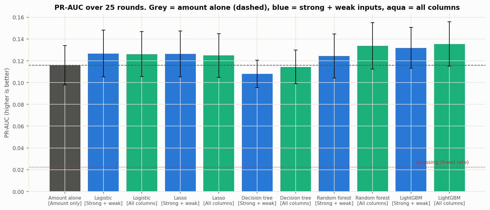
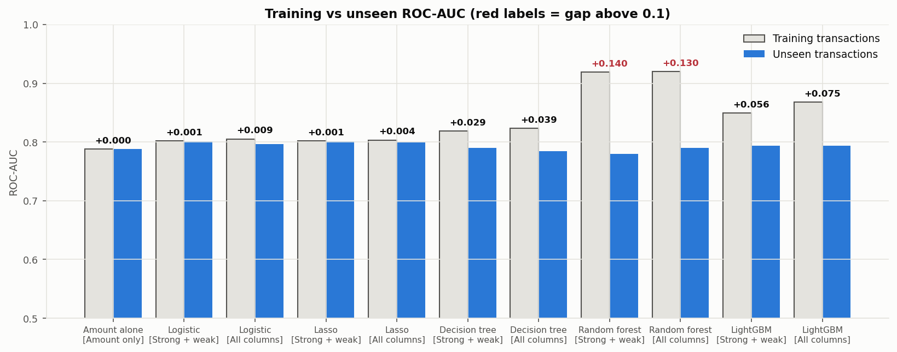
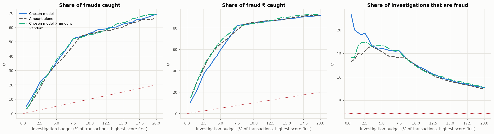
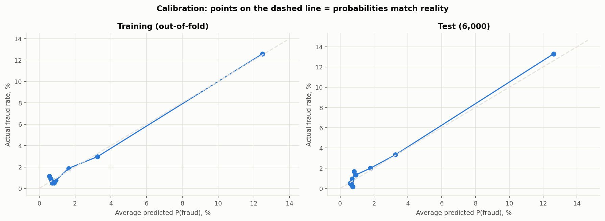
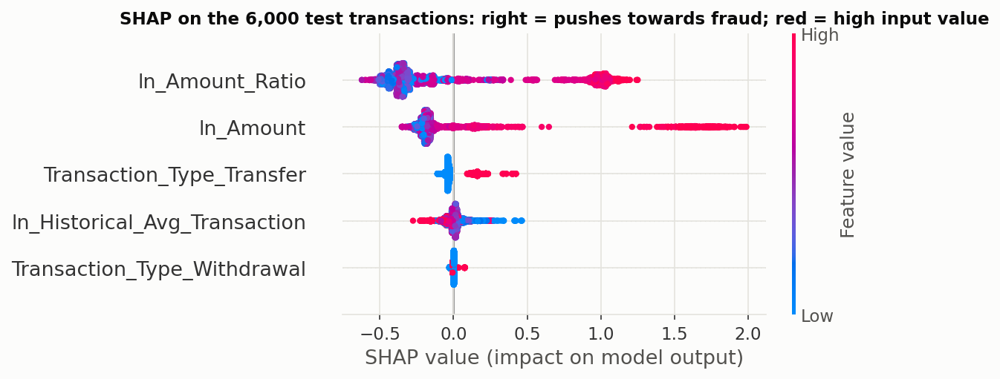

# Module 3 — Task 2 Report: Supervised fraud model

**Business problem (brief, verbatim):**
> NovaFin processes thousands of transactions every day. Management wants to identify suspicious transactions while minimizing unnecessary investigation.

**Task 2 (brief, verbatim):**
> **Task 2 — Supervised fraud model.** Target: Fraud_Flag. Build model and compare performance

"Supervised" means the model learns from past transactions whose answer (fraud or not) is known.

**Where this sits in the chain:** data and what drives fraud (Task 1) → **supervised fraud model (Task 2)** → anomaly detection with Isolation Forest (Task 3) → cost-based threshold (Task 4).

| Item | Where |
| --- | --- |
| Code and outputs | `notebooks/m03_task2_supervised.ipynb`: runs on its own (locally or in Colab) or from `run_module_3.ipynb`; about 11 minutes |
| Helpers used | `helpers/m03_data.py` (load, derived columns, the two input sets), `helpers/m03_style.py` |
| Charts and the 25-round summary | `outputs/task2/` (`cv_summary.csv`; other tables are in this report and the notebook; decision M3-16) |
| **Scores for Tasks 3 and 4** | **`outputs/task2/FINAL_M3_T2_fraud_scores.csv`**: Transaction_ID, Set, Fraud_Flag, Amount, P_fraud (chosen model), P_benchmark (amount alone) |
| Fitted model | `outputs/task2/chosen_model.joblib`, `chosen_model.json` |
| Decisions | M3-01, M3-02, M3-11 to M3-14, in `docs/decisions.md` |

**Terms used in this report:**
- **P(fraud):** the model's probability that a transaction is fraud.
- **Investigation budget:** the share of transactions the bank investigates, highest-scored first.
- **Recall (frauds caught):** frauds found ÷ all frauds. **Precision:** share of investigations that find a fraud.
- **PR-AUC:** how well the ranking puts frauds at the top, averaged over every budget. Guessing scores the fraud rate (0.023).
- **ROC-AUC:** the chance a random fraud ranks above a random honest transaction (0.5 = coin flip).
- **Brier score:** the average of (P(fraud) − actual outcome)². Lower means truer probabilities.

**What the brief asks, and what it doesn't:** build a model and compare performance. It asks for no fraud / not-fraud label: turning a score into "investigate" needs a threshold, which is Task 4. So performance is shown at every investigation budget.

---

## 1. Summary for management

**The ML case**
1. **A small boosted-tree model (LightGBM, 100 trees of 4 leaves) on five inputs was chosen.** The inputs are amount, amount ÷ usual amount, usual amount and transaction type. It was chosen by a rule agreed before results.
2. **It beats the simplest rule, "investigate the largest amounts first".**
   - Cross-validation: PR-AUC 0.132 vs 0.116, better in 22 of 25 rounds, gain +0.016 (range +0.010 to +0.022).
   - Final test on 6,000 later transactions: ROC-AUC 0.815 vs 0.787 (gain proven) and better probabilities (Brier gain proven). The PR-AUC gain (+0.021) only just touches zero on 144 test frauds.
3. **Complex models don't help.** Random forest memorises its training data (gap 0.13–0.14) and was ruled out. Adding the eight Task 1 "not informative" columns adds nothing beyond chance.
4. **No leakage:** all four checks pass. The model relies 88% on amount and the amount ratio, matching Task 1.

**The finance case**
1. **The model finds more frauds, but not more rupees.**
   - Investigating the top 1% of transactions, it catches 8.9% of frauds against 6.1% for amount alone.
   - But it catches only 16% of the fraud ₹ against 22%: 5.6 points less, beyond chance.
   - The model ranks by *chance of fraud*; the bank loses *rupees*.
2. **Combining the two is best.** Ranking by **expected ₹ loss = P(fraud) × amount**, the top 5% of transactions catches 37% of frauds and 68% of the fraud ₹: **₹4.53 lakh per 1,000 transactions, against ₹4.36 lakh for amount alone and ₹3.99 lakh for the model alone.**
3. **At a 10% budget every sensible ranking catches about 85% of the fraud ₹.** What remains is the ordinary-looking frauds (Task 1), which no model here can find.
4. **Even the most suspicious transactions are usually honest.** The highest-scored one (₹48,919, 56 times the customer's usual amount, P(fraud) 30%) was not fraud. A flag means "worth a look", not "fraud".

**Decision:** use the chosen model's P(fraud), and present it honestly as **a modest, real improvement on the amount rule**, whose value is best realised when combined with the amount. How the threshold is set (on P, on P × amount, or by sweeping costs) is decided in Task 4.

---

## 2. Split and leakage checks (step 1, decisions M3-01, M3-14)

| Set | Transactions | Frauds | Fraud rate | Period | ₹ in fraud |
| --- | --- | --- | --- | --- | --- |
| Training | 24,000 | 540 | 2.25% | Jan 2025 – Apr 2026 | ₹1.61 crore |
| Test | 6,000 | 144 | 2.40% | May – Aug 2026 | ₹0.40 crore |

**Why split by time:** the model is used on future transactions, and Task 1 found fraud stable over time. Before agreeing, a time split and five random splits were tested, and gave the same results.

**Leakage checks** (an input secretly containing the answer, or information not available at the time):

| Check | Result |
| --- | --- |
| Fraud_Flag is in no input | Pass |
| Every training transaction comes before every test transaction | Pass |
| Device and city change use only earlier transactions (each customer's first shows no change) | Pass |
| The usual amount doesn't include the current one | Pass: correlation +0.003 overall, −0.055 among frauds. If it did, large transactions would raise the "usual" amount |

---

## 3. Inputs and models (steps 2–3, decisions M3-11, M3-12)

**Two input sets:**

| Set | Columns |
| --- | --- |
| Strong + weak | Amount, Amount_Ratio, Historical_Avg_Transaction, Transaction_Type |
| All columns | The above, plus Merchant_Category, Location, Account_Age_Months, Transaction_Frequency, Hour, Weekday, Device_Change, Location_Change |

Money columns enter as ln(x), because money is skewed. Label columns enter as one 0/1 column per value (one-hot). Customer_ID, Device_ID and Transaction_ID are never inputs.

**Models, simplest to most complex:**

| Model | Settings |
| --- | --- |
| **Amount alone (benchmark)** | Turned into a probability by a one-input logistic regression on ln(Amount) |
| Logistic regression | Small built-in penalty |
| Lasso | Penalty tuned inside each round |
| Decision tree | Depth 2–6 tuned inside each round |
| Random forest | 200 trees, depth ≤ 8 |
| LightGBM | Light: learning rate 0.05; 4 or 8 leaves and 100 or 300 trees, tuned inside each round |

**No class weights:** tested before agreeing, they left the ranking unchanged and inflated the average P(fraud) from 2.3% to 27–37%.

---

## 4. Results over 25 rounds (steps 4–6)

```text
24,000 training transactions → 5 parts (each keeps the 2.3% fraud share); train on 4, score the 5th; × 5 shuffles = 25 rounds
```



| Set-up | PR-AUC | ROC-AUC | Gap (training − unseen ROC-AUC) | Verdict |
| --- | --- | --- | --- | --- |
| Amount alone | 0.116 | 0.788 | 0.000 | Benchmark; beaten beyond chance |
| Logistic, strong + weak | 0.127 | 0.801 | 0.001 | Below the best beyond chance |
| Logistic, all columns | 0.126 | 0.796 | 0.009 | Below the best beyond chance |
| Lasso, strong + weak / all | 0.126 / 0.125 | 0.801 / 0.799 | 0.001 / 0.004 | Below the best beyond chance |
| Decision tree, strong + weak / all | 0.108 / 0.114 | 0.790 / 0.784 | 0.029 / 0.039 | Below the best; no better than amount alone |
| Random forest, strong + weak / all | 0.124 / 0.134 | 0.779 / 0.790 | **0.140 / 0.130** | **Ruled out: overfits** |
| **LightGBM, strong + weak** | **0.132** | 0.794 | 0.056 | **Chosen** |
| LightGBM, all columns | 0.135 | 0.793 | 0.075 | Best PR-AUC |



**The selection rule, applied (agreed before results):**
1. **Rule out any set-up with a gap above 0.10.** Both random forests (0.13–0.14), whose every round sits above 0.09. The limit is 0.10, not lower, because a single round's gap is noisy: even logistic regression reaches +0.077.
2. **Best PR-AUC:** LightGBM on all columns, 0.135.
3. **The simplest set-up within chance of the best:** LightGBM on strong + weak. The difference is +0.004, with a 95% range of −0.002 to +0.009, which includes 0. Logistic and lasso are below the best beyond chance, by about 0.009.
4. **More inputs only if they help beyond chance:** they don't.

```text
Paired range over 25 rounds = mean(d) ± 2.064 × sd(d) ÷ √25,   d = PR-AUC(best) − PR-AUC(set-up) in each round
```

**Chosen against amount alone:** PR-AUC +0.016 (95% range +0.010 to +0.022), better in 22 of 25 rounds.

---

## 5. The finance case: what investigating catches, in ₹ (step 7)

Out-of-fold scores on the 24,000 training transactions. **₹6.71 lakh of fraud passes through every 1,000 transactions.**



| Investigate the top… | Ranking | Frauds caught | Fraud ₹ caught | Fraud ₹ caught per 1,000 transactions | ₹ per investigation |
| --- | --- | --- | --- | --- | --- |
| 1% | Chosen model | **8.9%** | 16.4% | ₹1.10 lakh | ₹11,021 |
| | Amount alone | 6.1% | **22.3%** | **₹1.50 lakh** | **₹14,982** |
| | P(fraud) × amount | 6.3% | 21.3% | ₹1.43 lakh | ₹14,307 |
| 5% | Chosen model | 35.7% | 59.5% | ₹3.99 lakh | ₹7,979 |
| | Amount alone | 34.1% | 64.9% | ₹4.36 lakh | ₹8,711 |
| | **P(fraud) × amount** | **37.2%** | **67.6%** | **₹4.53 lakh** | **₹9,068** |
| 10% | All three | 55–56% | 84–85% | ₹5.65–5.71 lakh | about ₹5,700 |

**The model's extra catch over amount alone (average of the 25 rounds, 95% range; the table above pools all out-of-fold scores, so its gaps differ slightly):**

| Budget | Extra frauds caught | Extra fraud ₹ caught |
| --- | --- | --- |
| 1% | **+3.1 points (+2.0 to +4.3)** | **−5.6 points (−8.5 to −2.8)** |
| 5% | +1.7 points (+0.4 to +3.1) | −6.0 points (−8.9 to −3.1) |
| 10% | +0.4 points (−0.4 to +1.2) | −0.7 points (−1.2 to −0.1) |

- **More frauds, fewer rupees:** at tight budgets the model puts medium-sized but very unusual transactions ahead of the largest ones. It finds more cases, but smaller ones.
- **Expected ₹ loss (P × amount) gets both:** at 5% it beats amount alone on frauds (37.2% vs 34.1%) and on ₹ (67.6% vs 64.9%). This is the main finance finding for Task 4, which decides how the threshold uses it.
- **Random investigation**, for scale: a 5% budget would catch only about 5% of frauds and 5% of the ₹.

---

## 6. The final test: 6,000 later transactions, used once (step 8)

| Measure | Chosen model (95% range) | Amount alone | Difference (95% range) |
| --- | --- | --- | --- |
| PR-AUC | 0.124 (0.094–0.169) | 0.103 | +0.021 (−0.000 to +0.050) |
| ROC-AUC | 0.815 (0.774–0.852) | 0.787 | **+0.028 (+0.004 to +0.054)** |
| Brier | 0.0218 | 0.0226 | **−0.0007 (−0.0012 to −0.0004)** |
| Frauds caught, top 5% | 33.3% | 28.5% | +4.9 points (−0.8 to +11.0) |
| Fraud ₹ caught, top 5% | 55.2% | 56.1% | −0.9 points (−11.3 to +9.1) |
| Fraud ₹ caught, top 10% | 82.0% | 85.1% | −3.0 points (−8.5 to +0.4) |

- **PR-AUC, ROC-AUC and Brier all point the same way as in cross-validation.** The ranking and probability gains are proven on the test set; the PR-AUC gain only just touches zero.
- **Accuracy at a 50% cut-off: 97.60%,** exactly the same as calling everything honest, because the model flags nothing at 50%. This is why accuracy isn't used.

---

## 7. Calibration, reported (step 9, decision M3-13)



| Risk group | Training: predicted / actual | Test: predicted / actual |
| --- | --- | --- |
| 1–7 (safest 70%) | 0.56–0.94% / 0.50–1.13% | 0.59–0.93% / 0.19–1.67% |
| 8 | 1.64% / 1.88% | 1.78% / 1.99% |
| 9 | 3.25% / 2.96% | 3.27% / 3.32% |
| **10 (riskiest)** | **12.5% / 12.6%** | **12.6% / 13.3%** |

- **The probabilities match reality where it matters:** in the riskiest tenth, which is where investigation happens.
- **The safest 70% all sit near 0.6–0.9% predicted.** The actual rates bounce around that, with only 1–27 frauds per group.
- **Brier beats always predicting the fraud rate** on both sets.
- **No correction is applied.** Whether Task 4 needs any is decided there, once it is settled how the threshold uses the probabilities.

---

## 8. What the model relies on (step 10)



| Input | Share of the model's reliance (mean absolute SHAP) |
| --- | --- |
| Amount ÷ usual amount | 53% |
| Amount | 35% |
| Transfer (vs payment) | 7% |
| Usual amount | 5% |
| Withdrawal | under 1% |

**88% of the model's reliance is on the two columns Task 1 found strong.** It has learned "a large amount, especially for this customer".

**Three example test transactions:**

| Example | Amount | Usual amount | Amount ÷ usual | Type | P(fraud) | Expected ₹ loss (P × amount) | Fraud? |
| --- | --- | --- | --- | --- | --- | --- | --- |
| Lowest P(fraud) | ₹1,853 | ₹23,527 | 0.08 | Withdrawal | 0.5% | ₹9 | No |
| Middle P(fraud) | ₹9,084 | ₹6,750 | 1.35 | Transfer | 0.8% | ₹70 | No |
| Highest P(fraud) | ₹48,919 | ₹872 | 56.1 | Withdrawal | 29.6% | ₹14,459 | **No** |

The highest-scored transaction is a ₹48,919 withdrawal by a customer who usually spends ₹872, and it was honest. Even at 30% P(fraud), 7 in 10 such transactions are honest. Investigation confirms; the model only prioritises.

---

## 9. What goes to Tasks 3 and 4

- `FINAL_M3_T2_fraud_scores.csv`: P(fraud) for every transaction. Training transactions are scored out-of-fold, by models that never saw them; test transactions by the final model. The amount-alone score sits alongside.
- **Task 3** compares Isolation Forest with this model on the same 6,000 test transactions, in frauds and in ₹.
- **Task 4** decides:
  - whether a missed fraud costs a flat ₹10,000 (the brief) or its actual amount (average ₹29,380);
  - whether the threshold is set on P(fraud), on P(fraud) × amount, or found by sweeping costs;
  - whether calibration needs any correction for that use.

---

## 10. Risks and limitations

- **Small test set:** 144 frauds. Ranges are wide, and the PR-AUC gain is not proven on the test set alone.
- **The model mostly learns amount.** That is a property of this data (Task 1): device, location and history carry no signal here, unlike typical real fraud data.
- **A third of frauds look ordinary,** and no model here finds them.
- **Data drift:** fraud was stable over these 20 months. In real use, the model should be re-checked regularly on new transactions.
- **Labels:** Fraud_Flag is taken as correct. Undetected fraud among the "honest" transactions would understate what any model catches.
