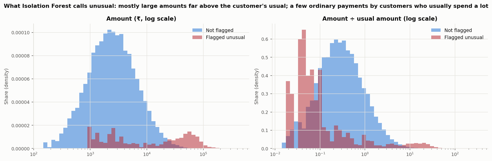
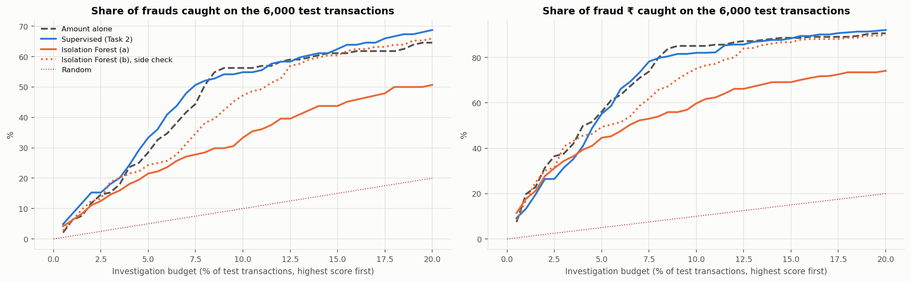
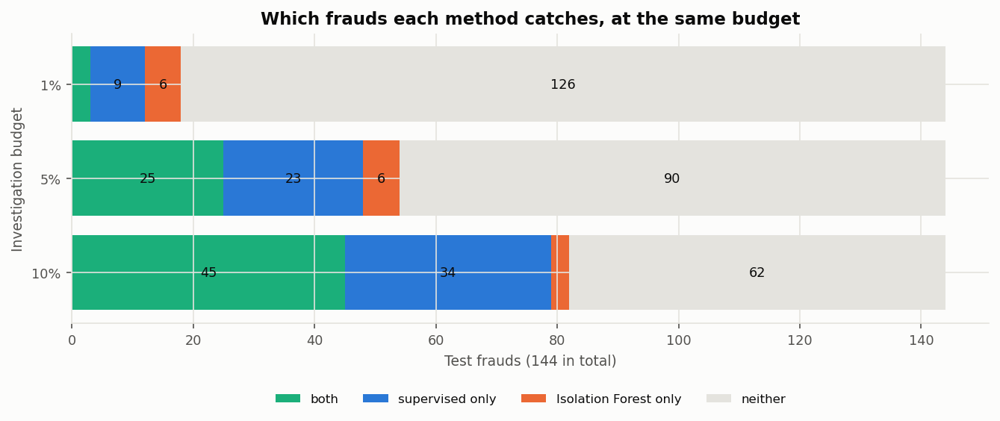
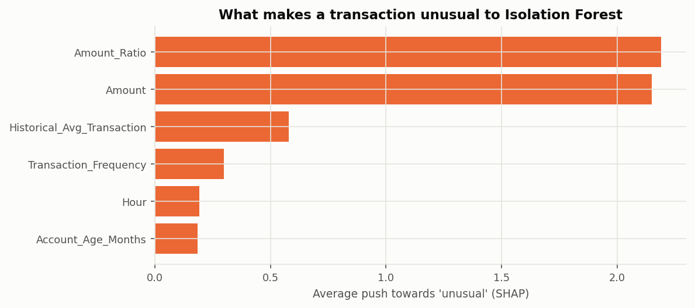

# Module 3 — Task 3 Report: Unsupervised detection with Isolation Forest

**Business problem (brief, verbatim):**
> NovaFin processes thousands of transactions every day. Management wants to identify suspicious transactions while minimizing unnecessary investigation.

**Task 3 (brief, verbatim):**
> **Task 3 — Unsupervised detection.** Use: Isolation Forest. The objective is to identify transactions that appear unusual even without relying directly on the fraud label. Compare: Supervised detection vs anomaly detection.

**Unsupervised** means the model learns without being told which transactions were fraud. **Anomaly detection** means finding transactions unlike the rest.

**Why a bank would want it:** fraud labels arrive late and miss new schemes. A method that needs no labels could catch fraud the label-trained model has never seen.

**Where this sits in the chain:** data (Task 1) → supervised model (Task 2) → **anomaly detection (Task 3)** → cost-based threshold (Task 4).

| Item | Where |
| --- | --- |
| Code | `notebooks/m03_task3_isolation_forest.ipynb`: runs on its own (locally or in Colab) or from `run_module_3.ipynb`; about 2 minutes; reads `outputs/task2/FINAL_M3_T2_fraud_scores.csv` |
| **The brief's deliverable** | **`outputs/task3/unusual_transactions.csv`**: the 680 transactions identified as unusual, each with its reasons in words, its anomaly score, the supervised model's P(fraud), and whether it was fraud |
| Hand-off to Task 4 | `outputs/task3/FINAL_M3_T3_anomaly_scores.csv`: every transaction's anomaly score |
| The comparison | `outputs/task3/comparison.csv`: amount alone vs supervised vs Isolation Forest on the 6,000 test transactions |
| Model and charts | `isolation_forest.joblib` / `.json`, 4 charts, `key_numbers.json` (other tables are in this report and the notebook) |
| Decisions | M3-15, M3-16, M3-17, in `docs/decisions.md` |

---

## 1. Summary for management

**The ML case**
1. **Isolation Forest, never shown a fraud label, flags transactions six times riskier than average.** Of the 680 it calls unusual (the top 2.25%), 13.8% were fraud, against 2.0% for the rest.
2. **But it is worse than both alternatives, beyond chance.** On 6,000 later test transactions:
   - PR-AUC 0.075, against 0.124 for the supervised model and 0.103 for "largest amount first";
   - ROC-AUC 0.721, against 0.815 and 0.787.
3. **"Unusual" isn't "fraud."** 9% of its flags are ordinary payments by customers who usually spend a lot (about ₹36,600). They are odd because of the customer, not the payment, and none was fraud.
4. **It adds almost nothing the supervised model misses:** 3–6 extra frauds out of 144, at any budget.
5. **Neither method finds the ordinary-looking third of frauds.** Of the 51 test frauds at ordinary amounts, the supervised model catches 0 in its top 10% and Isolation Forest catches 1.

**The finance case**
1. **For the same workload, Isolation Forest finds less fraud money.** Investigating 100 per 1,000 transactions (10%):

   | Ranking | Fraud caught per 1,000 transactions |
   | --- | --- |
   | Amount alone | ₹5.66 lakh |
   | Supervised | ₹5.46 lakh |
   | **Isolation Forest** | **₹3.98 lakh** |

   Isolation Forest catches about ₹1.7 lakh less.
2. **Combining the two doesn't pay:** each investigation given to Isolation Forest's picks displaces a better supervised pick.
3. **Where it would earn its place:** as a watch for *new* fraud patterns the labels haven't caught yet, or where no labels exist. Not as the main screen here.

**Answer to the brief's comparison:** in this data, **supervised detection beats anomaly detection.** The anomaly method still delivers what the brief asks: it identifies unusual transactions, with a reason for each, without the fraud label.

---

## 2. How Isolation Forest works

**The idea:** unusual transactions are *easy to isolate*. Cut the data at a random value of a random input, again and again. A normal transaction, among many similar ones, takes many cuts to stand alone; an unusual one takes few.

```text
Path length h(x) = cuts needed to isolate transaction x in one tree (each tree: a random sample of 256 transactions)
Anomaly score s(x) = 2 ^ ( − average h(x) over 500 trees ÷ c(256) )
c(n) = 2 × H(n − 1) − 2 × (n − 1) ÷ n,   H(k) ≈ ln(k) + 0.5772        (the path length expected for n points)
s close to 1 → isolated quickly → unusual;   s around 0.5 or below → normal
```

**It never sees Fraud_Flag.** The label is used only afterwards, to judge it.

---

## 3. What it sees: the input tests (decision M3-15)

Tested on the 24,000 training transactions with three seeds. The label judges the results but never fits the model.

| What Isolation Forest sees | PR-AUC (guessing 0.022) | Top 5%: frauds / fraud ₹ caught | Top 5% below the median amount |
| --- | --- | --- | --- |
| **(a) Six numeric descriptors, raw ₹: amount, amount ratio, usual amount, account age, frequency, hour [chosen]** | **0.087–0.092** | 26.1% / 50.8% | 8% |
| (b) Amount + amount ratio, raw ₹ [side check] | 0.109–0.111 | 31.3% / 59.3% | 0% |
| The same six, money logged | 0.043–0.054 | 13.1% / 27.0% | 55% |
| All 28 Task 2 inputs (incl. 0/1 category columns) | 0.029–0.030 | 7.0% / 11.8% | 52% |
| (a) + how common each category value is | 0.075–0.082 | 27.0% / 52.0% | 8% |
| (a) + how rare the type × merchant × city combination is | 0.089–0.091 | 26.5% / 52.4% | 10% |
| (a) + device / city change | 0.059–0.070 | 21.5% / 42.4% | 17% |
| (a) + city or type new for the customer | 0.085–0.089 | 25.7% / 49.6% | 8% |
| Category signals only | 0.023–0.024 | 6.3% / 6.2% | 51% |

**How the choice was made:**
- **(a) is chosen without fraud information.** It is every numeric description of a transaction. Raw ₹ is used because the bank's money is at risk in unusually *large* outflows; on a log scale, tiny transactions look just as odd (55% of the top 5% fall below the median amount).
- **Category columns can't mark anything here.** Every city, merchant and weekday holds 14–15% of transactions, so no value is rare. And fraud is no higher where categories look unusual: 2.7% vs 2.2% for the rarest combinations; 2.2% vs 2.3% for a new city.
- **(b) is a side check.** Its inputs were chosen using Task 1's findings, which used the label. It shows how far input choice explains the gap.

---

## 4. Settings and the unusual list (decision M3-17)

| Setting | Value | Why |
| --- | --- | --- |
| Transactions per tree | 256 | Small samples isolate unusual points better. Tested PR-AUC: 0.089 at 256, 0.079 at 1,024, 0.068 with all 24,000 |
| Trees | 500 | Steadier list: two random seeds share 93% of the list (84% with 100 trees). The ranking is the same at 100–500 |
| Learns from | The 24,000 training transactions only | The 6,000 test transactions stay "the future", as in Task 2 |
| Share flagged as unusual | **2.25%** = 540 ÷ 24,000, the training-period fraud rate | As many flags as there are frauds, using only an aggregate figure a bank knows. The all-data rate (2.28%) would include the test period. The method's own default flagged 14.2%, with 92% of flags honest |

**Result:** cut-off score 0.5975, set on training transactions. It flags 540 training and 140 test transactions, **680 in all**.



| Flagged transactions | Share | Fraud rate | Median amount | Median usual amount |
| --- | --- | --- | --- | --- |
| Over 3× the customer's usual amount | 86% (587) | **15.8%** | ₹65,242 | ₹3,469 |
| 1–3× the usual amount | 5% (31) | 3.2% | ₹41,463 | ₹28,904 |
| **Below the usual amount** | 9% (62) | **0%** | ₹7,848 | ₹36,567 |
| All flagged | 680 | 13.8% | ₹60,518 | ₹4,128 |
| Not flagged | 29,320 | 2.0% | ₹6,374 | ₹5,519 |

**"Unusual" includes harmless oddities.** A customer whose usual amount is very high is rare in itself, so their everyday payments get flagged. None of those 62 was fraud.

---

## 5. The comparison on 6,000 test transactions

All three rankings are judged on the same 6,000 test transactions (May–Aug 2026), which none of them learned from.

| Measure | Amount alone | Supervised (Task 2) | **Isolation Forest (a)** | Isolation Forest (b), side check |
| --- | --- | --- | --- | --- |
| PR-AUC (guessing 0.024) | 0.103 | **0.124** | 0.075 | 0.094 |
| ROC-AUC | 0.787 | **0.815** | 0.721 | 0.773 |
| Frauds / fraud ₹ caught, top 1% | 6.2% / **19.7%** | **8.3%** / 13.3% | 6.2% / 17.7% | 6.2% / 17.0% |
| Frauds / fraud ₹ caught, top 5% | 28.5% / **56.1%** | **33.3%** / 55.2% | 21.5% / 44.6% | 24.3% / 49.3% |
| Frauds / fraud ₹ caught, top 10% | **56.2% / 85.1%** | 54.9% / 82.0% | 33.3% / 59.8% | 47.2% / 75.1% |

**Isolation Forest (a), with 95% bootstrap ranges:**

| Against | PR-AUC | ROC-AUC | Fraud ₹ caught, top 10% |
| --- | --- | --- | --- |
| Supervised | −0.050 (−0.079 to −0.022) | −0.095 (−0.131 to −0.055) | −22 points (−31 to −13) |
| Amount alone | −0.029 (−0.043 to −0.009) | −0.066 (−0.103 to −0.028) | −25 points (−34 to −17) |



- **All six gaps in this table are beyond chance** (at tighter budgets, 1% and 5%, some gaps are within chance). Isolation Forest does far better than random, but worse than both the supervised model and the amount rule.
- **At the very top (1%) it is close on ₹.** Its most extreme flags are huge, very unusual transactions.
- **The side check narrows the gap but doesn't close it.** PR-AUC 0.094 is still below amount alone, so the gap is mostly built into the method, not just its inputs.

---

## 6. Overlap: do the two methods find the same frauds?



| Budget | Same transactions in both lists | Frauds: both | Supervised only | **Isolation Forest only** | Neither |
| --- | --- | --- | --- | --- | --- |
| 1% (60 each) | 30% | 3 | 9 | **6** | 126 |
| 5% (300 each) | 49% | 25 | 23 | **6** | 90 |
| 10% (600 each) | 56% | 45 | 34 | **3** | 62 |

- **Isolation Forest adds very few frauds of its own:** 3–6 of 144.
- **The ordinary-looking frauds stay hidden.** Of the 51 test frauds below ₹15,162 (the training 80th percentile of amount), the supervised model catches 0 in its top 10% and Isolation Forest catches 1. Nothing in this data marks them, with labels or without.

---

## 7. Combining the two

At the same number of investigations as either method alone:

| Approach | Top 5%: frauds / fraud ₹ | Top 10%: frauds / fraud ₹ |
| --- | --- | --- |
| Supervised alone | **33.3% / 55.2%** | **54.9% / 82.0%** |
| Flagged by either (half the budget each) | 25.0% / 48.3% | 53.5% / 82.5% |
| Blended rank (average position in both rankings) | 29.2% / 55.3% | 48.6% / 76.8% |

**Combining doesn't help.** The blended rank's PR-AUC (0.107) is below supervised alone (0.124). Isolation Forest's extra picks cost more in good picks than they add.

---

## 8. The finance case

₹6.66 lakh of fraud passes through every 1,000 test transactions.

| Investigations per 1,000 | Amount alone | Supervised | Isolation Forest (a) |
| --- | --- | --- | --- |
| 10 (1%) | ₹1.31 lakh (₹13,143 each) | ₹0.89 lakh (₹8,873) | ₹1.18 lakh (₹11,798) |
| 50 (5%) | ₹3.73 lakh (₹7,468) | ₹3.67 lakh (₹7,345) | ₹2.97 lakh (₹5,939) |
| 100 (10%) | ₹5.66 lakh (₹5,663) | ₹5.46 lakh (₹5,461) | ₹3.98 lakh (₹3,980) |

At the same investigation workload, Isolation Forest finds less fraud money, except at the very tightest budget. As a main screen it would cost the bank fraud it could have caught.

---

## 9. The unusual transactions, with their reasons (the brief's deliverable)

`outputs/task3/unusual_transactions.csv`: 680 rows, one per transaction identified as unusual.

| Column | Example (rank 1) |
| --- | --- |
| Transaction_ID, Date, Set | 5001615, 2025-02-02, train |
| Amount (₹), Transaction_Type, Location | ₹2,66,293, Transfer, Mumbai |
| Anomaly score, Anomaly rank | 0.7318, 1 |
| **Why unusual** | **81.1× the customer's usual ₹3,282 (top 1% of ratios); amount ₹2,66,293 (top 1% of amounts)** |
| Supervised P(fraud); also flagged by the supervised model | 21.1%; Yes |
| Actually fraud | Yes |

**How the reasons are made:** SHAP splits each transaction's anomaly score among its inputs, showing how much each one made the transaction easier to isolate. The two or three inputs that push hardest are written out with their actual values and how they compare with all training transactions.



- **Main reason across the 680:**
  - the amount ratio, for 325;
  - the amount, for 265;
  - the customer's very high usual amount, for 85 (the big spenders);
  - frequency, for 5.
- **Agreement with the supervised model:** it would also flag 43% of the training list and 36% of the test list in its own top 2.25%.

---

## 10. What goes to Task 4

- `FINAL_M3_T3_anomaly_scores.csv`: every transaction's anomaly score, beside Task 2's P(fraud).
- **The evidence for Task 4:** set the threshold on the supervised score, or on P(fraud) × amount. The anomaly score:
  - ranks worse;
  - adds few frauds the supervised model misses;
  - is not a probability, so any threshold on it can only be found by sweeping costs.

---

## 11. Risks and limitations

- **This data has little that is unusual but fraudulent beyond large amounts.** In real fraud data, a new device, a new city or a rare merchant is often a strong warning, and anomaly detection would have more to work with. The category encodings tested here are ready to re-run on real data.
- **No new fraud types can appear in a fixed file.** Anomaly detection's main real-world value, spotting schemes the labels haven't caught, can't be tested here.
- **"Unusual" depends on what the model sees.** Adding the usual amount brought in big spenders' ordinary payments. Any deployment needs its flags reviewed for harmless oddities.
- **Small test set:** 144 frauds, hence the wide ranges. The conclusions hold because the PR-AUC, ROC-AUC and top-10% gaps are beyond chance.
