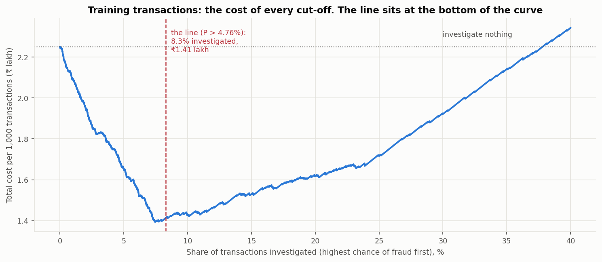
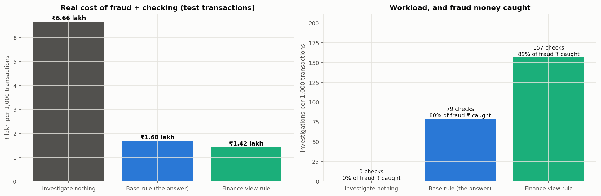

# Module 3 — Task 4 Report: Cost-based threshold

**Business problem (brief, verbatim):**
> NovaFin processes thousands of transactions every day. Management wants to identify suspicious transactions while minimizing unnecessary investigation.

**Task 4 (brief, verbatim):**
> **Task 4 — Cost-based threshold.** Assume: Missed fraud cost ₹10,000 · False-positive investigation cost ₹500. Then find a threshold that minimizes expected operational cost.

**In plain words:** for every transaction, the Task 2 model gives a chance of fraud. The bank picks one cut-off: investigate everything above it, let everything below through.

```text
Total cost = ₹10,000 × frauds let through (missed)  +  ₹500 × honest transactions investigated for nothing
```

| Item | Where |
| --- | --- |
| Code | `notebooks/m03_task4_cost_threshold.ipynb`: runs on its own or from `run_module_3.ipynb`; under a minute; reads Task 2's and Task 3's scores |
| **The answer, applied to every transaction** | **`outputs/task4/FINAL_M3_T4_transaction_decisions.csv`**: chance of fraud, expected cost each way, Investigate / Let through (brief's costs and finance view), whether it was fraud |
| The cost of each rule | `outputs/task4/threshold_summary.csv` |
| Charts and key numbers | 2 charts, `key_numbers.json` (other tables are in this report and the notebook) |
| Decisions | M3-18, M3-19, M3-20, in `docs/decisions.md` |

---

## 1. Summary for management

**The answer:** investigate a transaction when the model's **chance of fraud is above 4.76%**.

**The finance case**
1. **Under the brief's costs, this cuts the cost by 38%:** ₹1.48 lakh per 1,000 transactions, against ₹2.40 lakh for investigating nothing. The saving range is ₹62,819 to ₹1,21,835 per 1,000.
2. **It means checking 79 of every 1,000 transactions (8%)**, and catching half the frauds and 80% of the fraud money.
3. **In real money the saving is far bigger.** The average fraud is about ₹30,000, not ₹10,000. Investigating nothing really costs ₹6.66 lakh per 1,000 transactions; the rule brings that to ₹1.68 lakh, **a real saving of ₹4.98 lakh per 1,000 transactions (75%)**.
4. **Counting each fraud at its real amount saves a further ₹26,000 per 1,000 transactions,** but needs twice the investigations (157 against 79). That is a staffing decision for the Board.
5. **The workload depends heavily on the two cost assumptions.** If a missed fraud is 40 times a check (instead of 20), investigations nearly triple, to 223 per 1,000. The Board should settle these costs before staffing.

**The ML case**
1. **The 4.76% line needs no tuning.** It comes straight from the brief's two costs. Trying every cut-off on the training transactions finds 7.10%, which costs the same on the test transactions (₹1.48 lakh). Tuning on past data buys nothing.
2. **The line relies on the model's chances being honest, and they are.** Above the line the model predicted 14.75% fraud on test transactions; 15.82% happened, inside its 95% range. Below the line, 1.19% predicted against 1.25% actual.
3. **A threshold on Task 3's anomaly score saves only 13%.** Supervised scoring is the right basis.

---

## 2. The threshold from the brief's costs (decision M3-19)

Take one transaction and compare the two choices:

```text
Let it through:  chance of fraud × ₹10,000          (on average, what we lose by not checking)
Investigate:     (1 − chance of fraud) × ₹500       (on average, what we waste checking an honest one)
Investigate when the first is bigger  ⇔  chance > 500 ÷ 10,500 = 4.76%
```

| Chance of fraud | Expected cost if let through | Expected cost if investigated | Cheaper choice |
| --- | --- | --- | --- |
| 1% | ₹100 | ₹495 | Let through |
| 2% | ₹200 | ₹490 | Let through |
| **4.76%** | **₹476** | **₹476** | **Equal: the line** |
| 10% | ₹1,000 | ₹450 | Investigate |
| 30% | ₹3,000 | ₹350 | Investigate |

**Why 4.76%:** missing a fraud costs 20 times as much as a wasted check, so a transaction is worth checking once its chance of fraud passes about 1 in 21.

---

## 3. Can the model's chances be trusted around the line?

The line only works if a stated chance is honest. **Pass line, agreed before results:** on each side of the line, the actual fraud rate's 95% range must include the predicted rate.

| Set | Side of the line | Transactions | Predicted | Actual (95% range) | Pass |
| --- | --- | --- | --- | --- | --- |
| Training | Below | 22,009 | 1.17% | 1.15% (1.02–1.30%) | ✓ |
| Training | Above | 1,991 | 14.17% | 14.36% (12.89–15.97%) | ✓ |
| Test | Below | 5,526 | 1.19% | 1.25% (0.99–1.58%) | ✓ |
| Test | Above | 474 | 14.75% | 15.82% (12.81–19.38%) | ✓ |

All four pass, so the line is used. Had any failed, the sweep's cut-off would have been used instead.

---

## 4. Cross-check: trying every cut-off (the "sweep")

On the 24,000 training transactions, where the outcome is known, every cut-off is tried and its cost counted. Costs are per 1,000 transactions; about 22.5 of every 1,000 are fraud.

| Investigate if the chance is above… | Investigated | Frauds caught | Frauds missed | Honest checked | **Total cost** |
| --- | --- | --- | --- | --- | --- |
| Nothing investigated | 0 | 0 | 22.5 | 0 | ₹2,25,000 |
| 15% | 31 | 5.5 | 17.0 | 25 | ₹1,82,625 |
| 8% | 74 | 11.6 | 10.9 | 62 | ₹1,40,250 |
| **4.76% (the line)** | **83** | **11.9** | **10.6** | **71** | **₹1,41,354** |
| 3% | 165 | 14.3 | 8.2 | 151 | ₹1,57,208 |
| 1% | 314 | 17.5 | 5.0 | 296 | ₹1,98,583 |
| Everything | 1,000 | 22.5 | 0 | 978 | ₹4,88,750 |



Going down the table, fewer transactions are investigated: checking costs fall and missed-fraud costs rise. **The line sits at the bottom of the curve**, within ₹2,000 per 1,000 of the cheapest cut-off (7.10%, ₹1,39,333).

---

## 5. The real cost on 6,000 test transactions, used once

| Rule (set before seeing the test) | Investigated per 1,000 | Frauds caught | Fraud ₹ caught | Cost per 1,000 | Saving vs nothing (95% range) |
| --- | --- | --- | --- | --- | --- |
| **The line: P(fraud) > 4.76%** | **79** | **52%** | **80%** | **₹1,48,250** | **₹91,750 = 38% (₹62,819 to ₹1,21,835)** |
| Sweep's cut-off (P ≥ 7.10%) | 76 | 51% | 79% | ₹1,48,250 | ₹91,750 = 38% |
| Anomaly score, sweep's cut-off | 90 | 30% | 56% | ₹2,09,833 | ₹30,167 = 13% |
| Investigate nothing | 0 | 0% | 0% | ₹2,40,000 | — |
| Investigate everything | 1,000 | 100% | 100% | ₹4,88,000 | −₹2,48,000 |

- **The line saves 38%, beyond chance.**
- **The tuned cut-off gives exactly the same cost on new data.**
- **The anomaly score saves only 13%.**
- **Investigating everything costs twice as much as investigating nothing**, because checking 976 honest transactions per 1,000 costs more than the frauds it stops.

---

## 6. The finance view: what it really saves (decision M3-18)

Each missed fraud is counted at its actual amount (average about ₹30,000; nothing recovered).

| Rule | Investigated per 1,000 | Fraud ₹ caught | Fraud ₹ let through | Checking cost | **Real cost per 1,000** | Real saving |
| --- | --- | --- | --- | --- | --- | --- |
| Investigate nothing | 0 | 0% | ₹6,65,705 | ₹0 | ₹6,65,705 | — |
| **Base rule (the answer)** | 79 | 80% | ₹1,34,800 | ₹33,250 | **₹1,68,050** | **₹4,97,655 (75%)** |
| Finance-view rule: P × amount > (1 − P) × ₹500 | 157 | 89% | ₹71,360 | ₹70,833 | **₹1,42,194** | ₹5,23,512 (79%) |
| Investigate everything | 1,000 | 100% | ₹0 | ₹4,88,000 | ₹4,88,000 | ₹1,77,705 |



- **The brief's ₹10,000 understates what fraud costs** about three times over. So the base rule's real saving, ₹4.98 lakh per 1,000 transactions, is five times what the brief's costs show (₹0.92 lakh).
- **The finance-view rule saves ₹25,857 more per 1,000 transactions.** Its extra 78 checks cost ₹37,583 and recover ₹63,440 more fraud. It needs twice the investigation team.

---

### Module 9 inputs: Digital banking's cost of fraud risk in the standard fields (decision M3-21; final notebook step "What goes to Module 9")

**Why:** Module 9 compares every business on the same fields: return per ₹, bad-year result, capacity, evidence, how fast money comes back, gaps and controls. This module gives Digital banking's cost side: the cost of fraud risk per ₹ moved, with and without the ML rule, and a bad year (fraud three times as common). Its revenue is not in the data; its return per ₹ of capital comes from Module 1's Digital Banking and Payments units.

| Category | Return per ₹ (% a year) | Range | Bad year per ₹ | Bad year means | Capacity | Gap / assumption |
| --- | --- | --- | --- | --- | --- | --- |
| Digital banking: cost of fraud risk | -1.55 | −1.55% with the rule vs −6.13% with no screening (per ₹ of money moved) | -4.03 | Fraud three times as common (missed fraud × 3); no screening: −18.38% | Scales with the money moved | No fee revenue in the data: Digital banking's return per ₹ of capital comes from Module 1 (Digital Banking 13.2%, Payments 13.0%) |

## 7. Risks and limitations, including how the line moves if the costs change

| Missed fraud | Wasted check | Line | Investigated per 1,000 | Frauds caught | Cost per 1,000 | Investigate nothing |
| --- | --- | --- | --- | --- | --- | --- |
| **₹10,000** | **₹500** | **4.76%** | **79** | **52%** | **₹1,48,250** | ₹2,40,000 |
| ₹5,000 | ₹500 | 9.09% | 74 | 51% | ₹90,083 | ₹1,20,000 |
| ₹20,000 | ₹500 | 2.44% | 223 | 74% | ₹2,26,000 | ₹4,80,000 |
| ₹10,000 | ₹250 | 2.44% | 223 | 74% | ₹1,13,000 | ₹2,40,000 |
| ₹10,000 | ₹1,000 | 9.09% | 74 | 51% | ₹1,80,167 | ₹2,40,000 |

- **Only the ratio of the two costs matters.** ₹20,000 / ₹500 gives the same line as ₹10,000 / ₹250.
- **The workload jumps.** At a ratio of 40, investigations nearly triple (79 → 223 per 1,000), because the model gives many transactions chances of 2–5%. Settle the costs before staffing.
- **The model's chances were checked only on these 20 months.** As fraud patterns change, re-check the calibration around the line regularly.
- **A third of frauds look ordinary,** and no threshold catches them without new data (Tasks 1–3).
- **Missed frauds are assumed fully lost.** Any recovery lowers their real cost and the case for checking.
