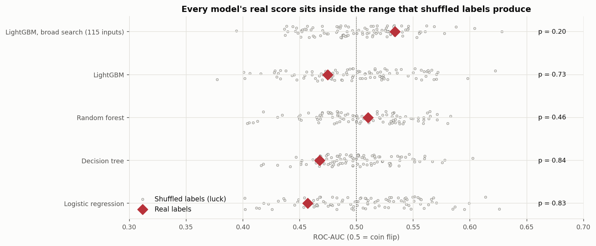
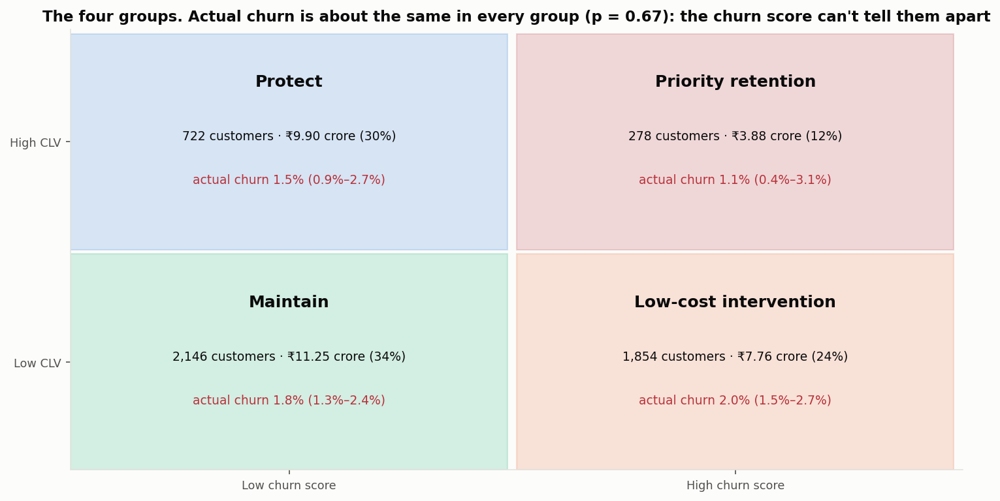
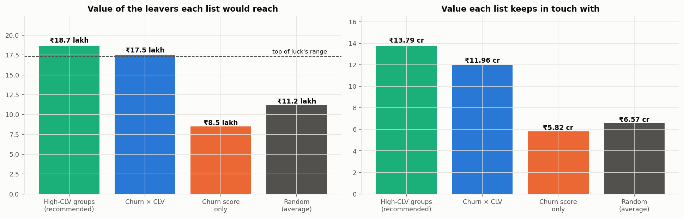

# Module 4 — Customer Analytics: Churn and Customer Lifetime Value

## Final report

**The business problem (brief, verbatim):**
> NovaFin wants to reduce customer attrition.
> Management asks:
> **Which customers should relationship managers prioritize for retention?**

**The three tasks and the executive question (brief, verbatim):**
> **Task 1 — Churn prediction.** Target: Churn_Flag. Build a classification model to predict churn
>
> **Task 2 — Customer Lifetime Value.** Estimate: CLV using the provided customer financial variables.
>
> **Task 3 — Customer prioritization.** Create four groups:
>
> | | Low Churn | High Churn |
> | --- | --- | --- |
> | High CLV | Protect | Priority retention |
> | Low CLV | Maintain | Low-cost intervention |
>
> **Executive question:** If NovaFin can contact only 1,000 customers, which customers should it target?

**Data:** `nova_customers.csv`: 5,000 customers, one snapshot each, with no missing values or duplicates. 89 left the bank (`Churn_Flag` = 1), a churn rate of 1.78%. Money is in plain rupees (1 lakh = ₹1,00,000; 1 crore = ₹100 lakh).

**Terms used throughout:**
- **Churn (attrition):** a customer leaving the bank.
- **CLV (customer lifetime value):** what a customer is worth to the bank, in ₹.
- **Chance of churn, P(churn):** a model's estimate of how likely a customer is to leave.
- **Out-of-fold:** each customer scored by models that never saw that customer, so the score is a fair test.

**How to read this report.** Each section opens with its conclusion. Every number comes from a notebook output in `outputs/`. Every term is defined where it is first used, and the glossary at the end collects them.

| Item | Where |
| --- | --- |
| **Final output (open this first)** | **`outputs/FINAL_M4_module_output.xlsx`**: Read me · Key numbers · Board actions · every task's final file · Hand-off · Decisions · Evidence index (project decision P-21) |
| Run everything | `run_module_4.ipynb` (Run all, about 13 minutes) |
| Task notebooks | `notebooks/m04_task1_churn.ipynb`, `m04_task2_clv.ipynb`, `m04_task3_prioritisation.ipynb` |
| Task reports | `reports/task1_report.md` to `task3_report.md` |
| Decisions and their evidence | `docs/decisions.md` (M4-01 to M4-19) |
| **Deliverables** | `outputs/task1/FINAL_M4_T1_churn_scores.csv` · `outputs/task2/FINAL_M4_T2_customer_value.csv` · **`outputs/task3/FINAL_M4_T3_contact_list.csv`** · `outputs/task3/customer_groups.csv` |

---

## 1. The answer in brief

**Relationship managers should prioritise the 1,000 highest-value customers**: the 278 in "Priority retention" first, then the 722 in "Protect", each ordered by CLV. They are worth ₹93,019 to ₹4,39,367 each and hold **₹13.79 crore, 42% of all customer value**, in 20% of customers.

**Why value and not churn risk:**

| Finding | Evidence |
| --- | --- |
| **Churn can't be predicted from this data** (Task 1) | No column, no model, no combined-input search and no simple bank rule beats random by more than luck. The five models: ROC-AUC 0.49–0.56 over 25 rounds, against 0.5 for a coin flip; shuffled-label test p 0.20–0.84 (that test, and its chart below, use one 5-fold split, where the scores are 0.457–0.534) |
| **Customer value can be estimated exactly** (Task 2) | CLV = max(0, 4% × income + 3% × account + 1.2% × loan + 1.8% × investment − ₹5,000 × complaints), matching all 5,000 customers within ₹0.01 (one paisa) |
| **So the four groups differ in value, not in risk** (Task 3) | Actual churn is about the same in every group (1.1–2.0%, p = 0.67). "Priority retention", rated riskiest by the model, churns least (1.08%) |

**Would the list have worked? (back-test)**

A back-test checks a list chosen without knowing who left against what actually happened:

| Way of choosing 1,000 | Leavers reached (of 89) | Value of those leavers (of ₹56.0 lakh that left) | Value contacted |
| --- | --- | --- | --- |
| **Recommended: the 1,000 highest-value customers** | 14 | **₹18.7 lakh** | **₹13.79 crore (42%)** |
| Chance of churn × CLV | 16 | ₹17.5 lakh | ₹11.96 crore (36%) |
| Churn score only | 15 | ₹8.5 lakh | ₹5.82 crore (18%) |
| Random 1,000 (average of 500) | 17.7 | ₹11.2 lakh | ₹6.57 crore (20%) |

No list reaches more leavers than random. The recommended list reaches the most *value*, because high-value customers are worth more when they leave.

**Is calling worth it?** If nobody is called, the expected loss on the list is 1.78% × ₹13.79 crore = **₹24.5 lakh**. The real call success rate is unknown, so no figure is assumed:
- **The break-even:** at ₹500 a call, the 1,000 calls (₹5 lakh) pay off only if they keep at least **20%** of would-be leavers.
- **The ceiling:** even if every call worked, retention would protect at most **₹19.5–22.0 lakh**.







**Recommendations for management:**
1. **Call the 1,000 highest-value customers** (`FINAL_M4_T3_contact_list.csv`, in call order, with the reason for each).
2. **Test before scaling.** Call a random half of a test group, leave the other half, and compare who leaves, to measure the real success rate.
3. **Reduce complaints.** Each costs ₹5,000 of customer value (Task 2), ₹3.81 crore in all (12% of the book). It's the one value driver the bank directly controls.
4. **Collect month-by-month data** (balances, transactions, product closures, service calls). It is what could make churn predictable.

---

## 2. The chain: how the three tasks fit together

| Hand-off | File | How it is used |
| --- | --- | --- |
| Task 1 → Task 3 | `FINAL_M4_T1_churn_scores.csv`: each customer's out-of-fold chance of churn (logistic regression) | Labelled "no better than chance"; forms the brief's churn axis, with each group's actual churn shown beside it |
| Task 2 → Task 3 | `FINAL_M4_T2_customer_value.csv`: each customer's CLV and its ₹ sources | Reliable; the prioritisation rests on it |
| Task 3 → Board, Module 9 | `FINAL_M4_T3_contact_list.csv`, `customer_groups.csv`, the break-even | The answer to the executive question; rates for Wealth management (§7) |

---

## 3. Churn prediction (Task 1)

**Conclusion: churn is not predictable from this data.** Every test agrees.

| Test | What it asks | Result |
| --- | --- | --- |
| Each column alone (15, incl. 5 business features) | Does any column separate leavers from stayers? | 0 of 15 below the line of 0.0033 (= 0.05 ÷ 15); lowest p 0.086 |
| Five model set-ups over 25 rounds | Can any model rank leavers above stayers? | ROC-AUC 0.489–0.561 (0.5 = coin flip) |
| Shuffled-label test (100 shuffles each) | Does the model beat luck? | p 0.20–0.84; none below the line of 0.01 |
| Business check: churners in the top 1,000 | Would calling the model's 1,000 riskiest reach more leavers? | 15–22, against 17.8 at random (best p = 0.16) |
| Seven simple bank rules | Would a rule a bank uses today do better? | 14–22 churners; none beats random beyond chance |
| Drivers (logistic regression) | Does any factor raise or lower churn? | 0 of 10 significant |

**Factors in plain words:**
- **ROC-AUC:** pick one leaver and one stayer at random; how often does the model give the leaver the higher chance? 0.5 = a coin flip.
- **Shuffled-label test:** mix up who left, refit the model, and see how often luck scores as well as the real model.
- **Bonferroni line:** 0.05 divided by the number of tests, so a chance "hit" among many tests isn't counted.

**Why the data was not rebalanced** (decision M4-11): rebalancing (SMOTE, class weights, undersampling) left the ranking at coin-flip, while inflating the average chance of churn from 1.8% to 17–48%. That would inflate Task 3's value at risk 10 to 27 times.

**What was delivered** (decision M4-10): the simplest model (logistic regression), with its out-of-fold scores labelled no better than chance, so the chain runs end to end and works unchanged if better data arrives.

Details: `reports/task1_report.md`.

---

## 4. Customer lifetime value (Task 2)

**Conclusion: CLV is an exact rule of income, balances and complaints; a simple linear regression recovers it.**

| Model (25 rounds) | Typical error (RMSE) | Top 1,000 matched |
| --- | --- | --- |
| **Linear regression** | **₹36** | **1,000** |
| Lasso | ₹88 | 1,000 |
| LightGBM | ₹6,739 | 982 |
| Random forest | ₹7,431 | 951 |
| Decision tree | ₹12,057 | 928 |

**RMSE (typical error)** = how far off a model usually is, in ₹, with big misses counting extra. The most flexible model isn't the best when the true relationship is simple.

```text
CLV = max(0,  4% × income + 3% × account balance + 1.2% × loan balance + 1.8% × investment balance − ₹5,000 × complaints)
```

| Source | ₹ crore | Share |
| --- | --- | --- |
| Income | ₹21.16 | 65% |
| Account balances | ₹6.81 | 21% |
| Investments | ₹5.91 | 18% |
| Loans | ₹2.74 | 8% |
| Complaints | −₹3.81 | −12% |
| **Total** | **₹32.80** | |

- **Age, products held, transactions, digital usage and relationship length don't count.**
- **CLV leaves out churn, time and loyalty:** it is a value score rather than a true lifetime value.
- **The banking meanings of the weights are our reading;** the data doesn't document how CLV was set.

Details: `reports/task2_report.md`.

---

## 5. Customer prioritisation (Task 3)

**Conclusion: the four groups are built as the brief asks, but they differ only in value.**

| Cut-off | Value | How it is derived |
| --- | --- | --- |
| High CLV | top 20% (CLV ≥ ₹92,963) | 1,000 contacts ÷ 5,000 customers |
| High churn | chance of churn above 1.78% | 89 leavers ÷ 5,000 customers (the actual average) |

| Group | Customers | CLV | Actual churn (95% range) | Action |
| --- | --- | --- | --- | --- |
| **Priority retention** | 278 | ₹3.88 crore | 1.08% (0.4–3.1%) | Personal call, first |
| **Protect** | 722 | ₹9.90 crore | 1.52% (0.9–2.7%) | Personal call, second |
| **Low-cost intervention** | 1,854 | ₹7.76 crore | 2.00% (1.5–2.7%) | Cheap automated contact |
| **Maintain** | 2,146 | ₹11.25 crore | 1.77% (1.3–2.4%) | Business as usual |

- **The groups are assigned only from what the bank would know in advance** (the chance of churn and CLV). The actual churn flag is used only to check them afterwards.
- **Every other way of calling customers "High churn"** (3+ complaints, low digital usage, short relationship) **also failed** to separate leavers (p 0.07–0.67).

Details: `reports/task3_report.md`.

---

## 6. How the pieces connect: cross-task conclusions

1. **The churn finding drives everything downstream.** Because Task 1 finds no signal, Task 3's churn axis carries no information. The prioritisation therefore rests on Task 2's value, the reliable part.
2. **Value and churn are unrelated.** Leavers and stayers have the same median CLV (₹55,579 vs ₹54,195), and churn is flat across CLV fifths (p = 0.59). So the value lost to churn, ₹56.0 lakh, is about the churn rate × the book (1.7%).
3. **The chain works unchanged with better data.** If a churn model ever passes the tests, the hand-off file is the same. The list could then be ranked by chance of churn × CLV (expected value at risk), which is the right ranking once churn has signal.
4. **The data looks synthetic.** Churn is unrelated to every column, and CLV is an exact formula. Real customer data usually shows at least weak churn signals (complaints, falling activity).

---

## 7. Hand-off to Module 9 (the ₹1,000 crore allocation)

Module 9 allocates capital across categories that include **Wealth management**. Module 4 provides **rates per ₹ of investment balance**, not ₹ totals (decision M4-19). Our file is a 5,000-customer sample; Module 9 needs what each ₹ deployed earns, whatever amount it allocates (the same approach as Module 3's "fraud costs 1.55% of money moved").

| Measure | Value | Source |
| --- | --- | --- |
| Investment balances in the file | ₹328.06 crore (all 5,000 customers) | Data |
| Fee yield on investments | **1.80%** of balances (₹5.91 crore) | Task 2's CLV weight; that it represents fees is our banking reading |
| Churn loss | **1.61%** of balances (₹5.29 crore held by leavers; fees lost ₹9.52 lakh) | Data |
| **Net fee yield after churn** | **1.77%** = 1.80% × (1 − 1.61%) | |

**Value protected by retention:** the real figure depends on a call success rate that is unknown, so it is given as a range, not a guess.

| Bound | What it means | Value on the 1,000 list (₹13.79 crore) |
| --- | --- | --- |
| **Floor: the break-even** | The least success calls need to pay off | At ₹250 a call: 10% of would-be leavers kept; at ₹500: 20% |
| **Ceiling: every call works (100%)** | The most retention could ever be worth | ₹24.5 lakh − call cost = ₹22.0 lakh at ₹250 (1.60%); ₹19.5 lakh at ₹500 (1.42%) |

- **For Module 9:**
  - Wealth management's return can be set at about **1.77% net of churn**.
  - Retention adds at most about 1.4–1.6% of the value contacted, and nothing unless calls clear the break-even. That is too small to change a ₹1,000 crore allocation.
- **Governance point:** churn can't be predicted from this data, so **no model-driven retention programme should be funded** until better data exists. A randomised test should come first.
- **Assumptions Module 9 must state:**
  - new money earns like this customer book;
  - the rates are per period of the data (the file doesn't say whether CLV and churn are yearly).
- **How Module 9 used it:** Wealth management's return comes from Module 1's Wealth initiatives; this 1.77% is kept as a health check, and no money goes to a model-driven retention programme (M9-08).

---

## 8. Key decisions

| # | Decision | Why |
| --- | --- | --- |
| M4-08, M4-10 | Show predictability with column tests, 25-round CV, shuffled labels and a business check; if nothing passes, hand on the simplest model labelled no better than chance | A model must beat luck before it is used; the chain must still run |
| M4-09 | No separate test set; repeated CV on all 5,000 | Only 89 leavers: a 20% test set would hold about 18 |
| M4-11 | No rebalancing; settings derived and tested on the data | Rebalancing doesn't help ranking and inflates chances 10–27× |
| M4-12 | Estimate the given CLV from the financial variables; own textbook CLV dropped | Every input to our own would be an unchecked assumption |
| M4-13 | Compare with simple bank rules | Shows what a bank already does; none beats random beyond chance either |
| M4-14 | Five regression models, RMSE decides, simplest within chance wins | Agreed before the results |
| M4-15 | Hand-offs to Task 3 | Churn labelled as noise; CLV reliable |
| M4-16 | Churn axis from the model's scores, actual churn shown beside each group | Brief's groups delivered honestly; no rule did better |
| M4-17 | High CLV = top 20%; High churn = above the 1.78% average | 20% = 1,000 ÷ 5,000; 1.78% = 89 ÷ 5,000 |
| M4-18 | The 1,000 highest-value customers; break-even, no assumed success rate | Value is the reliable part; the success rate can't be known from this data |
| M4-19 | Module 9: rates, break-even floor, 100% ceiling, governance point | Rates transfer from a sample; no guess in Board numbers |

Full table with evidence: `docs/decisions.md`.

---

### Module 9 inputs: Wealth management's fee income in the standard fields (decision M4-20; final notebook step "What goes to Module 9")

**Why:** Module 9 compares every business on the same fields: return per ₹, bad-year result, capacity, evidence, how fast money comes back, gaps and controls. This module gives Wealth management's fee income per ₹ of client balances, net of churn, and a bad year (markets −20%, churn twice as high). How much client money ₹1 of capital brings in is not in the data; Wealth's return per ₹ of capital comes from Module 1's Wealth unit.

| Category | Return per ₹ (% a year) | Range | Bad year per ₹ | Bad year means | Capacity | Gap / assumption |
| --- | --- | --- | --- | --- | --- | --- |
| Wealth management: fees on client balances | 1.77 | 1.39 (bad year) to 1.80 (no churn), per ₹ of client balances | 1.39 | Market fall of 20% (balances and fees fall with it) and churn twice as high | 328.1 | Per ₹ of client balances, not of NovaFin's capital; return per ₹ of capital comes from Module 1's Wealth unit (17.6% a year) |

## 9. Limitations

- **Only 89 leavers.** A weak real churn effect could hide below what this data can detect: "not predictable" means "not detectable here".
- **One snapshot per customer.** Churn is usually signalled by change over time (falling balances, closed products), which this file can't show.
- **The data looks synthetic:** no churn signal in any column, and CLV an exact formula. Results should be re-tested on real data.
- **CLV's construction is undocumented;** the banking meanings of its weights are our reading. It ignores churn, time and loyalty.
- **No record of past retention calls,** so the success rate and call cost are unknown. The break-even and ceiling bound the value without assuming them.
- **No later period of data,** so the back-test uses the same customers (with out-of-fold churn scores).
- **The data doesn't say whether churn and CLV are per year or over all time,** so Module 9's rates are "per period of the data".

---

## Glossary

| Term | Meaning |
| --- | --- |
| Back-test | Checking a list chosen without knowing who left against what actually happened |
| Bonferroni line | 0.05 divided by the number of tests, so chance "hits" among many tests aren't counted |
| Break-even | The point where a call's benefit equals its cost; here, the least share of would-be leavers a call must keep |
| Churn (attrition) | A customer leaving the bank |
| CLV | Customer lifetime value: what a customer is worth to the bank, in ₹ |
| Expected loss | Chance of leaving × CLV: the average value lost if nothing is done |
| Out-of-fold | Scored by models that never saw that customer |
| Randomised (A/B) test | Call a random half of a group, leave the other half, compare who leaves; measures the real success rate |
| RMSE | Typical error in ₹, with big misses counting extra |
| ROC-AUC | How often a model gives a random leaver a higher chance than a random stayer; 0.5 = coin flip |
| Shuffled-label test | Refit models on randomly mixed-up outcomes to see what luck scores |
| Wilson 95% range | The likely range of a group's true churn rate, suited to small counts |
