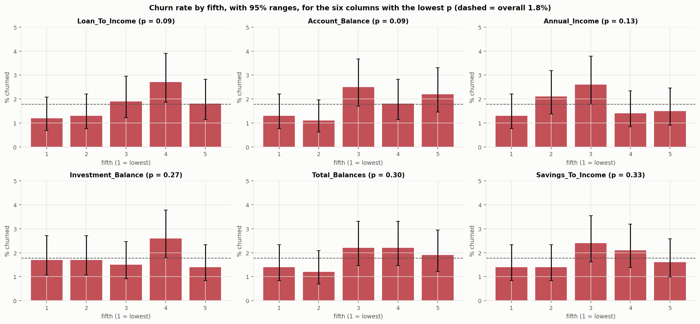
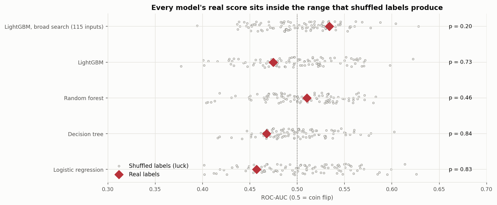

# Module 4 — Task 1 Report: Churn prediction

**Business problem (brief, verbatim):**
> NovaFin wants to reduce customer attrition. Management asks: Which customers should relationship managers prioritize for retention?

**Task 1 (brief, verbatim):**
> **Task 1 — Churn prediction.** Target: Churn_Flag. Build a classification model to predict churn

**Churn** = a customer leaving the bank. **A classification model** gives each customer a chance of leaving.

**Where this sits in the chain:** **churn prediction (Task 1)** → customer lifetime value (Task 2) → the four groups and the 1,000 customers to contact (Task 3).

| Item | Where |
| --- | --- |
| Code | `notebooks/m04_task1_churn.ipynb`: runs on its own (locally or in Colab) or from `run_module_4.ipynb`; about 12 minutes |
| Helpers | `helpers/m04_data.py` (load, checks, 5 business features), `helpers/m04_style.py` |
| **Hand-off to Task 3** | **`outputs/task1/FINAL_M4_T1_churn_scores.csv`**: each customer's out-of-fold chance of churn, labelled "no better than chance" |
| Evidence | `outputs/task1/model_tests.csv` (every model's tests), `evidence_table.csv` (every column's test), 2 charts, `key_numbers.json` |
| Decisions | M4-07 to M4-11 and M4-13, in `docs/decisions.md` (each number's derivation is recorded there) |

**Terms used in this report:**
- **ROC-AUC:** the chance a random churner ranks above a random stayer. 0.5 = coin flip.
- **Shuffled labels:** the churn flags randomly reassigned to customers. A model trained on them can only learn luck, so whatever it scores is what luck alone produces.
- **p:** the chance that luck alone would give a result at least this good. Small p = unlikely to be luck.
- **Bonferroni adjustment:** when many things are tested, the usual 0.05 line is divided by the number of tests, so chance "findings" aren't counted.

---

## 1. Summary for management

**The answer: churn cannot be predicted from the columns in this file.** Every test was agreed before the results were seen:

| Test | Pass line (how derived) | Result |
| --- | --- | --- |
| Does any single column separate churners? | p < 0.0033 (0.05 ÷ 15 columns) | **No: 0 of 15.** Lowest p = 0.086 |
| Does any model beat shuffled labels? | p < 0.01 (0.05 ÷ 5 set-ups), 100 shuffles each | **No: 0 of 5.** p = 0.20 to 0.84 |
| Does any model's top 1,000 hold more churners than random picking? | Above 20% (1,000 ÷ 5,000), p < 0.05 | **No: 0 of 5.** 15–22 churners vs 17.8 at random |
| Does any simple rule a bank could use today do better? | Same test | **No: 0 of 7.** 14–22 churners vs 17.8 at random |
| Is any driver of churn significant? | p < 0.005 (0.05 ÷ 10) | **No: 0 of 10.** The whole model: p = 0.63 |

**The ML case**
1. Four models (logistic regression, decision tree, random forest, LightGBM) score ROC-AUC 0.489–0.502 over 25 rounds: coin-flip.
2. A broad feature-engineering search over 115 inputs scores 0.561 over 25 rounds (0.534 on the split used for the luck test, where shuffled labels reach 0.562 one time in 20). It found patterns in noise, with "drivers" that make no business sense.
3. Rebalancing the data (class weights, artificial churners, dropping stayers) leaves the ranking at coin-flip. It inflates every predicted chance 9 to 27 times, so it was rejected.

**The finance case**
1. **₹55.96 lakh of lifetime value left with the 89 churners: 1.7% of the ₹32.80 crore book.** Churners are worth about the same as stayers (median CLV ₹55,579 vs ₹54,195).
2. **No "at-risk" list from these models beats a random list beyond chance:** 15–22 of 89 churners in 1,000 calls, against about 18 at random.
3. **So retention targeting can't rest on churn risk here; it must rest on customer value** (Task 2). And the bank needs data that moves before customers leave.

**Decision:** report honestly that churn isn't predictable from this data (decision M4-10). Hand on the simplest model's scores to Task 3, clearly labelled as no better than chance.

---

## 2. The data (notebook step 1)

| Measure | Value |
| --- | --- |
| Customers | 5,000; no missing values or duplicates |
| Churners | **89 (1.78%;** 95% range 1.45–2.19%) |
| Columns used | 10 given (age, income, three balances, products, transactions, digital usage, complaints, relationship length) + 5 business features |
| Left out | `Estimated_CLV` (decision M4-03): an exact formula of other columns, and Task 2's subject |

**Is CLV linked to churn?** No. The median CLV is ₹55,579 for churners and ₹54,195 for stayers. Across fifths of CLV, churn runs 1.4%, 2.0%, 2.1%, 2.0%, 1.4% (p = 0.59). So CLV carries no hidden churn signal.

**Why there is no separate test set (decision M4-09).** A 20% test set would hold about 89 × 20% ≈ 18 churners. Finding one more or one fewer would move the result by 1 ÷ 18 ≈ 5.6 points, too coarse to test anything. Instead, 25 rounds of cross-validation score every customer with models that never saw them:

```text
5,000 customers → 5 parts of 1,000 (each with the 1.8% churn share, about 18 churners)
Train on 4 parts, score the 5th; 5 rounds × 5 different shuffles = 25 rounds
```

---

## 3. The 5 business-based features (step 2, decision M4-11)

| Feature | Formula | Why a bank would expect it to matter |
| --- | --- | --- |
| Complaints per year | Complaints ÷ Relationship_Length_Years | Frequent complaints signal dissatisfaction |
| Total balances | Account + Loan + Investment | A larger relationship is harder to move |
| Balance per product | Total balances ÷ Products_Held | Deep products tie a customer in |
| Loan ÷ income | Loan_Balance ÷ Annual_Income | Heavy debt can push customers to refinance elsewhere |
| Savings ÷ income | (Account + Investment) ÷ Annual_Income | Savings held here show commitment |

---

## 4. Each column on its own (step 3)

**Significance line: 0.05 ÷ 15 = 0.0033.** 15 columns are tested; at a plain 0.05, about 15 × 0.05 = 0.75 columns would look significant by luck.

| Column | Churn rate, lowest → highest fifth | p | ROC-AUC |
| --- | --- | --- | --- |
| Loan ÷ income (derived) | 1.2% → 2.7% | 0.086 | 0.561 |
| Account balance | 1.1% → 2.5% | 0.094 | 0.554 |
| Annual income | 1.3% → 2.6% | 0.135 | 0.504 |
| Investment balance | 1.4% → 2.6% | 0.268 | 0.503 |
| Total balances (derived) | 1.2% → 2.2% | 0.303 | 0.547 |
| The other 10 | within 1.1%–2.4% | 0.33–0.96 | 0.51–0.55 |



**No column comes near the line.** The ups and downs between fifths have overlapping 95% ranges and no consistent direction.

---

## 5. The models and the shuffled-label test (steps 4–6)

**The factors used to judge the models, in plain words:**

| Factor | In plain words | Why it matters here |
| --- | --- | --- |
| **ROC-AUC** | Pick one churner and one stayer at random: how often does the model give the churner the higher chance? 0.5 = a coin flip, 1.0 = always | The main "can it tell them apart?" measure |
| **PR-AUC** | How well the model pushes churners to the top of its list. Guessing scores 0.018 (the churn rate) | Shows usefulness when churners are rare |
| **Brier score** | How close the predicted chances are to what actually happened (lower is better). Guessing 1.8% for everyone scores 0.0175 | Task 3 needs honest chances, not just a ranking |
| **Shuffled-label test (p)** | Mix up who churned, refit the model 100 times, and see how often luck scores as well as the real model | The first gate: a model that can't beat luck has learned nothing |
| **Churners in the top 1,000** | If the bank called the model's 1,000 riskiest customers, how many real churners would it reach? Random picking reaches about 18 | The business test, straight from the executive question |
| **Odds ratio** | How much more (above 1) or less (below 1) likely to churn a customer is when a column goes up by a typical amount | Says which columns drive churn, if any |
| **Bonferroni line** | Divide the usual 0.05 by the number of things tested, so a chance "hit" among many tests isn't counted | Keeps 15 column tests or 5 model tests from producing false findings |

| Model | Settings, and why |
| --- | --- |
| Logistic regression | The simplest; standardised inputs |
| Decision tree | Depth 3, at least 50 customers per end box: 89 churners can't support a deep tree |
| Random forest | 200 trees, at least 20 customers per end box |
| LightGBM | 200 small trees (4 leaves), learning rate 0.05 |
| LightGBM, broad search | The same, on 115 inputs: every log, pairwise ratio and product of the 10 given columns |

**Settings are fixed, not tuned.** Each set-up is re-run 100 times on shuffled labels; tuning inside every run would be very slow, and with 89 churners a tuned choice would mostly reflect luck.

**The shuffled-label test, and how its numbers are derived:**
- **Pass line p < 0.01:** 5 set-ups are tested, so 0.05 ÷ 5.
- **100 shuffles:** the smallest p this test can give is 1 ÷ (shuffles + 1). With 100 shuffles that's 0.0099, just below the line, so a real model could pass. With 50 shuffles the floor would be 0.0196, and nothing could ever pass.

| Set-up | ROC-AUC, 25 rounds (lowest – highest round) | Real vs shuffled: p | Churners in top 1,000 (random: 17.8) | Average predicted chance |
| --- | --- | --- | --- | --- |
| Logistic regression | 0.490 (0.35–0.60) | 0.83 | 15 | 1.78% |
| Decision tree | 0.489 (0.41–0.65) | 0.84 | 18 | 1.78% |
| Random forest | 0.502 (0.37–0.64) | 0.46 | 19 | 1.83% |
| LightGBM | 0.495 (0.37–0.61) | 0.73 | 22 (p = 0.16) | 1.70% |
| LightGBM, broad search | 0.561 (0.45–0.67) | 0.20 | 21 (p = 0.23) | 1.56% |



- **Every real score sits inside the range luck produces.**
- **The wide spread between rounds** (for example 0.35–0.60) comes from about 18 churners per test part. That's why one split could show 0.65 by luck, and why 25 rounds and 100 shuffles are needed.
- **The broad search's top inputs:** account balance × loan balance, annual income, products ÷ complaints, loan balance × relationship length. None tells a business story. It's the pattern-in-noise that 115 inputs and 89 churners make likely.

### 5.1 Simple rules the bank could use today (step 6b, decision M4-13)

There's no existing bank churn score in this dataset: none of the 13 columns is a churn rating. A bank without a model would call customers by a rule of thumb. Each rule is judged exactly like the models: churners reached in the top 1,000, against random picking (20% = 1,000 ÷ 5,000), one-sided binomial test, p < 0.05.

| Rule: call the 1,000 customers with… | Churners reached (of 89) | Better than random? (p) | ROC-AUC |
| --- | --- | --- | --- |
| Most complaints | 20 (22.5%) | No (0.32) | 0.512 |
| Lowest digital usage | 22 (24.7%) | No (0.16) | 0.546 |
| Shortest relationship | 22 (24.7%) | No (0.16) | 0.506 |
| Fewest products | 18 (20.2%) | No (0.52) | 0.502 |
| Fewest transactions | 15 (16.9%) | No (0.81) | 0.489 |
| Highest CLV | 14 (15.7%) | No (0.87) | 0.501 |
| Highest total balances | 19 (21.3%) | No (0.42) | 0.547 |
| *Random picking* | *17.8 (20%)* | — | *0.500* |

**No rule of thumb does better than the models, and none beats calling at random beyond chance.** Neither the bank's usual rules nor a model can single out who will leave from this data.

---

## 6. Why the data is not rebalanced (step 8)

| Model | Rebalancing | ROC-AUC | Average predicted chance (actual 1.78%) | Brier (guessing 0.0175) |
| --- | --- | --- | --- | --- |
| Logistic regression | None | 0.490 | **1.8%** | **0.0176** |
| | Class weights | 0.489 | 47.7% | 0.2405 |
| | SMOTE (artificial churners) | 0.485 | 47.2% | 0.2408 |
| | Undersample stayers 1:5 | 0.500 | 16.6% | 0.0441 |
| LightGBM | None | 0.495 | **1.7%** | **0.0177** |
| | Class weights | 0.498 | 31.2% | 0.1363 |
| | SMOTE | 0.477 | 17.8% | 0.0523 |
| | Undersample 1:5 | 0.508 | 15.7% | 0.0502 |

**Rebalancing can't create information that isn't there.** The ranking stays at coin-flip, while every chance is inflated 9 to 27 times. Task 3's value at risk (chance of churn × CLV) would be inflated by the same factor.

---

## 7. What drives churn (step 9)

Logistic regression on the 10 given columns, all 5,000 customers. Significance line: 0.05 ÷ 10 = 0.005.

| Column | Odds ratio per 1 standard deviation (95% range) | p |
| --- | --- | --- |
| Investment balance | 0.77 (0.57–1.05) | 0.095 |
| Digital usage | 0.85 (0.69–1.04) | 0.111 |
| Account balance | 1.29 (0.93–1.79) | 0.134 |
| Complaints | 1.08 (0.88–1.33) | 0.433 |
| The other 6 | 0.91–1.00 | 0.42–0.98 |

**No driver is significant,** and every 95% range includes 1.00 (no effect). The whole model is no better than no model (p = 0.63). Complaints, which a bank would expect to matter most, have no measurable effect here.

---

## 8. What goes to Task 3 (decision M4-10)

- **`FINAL_M4_T1_churn_scores.csv`:** each customer's out-of-fold chance of churn from **logistic regression**, labelled "Churn predictable: No: scores no better than chance".
  - **Why logistic regression:** when nothing beats luck, there's no basis for a complex model, and its chances average the real rate (1.78%), so they're on an honest scale.
  - **Its scores spread from 1.1% to 2.4%** for the middle 80% of customers. That spread is noise.
- **For Task 3 to decide:** how to form "High / Low Churn" and choose 1,000 customers when churn risk is effectively the same for everyone.

---

## 9. Risks and limitations

- **89 churners is very few.** A weak real effect (for example, an odds ratio of 1.2) could hide below what this data can detect. "Not predictable" means "not detectable here", not "impossible".
- **One snapshot per customer.** Churn is usually predicted from change over time (falling balances, fewer transactions, closed products, service calls). This file has none.
- **The data looks synthetic.** Complaints and digital usage, normally strong churn signals, have no effect here.
- **The broad search was one of many possible.** Searching further would find more noise. The shuffled-label test is the guard against that.
