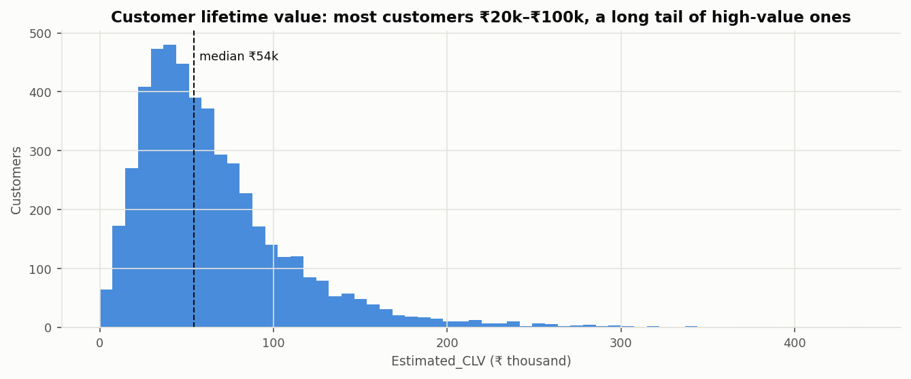
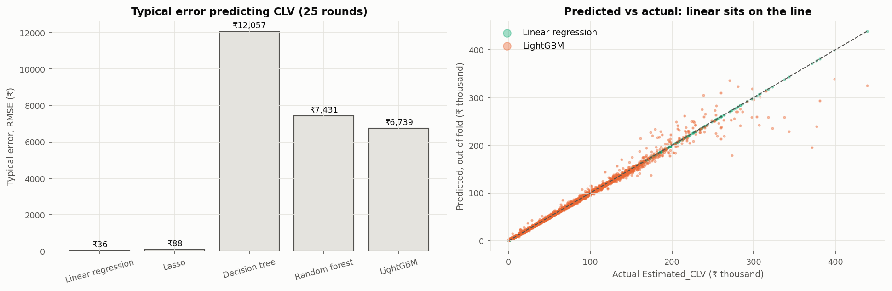
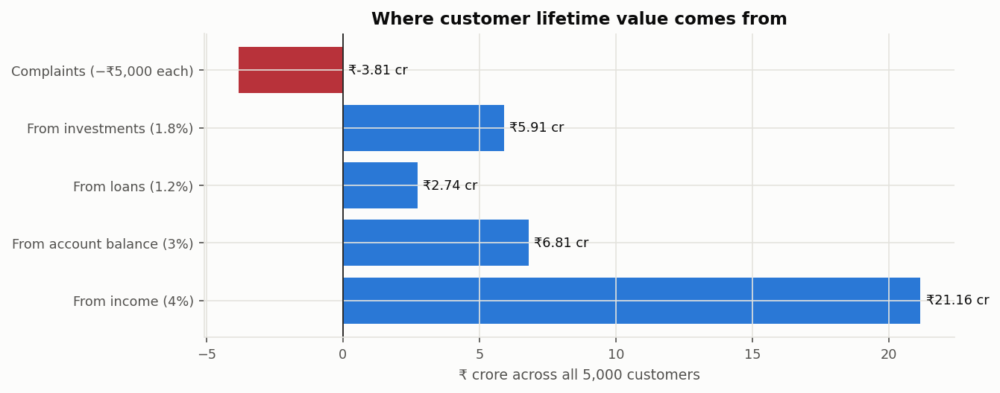

# Module 4 — Task 2 Report: Customer Lifetime Value

**Business problem (brief, verbatim):**
> NovaFin wants to reduce customer attrition. Management asks: Which customers should relationship managers prioritize for retention?

**Task 2 (brief, verbatim):**
> **Task 2 — Customer Lifetime Value.** Estimate: CLV using the provided customer financial variables.

**Customer lifetime value (CLV)** = what a customer is worth to the bank, in ₹.

**What this task does (decision M4-12).** The dataset already gives an `Estimated_CLV` for every customer. Task 2 **estimates it from the financial variables**, comparing regression models to find how it is built. That gives:
- a rule the bank can apply to any customer, including new ones;
- what drives value, in ₹;
- what the number leaves out.

A textbook CLV built from our own assumed margins and discount rate was considered and dropped: every input would be our assumption, with nothing to check it against.

**Where this sits in the chain:** churn prediction (Task 1) → **customer lifetime value (Task 2)** → the four groups and the 1,000 customers to contact (Task 3).

| Item | Where |
| --- | --- |
| Code | `notebooks/m04_task2_clv.ipynb`: runs on its own or from `run_module_4.ipynb`; about 1 minute |
| **Hand-off to Task 3** | **`outputs/task2/FINAL_M4_T2_customer_value.csv`**: every customer's CLV, the CLV from the rule, and the ₹ from each source |
| Evidence | `outputs/task2/model_comparison.csv`, 3 charts, `key_numbers.json` |
| Decisions | M4-12, M4-14, in `docs/decisions.md` |

**Terms:**
- **Regression:** a model that predicts a number.
- **RMSE:** the typical error in ₹, with big misses counting extra.
- **MAE:** the plain average error in ₹.
- **R²:** the share of differences between customers that a model explains (1 = all).
- **Rank correlation:** whether a model orders customers the same way as the real values (1 = identical order).
- **Top-1,000 overlap:** of the 1,000 customers with the highest real CLV, how many the model also puts in its own top 1,000. This is what matters for choosing whom to contact.

---

## 1. Summary for management

**The ML case**
1. **A simple linear rule explains customer value exactly; complex models do worse.** Over 25 rounds:

   | Model | Typical error |
   | --- | --- |
   | **Linear regression** | **₹36** (on an average CLV of ₹65,602) |
   | LightGBM | ₹6,739 |
   | Random forest | ₹7,431 |
   | Decision tree | ₹12,057 |

   The most flexible model isn't the best when the true relationship is simple.
2. **The rule, found from the data (not chosen by us):**

   ```text
   CLV = max(0,  4% × income + 3% × account balance + 1.2% × loan balance + 1.8% × investment balance − ₹5,000 × complaints)
   ```

   It matches the dataset's CLV for all 5,000 customers within ₹0.01 (one paisa).
3. **Age, products held, transactions, digital usage and relationship length don't count at all.**

**The finance case**
1. **The book is worth ₹32.80 crore.** Two-thirds comes from customers' income, a third from balances held with the bank.
2. **Complaints destroy ₹3.81 crore of value (12%),** at ₹5,000 each across 7,630 complaints. That is the one value driver the bank directly controls.
3. **Value is concentrated:** the 1,000 most valuable customers (20%) hold **₹13.79 crore, 42% of all CLV**. That is what the executive question's 1,000 contacts can protect.
4. **CLV has no churn in it.** It's a value score, not a risk-adjusted lifetime value. That is consistent with Task 1, where churn couldn't be predicted anyway.

---

## 2. Know the CLV (step 1)

| Measure | Value |
| --- | --- |
| Total CLV | ₹32.80 crore across 5,000 customers |
| Mean / median | ₹65,602 / ₹54,205 |
| Range | ₹0 (17 customers) to ₹4,39,367 |
| Churners vs stayers, median | ₹55,579 vs ₹54,195 (no difference) |



---

## 3. Five models compared over 25 rounds (step 2, decision M4-14)

```text
25 rounds: 5,000 customers → 5 parts; train on 4, predict the 5th; × 5 shuffles (the same design as Task 1)
Predictions floored at ₹0 (CLV can't be negative). RMSE decides. The simplest model wins unless a more complex one
has lower RMSE beyond chance: the paired 95% range = mean ± 2.064 × sd ÷ √25 excludes 0
```

**The factors used to judge the models, in plain words:**

| Factor | In plain words | Why it matters here |
| --- | --- | --- |
| **RMSE (typical error)** | How far off a model usually is, in ₹. A few big misses push it up more than many small ones | It decides, because a big miss on a high-value customer is the costliest mistake |
| **MAE (average error)** | The plain average of how far off the model is, in ₹ | Shows the everyday error without the extra weight on big misses |
| **R² (share explained)** | How much of the difference between customers' values the model accounts for: 1.0 = all of it, 0 = none | A quick "does it capture the pattern?" check |
| **Worst single error** | The biggest miss on any one customer | Shows whether a model can be badly wrong for someone, even when its average looks fine |
| **Rank correlation** | Whether the model puts customers in the same order as their real value: 1.0 = exactly the same order | Task 3 chooses customers by order, so getting the order right matters more than the exact ₹ |
| **Top-1,000 overlap** | Of the 1,000 truly most valuable customers, how many the model also puts in its own top 1,000 | The most direct check for the executive question's 1,000 contacts |
| **Paired 95% range** | Whether one model beats another by more than luck, judged round by round over the same 25 splits | Stops us picking a model that only looked better by chance |

| Model | RMSE | MAE | R² | Worst error | Rank correlation | Of the top 1,000 by CLV, also in its top 1,000 |
| --- | --- | --- | --- | --- | --- | --- |
| **Linear regression** | **₹36** | **₹28** | **1.0000** | **₹147** | **1.0000** | **1,000** |
| Lasso | ₹88 | ₹67 | 1.0000 | ₹416 | 1.0000 | 1,000 |
| LightGBM | ₹6,739 | ₹2,152 | 0.978 | ₹1,15,113 | 0.999 | 982 |
| Random forest | ₹7,431 | ₹3,764 | 0.974 | ₹99,991 | 0.993 | 951 |
| Decision tree | ₹12,057 | ₹7,826 | 0.932 | ₹1,12,636 | 0.968 | 928 |



**What this shows:**
1. **Linear regression is essentially exact, and best on every measure, beyond chance.** Its typical error is ₹36 on an average CLV of ₹65,602. The small error comes only from the 17 customers whose CLV is floored at ₹0, which a straight line can't reproduce. Fitting the rule on the customers with positive CLV and then flooring at ₹0 gives an exact match (within ₹0.01 (one paisa), §4).
2. **Tree models are far worse:** typical errors of ₹6,700–₹12,000, and single misses of about ₹1 lakh. Trees build values in steps, and a rule made of percentages of balances is exactly what they approximate badly. **The most flexible model isn't the best when the true relationship is simple.**
3. **This is the brief's "compare performance" in practice:** the simplest model wins clearly, and the comparison shows why.
4. **For Task 3, the ranking matters most.** Linear regression picks exactly the same top 1,000 as the real CLV; the trees would swap in 18–72 different customers.

**How the choice was made (decision M4-14, agreed before the results):**
- RMSE decides, because it is the error in ₹;
- the simplest model wins unless a more complex one has lower RMSE beyond chance;
- every other model's RMSE is higher than linear regression's, with the paired 95% range excluding 0 (lasso +₹51 to +₹53; LightGBM +₹6,130 to +₹7,274; random forest +₹6,996 to +₹7,794; tree +₹11,664 to +₹12,376).

---

## 4. The CLV rule and what each weight means (steps 3–4)

**How the weights were found:** least squares, on the 4,983 customers with positive CLV, then floored at ₹0 for everyone. R² = 1.000000. Each weight's 95% range is exact to the fourth decimal. The rule matches `Estimated_CLV` for all 5,000 customers within ₹0.01 (one paisa).

| Column | Weight found | In ₹ | A plausible banking reading (our interpretation) |
| --- | --- | --- | --- |
| Annual_Income | 0.04 | ₹1 lakh of income adds ₹4,000 | Capacity to bring business: spending, fees, future products |
| Account_Balance | 0.03 | ₹1 lakh in the account adds ₹3,000 | The margin a bank earns lending out deposits |
| Loan_Balance | 0.012 | ₹1 lakh of loan adds ₹1,200 | Loan interest margin, after the cost of defaults |
| Investment_Balance | 0.018 | ₹1 lakh invested adds ₹1,800 | Fees on managed investments |
| Complaints | −5,000 | Each complaint takes away ₹5,000 | The cost of handling an unhappy customer |
| Age, products, transactions, digital usage, relationship length | 0 (p = 0.28–0.79; lasso switches all off) | No effect | — |

**The banking meanings are our reading.** The dataset doesn't document how `Estimated_CLV` was set; only the weights themselves are facts from the data.

**Worked example, customer 300001:**

```text
4% × ₹5,15,268 + 3% × ₹8,98,438 + 1.2% × ₹3,92,907 + 1.8% × ₹19,33,424 − ₹5,000 × 1 = ₹82,080.38
```

`Estimated_CLV` for this customer is ₹82,080.38.

**What CLV leaves out:**
- **churn:** a true lifetime value would fall with the chance of leaving;
- **a time horizon and discounting:** it behaves like a yearly value score;
- **loyalty:** relationship length and products held count for nothing.

---

## 5. The finance view: where the ₹32.80 crore of value sits (step 5)

| Source | ₹ crore | Share |
| --- | --- | --- |
| Income (4%) | ₹21.16 | 65% |
| Account balances (3%) | ₹6.81 | 21% |
| Investments (1.8%) | ₹5.91 | 18% |
| Loans (1.2%) | ₹2.74 | 8% |
| **Complaints (−₹5,000 × 7,630)** | **−₹3.81** | **−12%** |



| Top customers by CLV | Share of customers | CLV | Share of total | Lowest CLV in the group |
| --- | --- | --- | --- | --- |
| 100 | 2% | ₹2.51 crore | 8% | ₹1,98,245 |
| 500 | 10% | ₹8.47 crore | 26% | ₹1,22,407 |
| **1,000** | **20%** | **₹13.79 crore** | **42%** | **₹93,019** |
| 2,500 | 50% | ₹24.45 crore | 75% | ₹54,206 |

- **Complaints are the one value driver the bank controls,** and they cost 12% of the book's value.
- **The 1,000 most valuable customers hold 42% of the value.** Every one of them is worth at least ₹93,019.

---

## 6. What goes to Task 3

- `FINAL_M4_T2_customer_value.csv`: every customer's CLV (`Estimated_CLV`, identical to the rule), and the ₹ from each source.
- **For Task 3 to decide:**
  - how to split High / Low CLV;
  - how to form the four groups and choose 1,000 customers when churn risk is the same for everyone (Task 1).

---

## 7. Risks and limitations

- **CLV was given, and is an exact formula,** so there's nothing uncertain to "estimate". The value of this task is the rule, its drivers, and what it leaves out.
- **The weights' banking meanings are our interpretation.**
- **CLV ignores churn, time and loyalty,** so it's a value score rather than a true lifetime value. A bank building its own CLV would add expected stay and discounting, but those need data this file doesn't have (how long churn takes, margins, the cost of funds).
