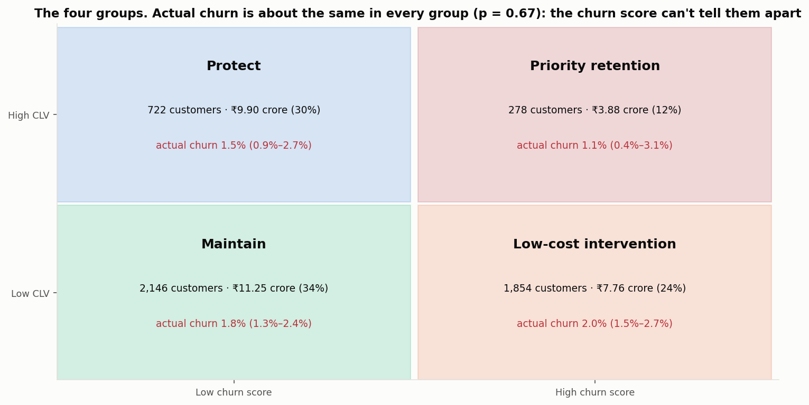
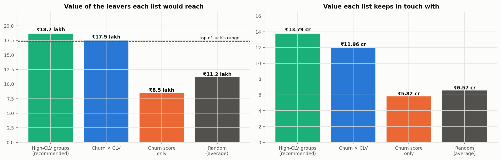

# Module 4 — Task 3 Report: Customer Prioritisation and the Executive Question

**Business problem (brief, verbatim):**
> NovaFin wants to reduce customer attrition. Management asks: Which customers should relationship managers prioritize for retention?

**Task 3 (brief, verbatim):**
> **Task 3 — Customer prioritization.** Create four groups:
>
> | | Low Churn | High Churn |
> | --- | --- | --- |
> | **High CLV** | Protect | Priority retention |
> | **Low CLV** | Maintain | Low-cost intervention |
>
> **Executive question:** If NovaFin can contact only 1,000 customers, which customers should it target?

**Where this sits in the chain:** churn prediction (Task 1) → customer lifetime value (Task 2) → **the four groups and the 1,000 customers to contact (Task 3)**.

| Item | Where |
| --- | --- |
| Code | `notebooks/m04_task3_prioritisation.ipynb`: runs on its own or from `run_module_4.ipynb`; under a minute (needs Tasks 1 and 2 first) |
| **The answer to the executive question** | **`outputs/task3/FINAL_M4_T3_contact_list.csv`**: the 1,000 customers in call order, with group, CLV, chance of churn and the reason for each |
| Evidence | `outputs/task3/customer_groups.csv` (every customer's group), 2 charts, `key_numbers.json` |
| Decisions | M4-15 to M4-18, in `docs/decisions.md` |

**Terms:**
- **Churn:** a customer leaving the bank. **Churn rate:** the share who leave (here 89 of 5,000 = 1.78%).
- **CLV (customer lifetime value):** what a customer is worth to the bank, in ₹ (Task 2).
- **Chance of churn (P(churn)):** Task 1's model estimate of how likely each customer is to leave. Task 1 showed it is **no better than chance**.
- **Back-test:** checking a list chosen *without* knowing who left against what actually happened: "if the bank had called these customers, how many of those who went on to leave would it have reached?"
- **Break-even:** the point at which a call's benefit equals its cost.
- **Wilson 95% range:** the range a group's true churn rate likely lies in, given how few leavers each group has.

---

## 1. Summary for management

**The answer to the executive question:** contact the **1,000 highest-value customers**: the 278 in "Priority retention" first, then the 722 in "Protect", each ordered by CLV. They are worth ₹93,019 to ₹4,39,367 each and hold **₹13.79 crore, 42% of all customer value**.

**The ML case**
1. **The four groups are built exactly as the brief asks,** from Task 1's chance of churn and Task 2's CLV.
2. **But the churn side doesn't separate customers.** Every group churns at about the same actual rate (1.1–2.0%; p = 0.67). "Priority retention", rated riskiest by the model, churns *least* (1.08%). That is Task 1's finding showing through: churn can't be predicted from this data.
3. **So the prioritisation rests on value, the part the data supports.** Back-tested, no list reaches more leavers than random calling (14–16 vs about 18 of 89), but the high-value list reaches the most *value* that left: ₹18.7 lakh of ₹56.0 lakh, more than any other way tested.

**The finance case**
1. **Value at stake on the list:** if nobody is called, the expected loss is 1.78% × ₹13.79 crore = **₹24.5 lakh**.
2. **Calling pays off only if calls keep enough would-be leavers.** At ₹500 a call, 1,000 calls cost ₹5 lakh and must keep at least **20%** of would-be leavers to pay for themselves (break-even; no success rate assumed).
3. **The bank should measure its real success rate** with a small randomised test before scaling the campaign.
4. **Complaints remain the one value driver the bank controls** (Task 2: ₹3.81 crore, 12% of value), a lever for all four groups.

---

## 2. How the four groups are formed (decisions M4-16, M4-17)

**Assigned only from what the bank would know in advance:** Task 1's chance of churn and Task 2's CLV. The actual churn flag (`Churn_Flag`, whether a customer went on to leave) is used **only afterwards**, to check the groups. A bank choosing whom to call can't know who will leave.

| Cut-off | Value | How it is derived | Why |
| --- | --- | --- | --- |
| **High CLV** | top 20%: CLV ≥ ₹92,963 | 1,000 contacts ÷ 5,000 customers = 20% | The high-value groups are then exactly as large as the calls available. The median would call 2,500 customers "High CLV", 2.5 times the calls |
| **High churn** | the model's chance of churn above 1.78% | 89 leavers ÷ 5,000 customers = 1.78%, the actual average | "High churn" reads as "rated more likely to leave than the typical customer", with no arbitrary percentage. The score is noise, so every cut tested gave near-equal actual churn |

**Other ways tested for the churn side** (about one in five customers called "High churn" each way):

| Way of choosing "High churn" | Actual churn: High / Low | Really different? (p) |
| --- | --- | --- |
| Model: top 20% of chance of churn | 1.50% / 1.85% | No (0.54); High churns *less* |
| Bank rule: 3 or more complaints | 1.99% / 1.73% | No (0.67) |
| Bank rule: lowest 20% digital usage | 2.20% / 1.68% | No (0.32) |
| Bank rule: relationship under 3 years | 2.89% / 1.65% | No (0.07, before allowing for four tries) |

None separates leavers from stayers, so the model's scores are used as the brief asks, with the evidence shown beside them.

---

## 3. The four groups (step 3)



| Group | Customers | CLV | Share of all CLV | Model's average chance of churn | Actual churn (95% range) | Value of leavers |
| --- | --- | --- | --- | --- | --- | --- |
| **Priority retention** (High CLV, High churn score) | 278 | ₹3.88 crore | 12% | 2.93% | 1.08% (0.4–3.1%) | ₹4.4 lakh |
| **Protect** (High CLV, Low churn score) | 722 | ₹9.90 crore | 30% | 1.17% | 1.52% (0.9–2.7%) | ₹14.3 lakh |
| **Low-cost intervention** (Low CLV, High churn score) | 1,854 | ₹7.76 crore | 24% | 2.24% | 2.00% (1.5–2.7%) | ₹15.8 lakh |
| **Maintain** (Low CLV, Low churn score) | 2,146 | ₹11.25 crore | 34% | 1.45% | 1.77% (1.3–2.4%) | ₹21.5 lakh |

**What this shows:**
1. **The groups differ in value, not in risk.** Actual churn is about the same in all four (chi-square p = 0.67: the chance the differences are just luck). Customers with a high churn score churn 1.88% against 1.71% for the rest (p = 0.74).
2. **"Priority retention" churns least (1.08%),** although the model rated it riskiest (2.93%). The churn score is noise (Task 1).
3. **The value difference is real and large:** the two High-CLV groups average about ₹1.38 lakh per customer, the two Low-CLV groups about ₹47,500.

**What each group means for relationship managers:**

| Group | Brief's intent | What it means on this data | Suggested action |
| --- | --- | --- | --- |
| **Priority retention** | High value, at risk: call first | High value; "at risk" can't be confirmed | Personal call from the relationship manager, first in the queue |
| **Protect** | High value, safe: keep happy | High value; as likely to leave as anyone | Personal call, after Priority retention: together they are the 1,000 |
| **Low-cost intervention** | Lower value, at risk | Lower value; risk not confirmed | Automated, cheap contact (email, app message) |
| **Maintain** | Lower value, safe | Lower value; as likely to leave as anyone | Business as usual |

---

## 4. The executive question: the 1,000 customers to contact (step 5, decision M4-18)

**The list:** the 278 "Priority retention" customers first, then the 722 "Protect", each ordered by CLV. Together these are exactly the 1,000 highest-value customers:
- CLV ₹93,019 to ₹4,39,367;
- **₹13.79 crore, 42% of all customer value**, in 20% of customers.

**Why value, not churn risk:** every customer is about equally likely to leave (Task 1). What differs is how much is lost when one does: that is CLV, which Task 2 showed is reliable.

**Why Priority retention goes first, though its churn score is noise:** it keeps the brief's groups and the list consistent, and it costs nothing. Both groups are called; the order only matters if the bank runs out of capacity part-way.

`FINAL_M4_T3_contact_list.csv` gives each customer's call order, group, CLV, chance of churn (labelled no better than chance), and the reason in words, for example: *"High value: CLV ₹4,39,367 (top 20%, at least ₹92,963); model rates churn above average (11.58% vs 1.78%), though this score is no better than chance"*. A back-test column shows who actually left; it is for checking only and would not be known when calling.

---

## 5. Back-test: would the list have worked? (step 6)



| Way of choosing 1,000 | Leavers reached (of 89) | Value of those leavers (of ₹56.0 lakh that left) | Value contacted |
| --- | --- | --- | --- |
| **Recommended: the high-CLV groups** | 14 | **₹18.7 lakh (33%)** | **₹13.79 crore (42%)** |
| Chance of churn × CLV ("expected value at risk") | 16 | ₹17.5 lakh (31%) | ₹11.96 crore (36%) |
| Churn score only | 15 | ₹8.5 lakh (15%) | ₹5.82 crore (18%) |
| Random 1,000 (average of 500 lists) | 17.7 | ₹11.2 lakh (95% range up to ₹17.4 lakh) | ₹6.57 crore (20%) |

**What the columns mean:**
- **Leavers reached:** of the 89 who left, how many were on the list.
- **Value of those leavers:** how much of the lifetime value that walked out the list would have had the chance to save.
- **Value contacted:** how much of the book's value the list keeps in touch with, which matters for loyalty whoever leaves.

**What this shows:**
1. **No list reaches more leavers than random calling.** Who leaves can't be foreseen (Task 1).
2. **The recommended list reaches the most value,** just above the top of luck's range. That isn't skill at spotting leavers: high-value customers are simply worth more when they leave.
3. **Adding the churn score only dilutes the list.** Ranking by chance × CLV covers less value (36%); the churn score alone does worse than random.

---

## 6. Is calling worth it? The break-even (step 7, decision M4-18)

**The success rate can't be predicted from this data:** there is no record of past calls or offers. Any figure would be our assumption. So instead of assuming one, the break-even works out **the success rate calls would need** to pay off:

```text
Expected loss if the bank doesn't call = chance of leaving × CLV        (chance = the actual 1.78%: nothing tells customers apart)
Value of a call                        = success rate × expected loss     (success rate = the share of would-be leavers the call keeps)
A call pays off if:  success rate × expected loss  >  cost of the call
→ success rate needed = cost of the call ÷ expected loss
```

**Worked example:** the lowest-value customer on the list, CLV ₹93,019:
- expected loss = 1.78% × ₹93,019 = ₹1,656;
- a ₹500 call must keep at least 500 ÷ 1,656 = **30%** of would-be leavers.

That is the bar calls must clear, not a claim that they *do* succeed 30% of the time.

| Customer on the list | CLV | Expected loss if not called | ₹100 call | ₹250 call | ₹500 call | ₹1,000 call |
| --- | --- | --- | --- | --- | --- | --- |
| Lowest-value | ₹93,019 | ₹1,656 | 6% | 15% | 30% | 60% |
| Median | ₹1,22,389 | ₹2,179 | 5% | 11% | 23% | 46% |
| Average | ₹1,37,855 | ₹2,454 | 4% | 10% | 20% | 41% |

**For the whole list:** expected loss if nobody is called = 1.78% × ₹13.79 crore = ₹24.5 lakh.

| Cost per call | Cost of 1,000 calls | Calls must keep at least |
| --- | --- | --- |
| ₹100 | ₹1 lakh | 4% of would-be leavers |
| ₹250 | ₹2.5 lakh | 10% |
| ₹500 | ₹5 lakh | 20% |
| ₹1,000 | ₹10 lakh | 41% |

**How the bank uses this:** it supplies its own call cost and experience. For example, "our calls cost about ₹250 and keep about 1 in 4 would-be leavers": 25% is above the 10% bar, so the campaign pays.

**To measure the real success rate:** a randomised test. Call a random half of a test group, leave the other half, and compare who leaves:

```text
Success rate (extra customers kept per call) = churn rate of those not called − churn rate of those called
```

---

### Module 9 inputs: Wealth management's fee income in the standard fields (decision M4-20; final notebook step "What goes to Module 9")

**Why:** Module 9 compares every business on the same fields: return per ₹, bad-year result, capacity, evidence, how fast money comes back, gaps and controls. This module gives Wealth management's fee income per ₹ of client balances, net of churn, and a bad year (markets −20%, churn twice as high). How much client money ₹1 of capital brings in is not in the data; Wealth's return per ₹ of capital comes from Module 1's Wealth unit.

| Category | Return per ₹ (% a year) | Range | Bad year per ₹ | Bad year means | Capacity | Gap / assumption |
| --- | --- | --- | --- | --- | --- | --- |
| Wealth management: fees on client balances | 1.77 | 1.39 (bad year) to 1.80 (no churn), per ₹ of client balances | 1.39 | Market fall of 20% (balances and fees fall with it) and churn twice as high | 328.1 | Per ₹ of client balances, not of NovaFin's capital; return per ₹ of capital comes from Module 1's Wealth unit (17.6% a year) |

## 7. Risks and limitations

- **Churn can't be predicted from this data** (Task 1), so "High / Low churn" labels carry no real information. They are kept because the brief asks for the four groups, with the evidence shown beside them.
- **The back-test uses the same customers the churn model was trained on** (out-of-fold scores, so each score came from models that never saw that customer). There is no later period of data to test on.
- **The success rate and call cost are unknown;** the break-even avoids assuming them, but the campaign's real payoff depends on them.
- **CLV ignores churn, time and loyalty** (Task 2), so it is a value score rather than a true lifetime value.
- **What would improve the list:** month-by-month signals (falling balances or transactions, closed products, service calls) that could make churn predictable, and a record of past retention calls to measure success.
