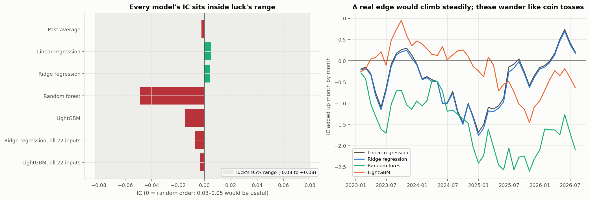
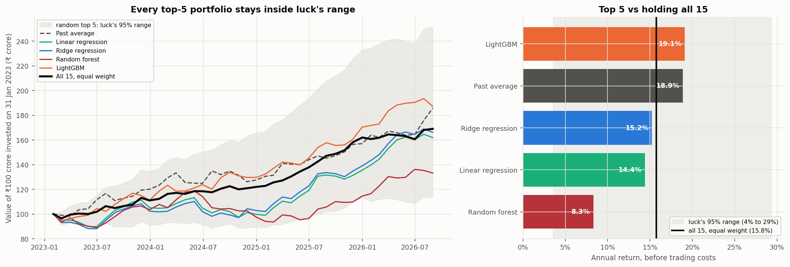

# Module 5 — Equity Markets: ML-Driven Investment Strategy

## Final report

**The business problem (brief, verbatim):**
> NovaFin manages an equity portfolio.
> The investment committee wants to know:
> **Can ML identify stocks with superior future returns?**

**The two tasks (brief, verbatim):**
> **Task 1 —** predict future returns by various models
>
> **Task 2 — Stock ranking**
> For every rebalance date (assumed):
> 1. Predict future returns
> 2. Rank stocks
> 3. Select top-ranked stocks
> 4. Construct portfolio

**Data:** `nova_market_data.csv`: 15 large Indian stocks (8 sectors) × 1,457 trading days, 29 Jan 2021 – 31 Aug 2026, no missing values. Prices in ₹ per share; 1 crore = ₹100 lakh = ₹1,00,00,000.

**Terms used throughout:**
- **Return:** the % change in price. ₹100 → ₹103 is a 3% return.
- **Rebalance date:** a day when the portfolio is reset to the chosen stocks. The brief leaves it to us ("assumed"); we use each month-end.
- **Walk-forward:** each month, a model is trained only on earlier months and predicts the next. It never sees the future.
- **IC (information coefficient):** how well a model puts the 15 stocks in the right order each month, averaged over months. −1 = exactly backwards, 0 = random, +1 = perfect. **0.03–0.05 is already useful** in real markets.
- **p:** the chance luck alone gives a result at least this strong. Range 0 to 1; below the line = probably real.
- **Equal weight:** the same share of money in each stock held (top 5 → 20% each; all 15 → 6.67%).
- **Benchmark:** what a strategy is compared with. Here: **holding all 15 stocks equally**, what NovaFin would do without a model.
- **Macro (macroeconomic):** measures of the whole economy or market (GDP growth, interest rate, VIX "fear index", market return), not of one company.

**How to read this report.** Each section opens with its conclusion. Every number comes from a notebook output in `outputs/`. The glossary at the end collects every term.

| Item | Where |
| --- | --- |
| **Final output (open this first)** | **`outputs/FINAL_M5_module_output.xlsx`**: Read me · Key numbers · Board actions · every task's final file · Hand-off · Decisions · Evidence index (project decision P-21) |
| Run everything | `run_module_5.ipynb` (Run all, about 50 minutes, mostly Task 1's luck test) |
| Task notebooks | `notebooks/m05_task1_returns.ipynb`, `m05_task2_ranking.ipynb` |
| Task reports | `reports/task1_report.md`, `task2_report.md` |
| Decisions and their evidence | `docs/decisions.md` (M5-01 to M5-17) |
| **Deliverables** | `outputs/task1/FINAL_M5_T1_return_predictions.csv` · **`outputs/task2/FINAL_M5_T2_stock_selections.csv`** · `outputs/task2/portfolio_returns.csv` · `outputs/task2/september_2026_portfolio.csv` |

---

## 1. The answer in brief

**On this data, ML cannot identify stocks with superior future returns. No model's picks beat holding all 15 stocks equally beyond luck, and holding all 15 had about half the risk.**

| Finding | Evidence |
| --- | --- |
| **No model predicts which stocks will do better** (Task 1) | Four models and two simple benchmarks, walk-forward over 43 months (645 predictions each): ICs −0.049 to +0.005. Luck alone gives −0.08 to +0.08; every model sits inside (shuffled-returns p 0.53–0.93) |
| **Nothing in the data predicts returns** (Task 1) | 0 of 66 input tests pass (22 inputs × next day, week, month); no sector, calendar or VIX effect; the best of 946 combined conditions is luck (p 0.48). The macro columns are random numbers |
| **No portfolio of the models' top picks beats holding all 15 beyond luck** (Task 2) | ₹100 crore in all 15 grew to **₹169.0 crore** (15.8% a year, 31 Jan 2023 – 31 Aug 2026, before costs). Models' top 5: ₹133.2 to ₹187.2 crore, p 0.40–0.98; a random top 5: ₹113 to ₹251 crore |
| **The answer holds under every variation tried** (Task 2) | Top 3, 5 or 7 stocks (the "best" model changes each time); quarterly instead of monthly; weighting the top 5 by the model's confidence (lowers the ML models' returns) |
| **Picking 5 stocks nearly doubles the risk, for no proven gain** (Task 2) | Volatility 10.9%–13.2% a year for any top 5, against 6.7% for all 15: about 1.8 times. All 15 had the best return per unit of risk (2.34 vs 0.63–1.75) |





**Recommendations for the investment committee:**
1. **Don't use these models to pick stocks.** They add risk (about 1.8 times), heavy trading (the portfolio turned over 11–16 times a year) and no proven return.
2. **Hold the stocks broadly:** equal weight, or the optimised mix Module 6 compares.
3. **Don't fund an ML stock-picking programme on this evidence.** A small edge (IC 0.03–0.05, worth about ₹3–5 crore a year on ₹100 crore) could exist and stay hidden in 43 months of 15 stocks.
4. **Re-test when better data is available:** real market data with genuine macro series, more stocks, a longer history, and company fundamentals (earnings, valuations).

---

## 2. The chain: how the two tasks fit together

| Hand-off | File | How it is used |
| --- | --- | --- |
| Task 1 → Task 2 | `FINAL_M5_T1_return_predictions.csv`: each model's walk-forward prediction for 43 months × 15 stocks, labelled "Returns predictable: No" | Task 2 ranks on these: the business check of each model |
| Task 2 → committee | `FINAL_M5_T2_stock_selections.csv`: rank, selected, weight and reason in words per strategy, month and stock; `september_2026_portfolio.csv` | The brief's four steps, row by row; the picks for the latest rebalance date |
| Task 1, Task 2 → Module 6 | Ridge regression's predictions; `portfolio_returns.csv` | The "ML-predicted-return portfolio" and the same months for Module 6's backtests (§6) |
| Module 5 → Module 9 | Rates before costs, replaced by Module 6's after-cost figures | "Equity investments" (§7) |

---

## 3. Predicting future returns (Task 1)

**Conclusion: no model ranks stocks better than luck, and the data shows why.**

**The target:** each stock's return from one month-end to the next (decision M5-01). The `Return` column is today's change, so predicting it would be leakage (using information not available in advance).

**Monthly, walk-forward (M5-03, M5-04):**
```text
68 month-ends (Jan 2021 – Aug 2026) − 1 = 67 months with a known next-month return
First 24 months train only → 43 test months (Jan 2023 – Jul 2026) × 15 stocks = 645 predictions per model
Smallest IC the test can tell from luck ≈ 2 × 0.25 (month-to-month spread of IC) ÷ √43 ≈ 0.08
```

**What the data contains (M5-06):**
- **The macro columns are random numbers:** 15 different values on the same date (real macro data has 1), and about 0 correlation with the day before (real: about +1). `Market_Return` correlates −0.016 with the stocks' average (a real index: +0.6 to +0.9).
- **The stocks move independently:** average correlation 0.004 (real large-caps: 0.3–0.5).
- **Returns are balanced and well-behaved:** 54.8% up months; 2 of 1,005 beyond 3 typical swings (a bell curve gives 2.7). No balancing or outlier treatment needed.

**Exploration:**
- **22 inputs × 3 horizons:** 0 of 66 pass the line 0.05 ÷ 66 = 0.0008 (smallest p 0.019).
- **Groups:** sectors p 0.96, calendar months p 0.73, VIX level p 0.40.
- **Combinations:** the best of 946 pairs of conditions beat the month by 2.73%; luck's best averages 2.71% (p 0.48).

**The models (M5-07, M5-08):** 13 price and trading inputs + sector; macro dropped.

| Model | IC | p (shuffled returns) | Typical error (RMSE) |
| --- | --- | --- | --- |
| Predict zero (benchmark) | — | — | **8.67%** (lowest) |
| Past average (benchmark) | −0.002 | — | 8.65% |
| Linear regression | +0.005 | 0.53 | 8.74% |
| Ridge regression | +0.004 | 0.53 | 8.73% |
| Random forest | −0.049 | 0.93 | 8.77% |
| LightGBM | −0.015 | 0.64 | 8.94% |

- The line was 0.05 ÷ 4 models = 0.0125. No model is near it.
- The flexible models (random forest, LightGBM) do slightly worse: they learn patterns that reverse (overfitting).

---

## 4. Ranking and portfolios (Task 2)

**Conclusion: no top-5 portfolio beats holding all 15 stocks beyond luck.**

On each of the 43 month-ends, for each model: rank the 15 stocks by prediction → take the top 5 (M5-05) → 20% each (M5-12) → hold one month. Before trading costs (M5-13).

| Strategy | Annual return | p (vs all 15) | Months beating all 15 (of 43) | Volatility | ₹100 crore became | Stocks replaced a month |
| --- | --- | --- | --- | --- | --- | --- |
| Past average | 18.9% | 0.60 | 23 | 11.2% | ₹185.7 crore | 10% |
| Linear regression | 14.4% | 0.92 | 20 | 13.0% | ₹161.9 crore | 49% |
| **Ridge regression** | 15.2% | 0.98 | 20 | 13.0% | ₹166.1 crore | 48% |
| Random forest | 8.3% | 0.40 | 17 | 13.3% | ₹133.2 crore | 58% |
| LightGBM | 19.1% | 0.57 | 24 | 10.9% | ₹187.2 crore | 68% |
| **All 15, equal weight** | **15.8%** | — | — | **6.7%** | **₹169.0 crore** | — |

- **The line was 0.05 ÷ 5 strategies = 0.01;** the smallest p is 0.40. A coin toss beats the benchmark in about 21–22 of 43 months.
- **Random picks:** 1,000 portfolios of 5 random stocks a month made 3.6% to 29.3% a year (95% range). Every strategy is inside it.
- **The "best" model flips with the number held:** past average at top 3 (25.6%), LightGBM at 5 (19.1%), ridge at 7 (20.3%). Smallest p anywhere 0.31.
- **The past average's 18.9% is a near-fixed bet** on ICICIBANK, INFY and RELIANCE (held in 95%–100% of months).

**Stock by stock (M5-18, `stock_scorecard.csv`):** best ICICIBANK +45.0% a year, worst BHARTIARTL −8.1%, every stock swinging 27.9%–30.6% a year. The spread between them (sd 15.5%) sits inside luck's range (10.4%–23.5%), and first-half winners weren't second-half winners (rank correlation −0.08). Ridge held ICICIBANK in only 12 of 43 months. Each stock's story is in words in the scorecard.

**Checks (M5-17):**
- **Quarterly rebalancing:** 0 of 22 inputs predict the next quarter; no strategy beats all 15 (smallest p 0.08, LightGBM); with 13 quarters the test can only detect an IC of 0.16 (monthly 0.08).
- **Confidence weighting** (by rank or by predicted return): lowers all four ML models' returns (ridge 15.2% → 8.6%) and raises the swings.

**September 2026, the latest rebalance date (M5-17):** each model trained on all 67 months picks its top 5. The ML models agree on **LT and ITC** (4 of 5 strategies each). They agreed as much over the 43 test months (2.9 shared picks vs 1.7 for random lists) without beating luck, so these are picks, not a recommendation.

---

## 5. How the pieces connect: cross-task conclusions

| Conclusion | Task 1 evidence | Task 2 evidence |
| --- | --- | --- |
| **The models have no ranking skill** | ICs inside luck's range | Portfolios inside luck's range; winner flips with the number held |
| **The weakest forecaster loses most money** | Random forest IC −0.049 (most negative) | Random forest worst at every size (5.8%–9.8% a year; −₹35.7 crore vs all 15) |
| **Rule-of-thumb ₹ value matches** | IC → ₹: random forest about −₹5.2 crore a year on ₹100 crore | Actual gap −₹7.4 crore a year: same direction, within luck |
| **Independent stocks make diversification powerful** | Stock correlation 0.004 | 15 stocks: 6.7% volatility; 5 stocks: 10.9%–13.2% |
| **More flexible models trade more and earn less** | Random forest, LightGBM overfit | Turnover 58%–68% a month; returns no better |

---

## 6. Hand-off to Module 6 (portfolio optimisation)

Module 6's brief (verbatim): *"One must transform ML predictions into an actual portfolio. Compare strategies- Equal-weight portfolio, Traditional Markowitz portfolio, ML-predicted-return portfolio. Perform backtesting to demonstrate performance and generate performance metrics."*

| File | What it holds | How Module 6 must treat it |
| --- | --- | --- |
| `outputs/task1/FINAL_M5_T1_return_predictions.csv` | Every model's walk-forward predicted return, 43 months × 15 stocks | **Use ridge regression's predictions** for the ML-predicted-return portfolio (M5-15). No proven skill |
| `outputs/task2/portfolio_returns.csv` | Monthly returns of each top-5 portfolio and of all 15 equal weight | Same months (31 Jan 2023 – 31 Aug 2026), before costs; Module 6 sets the trading-cost rate |
| `outputs/task2/FINAL_M5_T2_stock_selections.csv` | Rank, selection, weight, reason | The top-5 equal-weight portfolios, for comparison |
| `helpers/m05_data.py` | Loading, rebalance dates, the 22 inputs, the monthly table | Reuse, so both modules use identical data |

**Why ridge regression (M5-15):** no model has proven skill, so the choice rests on how each behaves:

| Factor (plain words) | Ridge | Linear | Random forest | LightGBM |
| --- | --- | --- | --- | --- |
| Orders stocks better than random? (IC) | +0.004, about 0 | +0.005, about 0 | −0.049, slightly backwards | −0.015, about 0 |
| How extreme its predictions are | −4.7% to +6.0%, moderate | −5.0% to +6.1% | −2.5% to +4.2% | −6.9% to +7.3%, most extreme |
| Share of stocks replaced a month | 48% | 49% | 58% | 68% |
| Can you read why it predicts what it does? | Yes | Yes | No | No |

- **Moderate predictions matter in Module 6:** Markowitz-style optimisers pile money into the stocks with the most extreme expected returns.
- **Ridge over linear:** near-identical here (they share 4.9 of 5 picks a month), but ridge keeps weights small, which makes it steadier on new data.
- **Not LightGBM for its 19.1%:** that lead turns into 11.7% at top 7; choosing it would be data dredging.

---

## 7. Hand-off to Module 9 (the capital allocation)

Module 9 allocates capital across businesses including **Equity investments**. Module 5 provides **rates**, not ₹ totals, so Module 9 can scale them to whatever amount it allocates (decision M5-16; the same approach as Modules 3 and 4).

| Measure | Value | Basis |
| --- | --- | --- |
| Return, holding all 15 equal weight | **15.8% a year** | 31 Jan 2023 – 31 Aug 2026, before costs |
| Volatility | **6.7% a year** | Monthly swings × √12 |
| Worst fall from a high | **−3.6%** | Same period |
| Extra return from ML stock-picking | **0** | No model or portfolio beats luck |

**Example:** ₹100 crore in equities → about ₹15.8 crore a year before costs, with typical yearly swings of about ±₹6.7 crore.

- **For Module 9:**
  - equity's expected return should come from **holding broadly, not from an ML edge**;
  - **no capital should be allocated on the promise of ML stock-picking.**
- **Assumptions Module 9 must state:**
  - 43 months of what looks like synthetic data (independent stocks, random macro columns): planning figures, not forecasts;
  - real markets swing together more, so real equity risk would be higher than 6.7%;
  - before trading costs and without dividends.
- **Replaced by Module 6 (decision M6-11).** The final equity figures for Module 9 are in **`module_06_portfolio_optimization/outputs/FINAL_M6_module_output.xlsx` (Hand-off tab)**: return 15.6% a year after costs (95% range 8.6%–22.6%), yearly swing about 19.4% with real-market co-movement, 1-month VaR about ₹8.00 crore per ₹100 crore, ₹20 crore in a 20% market fall, extra return from ML 0.

---

## 8. Key decisions

| ID | Decision | Why |
| --- | --- | --- |
| M5-01 | Target: next-month return | `Return` is today's change: leakage |
| M5-03 | Monthly rebalancing | Nothing predicts at any horizon; monthly gives 43 test periods (detects IC 0.08) vs quarterly 13 (0.16); quarterly tested in M5-17 with the same answer |
| M5-04 | Walk-forward, 24 training months, 43 test months | No learning from the future |
| M5-05 | Top 5 of 15, top 3 and 7 as a check | Fixed by reasoning; choosing by results would be data dredging |
| M5-07 | 13 price and trading inputs + sector; macro dropped | Macro columns are random numbers |
| M5-08 | IC decides; shuffled-returns test, line 0.0125 | Task 2 ranks stocks, so order matters |
| M5-11 | Benchmark: all 15 equal weight, plus random picks | What NovaFin holds without a model; no real market index exists |
| M5-12 | Equal weight | Neutral; optimised weights are Module 6's; confidence-weighting tested and worse |
| M5-13 | Before costs, turnover shown | No strategy beats the benchmark even before costs; Module 6 sets the rate |
| M5-15 | Ridge regression to Module 6 | Moderate predictions, lower turnover, readable |
| M5-16 | Rates to Module 9 | Scalable; replaced by Module 6's after-cost figures |
| M5-17 | September 2026 picks; quarterly and weighting checks | "Every rebalance date"; tests the two main alternatives |

All 17, with options and evidence: `docs/decisions.md`.

---

### Module 9 inputs: ML stock selection in the standard fields (decision M5-19; final notebook step "What goes to Module 9")

**Why:** Module 9 compares every business on the same fields: return per ₹, bad-year result, capacity, evidence, how fast money comes back, gaps and controls. This module gives Whether ML stock-picking adds return over holding all 15 stocks (it doesn't, beyond luck). The equity holding's own return and risk are Module 6's.

| Category | Return per ₹ (% a year) | Range | Bad year per ₹ | Bad year means | Capacity | Gap / assumption |
| --- | --- | --- | --- | --- | --- | --- |
| Equity investments: ML stock selection (extra over holding all 15) | 0.0 | Best model (LightGBM) +3.4 points, p = 0.57 (luck); ridge -0.5 | -7.42 | Worst model's shortfall against holding all 15 (a year, before costs) | — | Before trading costs; the stocks in the data look independent (synthetic) |

## 9. Limitations

- **43 months and 15 stocks:** an edge smaller than IC 0.08 can't be told from luck.
- **The data looks synthetic:** random macro columns, independent stocks, bell-curve returns. Real markets have common moves, fatter tails and real macro links.
- **No fundamentals:** no earnings, valuations or report dates, so quarterly-results strategies can't be tested.
- **Before trading costs, no dividends:** costs would lower every model's return (they trade 11–16 times the portfolio a year).
- **Model settings fixed in advance, not tuned:** tuning on 43 months of noise would fit the noise, but a tuned model could behave differently on other data.

---

## Glossary

| Term | Meaning |
| --- | --- |
| Annual return | Yearly growth rate achieved, compounded: (growth over the period)^(12 ÷ months) − 1 |
| Benchmark | What a strategy is compared with; here all 15 stocks, equal weight |
| Bonferroni line | 0.05 ÷ number of tests, so the chance of even one false "hit" stays about 1 in 20 |
| Data dredging | Trying many options and keeping the luckiest; its "winner" doesn't repeat |
| Diversification | Holding many stocks so their independent swings cancel out |
| Equal weight | The same share of money in each stock held |
| IC (information coefficient) | Rank correlation between predicted and actual returns across the stocks each month, averaged; −1 to +1, 0 = random |
| Leakage | Using information that wouldn't be known at the time of the prediction |
| Macro (macroeconomic) | Measures of the whole economy or market, not one company |
| Markowitz portfolio | Weights chosen to balance expected return against risk (Module 6) |
| Maximum drawdown | The largest fall from a previous high |
| Overfitting | A model learning noise in its training data, which then fails on new data |
| p | The chance luck alone gives a result at least this strong; 0 to 1, small = probably real |
| Rebalance date | A day when the portfolio is reset to the chosen stocks |
| Return per unit of risk | Annual return ÷ volatility; higher is better |
| RMSE | Typical size of a prediction error, big misses counting extra |
| Shuffled-returns test | Shuffle each month's returns among the stocks, rerun everything, and see what IC luck produces |
| Turnover | Share of the portfolio's stocks replaced each month |
| Volatility | How much returns swing: standard deviation of monthly returns × √12, a year |
| Walk-forward | Train on earlier months only, predict the next, move forward one month |
