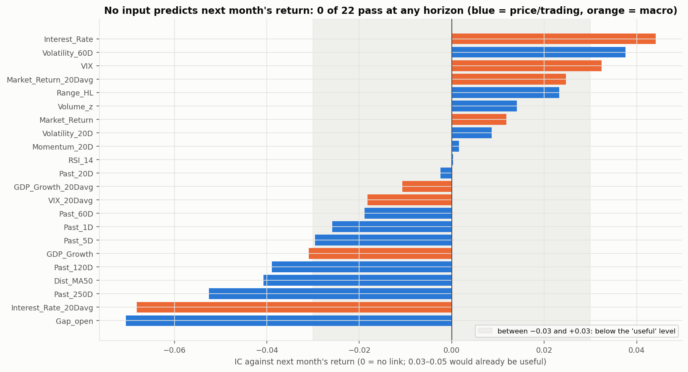
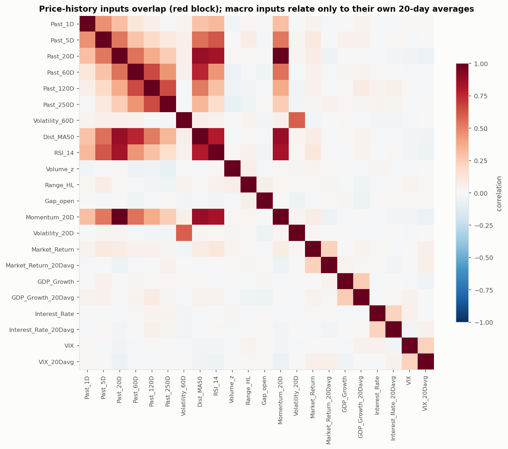
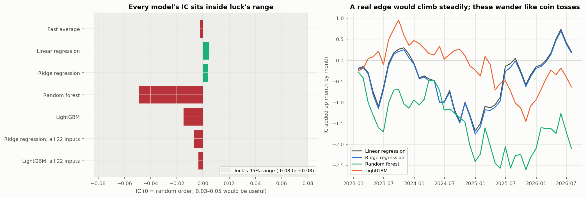

# Module 5 — Task 1 Report: Predict Future Returns by Various Models

**Business problem (brief, verbatim):**
> NovaFin manages an equity portfolio. The investment committee wants to know: **Can ML identify stocks with superior future returns?**

**Task 1 (brief, verbatim):**
> **Task 1 —** predict future returns by various models

**Where this sits:** **forecast each stock's next-month return (Task 1)** → rank the stocks, pick the top ones, build a portfolio (Task 2) → Module 6 turns the predictions into optimised portfolios.

| Item | Where |
| --- | --- |
| Code | `notebooks/m05_task1_returns.ipynb`: runs on its own or from `run_module_5.ipynb`; about 50 minutes |
| **Hand-off to Task 2** | **`outputs/task1/FINAL_M5_T1_return_predictions.csv`**: for each of the 43 test months and 15 stocks, the actual next-month return and every model's prediction |
| Evidence | `outputs/task1/model_tests.csv` (the models), `evidence_table.csv` (the 22 inputs), 3 charts, `key_numbers.json` |
| Decisions | M5-01 to M5-04, M5-06 to M5-08, M5-10, in `docs/decisions.md` |

**Terms:**
- **Return:** the % change in price. ₹100 → ₹103 is a 3% return.
- **Next-month return (the target):** a stock's return from one month-end to the next.
- **Walk-forward:** each month, train only on earlier months, predict the next month, then move forward. The model never sees the future.
- **IC (information coefficient):** each month, the rank correlation between predicted and actual returns across the 15 stocks, averaged over months. **−1** = exactly backwards, **0** = random, **+1** = perfect order. Higher is better; **0.03–0.05 is already useful** in real markets.
- **p:** the chance luck alone gives a result at least this strong. Range 0 to 1. The usual line is 0.05 (a 1-in-20 chance of being fooled); below it = probably real.
- **Bonferroni line:** with many tests, 0.05 is divided by the number of tests, so the chance of even one false "hit" across all of them stays about 1 in 20.
- **Macro (macroeconomic):** measures of the whole economy or market, not one company: GDP growth, interest rate, VIX (the "fear index") and the market's return.
- **RMSE / MAE:** the typical / average size of a miss, in % return. Lower is better.
- **Hit rate:** how often the direction (up or down) is right.

---

## 1. Summary for the investment committee

**Answer for Task 1: no model predicts which stocks will do better next month.**

**The ML case**
1. **Four models and two benchmarks were compared over 43 test months** (Jan 2023 – Jul 2026; 645 predictions each), each retrained every month on earlier months only.
2. **Every model ranks stocks no better than random:** ICs from −0.049 to +0.005. On shuffled returns, luck alone gives −0.08 to +0.08, and every real IC sits inside that range (smallest p = 0.53).
3. **No model beats the simplest benchmarks.** Predicting 0% for every stock has a lower typical error than any model, and no model beats "always predict up" on direction.
4. **The data shows why:** no input, no combination of inputs, no sector and no season predicts returns; the "macro" columns are random numbers; and the 15 stocks move independently of each other.

**The finance case**
1. **An edge would be worth crores.** By a standard rule of thumb, an IC of 0.05 would add about 5.3% a year to a top-5 portfolio: **₹5.3 crore a year on ₹100 crore**, before trading costs.
2. **This data offers none.** The best models here (IC +0.004 to +0.005) correspond to about ₹0.4–0.5 crore, indistinguishable from zero. Following the random forest would have *cost* about ₹5 crore a year.
3. **The test could detect an edge of IC 0.08 or more** (worth about ₹8.4 crore a year on ₹100 crore). A smaller, real edge could stay hidden in 43 months.

---

## 2. The data, and what the macro columns really contain (step 1)

| Check | Result | Real-market comparison |
| --- | --- | --- |
| Rows | 21,855 = 15 stocks × 1,457 trading days (29 Jan 2021 – 31 Aug 2026); no missing values or duplicates | — |
| `Return` | Today's close-to-close change, so it can't be an input for predicting the future (leakage) | — |
| Macro columns: values on the same date | **15** (one per stock) | **1** for everyone |
| Macro columns: correlation with the day before | **about 0** (−0.008 to +0.009) | about **+1** (GDP, rates move slowly) |
| `Market_Return` vs the 15 stocks' average return | **−0.016** | +0.6 to +0.9 |
| Two stocks' daily returns | correlation **0.004** | 0.3 to 0.5 |

**What this means:** the macro columns are random numbers with economic labels, and the stocks don't share the market-wide moves real stocks do. The data behaves like 15 independent random walks: each day's move is random and unrelated to the past or to the other stocks.

---

## 3. Explore the data and engineer the inputs (step 2, decision M5-06)

### 3a. The target

```text
Rows = 68 month-ends (Jan 2021 – Aug 2026 = 5 × 12 + 8) − 1 (the last has no next month) = 67 months × 15 stocks = 1,005
```

| Check | Result | What it means |
| --- | --- | --- |
| Up vs down months | 54.8% / 45.2% | **Nearly balanced:** no balancing needed (balancing matters only when one outcome is rare) |
| Average month, and typical swing | +1.17%; ±8.64% | The swing is about seven times the average: noise dominates |
| Beyond 3 typical swings | 2 of 1,005 (a bell curve gives 2.7) | **No outliers** |
| Lopsidedness (skew) / fat tails (excess kurtosis) | 0.14 / 0.03 (0 = a bell curve) | A textbook bell curve; real returns usually have fatter tails |
| Spread between stocks in a month / of the monthly average | 8.52% / 2.16% | Most variation is stock against stock: good for ranking, if anything predicted it |

### 3b. 22 inputs against the next day, week and month

**The 22 inputs** (all known at the day's close):
- **price history:** past 1, 5, 20, 60, 120, 250-day returns; `Momentum_20D` (given); distance from the 50-day average; RSI (a 0–100 gauge of recent up vs down days);
- **risk:** 20-day (given) and 60-day volatility (how much daily returns swing);
- **trading:** volume vs its 60-day normal; the day's high–low range; the overnight gap;
- **macro:** the four macro columns, raw and as 20-day averages.

```text
Tests = 22 inputs × 3 horizons = 66;   line = 0.05 ÷ 66 = 0.0008
```



| Result | Value |
| --- | --- |
| **Inputs passing the line** | **0 of 22** at any horizon |
| Smallest p | 0.019 (overnight gap vs next day): below 0.05 alone, but with 66 tests about 3 such "hits" are expected by luck |
| ICs against next month | −0.071 to +0.044 |

### 3c. The inputs against each other



- **Price-history inputs overlap:** past 20-day return and `Momentum_20D` are identical (+1.00); distance from the 50-day average and RSI correlate +0.79 to +0.87 with them.
- **The given columns are unrelated to each other** (largest correlation 0.07); each macro column relates only to its own 20-day average.

### 3d. Sector, calendar month and market mood

| Question | Result | Answer |
| --- | --- | --- |
| Do sectors earn differently? | Telecom 0.11% a month up to Energy 2.00%; p = 0.96 | No |
| Do calendar months differ? | p = 0.73 | No |
| Do returns differ when VIX is high? | 0.91% vs 1.42% a month; p = 0.40 | No |

### 3e. Combinations: "stocks that are X and Y"
- Each month, the top and bottom third of every input (44 conditions); **all 946 pairs** tested.
- **Best pair:** bottom third of past-year return **and** bottom third of GDP growth: 86 stock-months, beating the month's average by **2.73% a month** (p = 0.012 tested alone).
- **On shuffled returns** (100 times), the same search finds a best pair averaging **2.71%**, so **p = 0.48**. Search 946 groups and one always looks good: the winner is luck.

---

## 4. The inputs the models get (step 3, decision M5-07)

- **Dropped: the 8 macro inputs,** for what they are (random numbers), not for a test score.
- **Dropped: `Past_20D`,** identical to `Momentum_20D`.
- **Kept: 13 inputs + sector** (8 yes/no columns): past 1, 5, 60, 120, 250-day returns; `Momentum_20D`; 20- and 60-day volatility; distance from the 50-day average; RSI; volume vs normal; high–low range; overnight gap.
- **Early months:** the 250-day return starts Jan 2022 and the 120-day Jul 2021; earlier gaps are filled with the training months' median, so the first 24 months still train the models.

---

## 5. Five ways of predicting, compared (steps 4–6, decision M5-08)

```text
Test months = 67 − 24 training-only months (Jan 2021 – Dec 2022) = 43   (Jan 2023 – Jul 2026)
Test predictions = 43 × 15 = 645 per model
```

| Way of predicting | What it does | Settings, and why |
| --- | --- | --- |
| Predict zero (benchmark) | Every stock 0% | "Know nothing" |
| Past average (benchmark) | Each stock's average monthly return so far | "History repeats" |
| Linear regression | A weighted sum of the inputs | — |
| Ridge regression | Linear, weights kept small | Penalty 10 (noisy data needs restraint) |
| Random forest | 200 trees on random samples, averaged | ≥ 20 stock-months per end box (training windows hold 360–960 stock-months) |
| LightGBM | Small trees, each fixing the last one's errors | 200 trees, 4 end boxes, learning rate 0.05, ≥ 20 per box |

**The factors used to judge the models, in plain words:**

| Factor | In plain words | Why it matters here |
| --- | --- | --- |
| **IC** (decides) | Does the model put the 15 stocks in the right order each month? | Task 2 ranks stocks and buys the top ones: the order is what matters |
| **RMSE** | Typical size of a miss, in % return; big misses count extra | Shows whether a model beats "predict zero"; here the ±8.6% noise swamps differences |
| **MAE** | Plain average size of a miss | Same, without the extra weight on big misses |
| **Hit rate** | How often the direction is right | Fair only against "always up" (55.0% of test stock-months were up), not 50% |
| **Shuffled-returns test** | Shuffle each month's returns among the stocks, rerun the whole walk-forward 100 times: how often does luck match the real IC? | The pass test. p = (shuffled ICs ≥ real + 1) ÷ 101; line 0.05 ÷ 4 models = 0.0125 |

| Model | IC | Months IC > 0 | p (shuffled) | RMSE | MAE | Hit rate (vs 55.0%) |
| --- | --- | --- | --- | --- | --- | --- |
| Predict zero | — | — | — | 8.67% | **6.89%** | — |
| Past average | −0.002 | 42% | — | **8.65%** | 6.91% | 52.7% |
| Linear regression | +0.005 | 56% | 0.53 | 8.74% | 6.91% | 52.9% |
| Ridge regression | +0.004 | 53% | 0.53 | 8.73% | 6.91% | 54.0% |
| Random forest | −0.049 | 37% | 0.93 | 8.77% | 6.92% | 53.3% |
| LightGBM | −0.015 | 49% | 0.64 | 8.94% | 7.08% | 52.6% |
| *Check:* ridge, all 22 inputs | −0.007 | 49% | — | 8.77% | 6.94% | 54.9% |
| *Check:* LightGBM, all 22 inputs | −0.003 | 53% | — | 8.92% | 7.05% | 52.9% |



**What this shows:**
1. **No model beats luck.** Luck's 95% range runs from about −0.08 to +0.08; every model sits inside it, with p from 0.53 to 0.93, far above the line of 0.0125.
2. **No model beats the benchmarks.** Predicting zero has a lower typical error (RMSE and MAE) than every model; each stock's past average has the lowest RMSE of all. No model beats "always up" on direction.
3. **More flexible models do slightly worse.** Random forest (−0.049) and LightGBM (−0.015) learn patterns in the training months that reverse the next month: overfitting, i.e. learning noise.
4. **The macro columns don't help:** with all 22 inputs, ridge −0.007 and LightGBM −0.003.
5. **The right-hand chart:** a real edge would climb steadily month after month; these lines wander like running totals of coin tosses.

**What "no edge" covers:** with 43 test months, only an IC of about 0.08 or more could be told apart from luck:

```text
Smallest detectable IC ≈ 2 × (month-to-month spread of IC, about 0.25) ÷ √43 ≈ 0.08
```

A real edge of 0.03–0.05 could exist and stay hidden in this data.

---

## 6. What an IC is worth in ₹ (step 7)

```text
Extra return of the top 5 a month ≈ IC × spread between stocks (8.52%) × average score of the best 5 of 15 (1.03)
Example: IC 0.05 → 0.05 × 8.52% × 1.03 = 0.44% a month → 5.3% a year → ₹5.3 crore a year on ₹100 crore (before trading costs)
```

- **Spread between stocks (8.52%):** the typical gap between stocks' returns in the same month (§3a).
- **Average score of the best 5 of 15 (1.03):** how far above the average, in typical gaps, the best 5 of 15 sit when ranked perfectly. Worked out by simulation.

| IC | Meaning | Extra a year | On ₹100 crore a year |
| --- | --- | --- | --- |
| 0.03 | Useful in real markets (low end) | +3.2% | ₹3.2 crore |
| 0.05 | Useful (high end) | +5.3% | ₹5.3 crore |
| 0.08 | Smallest this test could detect | +8.4% | ₹8.4 crore |
| +0.005 / +0.004 | Linear / ridge regression here | +0.5% / +0.4% | ₹0.5 / ₹0.4 crore (indistinguishable from 0) |
| −0.015 | LightGBM here | −1.6% | −₹1.6 crore |
| −0.049 | Random forest here | −5.2% | −₹5.2 crore |

This is a rule of thumb. Task 2 measures the actual return of buying each model's top picks.

---

## 7. What goes to Task 2

- **`FINAL_M5_T1_return_predictions.csv`** (decision M5-10, kept lean): Date, Ticker, Sector, Next_Month_Return, one prediction column per model and benchmark, and "Returns predictable: No: no model beats luck".
- **For Task 2 to decide:** how many stocks to select, how to weight them, what to compare against, and which model's predictions go on to Module 6.

---

## 8. Risks and limitations

- **The data looks synthetic:** random macro columns, independent stocks, bell-curve returns with no fat tails. Results should be re-tested on real market data.
- **43 test months** can only reveal an edge of IC about 0.08 or more; a small real edge could be missed.
- **15 stocks** make each month's IC noisy: one or two stocks swing it.
- **No dividends or trading costs** in the data; costs are added in Task 2 or Module 6.
- **Model settings were fixed in advance,** not tuned: tuning on 43 months of noise would mostly fit the noise.
