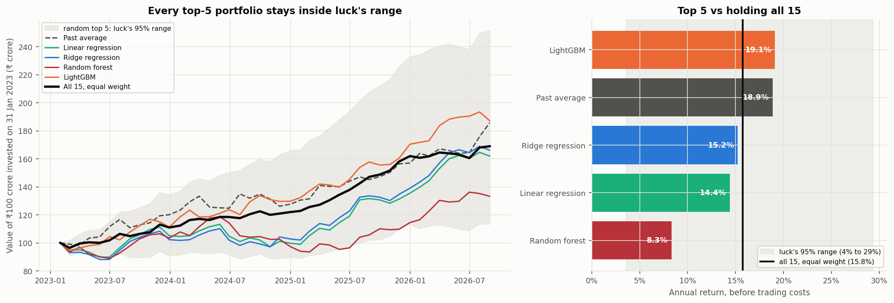
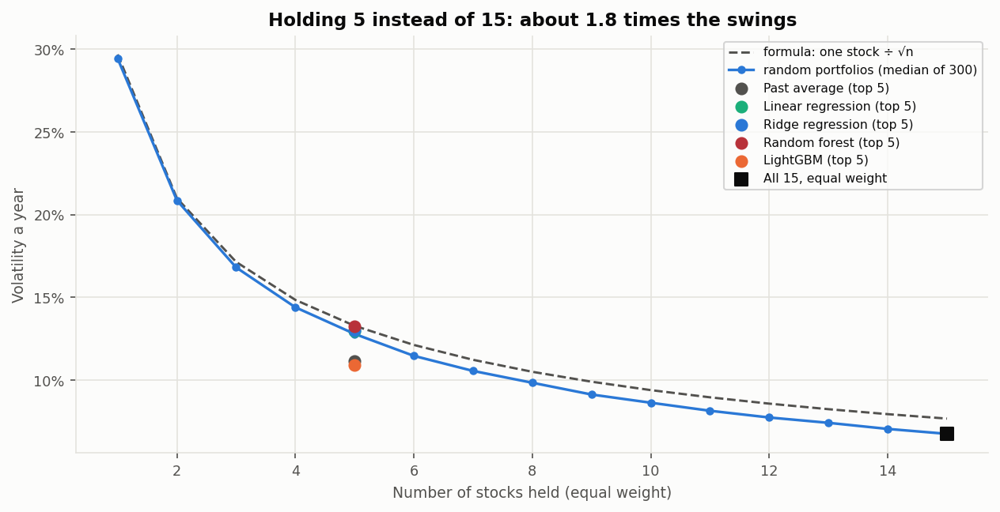
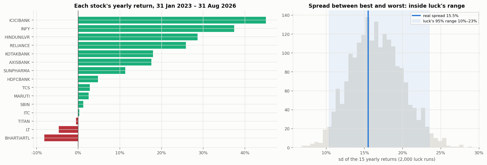

# Module 5 — Task 2 Report: Stock Ranking and Portfolio

**Business problem (brief, verbatim):**
> NovaFin manages an equity portfolio. The investment committee wants to know: **Can ML identify stocks with superior future returns?**

**Task 2 (brief, verbatim):**
> **Task 2 — Stock ranking**
> For every rebalance date (assumed):
> 1. Predict future returns
> 2. Rank stocks
> 3. Select top-ranked stocks
> 4. Construct portfolio

**Where this sits:** forecast each stock's next-month return (Task 1) → **rank the stocks, pick the top 5, build a portfolio and compare it with holding all 15 (Task 2)** → Module 6 turns ML predictions into optimised portfolios and compares them with equal-weight and Markowitz portfolios.

| Item | Where |
| --- | --- |
| Code | `notebooks/m05_task2_ranking.ipynb`: runs on its own or from `run_module_5.ipynb`; under a minute |
| **The brief's four steps, row by row** | **`outputs/task2/FINAL_M5_T2_stock_selections.csv`**: for each strategy, rebalance date and stock: predicted return, rank, selected (Yes/No), weight, the reason in words, the actual return |
| **Latest portfolio** | **`outputs/task2/september_2026_portfolio.csv`**: every strategy's ranking on 31 Aug 2026, top 5 marked |
| **Stock by stock** | `outputs/task2/stock_scorecard.csv`: the 15 stocks best to worst, with what happened to each in words |
| Evidence | `outputs/task2/portfolio_returns.csv` (monthly returns), `portfolio_summary.csv` (top 3, 5, 7), 2 charts, `key_numbers.json` |
| Decisions | M5-03, M5-04, M5-05, M5-08, M5-10 to M5-17, in `docs/decisions.md` |

**Terms:**
- **Rebalance date:** a day when the portfolio is reset to the chosen stocks. The brief leaves it to us ("assumed"); we use each month-end. 43 test month-ends (31 Jan 2023 – 31 Jul 2026), each held to the next month-end, so the money is invested from 31 Jan 2023 to 31 Aug 2026 (3.58 years).
- **Equal weight:** every stock held gets the same share of the money (top 5 → 20% each; all 15 → 6.67% each).
- **Benchmark:** what a strategy is compared with. Here: **holding all 15 stocks equally**, what NovaFin would do without any model.
- **Annual return:** the yearly growth rate achieved, compounded (gains earn gains).
- **Volatility (annual):** how much the monthly return swings (its standard deviation) × √12. Higher = a bumpier ride.
- **Excess:** the portfolio's monthly return minus the benchmark's.
- **p:** the chance luck alone gives a result at least this far from zero. Range 0 to 1; the line here is 0.05 ÷ 5 strategies = **0.01** (Bonferroni line: 0.05, the usual 1-in-20 line, divided by the number of tests so the chance of even one false "hit" stays about 1 in 20).
- **Maximum drawdown:** the largest fall from a previous high. Closer to 0 is better.
- **Turnover:** the share of the portfolio's stocks replaced each month. Each replacement is a sale and a purchase, and both cost money.
- **IC (information coefficient, from Task 1):** how well a model orders the 15 stocks each month. −1 = backwards, 0 = random, +1 = perfect; 0.03–0.05 is useful in real markets.

---

## 1. Summary for the investment committee

**Answer for Task 2: no portfolio built from the models' rankings beats simply holding all 15 stocks beyond luck.**

**The ML case**
1. **On every one of the 43 rebalance dates, each model's predictions were ranked, the top 5 selected and held equally** for a month: the brief's four steps, done for 4 models and the past-average benchmark.
2. **No top-5 portfolio beats holding all 15 beyond luck.** Annual returns 8.3%–19.1% against the benchmark's 15.8%; every p is 0.40 or more (line 0.01).
3. **Random picks do just as well.** 1,000 portfolios of 5 random stocks a month made 3.6% to 29.3% a year (95% range); every strategy sits inside.
4. **The "best" model changes with the number of stocks** (top 3: past average; top 5: LightGBM; top 7: ridge). A real skill would hold at every size; this is noise. It matches Task 1: no model ranks stocks better than random.
5. **The same answer with quarterly rebalancing** (no strategy beats all 15 over 13 quarters) **and with the top 5 weighted by the models' confidence** (it lowers the ML models' returns).
6. **For September 2026** (the latest rebalance date) the ML models' top 5 mostly agree on LT and ITC; they agreed as much in past months without beating luck, so these are picks, not a recommendation.

**The finance case**
1. **₹100 crore held in all 15 grew to ₹169.0 crore** (31 Jan 2023 – 31 Aug 2026, before costs). The top-5 portfolios ended between ₹133.2 crore (random forest, −₹35.7 crore) and ₹187.2 crore (LightGBM, +₹18.2 crore). A random top 5 ended anywhere from ₹113 to ₹251 crore, so those leads and shortfalls are within luck.
2. **Holding 5 instead of 15 carries about 1.8 times the risk** (volatility 10.9%–13.2% vs 6.7%) for no proven extra return. Holding all 15 gives the best return per unit of risk (2.34, against 0.63–1.75).
3. **The models trade heavily:** they replace about half their stocks every month (48%–68%), so the whole portfolio is traded 11–16 times a year. Trading costs, applied in Module 6, can only lower their returns.
4. **Recommendation on this data:** do not use these models to pick stocks. Hold the stocks broadly (equal weight, or Module 6's optimised mix), and re-test if better data (real market data, more stocks, longer history, company fundamentals) becomes available.

---

## 2. Predict future returns (step 1 of the brief)

Task 1 already predicted each stock's next-month return, walk-forward: on each rebalance date every model was trained only on earlier months (decision M5-04). Task 2 reads those predictions (`outputs/task1/FINAL_M5_T1_return_predictions.csv`) instead of retraining.

**Rankers used:** the past-average benchmark (each stock's average monthly return so far) and Task 1's four models (linear regression, ridge regression, random forest, LightGBM). "Predict zero" gives every stock the same number, so it can't rank.

**Carried from Task 1 (decision M5-08):** no model ranks better than luck (ICs −0.049 to +0.005, p 0.53–0.93). So this task is the business check: would buying each model's top picks have made more money?

## 3. Rank the stocks and select the top 5 (steps 2–3, decision M5-05)

- **Rank:** on each rebalance date, order the 15 stocks by predicted return; rank 1 = highest. Ties go to the alphabetically first ticker, so the result is repeatable.
- **Select the top 5**, fixed before looking at results:
  - one-third of the 15: concentrated enough that a real ranking skill would show;
  - diversified enough not to rest on one or two stocks;
  - the planning proposal. Choosing the number by whichever did best would be data dredging (trying many options and keeping the luckiest), so 3 and 7 are shown only as a check (section 6).

**Example: ridge regression on 31 Jan 2023**

| Rank | Stock | Predicted | Selected | Actual return (Feb 2023) |
| --- | --- | --- | --- | --- |
| 1 | HINDUNILVR | +5.96% | Yes, 20% | −13.36% |
| 2 | SBIN | +4.77% | Yes, 20% | −7.52% |
| 3 | ITC | +3.36% | Yes, 20% | −8.59% |
| 4 | KOTAKBANK | +2.25% | Yes, 20% | +6.17% |
| 5 | RELIANCE | +1.73% | Yes, 20% | −11.36% |
| 6 | SUNPHARMA | +1.58% | No | −2.64% |
| … | … | … | … | … |
| 15 | AXISBANK | −3.38% | No | +3.91% |

Each row of `FINAL_M5_T2_stock_selections.csv` carries the reason in words, e.g. *"Rank 1 of 15 by Ridge regression (predicted +5.96% next month) → in the top 5, bought at 20%"*.

**How often each stock was picked** (an even spread would be 5 ÷ 15 = 33% of months each):
- **The four models spread their picks widely:** each stock picked in 9%–72% of months (LightGBM 23%–49%). They switch stocks often.
- **The past average almost always holds the same three stocks:** ICICIBANK (100% of months), INFY (98%) and RELIANCE (95%), the early winners, and never 5 others. It is close to a fixed bet that past winners keep winning (Task 1: long-run returns don't persist, correlation −0.13 between each stock's first and second half).

## 4. Construct the portfolios (step 4, decisions M5-11 to M5-13)

```text
Portfolio return in a month = average of its 5 stocks' returns           (20% × each, added up)
Benchmark return in a month = average of all 15 stocks' returns           (6.67% × each)
Annual return               = (growth over 43 months) ^ (12 ÷ 43) − 1     (compounded)
Example, benchmark: ₹100 → ₹169.0 over 43 months → 1.690 ^ (12 ÷ 43) − 1 = 15.8% a year
```

- **Benchmark: all 15, equal weight (M5-11).** "Superior" needs a comparison; holding all 15 is what NovaFin would do without a model. Random picks give luck's range alongside.
- **Equal weight (M5-12).** Optimised weights (Markowitz: weights chosen to balance expected return against risk) are Module 6's comparison.
- **Before trading costs (M5-13).** Turnover is reported so Module 6 can apply a cost rate.

## 5. How the portfolios did (steps 4–5)

**The factors, in plain words:**
- **Annual return (decides):** how fast the money grew a year. This is the brief's "superior future returns".
- **Excess a year:** annual return − the benchmark's 15.8%. Above 0 = beat holding all 15.
- **p (excess):** t-test over the 43 monthly excesses. Below 0.01 = real.
- **Months beating all 15:** out of 43; a coin toss gives about 21–22.
- **Random picks doing at least as well:** of 1,000 random top-5 portfolios. About 50% = what luck does; below 1% would be real skill.
- **Return per unit of risk** = annual return ÷ volatility. Higher is better. (A Sharpe-style ratio without a risk-free rate: the data has no real interest-rate series.)

**Top 5, equal weight, before trading costs**

| Strategy | Annual return | Excess a year | p | Months beating all 15 | Random picks doing as well | Volatility | Return per unit of risk | Max drawdown | Turnover a month |
| --- | --- | --- | --- | --- | --- | --- | --- | --- | --- |
| Past average (benchmark) | 18.9% | +3.1% | 0.60 | 23 | 28% | 11.2% | 1.69 | −6.5% | 10% |
| Linear regression | 14.4% | −1.4% | 0.92 | 20 | 53% | 13.0% | 1.11 | −14.1% | 49% |
| Ridge regression | 15.2% | −0.5% | 0.98 | 20 | 47% | 13.0% | 1.17 | −11.9% | 48% |
| Random forest | 8.3% | −7.4% | 0.40 | 17 | 87% | 13.3% | 0.63 | −21.2% | 58% |
| LightGBM | 19.1% | +3.4% | 0.57 | 24 | 27% | 10.9% | 1.75 | −5.4% | 68% |
| **All 15, equal weight** | **15.8%** | — | — | — | — | **6.7%** | **2.34** | **−3.6%** | — |



- **No strategy beats the benchmark beyond luck** (smallest p 0.40; line 0.01).
- **The two that finished ahead (LightGBM, past average) were matched by about 1 random portfolio in 4.** Their monthly lead is 24 and 23 months of 43, a coin toss's 21–22.
- **The random forest did worst** (8.3%), as its negative IC in Task 1 (−0.049) suggested: it learned patterns that reversed.
- **Holding all 15 was the calmest and gave the most return per unit of risk.**

## 6. Check: top 3 and top 7

| Strategy | Top 3 | Top 5 | Top 7 |
| --- | --- | --- | --- |
| Past average | 25.6% (p 0.31) | 18.9% (p 0.60) | 12.6% (p 0.53) |
| Linear regression | 9.5% (p 0.54) | 14.4% (p 0.92) | 19.8% (p 0.43) |
| Ridge regression | 9.1% (p 0.50) | 15.2% (p 0.98) | 20.3% (p 0.38) |
| Random forest | 5.8% (p 0.35) | 8.3% (p 0.40) | 9.8% (p 0.35) |
| LightGBM | 19.9% (p 0.60) | 19.1% (p 0.57) | 11.7% (p 0.46) |
| All 15, equal weight | 15.8% | 15.8% | 15.8% |
| Luck's 95% range (random picks) | −2.6% to 33.7% | 3.6% to 29.3% | 5.7% to 25.6% |

- **A real skill would help at every size,** and the fewest stocks (a model's strongest picks) would beat the benchmark by most.
- **Here the winner flips:** ridge is worst at top 3 and best at top 7; LightGBM the reverse. No p anywhere is below the line (smallest 0.31).
- **So neither the number of stocks nor the model can be chosen from this table** without data dredging.
- Luck's range is wider for fewer stocks (−2.6% to 33.7% for 3): fewer stocks = more chance.

## 7. Concentration and risk: 5 stocks vs 15

```text
If stocks move independently:  portfolio volatility ≈ one stock's volatility ÷ √(number of stocks)
One stock here: 29.7% a year  →  5 stocks: 29.7% ÷ √5 ≈ 13.3%    15 stocks: 29.7% ÷ √15 ≈ 7.7%
Measured: top-5 strategies 10.9%–13.2%;  all 15: 6.7%  →  about 1.8 times the risk
```



- The stocks barely move together (correlation 0.004), so the formula fits closely. In real markets stocks move together more (0.3–0.5), so holding all 15 would save less risk than here.
- **For the committee:** concentrating in 5 stocks is worth its extra risk only if the ranking has skill. Here it doesn't, so it's risk without reward.

## 8. What it means in ₹

₹100 crore invested on 31 Jan 2023, rebalanced every month-end, valued on 31 Aug 2026, before trading costs:

| Strategy | Value at the end | Gain vs all 15 | Gap a year | Trades a year (share of the portfolio) |
| --- | --- | --- | --- | --- |
| **All 15, equal weight** | **₹169.0 crore** | — | — | — |
| Past average | ₹185.7 crore | +₹16.8 crore | +₹3.1 crore | 229% |
| Linear regression | ₹161.9 crore | −₹7.0 crore | −₹1.4 crore | 1,166% |
| Ridge regression | ₹166.1 crore | −₹2.8 crore | −₹0.5 crore | 1,143% |
| Random forest | ₹133.2 crore | −₹35.7 crore | −₹7.4 crore | 1,383% |
| LightGBM | ₹187.2 crore | +₹18.2 crore | +₹3.4 crore | 1,634% |

```text
Value at the end = ₹100 crore × growth (e.g. ridge: ₹100 crore × 1.661 = ₹166.1 crore)
Gap a year       = (annual return − 15.8%) × ₹100 crore   (e.g. ridge: (15.2% − 15.8%) × ₹100 crore ≈ −₹0.5 crore)
Trades a year    = turnover a month × 2 (a sale and a purchase) × 12   (e.g. ridge: 48% × 2 × 12 = 1,143%)
```

- **A random top 5 ended anywhere from ₹113 to ₹251 crore** (95% range). A ₹16–18 crore lead over ₹169 crore is well within luck.
- **Trading costs widen every gap.** The models trade 11–16 times the portfolio's value a year; holding all 15 trades almost nothing. Module 6 sets the cost rate (M5-13).

## 9. The portfolio for September 2026 (step 9)

The brief says "for every rebalance date"; the last one, 31 Aug 2026, is the date NovaFin would act on. Every model trained on all 67 months, predicting September from 31 Aug 2026 (predicted return in brackets):

| Rank | Past average | Linear regression | Ridge regression | Random forest | LightGBM |
| --- | --- | --- | --- | --- | --- |
| 1 | ICICIBANK (+3.0%) | LT (+3.5%) | LT (+3.5%) | LT (+3.9%) | LT (+5.6%) |
| 2 | INFY (+2.5%) | HDFCBANK (+1.9%) | HDFCBANK (+2.0%) | BHARTIARTL (+2.5%) | SBIN (+3.7%) |
| 3 | RELIANCE (+2.0%) | ITC (+1.7%) | ITC (+1.7%) | ITC (+2.4%) | ITC (+3.1%) |
| 4 | HINDUNILVR (+1.8%) | TITAN (+1.6%) | TITAN (+1.6%) | SBIN (+1.9%) | TCS (+2.9%) |
| 5 | SUNPHARMA (+1.4%) | AXISBANK (+1.1%) | AXISBANK (+1.2%) | HDFCBANK (+1.9%) | ICICIBANK (+2.2%) |

- **The four ML models agree on LT and ITC** (each picked by 4 of the 5 strategies); HDFCBANK by 3. The past average picks a different list: the same early winners it has held throughout.
- **Two ML models share 3.0 of their 5 picks on average** (random lists: 1.7). Over the 43 test months they shared 2.9, and still didn't beat luck. So the agreement comes from the same inputs, not from a proven signal. Linear and ridge are near-identical (they share 4.9 a month on average).
- **These are the models' picks, not a recommendation.** No model has shown skill, so the evidence favours holding all 15. They can't decide the model for Module 6 either: September's result isn't in the data.

## 10. Two more checks: quarterly rebalancing and weighting (step 10)

**Quarterly rebalancing gives the same answer:**

| Check | Monthly | Quarterly |
| --- | --- | --- |
| Test periods | 43 months | 13 quarters (Mar 2023 – Mar 2026) |
| Inputs that predict the next period | 0 of 66 (line 0.0008) | 0 of 22 (line 0.0023; smallest p 0.019, VIX: a random column) |
| Rankers' IC | −0.049 to +0.005 | −0.091 to +0.090 |
| Best top 5 vs all 15 | LightGBM 19.1% vs 15.8%, p 0.57 | LightGBM 24.9% vs 14.9%, p 0.08 |
| Any strategy beats all 15? (line 0.01) | No | No |
| Smallest IC the test could detect | about 0.08 | about 0.16 |

- With only 13 quarters, ICs and returns swing more (ridge −0.091, LightGBM +0.090), and a real edge would need an IC of 0.16 to show. Quarterly has no earnings data to use here, and gives a weaker test. Monthly stays (decision M5-03).
- LightGBM's quarterly p of 0.08 is the closest to the line anywhere, but still eight times above it, and its monthly version doesn't beat the benchmark (p 0.57).

**Weighting the top 5 by the model's confidence doesn't help the ML models:**

| Strategy | Equal (20% each) | By rank (33/27/20/13/7%) | By predicted return |
| --- | --- | --- | --- |
| Past average | 18.9% | 25.7% | 29.5% |
| Linear regression | 14.4% | 10.2% | 7.7% |
| Ridge regression | 15.2% | 11.8% | 8.6% |
| Random forest | 8.3% | 7.4% | 7.8% |
| LightGBM | 19.1% | 16.5% | 12.3% |
| *All 15, equal weight* | *15.8%* | | |

- **For all four ML models, more money behind the stronger predictions lowers the return**, and the swings rise for every strategy (volatility about 15%–18% with prediction weights, against 11%–13% with equal weights).
- **The past average rises to 29.5%, but that is a near single-stock bet** (over 30% in ICICIBANK in 41 of 43 months; volatility 17.6%), and it still doesn't pass the luck test (smallest p anywhere 0.18, line 0.01).
- So equal weight is the honest choice for Task 2. Optimised weights are Module 6's comparison (decision M5-12).

## 11. Stock by stock: the scorecard (step 11)

Each stock over the test period (31 Jan 2023 – 31 Aug 2026), best to worst. Full table with every model's pick count and a sentence per stock: `stock_scorecard.csv`.

| Rank | Stock | Sector | Yearly return | Yearly swing | Worst fall | First half | Second half | Ridge: months in top 5 (of 43) | Past average: months in top 5 |
| --- | --- | --- | --- | --- | --- | --- | --- | --- | --- |
| 1 | ICICIBANK | Banking | +45.0% | 29.3% | −24.8% | +77.5% | +18.5% | 12 | 43 |
| 2 | INFY | IT | +37.4% | 28.7% | −18.5% | +43.0% | +32.0% | 11 | 42 |
| 3 | HINDUNILVR | Consumer | +28.7% | 30.6% | −21.9% | +11.3% | +48.7% | 16 | 14 |
| 4 | RELIANCE | Energy | +25.8% | 29.9% | −32.6% | +19.7% | +32.3% | 31 | 41 |
| 5 | KOTAKBANK | Banking | +17.9% | 30.3% | −47.2% | −7.5% | +50.4% | 16 | 0 |
| 6 | AXISBANK | Banking | +17.6% | 29.0% | −43.1% | 0.0% | +38.2% | 9 | 10 |
| 7 | SUNPHARMA | Healthcare | +11.3% | 28.9% | −38.8% | −5.9% | +31.7% | 17 | 15 |
| 8 | HDFCBANK | Banking | +4.7% | 28.7% | −30.5% | +17.4% | −6.6% | 13 | 1 |
| 9 | TCS | IT | +2.8% | 28.7% | −37.1% | −16.2% | +26.0% | 18 | 0 |
| 10 | MARUTI | Auto | +2.5% | 28.6% | −48.5% | −18.8% | +29.3% | 4 | 3 |
| 11 | SBIN | Banking | +1.2% | 27.9% | −27.7% | −4.0% | +6.8% | 14 | 0 |
| 12 | ITC | Consumer | +0.3% | 28.9% | −35.2% | +7.7% | −6.6% | 18 | 12 |
| 13 | TITAN | Consumer | −0.5% | 30.1% | −51.0% | +4.8% | −5.6% | 14 | 26 |
| 14 | LT | Industrials | −4.7% | 28.0% | −48.9% | +8.7% | −16.3% | 15 | 8 |
| 15 | BHARTIARTL | Telecom | −8.1% | 30.2% | −51.8% | −0.6% | −15.1% | 7 | 0 |

- **The best stock grew 45.0% a year and the worst lost 8.1% a year, with almost identical risk:** every stock's yearly swing is 27.9%–30.6%.
- **The spread between winners and losers is what luck produces.** 15 simulated stocks with the same average return and swing, 2,000 times: the sd of their 15 yearly returns falls between 10.4% and 23.5% (95% range). The real spread, 15.5%, is inside it.
- **Winners didn't stay winners.** Ranking the stocks by first-half and by second-half return gives unrelated orders (rank correlation −0.08, p 0.77). KOTAKBANK went from −7.5% to +50.4% a year; HDFCBANK from +17.4% to −6.6%. The 2021–22 order vs the test-period order is +0.45 but not proven with 15 stocks (p 0.10).
- **The models didn't find the winners.** Ridge put ICICIBANK (the best stock) in its top 5 in only 12 of 43 months, about the even-spread 14, and its forecasts for it ran slightly opposite to what happened (−0.07). It favoured RELIANCE most (31 months). The past average held ICICIBANK and INFY almost every month: the early winners, which happened to keep rising.
- **Why each stock did what it did can't be explained from this data:** no input, sector or season predicts returns (Task 1). In real markets the reasons would be earnings, valuations and news, which the file doesn't contain.



## 12. Answer to the committee's question

**"Can ML identify stocks with superior future returns?" On this data, no.**
- No model predicts which stocks do better (Task 1).
- No portfolio built from those predictions beats holding all 15 equally beyond luck, before costs, at 3, 5 or 7 stocks (Task 2).
- Holding all 15 earned 15.8% a year with the least risk.

**What this covers:** 43 months and 15 stocks. A small real edge (IC 0.03–0.05, worth about ₹3–5 crore a year on ₹100 crore) could exist and stay hidden in data this size; the tests could detect an IC of about 0.08 or more (M5-04).

## 13. What goes to Module 6

| File | What it holds | How Module 6 must treat it |
| --- | --- | --- |
| `outputs/task1/FINAL_M5_T1_return_predictions.csv` | Each model's predicted next-month return per stock and month (43 × 15) | Input to the "ML-predicted-return portfolio": ridge regression's predictions (decision M5-15). Predictions carry no proven skill |
| `outputs/task2/FINAL_M5_T2_stock_selections.csv` | Rank, selection, weight and reason per strategy, month and stock | The top-5 equal-weight portfolios, for comparison |
| `outputs/task2/portfolio_returns.csv` | Monthly return of each top-5 portfolio and of all 15 equal weight | Same months (31 Jan 2023 – 31 Aug 2026) and starting numbers for Module 6's backtests; returns before costs |

### Module 9 inputs: ML stock selection in the standard fields (decision M5-19; final notebook step "What goes to Module 9")

**Why:** Module 9 compares every business on the same fields: return per ₹, bad-year result, capacity, evidence, how fast money comes back, gaps and controls. This module gives Whether ML stock-picking adds return over holding all 15 stocks (it doesn't, beyond luck). The equity holding's own return and risk are Module 6's.

| Category | Return per ₹ (% a year) | Range | Bad year per ₹ | Bad year means | Capacity | Gap / assumption |
| --- | --- | --- | --- | --- | --- | --- |
| Equity investments: ML stock selection (extra over holding all 15) | 0.0 | Best model (LightGBM) +3.4 points, p = 0.57 (luck); ridge -0.5 | -7.42 | Worst model's shortfall against holding all 15 (a year, before costs) | — | Before trading costs; the stocks in the data look independent (synthetic) |

## 14. Risks and limitations

- **Before trading costs:** turnover of 48%–68% a month makes costs material; Module 6 applies them.
- **43 months and 15 stocks:** small edges can't be detected; luck's range for a top 5 is about 26 percentage points wide.
- **Synthetic-looking data:** stocks move independently and the macro columns are random (Task 1), so the diversification benefit here is larger than in real markets.
- **Equal weight only:** optimised weights are Module 6's job.
- **No dividends** in the data: returns are price changes only.
