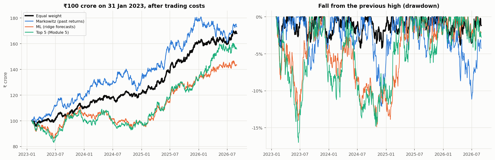
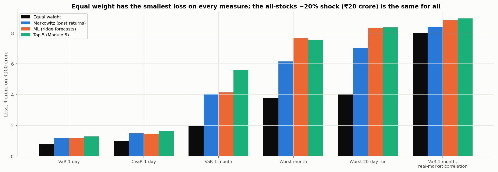

# Module 6 — Portfolio Optimization

## Final report

**The brief (verbatim):**
> **Module 6 — Portfolio Optimization**
> Dataset: nova_market_data.csv (same dataset as Module 5)
> One must transform ML predictions into an actual portfolio. Compare strategies- Equal-weight portfolio, Traditional Markowitz portfolio, ML-predicted-return portfolio. Perform backtesting to demonstrate performance and generate performance metrics.

**Also covered here:** the learning objectives **"Calculate VaR"** and **"Conduct stress testing"**, which no module's tasks name (project decision P-08).

**Data:** `nova_market_data.csv` (15 stocks, daily, 29 Jan 2021 – 31 Aug 2026; every weekday, no holidays: 261 trading days a year) and Module 5's ridge regression forecasts (`module_05_equity_markets/outputs/task1/FINAL_M5_T1_return_predictions.csv`, decision M5-15).

**Terms used throughout** (full list, formulas and the measures not used, such as alpha and beta: `docs/documentation.md` section 9):
- **Weight:** the share of the money in a stock; weights add to 100%.
- **Backtest:** replay a strategy month by month on past data, using only what was known at each date.
- **Test (out-of-sample) months:** 43 months, 31 Jan 2023 – 31 Aug 2026; each decided using only earlier data.
- **CAGR:** steady yearly growth. **Volatility:** yearly swing. **Sharpe:** (return − 6.8% safe rate) ÷ volatility; above 1 good.
- **Maximum drawdown:** worst fall from a high. **Turnover:** share of the portfolio traded at a reset.
- **VaR 95%:** loss not exceeded on 95% of days (or months). **CVaR:** average loss on the worst 5%.
- **p:** the chance luck alone gives a gap this big; line 0.05 ÷ 3 = 0.017 (the usual 1-in-20 line, ÷ 3 comparisons).

| Item | Where |
| --- | --- |
| **Final output (open this first)** | **`outputs/FINAL_M6_module_output.xlsx`**: Read me · Key numbers · Board actions · every part's final file · Hand-off to Module 9 · Decisions · Evidence index (project decision P-21) |
| Run everything | `run_module_6.ipynb` (Run all, under a minute; needs Module 5's Task 1 outputs) |
| Notebooks | `notebooks/m06_partA_backtest.ipynb`, `m06_partB_risk.ipynb` |
| Part reports | `reports/partA_report.md`, `partB_report.md` |
| Decisions and their evidence | `docs/decisions.md` (M6-01 to M6-12) |
| **Deliverables** | **`outputs/partA/FINAL_M6_A_portfolio_weights.csv`** (ML predictions as an actual portfolio) · `outputs/partA/daily_returns.csv` · `outputs/partB/FINAL_M6_B_risk_summary.csv` · **`outputs/FINAL_M6_module_output.xlsx` (Hand-off tab)** (final hand-off to Module 9) |

---

## 1. The answer in brief

**Hold NovaFin's equity portfolio equally weighted. No optimised portfolio beat it beyond luck (the best, Markowitz, earned 16.6% against 15.6% a year, p 0.79), and it had the least risk and the lowest cost; the ML-predicted-return portfolio did worst.**

| Finding | Evidence |
| --- | --- |
| **ML predictions became an actual portfolio** | Each month, ridge's forecasts went into a Markowitz optimiser (maximum Sharpe, 0–25% per stock): `FINAL_M6_A_portfolio_weights.csv` |
| **Equal weight has the best return for the risk** | Sharpe 1.06 vs 0.80 (Markowitz), 0.36 (ML), 0.51 (top 5); worst fall −4.2% vs −12% to −17% |
| **No optimiser beats equal weight beyond luck** | Markowitz 16.6% vs 15.6% a year, p 0.79; ML 10.6%, p 0.39 (line 0.017) |
| **The ML portfolio does worst** | −₹24.6 crore vs equal weight on ₹100 crore over 3.58 years; trades 90% of the portfolio a month |
| **Equal weight has the smallest loss on every risk measure, except a 20% fall in all stocks, which costs every strategy the same** | 1-day VaR ₹0.76 crore per ₹100 crore (others ₹1.16–1.29 crore); worst month ₹3.76 crore (others ₹6.15–7.67 crore) |
| **This data understates real risk about 2.5 times** | With stocks moving together like real large-caps (correlation 0.4), equal weight's swing rises from 7.8% to 19.4% a year |
| **A market-wide crash can't be diversified away** | Every stock −20% costs ₹20 crore per ₹100 crore in every strategy |





**Recommendations for the investment committee:**
1. **Hold the equity portfolio equally weighted**, reset monthly: best return per unit of risk, smallest falls, about 0.2% a year in trading costs.
2. **Don't optimise on expected returns from this data:** neither past averages nor ML forecasts predict (Module 5), so optimisers concentrate money on noise.
3. **Plan equity risk at real-market levels** (about 19% yearly swing; about ₹8 crore 1-month VaR per ₹100 crore), not this data's 7.8%.
4. **Control crash risk through the size of the equity allocation (Module 9) and hedging (Module 8):** diversification can't reduce it.
5. **Re-test minimum-risk Markowitz on real market data:** there, stocks differ in risk and move in groups, so its weights would differ from equal weight.

---

## 2. The chain

| Hand-off | File | How it is used |
| --- | --- | --- |
| Module 5 → Part A | `FINAL_M5_T1_return_predictions.csv`: ridge's walk-forward forecasts | Expected returns for the ML portfolio; no proven skill |
| Part A → Part B | `daily_returns.csv` (934 days × 4 strategies, after costs), `FINAL_M6_A_portfolio_weights.csv` | VaR, stress tests |
| Part B → Module 9 | **`outputs/FINAL_M6_module_output.xlsx` (Hand-off tab)** | The equity figures, Modules 5 and 6 combined (§6) |

---

## 3. Part A: three portfolios, backtested

**Conclusion: equal weight gives the best return for the risk; neither optimiser beats it beyond luck.**

**Settings (all fixed before running, decisions M6-01 to M6-05, M6-08, M6-09):** monthly resets; 1-year (261-day) risk estimate with Ledoit–Wolf shrinkage; maximum Sharpe, long-only, ≤ 25% per stock; trading cost 0.15% of every ₹ bought or sold; risk-free 6.8% a year.

```text
Maximise (w·μ − 6.8% a year) ÷ √(w·Σ·w)    subject to: weights add to 100%, each 0–25%
    μ (expected return): past-year average (Markowitz) or ridge's forecast (ML)
    Σ (how stocks move together): past 261 days, Ledoit–Wolf
```

| Strategy | CAGR | Volatility | Sharpe | Max drawdown | Turnover a month | Information ratio | p vs equal weight | ₹100 crore became |
| --- | --- | --- | --- | --- | --- | --- | --- | --- |
| **Equal weight** | 15.6% | **7.8%** | **1.06** | **−4.2%** | **7%** | — | — | ₹168.0 crore |
| Markowitz (past returns) | **16.6%** | 11.8% | 0.80 | −12.1% | 33% | +0.11 | 0.79 | ₹173.2 crore |
| ML (ridge forecasts) | 10.6% | 11.6% | 0.36 | −14.9% | 90% | −0.62 | 0.39 | ₹143.4 crore |
| Top 5 (Module 5) | 13.2% | 13.3% | 0.51 | −17.0% | 99% | −0.23 | 0.81 | ₹155.9 crore |

- **Markowitz's +₹5.2 crore is not beyond luck** (p 0.79; ahead in 22 of 43 months) and came with a worst fall of ₹12.1 crore instead of ₹4.2 crore.
- **ML lost ₹24.6 crore against equal weight,** ₹5.8 crore of it in trading costs.
- **Minimum-risk Markowitz = equal weight exactly:** alike, independent stocks → spreading evenly is the lowest-risk mix.
- **The order holds at every check:** trading costs 0%, 0.10%, 0.30%; risk-free 0%.

## 4. Part B: VaR and stress tests

**Conclusion: equal weight has the smallest loss on every measure except a 20% fall in all stocks (the same for all), but this data's risk is far below real markets'.**

| Strategy (₹ crore lost on ₹100 crore) | VaR 1 day | CVaR 1 day | VaR 1 month | Worst month | Every stock −20% | VaR 1 month, real-market correlation |
| --- | --- | --- | --- | --- | --- | --- |
| **Equal weight** | **0.76** | **0.98** | **1.98** | **3.76** | 20.0 | **8.00** |
| Markowitz (past returns) | 1.18 | 1.48 | 4.05 | 6.15 | 20.0 | 8.43 |
| ML (ridge forecasts) | 1.16 | 1.44 | 4.14 | 7.67 | 20.0 | 8.84 |
| Top 5 (Module 5) | 1.29 | 1.62 | 5.59 | 7.55 | 20.0 | 8.95 |

```text
Equal weight's VaR as a share of the other three's average:
  1 day:   ₹0.76 ÷ [(₹1.18 + ₹1.16 + ₹1.29) ÷ 3 = ₹1.21] = 63%
  1 month: ₹1.98 ÷ [(₹4.05 + ₹4.14 + ₹5.59) ÷ 3 = ₹4.59] = 43%
Real-market correlation (0.4): equal weight's yearly swing 7.8% → 19.4% = × 2.5 (19.4 ÷ 7.8)
```

- **The bell curve fits this data** (4.9%–5.6% of days breach the parametric VaR; worst day about 3 standard deviations). Real markets have fat tails, so real VaR would be larger still.
- **Why not VIX or beta stress tests:** both columns are random in this data (Module 5), so there is no fear period to replay and no market to measure beta against. Against the equal-weight portfolio every stock's beta is 0.75–1.21 (average 1.00), so a beta shock ≈ every stock falling equally.

## 5. Cross-part conclusions

| Conclusion | Part A | Part B |
| --- | --- | --- |
| **Equal weight is best for this data** | Best Sharpe, smallest drawdown, lowest cost | Smallest VaR, CVaR and worst stretches |
| **ML forecasts hurt when optimised** | −₹24.6 crore vs equal weight | Worst month ₹7.67 crore (equal weight ₹3.76 crore) |
| **Its advantage comes from independent stocks** | Minimum risk = equal weight | Swing ×2.5 with real co-movement; all four end at 19.4%–21.1% |
| **Agrees with Module 5** | Equal weight before costs 15.8% = Module 5's "all 15" | No ML edge to pay for the extra risk |

---

## 6. Hand-off to Module 9: `outputs/FINAL_M6_module_output.xlsx` (Hand-off tab)

Module 9 allocates capital across businesses including **"Equity investments"**. This file gives every equity figure from Modules 5 and 6 in one place, per ₹100 crore (decisions M6-11, M6-12; it replaces Module 5's before-cost figures, M5-16). Each row carries its **status** (Measured / Stress estimate / Assumption / Conclusion), source, decision and how Module 9 should use it.

| Figure | Value | Status | How Module 9 should use it |
| --- | --- | --- | --- |
| Recommended equity portfolio | Equal weight, 15 stocks at 6.67%, monthly | Conclusion | Hold broadly; no model-driven stock-picking |
| Expected return, after trading costs | 15.6% a year | Measured (43 months) | Return assumption for the equity bucket |
| 95% range of that return | 8.6% to 22.6% a year | Measured | Test the allocation at the low end |
| Return before trading costs | 15.8% a year | Measured | Cross-check: Modules 5 and 6 agree |
| Trading-cost drag | 0.2% a year | Measured | Already in the 15.6% |
| **Yearly swing, real-market** | **19.4%** | Stress estimate (correlation 0.4) | **Use for equity risk** |
| Yearly swing, this data | 7.8% | Measured; understates | Reference only |
| Sharpe at real-market risk | 0.45 | Stress estimate | Compare with other businesses per unit of risk |
| VaR 95%, 1 day / 1 month, real-market | ₹1.91 / ₹8.00 crore | Stress estimate | Daily limit / monthly risk budget |
| CVaR 95%, 1 month, real-market | ₹10.35 crore | Stress estimate | Average loss in the worst 1 month in 20 |
| Loss if every stock falls 20% | ₹20.0 crore | Stress estimate (scenario) | Size the allocation or hedge (Module 8) |
| Worst month seen in the data | ₹3.76 crore | Measured; understates | Reference only |
| Extra return from ML stock-picking | 0 | Conclusion (Modules 5 and 6) | Allocate no capital on an ML equity edge |
| Cost of following the ML portfolio | −₹24.6 crore over 3.58 years | Measured | The ₹ answer to "why not ML?" |
| Assumptions | Cost 0.15%; risk-free 6.8%; 43 months; 15 stocks; synthetic-looking data; no dividends | Assumption | State them when using the figures |

```text
95% range of the return = 15.6% ± 1.96 × (monthly sd 1.95% ÷ √43) × 12 = 15.6% ± 7.0%
Sharpe at real-market risk = (15.6% − 6.8%) ÷ 19.4% = 0.45
CVaR 1 month = −(1-month average − 1-month sd × 2.063), with the real-market sd    (2.063 = average depth of a bell curve's worst 5%)
```

- **Example for Module 9:** ₹100 crore in equities → about ₹15.6 crore a year after costs (plausibly ₹8.6–22.6 crore), with 1 month in 20 losing more than ₹8 crore, and ₹20 crore lost in a 20% market crash.

---

## 7. Key decisions

| ID | Decision | Why |
| --- | --- | --- |
| M6-01 | Monthly resets | Same as Module 5; quarterly tested there with the same answer |
| M6-02 | Markowitz = maximum Sharpe, long-only, ≤ 25% | Textbook version; minimum risk = equal weight here |
| M6-03 | 1-year risk estimate, Ledoit–Wolf; 261-day year | The data has every weekday; 252 would misstate yearly figures |
| M6-04 | Trading cost 0.15% per ₹ traded; checks 0%, 0.10%, 0.30% | STT 0.1% each way + charges + institutional brokerage and impact |
| M6-05 | Risk-free 6.8% fixed; check 0% | `Interest_Rate` is random; 6.8% ≈ Indian Treasury bills |
| M6-06 | VaR, CVaR; stress tests: worst stretches, every stock −20%, real-market correlation | VIX and beta are random here |
| M6-07 | Two parts: A (brief), B (VaR, stress) | Same structure as other modules |
| M6-08 | ML portfolio = ridge forecasts in the same optimiser | Isolates the value of the forecasts; no blending (would be tuned on test months) |
| M6-09 | Same 43 test months as Module 5 | Fair comparison |
| M6-10 | Measures incl. tracking error, information ratio, Calmar; luck line 0.017 | Alpha and beta need a real market index |
| M6-11 | Equal weight's figures, with real-market risk, to Module 9 | This data's risk understates real risk about 2.5 times |
| M6-12 | One combined hand-off file, with status and use per figure | One place for Module 9; generated by the notebook |

All 12, with options and evidence: `docs/decisions.md`.

---

### Module 9 inputs: equities in the standard fields (decision M6-14; final notebook step "What goes to Module 9")

**Why:** Module 9 compares every business on the same fields: return per ₹, bad-year result, capacity, evidence, how fast money comes back, gaps and controls. This module gives Equities: return after costs with its 95% range, the 1-in-20 year at the real-market swing, and the 20% crash loss diversification can't remove.

| Category | Return per ₹ (% a year) | Range | Bad year per ₹ | Bad year means | Capacity | Gap / assumption |
| --- | --- | --- | --- | --- | --- | --- |
| Equity investments (equal weight, 15 stocks) | 15.6 | 8.6 to 22.6 (95% range of the measured return) | -16.24 | 1-in-20 year at the real-market swing (19.4%): return − 1.645 × swing; a crash (all stocks −20%) loses 20% | Large (listed stocks) | Stocks in the data move independently, so measured risk understates the real one; no dividends |

## 8. Limitations

- **43 test months:** modest real differences between strategies could stay hidden; every p-value is high.
- **Synthetic-looking data:** independent stocks, bell-curve returns, random macro columns. Measured risk is far below real markets'; stress test (c) adjusts for co-movement but not for fat tails.
- **Assumed inputs:** trading cost, risk-free rate and the 0.4 correlation are assumptions, each checked or stated.
- **Long-only, monthly, no dividends;** no constraints by sector or liquidity.

---

## Glossary

| Term | Meaning |
| --- | --- |
| Alpha, beta (not used) | Beta: move per 1% market move; alpha: return beyond what market exposure explains. Both need a real market index |
| Backtest | Replaying a strategy on past data using only what was known at each date |
| Calmar ratio | CAGR ÷ size of the maximum drawdown |
| CAGR | Steady yearly growth rate: (end ÷ start) ^ (1 ÷ years) − 1 |
| Correlation | How closely two stocks move together, −1 to +1 |
| CVaR (expected shortfall) | Average loss on the worst 5% of days (or months) |
| Equal weight | The same share of money in each stock |
| Information ratio | Extra return over the benchmark ÷ tracking error |
| Ledoit–Wolf shrinkage | Blending a noisy covariance estimate with a simple structure to steady it |
| Markowitz (maximum Sharpe) | Weights with the most return above the safe rate per unit of risk |
| Maximum drawdown | Worst fall from a previous high |
| Parametric VaR | VaR from a bell curve: −(average − 1.645 × sd) |
| Risk-free rate | Return on a safe government bill (6.8% assumed) |
| Sharpe ratio | (return − risk-free) ÷ volatility |
| Sortino ratio | Sharpe using only downside swings |
| Stress test | Loss in a specific bad scenario |
| Tracking error | How far a strategy's returns wander from the benchmark's, a year |
| Turnover | Share of the portfolio traded at a reset (buys + sells) |
| VaR (value at risk) 95% | Loss not exceeded on 95% of days (or months) |
| Volatility | Standard deviation of daily returns × √261 |
