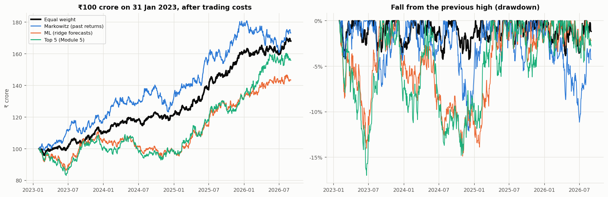
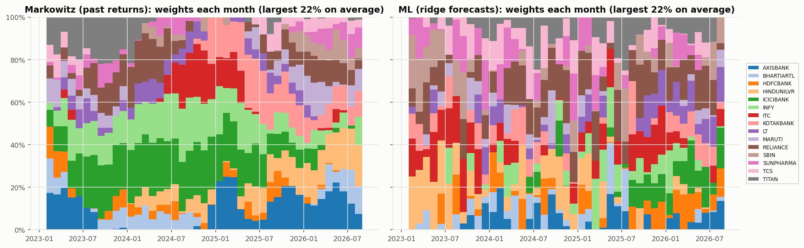

# Module 6 — Part A Report: Three Portfolios, Backtested

**The brief (verbatim):**
> **Module 6 — Portfolio Optimization**
> Dataset: nova_market_data.csv (same dataset as Module 5)
> One must transform ML predictions into an actual portfolio. Compare strategies- Equal-weight portfolio, Traditional Markowitz portfolio, ML-predicted-return portfolio. Perform backtesting to demonstrate performance and generate performance metrics.

**Where this sits:** Module 5 forecast each stock's next-month return (ridge regression, decision M5-15) → **Part A: turn forecasts into weights, replay every month with trading costs, compare** → Part B: VaR and stress tests → Module 9 ("Equity investments").

| Item | Where |
| --- | --- |
| Code | `notebooks/m06_partA_backtest.ipynb`: runs on its own or from `run_module_6.ipynb`; under a minute |
| **ML predictions as an actual portfolio** | **`outputs/partA/FINAL_M6_A_portfolio_weights.csv`**: every strategy's weight per stock on each rebalance date, with the expected return the optimiser used |
| **Hand-off to Part B and Module 9** | `outputs/partA/daily_returns.csv`: each strategy's daily return after costs |
| Evidence | `strategy_comparison.csv`, `cost_checks.csv`, 2 charts, `key_numbers.json` |
| Decisions | M6-01 to M6-05, M6-08 to M6-10, in `docs/decisions.md` |

**Terms** (full definitions, formulas and the measures not used, such as alpha and beta, in `docs/documentation.md` section 9):
- **Weight:** the share of the money in a stock; weights add up to 100%.
- **Backtest:** replay a strategy month by month on past data, using only what was known at each date.
- **Test (out-of-sample) months:** the 43 months 31 Jan 2023 – 31 Aug 2026, each decided using only earlier data.
- **CAGR:** steady yearly growth rate. **Volatility:** yearly swing (standard deviation of daily returns × √261).
- **Sharpe ratio:** (return − 6.8% safe rate) ÷ volatility; higher is better, above 1 good. **Sortino:** the same, counting only downside swings.
- **Maximum drawdown:** worst fall from a previous high. **Calmar:** CAGR ÷ |worst fall|.
- **Tracking error:** how far a strategy wanders from equal weight, a year. **Information ratio:** extra yearly return over equal weight ÷ tracking error; 0.5 good.
- **VaR 95% (1 day):** loss not exceeded on 95% of days. **CVaR:** average loss on the worst 5% of days.
- **Turnover:** share of the portfolio traded at a rebalance, counting buys and sells.
- **p:** the chance luck alone gives a gap this big. Line **0.05 ÷ 3 = 0.017**: 0.05 is the usual accepted 1-in-20 chance of being fooled by luck; divided by 3 because three strategies are compared with equal weight (Bonferroni correction).

---

## 1. Summary for the investment committee

**Answer: hold the equity portfolio equally weighted. It gives the best return for the risk taken; neither optimiser beats it beyond luck, and the ML portfolio does worst.**

**The ML case**
1. **ML predictions became an actual portfolio:** each month, ridge's forecasts went into a Markowitz optimiser (maximum Sharpe, up to 25% per stock), giving weights for all 15 stocks (`FINAL_M6_A_portfolio_weights.csv`).
2. **The ML portfolio did worst:** 10.6% a year (Sharpe 0.36) against equal weight's 15.6% (Sharpe 1.06). It beat equal weight in only 14 of 43 months. The forecasts carry no skill (Module 5), so the optimiser concentrated money on noise and traded 90% of the portfolio a month following it.
3. **Traditional Markowitz (past returns) earned a little more** (16.6%) but with 1.5 times the swing and nearly 3 times the worst fall; p 0.79, so the extra could easily be luck.
4. **Minimum-risk Markowitz = equal weight exactly:** with alike, independent stocks, spreading evenly is the lowest-risk mix.

**The finance case**
1. **₹100 crore became ₹168.0 crore in equal weight** (after costs). Markowitz: ₹173.2 crore (+₹5.2 crore) with a worst fall of ₹12.1 crore instead of ₹4.2 crore. ML: ₹143.4 crore (−₹24.6 crore), ₹5.8 crore of it trading costs.
2. **Equal weight is the cheapest to run:** 7% of the portfolio traded a month, against 33% (Markowitz) and 90% (ML).
3. **The conclusion holds at every trading cost (0%–0.30%) and with a 0% risk-free rate.**

---

## 2. The data and settings (steps 0–1)

| Setting | Value | Why (decision) |
| --- | --- | --- |
| Test months | 43 rebalance dates, 31 Jan 2023 – 31 Jul 2026, held to 31 Aug 2026 (934 days) | Same as Module 5; ML forecasts exist only for these (M6-09) |
| Days in a year | **261** | Every weekday, no holidays (2023: 260 rows, 2024: 262, 2025: 261). With 252, the 934 days would wrongly count as 3.71 years instead of 3.58 (M6-03) |
| Risk estimate | Past 261 days, Ledoit–Wolf shrinkage | One year; shrinkage steadies noisy estimates (M6-03) |
| Largest weight | 25%, no short selling | Stops all money going into one stock (M6-02) |
| Trading cost | 0.15% of every ₹ bought or sold | STT 0.1% each way + stamp duty + charges + institutional brokerage and price impact (M6-04) |
| Risk-free rate | 6.8% a year, fixed | `Interest_Rate` is random (15 values per date); 6.8% ≈ Indian Treasury bills (M6-05) |

- Ridge forecasts range from −4.7% to +6.0% a month. In every month at least one stock's forecast beats the risk-free rate (0.55% a month), so the maximum-Sharpe optimisation is always well defined.

## 3. Turning forecasts into weights (step 2, decisions M6-02, M6-08)

```text
Expected monthly return of each stock, μ:
    Markowitz (past returns): average daily return over the past 261 days × 21.75 (days in a month)
    ML (ridge forecasts):     ridge's forecast of next month's return
How stocks move together, Σ: covariance of the past 261 days' returns (Ledoit–Wolf) × 21.75
Choose weights w to maximise   Sharpe = (w·μ − risk-free) ÷ √(w·Σ·w)
    subject to: weights add up to 100%; each between 0% and 25%
```

**Example, 31 Jan 2023:**
- **Markowitz** favoured the stocks with the best past year: AXISBANK 17.3% (past-year average +3.19% a month), BHARTIARTL 16.2%, HDFCBANK 14.9%, TITAN 12.9%, MARUTI 11.4%.
- **The ML portfolio** favoured the stocks ridge rated highest: HINDUNILVR 25% (forecast +5.96%), SBIN 25% (+4.77%), ITC 17.9%, KOTAKBANK 11.7%.
- **The two lists barely overlap:** past winners and ML favourites point in different directions, and neither predicts (Module 5).

## 4. The backtest (step 3)

1. On each rebalance date, compute target weights from data up to that day only.
2. Trade from the drifted weights to the targets. Turnover = sum of |target − held|; cost = 0.15% × turnover.
3. Hold to the next month-end; daily return = value-weighted average of the stocks' returns (weights drift with prices).

## 5. Results (step 4)

| Strategy | CAGR | Volatility | Sharpe | Sortino | Max drawdown | Calmar | VaR 95% (1 day) | CVaR 95% | Turnover a month | Info. ratio | p | Months ahead (of 43) |
| --- | --- | --- | --- | --- | --- | --- | --- | --- | --- | --- | --- | --- |
| **Equal weight** | 15.6% | **7.8%** | **1.06** | **1.56** | **−4.2%** | **3.67** | **0.76%** | **0.98%** | **7%** | — | — | — |
| Markowitz (past returns) | **16.6%** | 11.8% | 0.80 | 1.16 | −12.1% | 1.37 | 1.18% | 1.48% | 33% | +0.11 | 0.79 | 22 |
| ML (ridge forecasts) | 10.6% | 11.6% | 0.36 | 0.52 | −14.9% | 0.71 | 1.16% | 1.44% | 90% | −0.62 | 0.39 | 14 |
| Top 5 (Module 5) | 13.2% | 13.3% | 0.51 | 0.73 | −17.0% | 0.78 | 1.29% | 1.62% | 99% | −0.23 | 0.81 | 20 |



- **Equal weight is best on every risk-adjusted and risk measure.**
- **Markowitz's higher CAGR is not beyond luck** (p 0.79, line 0.017) and costs much more risk. Information ratio +0.11: about 0.1% extra return per 1% of extra wandering from equal weight, far below the 0.5 that counts as good.
- **ML is worst:** information ratio −0.62, beat equal weight in 14 of 43 months.
- **Markowitz and ML hold about 9.5 stocks above 1% on average, with the largest at 22%:** concentrated bets that change every month.



- **Markowitz shifts slowly** (its past-year averages change a little each month; 33% turnover) and **ML jumps around** (forecasts change a lot; 90% turnover).

## 6. Checks (step 6)

| Strategy | CAGR at 0% cost | 0.10% | **0.15%** | 0.30% | Sharpe at 0% risk-free |
| --- | --- | --- | --- | --- | --- |
| Equal weight | 15.8% | 15.7% | 15.6% | 15.4% | **1.90** |
| Markowitz (past returns) | **17.3%** | **16.8%** | **16.6%** | **15.9%** | 1.36 |
| ML (ridge forecasts) | 12.4% | 11.2% | 10.6% | 8.8% | 0.93 |
| Top 5 (Module 5) | 15.2% | 13.9% | 13.2% | 11.2% | 1.00 |

- **The order never changes:** equal weight best Sharpe; Markowitz highest CAGR; ML lowest.
- **Costs hurt busy strategies most:** 0% → 0.30% costs equal weight 0.4% a year, ML 3.6%, top 5 4.0%.
- **Equal weight before costs = 15.8%,** matching Module 5's "all 15" benchmark.

## 7. What it means in ₹ (step 7)

| Strategy | ₹100 crore became | vs equal weight | Trading costs paid (approx.) | Worst fall |
| --- | --- | --- | --- | --- |
| **Equal weight** | **₹168.0 crore** | — | ₹0.6 crore | −₹4.2 crore |
| Markowitz (past returns) | ₹173.2 crore | +₹5.2 crore | ₹2.2 crore | −₹12.1 crore |
| ML (ridge forecasts) | ₹143.4 crore | −₹24.6 crore | ₹5.8 crore | −₹14.9 crore |
| Top 5 (Module 5) | ₹155.9 crore | −₹12.2 crore | ₹6.4 crore | −₹17.0 crore |

```text
Value             = ₹100 crore × growth over 934 days, after costs
Costs paid, approx. = ₹100 crore × 0.15% × total turnover over 43 months (e.g. ML: 100 × 0.15% × about 39 = ₹5.8 crore)
```

## 8. Why the optimisers lose here, and when they wouldn't

- **Markowitz needs good expected returns.** Here neither past averages (Module 5: IC −0.002) nor ML forecasts (IC +0.004) predict, so the optimiser puts up to 25% on whichever stocks the noise favours.
- **Its risk side points to equal weight here:** the stocks swing alike (about 30% a year each) and move independently (correlation 0.004), so minimum-risk weights = 1/15 each.
- **On real data it could differ:** where stocks differ in risk and move in groups, minimum-risk weights would hold more of the calm, less-connected stocks. A well-known study (DeMiguel, Garlappi and Uppal, 2009) still found that on real data 14 optimisation methods didn't reliably beat equal weight, because estimated expected returns are too noisy.

## 9. Reading the final file: `FINAL_M6_A_portfolio_weights.csv` (decision M6-13)

One row per strategy × rebalance date × stock (4 × 43 × 15 = 2,580). Besides the weight:
- **Sector; weight vs equal weight** (points above or below 6.67%);
- **both forecasts side by side:** the past-year average (what Markowitz used) and ridge's forecast (what ML used), the one this strategy used, and its **rank of 15**. The two rarely agree, which is why the optimisers hold different stocks;
- **bought / sold at this reset** (target − the drifted weight held before);
- **actual return that month** and **contribution to the portfolio** (weight × actual);
- **reason in words**, e.g. *"Markowitz (past returns) put 16.2% in BHARTIARTL: its past-year average (+3.02% a month) ranked #2 of 15; above equal weight by 9.6 points. Actual return that month −14.1%, costing the portfolio 2.29%."*

## 9b. Recommendation and hand-off

**For the committee:** hold the equity portfolio equally weighted. Re-test minimum-risk Markowitz if real market data (with real co-movement) becomes available.

| To | File | What it holds |
| --- | --- | --- |
| Part B | `outputs/partA/daily_returns.csv` | Each strategy's daily return after costs (934 days), for VaR and stress tests |
| Part B | `outputs/partA/FINAL_M6_A_portfolio_weights.csv` | Each strategy's weights per month, for stress test (c) |
| Module 9 | Through Part B | Equal weight's return and risk figures for "Equity investments" |

## 10. Risks and limitations

- **43 months:** a modest real advantage could stay hidden; p-values are high for every comparison.
- **The data's stocks move independently:** measured risk understates real-market risk (Part B, stress test c).
- **Assumed trading cost and risk-free rate:** checked at 0%–0.30% and 0%/6.8%; the order of strategies doesn't change.
- **No dividends; no short selling; monthly resets only.**
