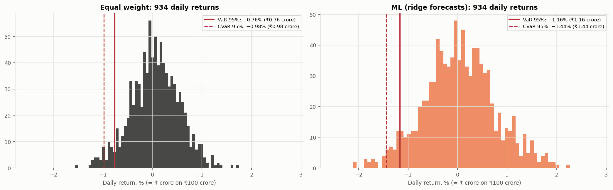
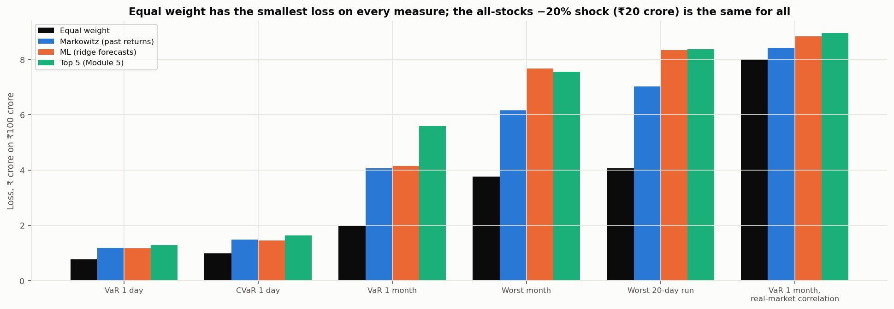

# Module 6 — Part B Report: VaR and Stress Tests

**Why this part:** the brief's learning objectives include **"Calculate VaR"** and **"Conduct stress testing"**, which no module's tasks name; they are covered here, on the four portfolios from Part A (project decision P-08, decision M6-06).

**Where this sits:** Part A built and backtested the four strategies → **Part B: how much each could lose on a bad day, a bad month and in shocks** → Module 9 sizes "Equity investments" with these figures.

| Item | Where |
| --- | --- |
| Code | `notebooks/m06_partB_risk.ipynb`: runs on its own or from `run_module_6.ipynb`; under a minute; needs Part A's outputs |
| **Hand-off to Module 9** | **`outputs/partB/FINAL_M6_B_risk_summary.csv`**: every strategy's VaR, CVaR and stress losses in ₹ per ₹100 crore |
| Evidence | `var_table.csv`, `stress_tests.csv`, 2 charts, `key_numbers.json` |
| Decisions | M6-03, M6-06, M6-07 in `docs/decisions.md` |

**Terms** (details in `docs/documentation.md` section 9):
- **VaR (value at risk), 95%:** the loss not exceeded on 95% of days (or months). "1-day VaR ₹0.76 crore" = on 19 days in 20 the loss is smaller.
- **CVaR (expected shortfall), 95%:** the average loss on the worst 5% of days.
- **Historical VaR:** read from the actual days. **Parametric VaR:** from a bell curve: −(average − 1.645 × standard deviation). 1.645 = how many standard deviations below average cut off the worst 5% of a bell curve.
- **Stress test:** the loss in a specific bad scenario, real (historical) or imagined (hypothetical).
- **Correlation:** how closely two stocks move together, −1 to +1. This data: 0.005 on average; real Indian large-caps: about 0.3–0.5.

---

## 1. Summary for the investment committee

**Answer: equal weight has the smallest loss on every risk measure, except a 20% fall in all stocks, which costs every strategy the same. But this data understates real risk: with real-market co-movement, equal weight's yearly swing would be about 2.5 times larger, and all four strategies would carry similar risk.**

**The risk case**
1. **Normal bad days:** on 19 days in 20, equal weight loses less than **₹0.76 crore per ₹100 crore**; the others ₹1.16–1.29 crore (equal weight = 63% of their average). Over a month: ₹1.98 crore vs ₹4.05–5.59 crore (43%).
2. **Worst stretches that happened:** equal weight's worst month cost ₹3.76 crore; the others ₹6.15–7.67 crore.
3. **A market-wide 20% fall costs ₹20 crore per ₹100 crore in every strategy:** diversification can't protect against a fall in every stock at once.
4. **With real-market correlation (0.4):** equal weight's yearly swing rises from 7.8% to 19.4%, and its 1-month VaR from ₹1.98 crore to about ₹8.00 crore. The others rise to 20.4%–21.1% (₹8.43–8.95 crore).

**For Module 9:** use the real-market figures (about 19% yearly swing; about ₹8 crore 1-month VaR per ₹100 crore) to size the equity allocation, not this data's 7.8%.

---

## 2. VaR and CVaR (step 2)

```text
1 day, historical VaR = the 5th-percentile daily return (the 47th-worst of 934 days), as a loss
1 day, parametric VaR = −(average daily return − 1.645 × daily sd)
CVaR                  = average loss on the days worse than the historical VaR
1 month = 22 trading days (261 ÷ 12 = 21.75, rounded):
    historical        = 5th percentile of every 22-day run's compounded return (913 overlapping runs)
    parametric        = −(22 × average daily − 1.645 × daily sd × √22)      (swings grow with √time)
In ₹: loss % × ₹100 crore. Example: equal weight 0.76% → ₹0.76 crore
```

| Strategy (₹ crore on ₹100 crore) | VaR 1 day, historical | VaR 1 day, parametric | CVaR 1 day | VaR 1 month, historical | VaR 1 month, parametric | CVaR 1 month |
| --- | --- | --- | --- | --- | --- | --- |
| **Equal weight** | **0.76** | **0.74** | **0.98** | **1.98** | **2.47** | **2.38** |
| Markowitz (past returns) | 1.18 | 1.14 | 1.48 | 4.05 | 4.28 | 5.24 |
| ML (ridge forecasts) | 1.16 | 1.14 | 1.44 | 4.14 | 4.63 | 5.13 |
| Top 5 (Module 5) | 1.29 | 1.30 | 1.62 | 5.59 | 5.21 | 6.75 |



- **Equal weight's VaR as a share of the other three's average:**

```text
1 day:   ₹0.76 ÷ [(₹1.18 + ₹1.16 + ₹1.29) ÷ 3 = ₹1.21] = 63%
1 month: ₹1.98 ÷ [(₹4.05 + ₹4.14 + ₹5.59) ÷ 3 = ₹4.59] = 43%
```
- **The overlapping 22-day runs share 21 of 22 days,** so they count as far fewer than 913 independent observations; the monthly VaR is less precise than the daily one.

## 3. Does the bell curve fit? (step 3)

| Strategy | Days worse than parametric VaR | Share (5% expected) | Worst day ÷ daily sd |
| --- | --- | --- | --- |
| Equal weight | 52 | 5.6% | 3.2 |
| Markowitz (past returns) | 49 | 5.2% | 2.8 |
| ML (ridge forecasts) | 50 | 5.4% | 2.9 |
| Top 5 (Module 5) | 46 | 4.9% | 3.1 |

- **Yes, closely:** about 5% of days breach the bell-curve VaR, and the worst day is only about 3 standard deviations below average.
- **Real markets don't behave like this:** they have "fat tails", with occasional days of 5–10 standard deviations (e.g. March 2020), so a bell-curve VaR understates real risk. Another sign this data is synthetic (Module 5: skew 0.14, excess kurtosis 0.03).

## 4. Stress test (a): the worst stretches that happened (step 4)

| Strategy (₹ crore on ₹100 crore) | Worst day | When | Worst month | Month starting | Worst 20-day run | Run ending |
| --- | --- | --- | --- | --- | --- | --- |
| **Equal weight** | **−1.57** | 13 May 2025 | **−3.76** | 31 Jan 2023 | **−4.06** | 1 Mar 2023 |
| Markowitz (past returns) | −2.08 | 9 Jan 2025 | −6.15 | 30 Sep 2024 | −7.03 | 6 Sep 2023 |
| ML (ridge forecasts) | −2.11 | 20 Feb 2023 | −7.67 | 31 Jan 2023 | −8.33 | 1 Mar 2023 |
| Top 5 (Module 5) | −2.57 | 16 Jun 2023 | −7.55 | 31 May 2024 | −8.37 | 2 Jul 2024 |

- **Why not the planned "replay the highest-VIX period":** VIX is the "fear index", the market's expected swing over the next 30 days from option prices (10–20 calm, 30+ panic; India VIX about 85 in March 2020). Crashes come with VIX spikes, so the highest-VIX period is a natural real-market scenario. Here VIX is random (15 values on the same day, no link to returns), so there's no fear period to replay.

## 5. Stress test (b): every stock falls 20% at once (step 5)

| Strategy | Every stock −20% | Beta-scaled fall |
| --- | --- | --- |
| Equal weight | −₹20.0 crore | −₹20.0 crore |
| Markowitz (past returns) | −₹20.0 crore | −₹20.9 crore |
| ML (ridge forecasts) | −₹20.0 crore | −₹19.4 crore |
| Top 5 (Module 5) | −₹20.0 crore | −₹19.8 crore |

- **The same ₹20 crore for every strategy:** a fully invested, long-only portfolio loses exactly an equal fall in every stock, whatever its weights. This is the market risk diversification can't remove; only a smaller equity allocation (Module 9) or a hedge (Module 8) reduces it.
- **Why not the planned beta shock:** beta = how much a stock moves per 1% market move. It needs a real market index; `Market_Return` isn't one. Against the equal-weight portfolio the stocks' betas are 0.75–1.21 (average 1.00), so the beta-scaled fall barely differs (₹19.4–20.9 crore).

## 6. Stress test (c): if the stocks moved together like real large-caps (step 6)

```text
Portfolio swing = √(w·Σ·w),  Σ(i, j) = swing of stock i × swing of stock j × correlation(i, j)
Stressed: keep each stock's own swing (about 29% a year), set every correlation to 0.4
Equal weight, rough check: 29% × √(ρ + (1 − ρ) ÷ 15):  ρ = 0.005 → 7.8%;  ρ = 0.4 → 19.4%
```

| Strategy | Yearly swing: data | Real-market (0.4) | × | VaR 1 month: data | Real-market |
| --- | --- | --- | --- | --- | --- |
| **Equal weight** | 7.8% | 19.4% | ×2.5 | ₹2.47 crore | ₹8.00 crore |
| Markowitz (past returns) | 11.4% | 20.5% | ×1.8 | ₹4.10 crore | ₹8.43 crore |
| ML (ridge forecasts) | 11.2% | 20.4% | ×1.8 | ₹4.43 crore | ₹8.84 crore |
| Top 5 (Module 5) | 13.1% | 21.1% | ×1.6 | ₹5.15 crore | ₹8.95 crore |

(Parametric VaR, averaged over the 43 months' weights.)

- **Equal weight's low risk here comes from the stocks being independent.** Spreading over 15 independent stocks cancels most swings; with real co-movement, much less cancels, so its risk rises most.
- **All four end up close:** equal weight still lowest, but its lead shrinks:

```text
Equal weight's yearly swing: 7.8% → 19.4% = × 2.5 (19.4 ÷ 7.8)
Its 1-month parametric VaR as a share of the other three's average:
  data:        ₹2.47 ÷ [(₹4.10 + ₹4.43 + ₹5.15) ÷ 3 = ₹4.56] = 54%
  real-market: ₹8.00 ÷ [(₹8.43 + ₹8.84 + ₹8.95) ÷ 3 = ₹8.74] = 92%
```

## 7. All the risk figures in ₹ (step 7)

| Strategy (₹ crore lost on ₹100 crore) | VaR 1 day | CVaR 1 day | VaR 1 month | Worst day | Worst month | Worst 20-day run | Every stock −20% | VaR 1 month, real-market |
| --- | --- | --- | --- | --- | --- | --- | --- | --- |
| **Equal weight** | **0.76** | **0.98** | **1.98** | **1.57** | **3.76** | **4.06** | 20.0 | **8.00** |
| Markowitz (past returns) | 1.18 | 1.48 | 4.05 | 2.08 | 6.15 | 7.03 | 20.0 | 8.43 |
| ML (ridge forecasts) | 1.16 | 1.44 | 4.14 | 2.11 | 7.67 | 8.33 | 20.0 | 8.84 |
| Top 5 (Module 5) | 1.29 | 1.62 | 5.59 | 2.57 | 7.55 | 8.37 | 20.0 | 8.95 |



## 8. Reading the final file: `FINAL_M6_B_risk_summary.csv` (decision M6-13)

One row per strategy × measure (4 × 15 = 60): **Value, Unit, Basis** (actual days / bell curve / stress scenario), **rank among the 4 strategies** (1 = smallest loss) and **what it means, in words**, e.g. *"If the stocks moved together like real large-caps, in 19 months out of 20 ₹100 crore in Equal weight would lose less than ₹8.00 crore; the lowest of the 4 strategies."* No per-stock breakdown: with equal weights and near-identical swings, each stock is about 1/15 of the risk (the stock-by-stock view is Module 5's scorecard).

## 8b. Recommendation and hand-off

- **Equal weight is the lowest-risk strategy on every measure except a 20% fall in all stocks (the same for all),** in this data and under real-market correlation; with Part A, it is the recommended equity portfolio.
- **Module 9 should plan with real-market risk:** about 19% yearly swing and about ₹8 crore 1-month VaR per ₹100 crore, plus ₹20 crore in a 20% market fall.

| To | File | What it holds |
| --- | --- | --- |
| Module 9 | `outputs/partB/FINAL_M6_B_risk_summary.csv` | Every strategy's VaR, CVaR and stress losses in ₹ per ₹100 crore |

### Module 9 inputs: equities in the standard fields (decision M6-14; final notebook step "What goes to Module 9")

**Why:** Module 9 compares every business on the same fields: return per ₹, bad-year result, capacity, evidence, how fast money comes back, gaps and controls. This module gives Equities: return after costs with its 95% range, the 1-in-20 year at the real-market swing, and the 20% crash loss diversification can't remove.

| Category | Return per ₹ (% a year) | Range | Bad year per ₹ | Bad year means | Capacity | Gap / assumption |
| --- | --- | --- | --- | --- | --- | --- |
| Equity investments (equal weight, 15 stocks) | 15.6 | 8.6 to 22.6 (95% range of the measured return) | -16.24 | 1-in-20 year at the real-market swing (19.4%): return − 1.645 × swing; a crash (all stocks −20%) loses 20% | Large (listed stocks) | Stocks in the data move independently, so measured risk understates the real one; no dividends |

## 9. Risks and limitations

- **Synthetic-looking data:** independent stocks and bell-curve returns make this data's risk far smaller than real markets'; stress test (c) adjusts for co-movement, but not for fat tails.
- **934 days:** the 5% tail is about 47 days; monthly VaR rests on overlapping runs.
- **The 0.4 correlation is an assumption** (typical of Indian large-caps), not measured from this data.
- **No VIX or beta scenarios:** those columns are random here.
