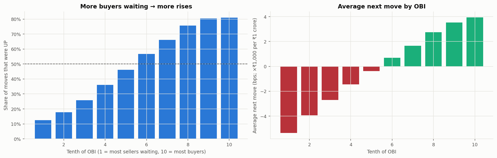
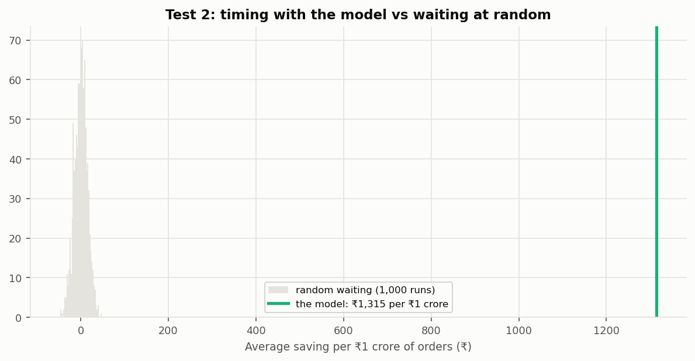
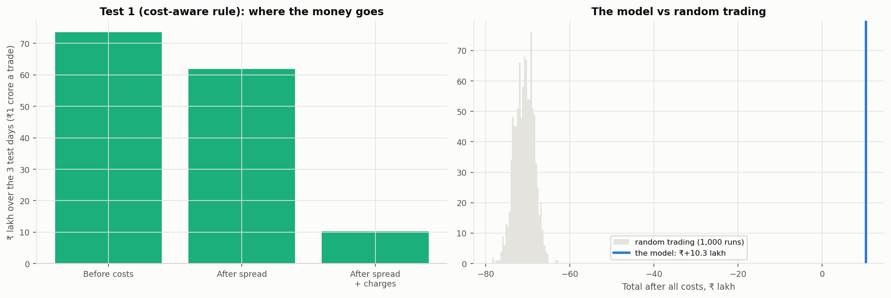

# Module 7 — High-Frequency Trading

## Final report

**The Head of Trading's question (brief, verbatim):**
> NovaFin's trading desk executes large equity orders in the market. The Head of Trading asks: **Can ML use limit-order-book information to predict short-horizon price movements and improve order execution?**

**The two tasks (brief, verbatim):**
> **ML Task 1 — Short-Horizon Direction Prediction.** Target: Price_Move_Class with: UP, DOWN, NO_MOVE … Compare models and performance
>
> **ML task 2 — model probability into trading signal.** Does the prediction generate enough economic value? Can we generate some trading signal and backtest.

| Item | Where |
| --- | --- |
| **Final output (open this first)** | **`outputs/FINAL_M7_module_output.xlsx`**: Read me (with a column guide) · Key numbers · Board actions · Task 1 and Task 2 final files · Hand-off to Module 9 · Decisions · Evidence index |
| Run everything | `run_module_7.ipynb` (about 4 minutes) |
| Task reports | `reports/task1_report.md`, `task2_report.md` |
| Decisions | `docs/decisions.md` (M7-01 to M7-16) |

**Words used:**
- **Order book:** waiting buy orders (bids) and sell orders (asks).
- **OBI:** the balance of waiting buyers and sellers, from −1 to +1.
- **Spread:** the gap between the best buying and selling prices.
- **The lean:** the model's chance of a rise − its chance of a fall.
- **Money is shown per ₹1 crore traded;** 1 bp (0.01%) = ₹1,000.

---

## 1. The answer in brief

**Yes, on both counts. ML predicts the next tenth of a second's move well, and it improves order execution: timing the desk's own orders saves about ₹1,300 per ₹1 crore. Trading on the signal, using the cost-aware rule that Task 1's results point to, makes about ₹700 per ₹1 crore trade, every test day, but most of the gross gain goes on costs.**

| Finding | Evidence |
| --- | --- |
| **The order book predicts the next move** | Right 60.6% of the time on unseen days, against 42.0% for guessing; the percentages are honest |
| **Most of the skill is one number** | The balance of waiting buyers and sellers: 12% of moves are rises when sellers dominate, 81% when buyers do |
| **ML adds a small, real gain** | Logistic regression beats the simple balance rule: AUC 0.791 vs 0.781 (gain 95% range +0.008 to +0.012), in all 10 stocks and on all 3 test days; passes the luck test (p = 0.0099); smallest overfitting gap (+0.003) |
| **Timing the desk's orders saves money** | ₹1,315 per ₹1 crore of orders, beyond luck, on buys and sells and in all 10 stocks: ₹3.4 crore a year per ₹100 crore a day |
| **Task 1's results reshaped the trading rule** | Spreads are widest when the model is most confident, so trading only when the expected gain beats that moment's own cost more than doubles profit (+₹10.3 lakh vs +₹4.5 lakh for a fixed confidence cut-off) |
| **Trading on the signal pays, modestly** | +₹700 per ₹1 crore trade after all costs (8% of moments traded); +₹10.3 lakh over 3 test days, 95% range +₹6.4 to +₹14.1 lakh, every day positive; 86% of the gross gain goes on costs, and 1 bp of unmeasured cost turns it into a loss |

**Recommendations for the Head of Trading:**
1. **Use the model to time the desk's own orders.** It's a dependable saving, with no extra charges.
2. **Run the cost-aware trading rule as a measured pilot.** Feed the real costs into the rule, which then trades less and stays profitable, and stop if the profit after costs turns negative.
3. **Measure real brokerage, slippage and fill prices** before scaling any trading.
4. **Collect longer-horizon prices and order-fill data** to test longer waits and limit orders.

#### The recommendation: what it means, what it adds, why it matters

**It answers the Head of Trading's two-part question** ("predict short-horizon price movements **and improve order execution**") and the brief's "does the prediction generate enough economic value?". It turns the analysis into what to do, and what each part is worth.

**1. Time the desk's own orders now.**
- **What it means:** the desk already places large client orders every day. When it has to buy, it checks the model first. If the model expects the price to dip in the next tenth of a second, it waits a moment and buys a little cheaper (the reverse for sales).
- **What it adds:** about **₹1,315 saved for every ₹1 crore of orders**, which is about **₹1.3 lakh a day, ₹3.4 crore a year** for a desk placing ₹100 crore of orders a day. It grows with the desk's volume.
- **Why now:** there's no extra cost (the order and its taxes happen anyway), it's reliable (buys and sells, all 10 stocks, far beyond luck), and it's low-risk (it changes only *when* an order goes in, not *whether*).

**2. Run the cost-aware trading rule as a measured pilot.**
- **What it means:** NovaFin could also trade for its own profit, buying and selling within a tenth of a second when the expected gain beats that moment's cost. On the test days this made **+₹700 per ₹1 crore trade, +₹10.3 lakh over 3 days, profitable every day**.
- **Why a pilot, not full scale:**
  - The margin is thin. Of ₹4,994 caught per trade before costs, ₹4,294 (86%) went on the spread and taxes.
  - It rests on costs that were assumed, not measured (zero brokerage, fills at the quoted price). If the real cost is 1 bp higher and the rule isn't told, the ₹10.3 lakh becomes a ₹4.4 lakh loss.
- **The pilot, step by step:**
  1. Start with small trades in the narrow-spread stocks, where most of the profit came from (NOVA09: +₹4.7 lakh).
  2. Record the real brokerage, the prices actually achieved and the slippage.
  3. Feed the real cost into the rule. Told the true cost, it trades less and stayed profitable even at 1 bp more (+₹0.7 lakh).
  4. Stop if the profit after costs turns negative.
- **What it adds:** a chance at extra trading income, with the true costs found out before real money is committed.

**Why it matters for the Board and Module 9**

| Without the recommendation | With it |
| --- | --- |
| "The model is 60.6% accurate", which says nothing about money | Two concrete uses, each with a ₹ value and a risk level |
| Risk of funding a trading desk on a thin, cost-sensitive profit | Capital goes only where the gain is solid (order timing); trading earns its place through a pilot |
| Module 9 can't value high-frequency trading | Module 9 gets ₹1,315 saved per ₹1 crore of orders as a cost saving, and trading as a small pilot rather than a capital line |

**In short:** the model's value lies mainly in making the desk's existing trading cheaper, which is dependable and should start now. Trading on it for profit may add more, but only after its real costs are proven.

## 2. The chain

| Hand-off | File | How it's used |
| --- | --- | --- |
| Task 1 → Task 2 | `FINAL_M7_T1_direction_predictions.csv`: each moment's chances, lean and outcome | Test 1 trades on the lean; Test 2 times orders with it |
| Task 2 → Board, Module 9 | `FINAL_M7_T2_trade_decisions.csv` and the workbook's Hand-off tab | The recommendation and the figures for the "High frequency trading" line |

## 3. Task 1: prediction

**The order book predicts well, mostly from the buyer/seller balance; ML adds a small but real gain.**

| Model | AUC, rises vs falls | Right class | Beats the simple rule? |
| --- | --- | --- | --- |
| OBI alone | 0.781 | 60.1% | — |
| **Logistic regression** | **0.791** | **60.6%** | **Yes (p < 0.0001)** |
| Random forest | 0.789 | 60.6% | Yes |
| LightGBM | 0.789 | 60.5% | Yes |

**What else Task 1 found:**
- Trade size, time of day, stock and the rest of the market add nothing.
- No-moves can't be foreseen. They stay in every measure, and the "don't trade" zone covers them.
- **The result is solid:** overfitting gap +0.003; better than the simple rule in all 10 stocks and on all 3 days; luck-test p = 0.0099.
- **What the model relies on:** the buyer/seller balance at the best price (odds of a rise × 2.39 per typical step), then the spread (× 0.74: wide spreads lean towards falls).
- **What it means for Task 2:**
  - the move caught grows about 7.1 bps × the lean;
  - the percentages are honest;
  - spreads are widest when the model is most confident.
  So Test 1 compares each moment's expected gain with its own cost (decisions M7-13, M7-17).

Details: `task1_report.md`.

## 4. Task 2: economic value

**Order timing is the solid gain; trading on the signal is thin.**
- **Test 1, trading on the signal (cost-aware rule: expected gain must beat that moment's spread + 3.5 bps):**
  - per ₹1 crore trade: +₹4,994 before costs → +₹4,200 after the spread → **+₹700 after charges**;
  - 1,473 trades; +₹10.3 lakh (95% range +₹6.4 to +₹14.1 lakh); every test day positive; profitable in 8 of 10 stocks; beyond luck (p = 0.001);
  - the old fixed cut-off (0.70) made +₹4.5 lakh;
  - **if real costs are 1 bp higher:** −₹4.4 lakh if the rule isn't told, +₹0.7 lakh if it is.
- **Test 2, order timing:** **₹1,315 saved per ₹1 crore of orders** (95% range ₹1,272–₹1,356), beyond luck (p = 0.001). That's ₹1.31 lakh a day, ₹3.43 crore a year (261 trading days, as in the data: every weekday), per ₹100 crore of orders a day.

Details: `task2_report.md`.

## 5. Hand-off to Module 9 (workbook, Hand-off tab)

Module 9's brief lists "High frequency trading". Each figure below points to its tab, columns and rows in the workbook.

| Figure | Value | Status |
| --- | --- | --- |
| Can the order book predict? | Yes: 60.6% right vs 42.0% | Measured |
| Recommended use | Time the desk's orders now; cost-aware trading as a measured pilot | Conclusion |
| Order timing saving | ₹1,315 per ₹1 crore of orders | Measured |
| Per ₹100 crore of orders a day | ₹1.31 lakh a day; ₹3.43 crore a year (261 trading days) | Measured + Assumption |
| Trading: net per trade | +₹700 per ₹1 crore | Measured |
| Trading: total over 3 test days | +₹10.3 lakh (range +₹6.4 to +₹14.1 lakh) | Measured |
| Trading if real costs are 0.5 / 1 bp higher | +₹2.9 / −₹4.4 lakh (rule told the real cost at 1 bp: +₹0.7 lakh) | Stress estimate |
| Share of moments traded | 8.2% | Measured |

**For Module 9:**
- The HFT capability's value is **cost saving on the desk's existing orders**, scaled by its order volume. It isn't a capital line that earns a return of its own.
- Trading on the signal earns modestly; it shouldn't receive material capital until its real costs are measured and fed into the rule.

### Module 9 inputs: HFT in the standard fields (decision M7-18; Task 2 step 5b)

**Why:** Module 9 compares every business on the same fields. HFT isn't a place to park capital, so its fields are per ₹ of orders or trades, with the link to Module 9's own equity trading.

| Category | Return per ₹ | Range | Bad case | Capital needed |
| --- | --- | --- | --- | --- |
| Order timing (desk orders) | Saves 0.013% of every ₹ of orders (₹1,315 per ₹1 crore) | 0.013–0.014% | 0 (if the signal stopped working, waits save nothing) | None |
| Order timing on Module 9's equity money | 0.010% a year of the equity money (Module 6 turnover ≈ 0.8× a year) | 0.010–0.011% | 0 | None |
| Trading pilot | +₹700 per ₹1 crore traded, per trade | +₹6.4 to +₹14.1 lakh over 3 test days | −₹4.4 lakh over 3 days if costs are 1 bp higher and the rule isn't told | Small; same-day positions |

- **On Module 9's equity money, order timing is worth about 0.01% a year** (about ₹1 lakh per ₹100 crore of equities): real, but too small to change an allocation.
- **The trading pilot's bad case is hidden costs,** not market moves: 1 bp more than assumed turns the 3-day profit into a loss.

## 6. Key decisions

| ID | Decision | Why |
| --- | --- | --- |
| M7-02 | Future_Return_100ms and Future_Price_100ms are never inputs | They build the label |
| M7-04 | Days 1–14 learn, 15–17 choose, 18–20 judge once | Days alike; a random split leaks |
| M7-08 | 15 inputs; OBI alone as the benchmark | Pass the line and make a meaningful difference |
| M7-10 | AUC decides, log-loss second; DeLong p < 0.017 to beat OBI | Trading rests on ordering and honest chances |
| M7-11 | NO_MOVE kept, models unweighted | Weighting hurts honesty with no gain |
| M7-06 | Costs: spread both ways + 3.5 bps Indian charges | STT and statutory charges |
| M7-12 | Two tests, one recommendation | Different uses, different costs |
| M7-13 | Trade when the expected gain beats that moment's cost (revised after Task 1's review) | Spreads are widest when the model is most confident |
| M7-17 | Task 1's results reviewed against Task 2's rules | Project working rule: review each task before building the next |
| M7-14, M7-15 | Order timing in middle detail; "enough value" = profit, beyond luck, most days | Proportionate and comparable with other modules |

## 7. Limitations

- **A tenth of a second only:** the data shows no longer horizon, and no information on order fills.
- **Assumptions:** fills at the quoted price, no market impact, zero brokerage. Each would only lower Test 1's profit, which is concentrated in the narrow-spread stocks.
- **20 days of one month; the data looks simulated** (trade size has no effect).
