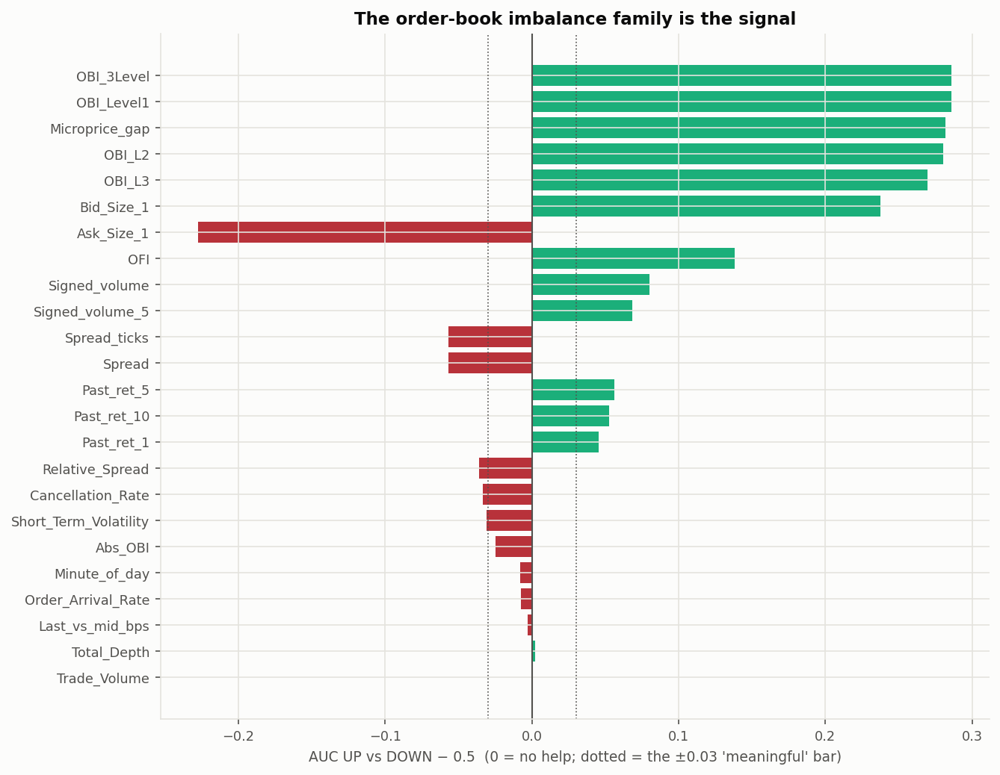
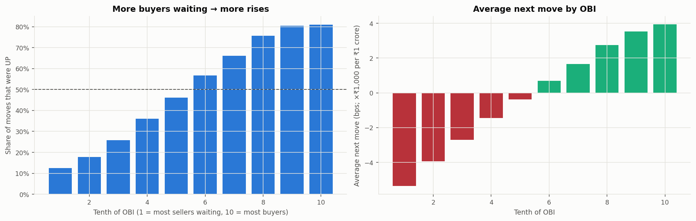
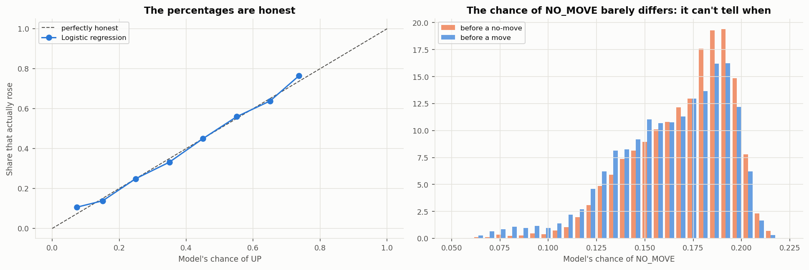
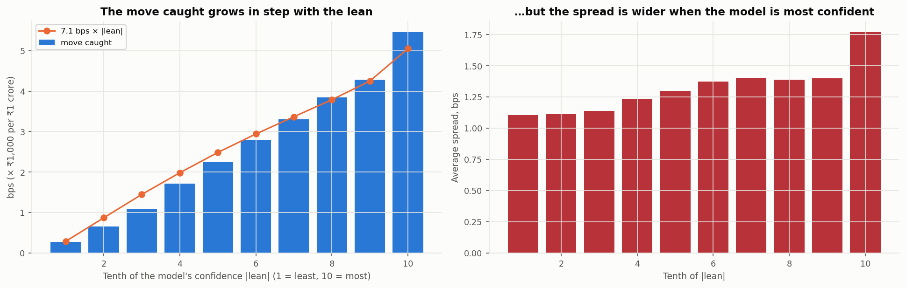

# Module 7 — Task 1 Report: Predicting the Next Price Move from the Order Book

**The Head of Trading's question (brief, verbatim):**
> NovaFin's trading desk executes large equity orders in the market. The Head of Trading asks: **Can ML use limit-order-book information to predict short-horizon price movements and improve order execution?**

**Task 1 (brief, verbatim):**
> **ML Task 1 — Short-Horizon Direction Prediction.** Target: Price_Move_Class with: UP, DOWN, NO_MOVE. Note: the provided dataset (nova_hft_orderbook.csv) labels this class FLAT. Treat FLAT as equivalent to NO_MOVE. Important: Exclude Future_Return_100ms and Future_Price_100ms from your feature set for this task — these variables are used to construct the target label and will cause data leakage if included. Compare models and performance

| Item | Where |
| --- | --- |
| **Final output (open this first)** | **`outputs/FINAL_M7_module_output.xlsx`** (tab "T1 direction predictions"; column guide in the Read me tab) |
| Task 1 final file | `outputs/task1/FINAL_M7_T1_direction_predictions.csv`: every tuning- and test-day moment: the chances of up / down / no move, the prediction, what happened, and why, in plain words |
| Code | `notebooks/m07_task1_direction.ipynb` (about 3 minutes) |
| Evidence | `evidence_table.csv`, `model_tests.csv`, `model_drivers.csv`, 4 charts, `key_numbers.json` |
| Decisions | M7-01 to M7-11, and M7-17 (this review of Task 2's rules) in `docs/decisions.md` |

**Words used** (each explained once; more in `docs/documentation.md`):
- **Order book:** the exchange's list of orders waiting to be filled. **Bids** are buyers ("I'll pay up to ₹X"); **asks** are sellers ("I'll sell at ₹Y or more").
- **Level 1, 2, 3:** the best, second-best and third-best prices on each side, and the shares waiting at each.
- **Spread:** best selling price − best buying price. It's the cost of trading immediately.
- **OBI (order-book imbalance):** (shares waiting to buy − shares waiting to sell) ÷ both, from −1 (only sellers) to +1 (only buyers).
- **bp (basis point):** 0.01%. On ₹1 crore, 1 bp = ₹1,000.
- **UP / DOWN / NO_MOVE:** the price a tenth of a second later is more than 0.012% higher / more than 0.012% lower / within ±0.012%.
- **AUC:** how well a score separates two groups. 0.5 = no better than a coin flip, 1 = perfect.
- **Log-loss:** how honest a model's percentages are. Lower is better.

---

## 1. Summary

**Yes: the order book predicts the next tenth of a second's move. The model is right 60.6% of the time on days it never saw, against 42.0% for always guessing the commonest move. Most of the skill comes from one number: the balance of waiting buyers and sellers.**

1. **The signal is the balance of waiting orders (OBI).** When far more shares wait to be sold than bought, only 12% of moves are rises. When far more wait to be bought, 81% are.
2. **Four models were compared:** the simple OBI rule, logistic regression, random forest and LightGBM. All three ML models beat the simple rule beyond chance (p < 0.0001), but only slightly (+0.008 to +0.010 AUC).
3. **Logistic regression is best and goes to Task 2.** The tree models don't beat it, because the link between the imbalance and the next move is close to a straight line. It also learns the least noise (training-to-test gap +0.003 vs +0.043 to +0.053 for the trees), beats the simple rule in every stock and on every test day, and passes the luck test (p = 0.0099).
4. **Its percentages are honest.** Of the moments it gave about a 70% chance of a rise, about 70% rose. Task 2 needs this to weigh chances against costs.
5. **NO_MOVE can't be foreseen.** It stays in every measure, and the model gives it a chance on every row. But nothing in the data tells a coming no-move apart from a coming move, so it's never the predicted class.
6. **What this means for Task 2 (§7):**
   - the move a trade catches grows in step with the model's confidence, about 7.1 bps × its lean;
   - but spreads are widest exactly when the model is most confident.
   So Task 2 should trade on **expected gain vs that moment's own cost**, not on confidence alone. Task 2's agreed rule is revised accordingly (decision M7-13).

## 2. The data and the split

- **The data:** 120,000 moments, 20 trading days (5–30 January 2026), 10 stocks, no gaps. UP 41.7%, DOWN 41.9%, NO_MOVE 16.4%.
- **The label:** UP if the price a tenth of a second later is more than 1.2 bps higher, DOWN if more than 1.2 bps lower, otherwise NO_MOVE. Checked exactly against `Future_Return_100ms`, which, with `Future_Price_100ms`, is never an input (that would be leakage).
- **The split (decision M7-04):** days 1–14 to learn (84,054 moments), days 15–17 to choose (18,070), days 18–20 to judge, used once (17,876). The days behave alike, so one split is enough. A random split would put moments from the same stock and minute on both sides, which is leakage.

## 3. What the data shows (training days only, decision M7-07)

**The balance of waiting buyers and sellers is the signal; almost nothing else matters.** 27 candidate inputs were tested, so a result had to pass p < 0.05 ÷ 27 = 0.0019.

| Input family | How well it tells rises from falls (AUC) | Verdict |
| --- | --- | --- |
| Balance of waiting orders: OBI at levels 1–3, microprice | 0.77–0.79 | **The main signal** |
| Change in waiting orders since the last moment (OFI) | 0.64 | Real, partly separate |
| Direction of recent trades | 0.57–0.58 | Weak |
| Recent price moves | 0.55–0.56 | Weak |
| Spread, volatility, order rates | 0.44–0.47 | Small; the only hint about no-moves |
| Trade size, depth, time of day, stock, event type | about 0.50 | Nothing |

**Questions raised in review:**
- **Trade size:** among purchases, small, medium and large ones are followed by the same share of rises: 57.4%, 57.9%, 57.5%. Direction matters; size doesn't.
- **Time of day:** no stock's mix of rises, falls and no-moves changes with the hour beyond chance.
- **Industries:** the data has no industry column. The 10 stocks do move together (minute-to-minute correlation 0.51), but the rest of the market's order books add nothing once a stock's own book is known.

## 4. The inputs (decision M7-08)

**15 inputs, chosen by a fixed rule:** each passes the line and makes a meaningful difference (AUC at least 0.03 away from 0.5), and near-duplicates are dropped. They are:
- **OBI** at levels 1, 2 and 3;
- **OFI** (change in waiting orders since the last moment);
- **signed volume**, for the last trade and the last 5;
- **past moves** over 1, 5 and 10 moments;
- **spread** in ticks, and relative spread;
- **volatility**, cancellation rate and arrival rate;
- **the size of the imbalance.**

**Benchmark:** OBI alone, the simplest rule a trader could use.

## 5. The four models (decisions M7-09, M7-10)

**Every model learned from days 1–14, was compared on days 15–17, and judged once on days 18–20.**

| Model | AUC, rises vs falls | Log-loss (lower = more honest) | Right class | Beats OBI alone? (DeLong test, line 0.017) |
| --- | --- | --- | --- | --- |
| OBI alone (benchmark) | 0.781 | 0.917 | 60.1% | — |
| **Logistic regression** | **0.791** | **0.908** | **60.6%** | **Yes (+0.010, p < 0.0001)** |
| Random forest | 0.789 | 0.910 | 60.6% | Yes (+0.008, p < 0.0001) |
| LightGBM | 0.789 | 0.912 | 60.5% | Yes (+0.008, p < 0.0001) |

*Test days. Always guessing the commonest class is right 42.0% of the time.*

- **Small gains can still be real.** About 15,000 rises and falls on the test days make even a +0.01 AUC gain clear of chance.
- **Checks on the tuning days:**
  - adding every candidate input changes nothing (AUC 0.789 vs 0.788);
  - giving NO_MOVE extra weight catches 17–25% of no-moves, but costs 3–5 points of accuracy and makes the percentages less honest.

### 5b–5e. Is the result solid?

| Check | Result | What it means |
| --- | --- | --- |
| **Overfitting** (training-day AUC − test-day AUC) | Logistic regression +0.003; OBI alone +0.005; random forest +0.043; LightGBM +0.053 | The trees learned some noise; logistic regression didn't |
| **Holds everywhere?** | Logistic regression beats OBI alone in **all 10 stocks** (AUC 0.774–0.806) and **all 3 test days** | Not a quirk of one stock or day |
| **Better than luck?** Outcomes shuffled within each training day, model refitted 100 times | Shuffled: AUC 0.54 on average (95% range 0.42–0.67); real: 0.79; p = 0.0099 (the smallest possible) | The skill is real |
| **Gain over the simple rule** | +0.010 AUC, 95% range +0.008 to +0.012 | Small but clearly above zero |

**Choosing the model, factor by factor:**

| Factor | OBI alone | **Logistic regression** | Random forest | LightGBM |
| --- | --- | --- | --- | --- |
| Tells rises from falls (test AUC) | 0.781 | **0.791** | 0.789 | 0.789 |
| Honest percentages (log-loss, lower = better) | 0.917 | **0.908** | 0.910 | 0.912 |
| Learned noise? (training − test AUC) | +0.005 | **+0.003** | +0.043 | +0.053 |
| Can you see why it predicts? | Yes | **Yes: one weight per input** | Partly | Partly |
| Training time | Instant | About 1 second | About a minute | About 15 seconds |

**Logistic regression is best or joint-best on every factor, so it goes to Task 2.**

## 6. Honest percentages, and NO_MOVE (decision M7-11)

- **The percentages are honest:** the points sit on the diagonal.
- **NO_MOVE:** the model's chance runs from 5% to 22% (typically 17%). It is barely higher before real no-moves (17.6%) than before moves (16.8%). So the model knows no-moves happen about 1 time in 6, but not when. Task 2's "don't trade" zone covers them.

## 6b. What the model relies on

For one typical step up in each input, with the others held fixed, the odds of a rise rather than a fall change by:

| Input, in plain words | Odds of a rise vs a fall | Meaning |
| --- | --- | --- |
| More buyers than sellers waiting at the best price | **× 2.39** | The main driver by far |
| A wider gap between buying and selling prices | **× 0.74** | Wide spreads lean towards falls |
| More buyers than sellers at the second-best price | × 1.28 | Depth just behind the best price adds a little |
| New orders arriving faster | × 1.12 | |
| Orders being cancelled faster | × 0.91 | |
| More buyers than sellers at the third-best price | × 1.09 | |
| Recent trades, recent price moves, change in waiting orders, volatility | about × 1.00 | They each helped alone in §3, but carry the same information as the imbalance |

Table: `outputs/task1/model_drivers.csv`.

## 7. What Task 1 means for Task 2 (review of Task 2's agreed rules)

**Task 2's rules were agreed before Task 1 was built. This review checks them against what Task 1 actually found, on the tuning days only (the test days stay untouched for Task 2).** "Lean" = the model's chance of a rise − its chance of a fall; "move caught" = the next move if you had traded in the lean's direction.

| Tenth of the model's confidence (1 = least, 10 = most) | Typical lean | Move caught | Spread | Share that end in no move |
| --- | --- | --- | --- | --- |
| 1 | 0.04 | +0.27 bps (₹270 per ₹1 crore) | 1.10 bps | 20.9% |
| 3 | 0.20 | +1.08 bps | 1.14 bps | 19.0% |
| 5 | 0.35 | +2.24 bps | 1.30 bps | 17.3% |
| 7 | 0.47 | +3.31 bps | 1.40 bps | 15.3% |
| 9 | 0.60 | +4.28 bps | 1.40 bps | 14.3% |
| 10 | 0.71 | **+5.46 bps (₹5,460)** | **1.77 bps** | **10.5%** |

| What Task 1 found | What it means for Task 2 | Decision |
| --- | --- | --- |
| **The move caught grows in step with the lean:** about **7.1 bps × size of the lean** (a lean of 0.5 → about 3.5 bps = ₹3,550 per ₹1 crore before costs) | Each trade's **expected gain** can be estimated from the lean | New input to Task 2 |
| **The percentages are honest** (§6) | That estimate can be trusted enough to weigh against costs | — |
| **Spreads are widest when the model is most confident** (1.77 vs 1.10 bps) | A single confidence cut-off trades exactly where costs are highest. **Trade only when the expected gain beats that moment's own cost** (its spread + 3.5 bps of charges) | **M7-13 revised** |
| **Confident moments end in no move less often** (10.5% vs 20.9%) | The "don't trade" zone for weak leans also avoids most no-move trades | M7-11 holds |
| **Almost all skill is in the buyer/seller balance;** logistic regression beats it slightly | Use logistic regression in Task 2; show OBI alone as a comparison | M7-10 holds |

## 8. What goes to Task 2

| File | What it holds | How Task 2 must use it |
| --- | --- | --- |
| `outputs/task1/FINAL_M7_T1_direction_predictions.csv` | Every tuning- and test-day moment: the chances of up / down / no move from logistic regression, the lean, what happened, every model's lean, and why in plain words | Trade and time orders on the lean; score with the actual move only |
| `outputs/task1/key_numbers.json` → `task2_review` | The expected-gain slope (7.09 bps per unit of lean), and spread and no-move share in the most vs least confident tenth | The slope sets each moment's expected gain in Test 1's cost-aware rule |

An example of its "why, in words" column:
> *"At the best price, about 10.6 times as many shares are waiting to be sold as bought, and the last trade was a sale. The model gives a 6% chance the price rises in the next tenth of a second, 87% that it falls and 8% that it doesn't move, so it predicts a fall. What happened: the price fell by 0.117% (₹11,750 per ₹1 crore)."*

## 9. Limitations

- **A tenth of a second only:** the data shows no longer horizon.
- **The data looks simulated:** trade size has no effect, unlike real markets.
- **20 days of one month:** different market conditions could weaken the signal.
