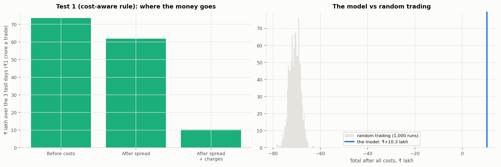
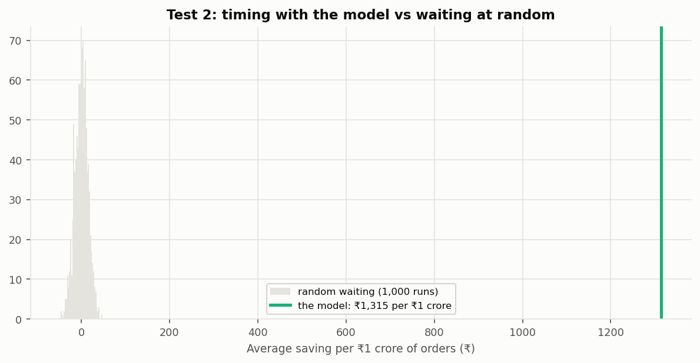

# Module 7 — Task 2 Report: Is the Prediction Worth Money?

**Task 2 (brief, verbatim):**
> **ML task 2 — model probability into trading signal.** Does the prediction generate enough economic value? Can we generate some trading signal and backtest.

**And the Head of Trading's question (brief, verbatim):** *"Can ML use limit-order-book information to predict short-horizon price movements **and improve order execution**?"*

| Item | Where |
| --- | --- |
| **Final output (open this first)** | **`outputs/FINAL_M7_module_output.xlsx`** (tab "T2 trade decisions"; column guide in the Read me tab) |
| Task 2 final file | `outputs/task2/FINAL_M7_T2_trade_decisions.csv`: every test-day moment's expected gain and cost, what Test 1 and Test 2 did, the ₹ result, and the reasons in plain words |
| Code | `notebooks/m07_task2_signal.ipynb` (under a minute) |
| Evidence | `test1_rules.csv` (both rules on the tuning days), 2 charts, `key_numbers.json` |
| Decisions | M7-06, M7-12 to M7-15, M7-17 in `docs/decisions.md` |

**Words used:**
- **The lean (the signal):** the model's chance of a rise − its chance of a fall. Example: 70% rise, 20% fall → lean +0.50 → buy.
- **Expected gain:** Task 1 found that the move a trade catches grows in step with the lean, about **7.1 bps × the lean**. So each moment's expected gain = 7.1 bps × its lean. Example: lean 0.5 → about 3.5 bps = ₹3,550 per ₹1 crore.
- **This moment's cost:** that moment's own bid–ask spread (buying at the sellers' price and selling at the buyers') + 3.5 bps of Indian charges.
- **Money is per ₹1 crore traded** (a measuring unit, not a trade size). 1 bp (0.01%) = ₹1,000.
- **Charges (decision M7-06):** about ₹3,500 per ₹1 crore round trip, made up of:
  - securities transaction tax: 0.025% on the sale (2.5 bps);
  - exchange charges: about 0.003% each way (0.6 bps);
  - stamp duty: 0.003% on the purchase (0.3 bps);
  - SEBI fee and GST (0.1 bp).

---

## 1. Summary for the Head of Trading

**The prediction is worth money in both uses. Timing the desk's own orders saves about ₹1,300 per ₹1 crore of orders. Trading on the signal, using the cost-aware rule that Task 1's results point to, makes about ₹700 per ₹1 crore trade, on every test day.**

| | Test 1: trading on the signal | Test 2: timing the desk's own orders |
| --- | --- | --- |
| **What it does** | Trade only when the expected gain beats that moment's cost; get out a tenth of a second later | When the desk must buy, wait a moment if a fall is expected (and the reverse for a sale) |
| **Result per ₹1 crore** | **+₹700 a trade** after the spread and charges | **₹1,315 saved per order** |
| **How sure** | Total +₹10.3 lakh; 95% range +₹6.4 to +₹14.1 lakh; all 3 days positive | 95% range ₹1,272–₹1,356 |
| **Beyond luck?** | Yes. Random trading loses about ₹71 lakh (p = 0.001) | Yes. Random waiting saves ₹0 (p = 0.001) |
| **Watch-out** | 86% of the gross gain goes on costs; if the real cost is 1 bp higher than assumed, it loses | Assumes the spread doesn't change during the wait |
| **In ₹** | +₹10.3 lakh over 3 test days (₹1 crore a trade) | ₹1.31 lakh a day, **₹3.4 crore a year** per ₹100 crore of orders a day |

**Recommendations:**
1. **Use the model to time the desk's own orders now.**
2. **Run the cost-aware trading rule as a measured pilot.**
   - Measure the real brokerage, slippage and fill prices, and feed the real cost into the rule.
   - Stop if the profit after costs turns negative.

## 2. How Task 1's results shaped Test 1 (decisions M7-13, M7-17)

**Task 2's trading rule was agreed before Task 1 was built. Reviewing it against Task 1's results changed it.**

| What Task 1 found (its step 7) | What changed in Test 1 |
| --- | --- |
| The move caught grows in step with the lean: about 7.1 bps × the lean (+0.27 bps in the least confident tenth, +5.46 in the most) | Each moment's **expected gain** is estimated from the lean |
| The percentages are honest | That estimate can be weighed against costs |
| **Spreads are widest when the model is most confident** (1.77 vs 1.10 bps) | Instead of one confidence cut-off, **compare each moment's expected gain with its own cost** |

**On the tuning days, the two rules compared like this.** The settings for each rule were chosen here, then applied unchanged to the test days.

| Rule | Trades | Net per trade | Total over 3 tuning days | Average spread paid |
| --- | --- | --- | --- | --- |
| **Cost-aware, margin 0** (chosen: most total profit) | 1,479 | +₹799 | **+₹11.8 lakh** | ₹804 |
| Cost-aware, margin +0.5 bp | 581 | +₹1,260 | +₹7.3 lakh | ₹726 |
| Fixed cut-off 0.70 (best of the old rule) | 867 | +₹455 | +₹3.9 lakh | ₹2,139 |
| Fixed cut-off 0.50 | 5,535 | −₹505 | −₹27.9 lakh | ₹1,517 |

## 3. Test 1 on the test days (decision M7-15)

**The cost-aware rule made +₹700 per ₹1 crore trade, +₹10.3 lakh in total, more than double the old rule.**

| Rule | Trades | Net per trade | Total | Average spread paid |
| --- | --- | --- | --- | --- |
| **Cost-aware rule** | **1,473 (8.2% of moments)** | **+₹700** | **+₹10.3 lakh** | ₹794 |
| Old rule: fixed cut-off 0.70 | 868 (4.9%) | +₹516 | +₹4.5 lakh | ₹2,203 |

| Step (cost-aware rule) | Per trade | Total over 3 test days |
| --- | --- | --- |
| Before costs (the price move caught) | +₹4,994 | +₹73.6 lakh |
| After the bid–ask spread | +₹4,200 | +₹61.9 lakh |
| **After spread and charges** | **+₹700** | **+₹10.3 lakh** |

- **How the trades landed:** 78% the right way (about +₹6,980 each before costs), 12% the wrong way (about −₹3,790) and 11% no move (about ₹0, but still paying the costs).
- **By day:** +₹1.6 lakh, +₹5.2 lakh and +₹3.5 lakh. All positive.
- **How sure:** the 95% range of the total, from resampling the trades 1,000 times, is +₹6.4 to +₹14.1 lakh.
- **Beyond luck:** trading the same number of random moments, in random directions, loses about ₹71 lakh in every one of 1,000 runs (p = 0.001).
- **By stock: profitable in 8 of 10.**
  - Most profit comes from the narrow-spread stocks. NOVA09 (typical spread ₹461) made +₹4.7 lakh from 420 trades.
  - The two exceptions are wide-spread stocks the rule rarely trades: NOVA03 (21 trades, −₹0.4 lakh) and NOVA06 (1 trade).
- **Nearby margins also profit:** from +₹2.1 lakh (demanding 1 bp extra) to +₹13.0 lakh (accepting 0.25 bp less).
- **Verdict: enough economic value.** It's profitable after all costs, beyond luck, positive on every day, and its range sits above zero. But it's modest: about 14% of the gross gain survives the costs.

### 3b. How much it depends on the cost per trade

**The rates don't change; the real cost per trade can differ from the 3.5 bps estimate, and only upwards.** The statutory part is fixed by law and the exchange. What we assumed to be zero can only add to it: brokerage, and slippage (getting a worse price than quoted).

| Cost per round trip | What it would mean | If the rule knows the real cost | If the rule assumes 3.5 but the real cost is this |
| --- | --- | --- | --- |
| 2.5 bps | Only if the government cut the tax (STT alone is 2.5): not realistic today | +₹43.6 lakh (4,620 trades) | +₹25.0 lakh |
| 3.0 bps | Only with lower exchange charges or a tax cut: unlikely | +₹25.8 lakh | +₹17.7 lakh |
| **3.5 bps (base)** | **Statutory charges, zero brokerage, fills at the quoted price** | **+₹10.3 lakh** | **+₹10.3 lakh** |
| 4.0 bps | Brokerage or a slightly worse fill adds half a basis point | +₹3.0 lakh (572 trades) | +₹2.9 lakh |
| 4.5 bps | Brokerage and worse fills add a full basis point | +₹0.7 lakh (138 trades) | −₹4.4 lakh |

**If the rule is given the real cost, it trades less and stays profitable. If the cost is underestimated by 1 bp, it loses.** So measuring the true cost is the first step of any pilot.

## 4. Test 2: timing the desk's own orders (decision M7-14)

**Waiting a tenth of a second when the model expects the price to move against the order saves about ₹1,315 per ₹1 crore of orders.**

- **The rule:** for every test moment, the desk must buy (and, separately, sell) ₹1 crore. If the model expects an adverse move, it waits 0.1 s; otherwise it places the order now. There are no extra charges, because the order is placed either way.
- **Results:**
  - ₹1,315 saved per ₹1 crore across all orders (95% range ₹1,272–₹1,356).
  - Buys save ₹1,332 and sells ₹1,298; each of the 10 stocks saves ₹1,233–₹1,462.
  - Half the orders wait, and 69% of those waits pay off. The 31% that go wrong cost ₹3,223 on average (the worst 5% more than ₹8,353).
  - Waiting at random saves ₹0 on average (p = 0.001).
  - Per ₹100 crore of orders a day: **₹1.31 lakh a day, ₹3.43 crore a year** (261 trading days).
  - Waiting only on strong signals saves less in total (₹1,119 beyond a lean of 0.3, ₹396 beyond 0.6). The simple buyer/seller balance alone does almost as well (₹1,287).

## 5. The recommendation (decision M7-12)

**It answers the Head of Trading's two-part question** ("predict short-horizon price movements **and improve order execution**") and the brief's "does the prediction generate enough economic value?". It turns the analysis into what to do, and what each part is worth.

**1. Time the desk's own orders now.**
- **What it means:** the desk already places large client orders every day. When it has to buy, it checks the model first. If the model expects the price to dip in the next tenth of a second, it waits a moment and buys a little cheaper (the reverse for sales).
- **What it adds:** about **₹1,315 saved for every ₹1 crore of orders**, which is about **₹1.3 lakh a day, ₹3.4 crore a year** for a desk placing ₹100 crore of orders a day. It grows with the desk's volume.
- **Why now:** there's no extra cost (the order and its taxes happen anyway), it's reliable (buys and sells, all 10 stocks, far beyond luck), and it's low-risk (it changes only *when* an order goes in, not *whether*).

**2. Run the cost-aware trading rule as a measured pilot.**
- **What it means:** NovaFin could also trade for its own profit, buying and selling within a tenth of a second when the expected gain beats that moment's cost. On the test days this made **+₹700 per ₹1 crore trade, +₹10.3 lakh over 3 days, profitable every day**.
- **Why a pilot, not full scale:**
  - The margin is thin. Of ₹4,994 caught per trade before costs, ₹4,294 (86%) went on the spread and taxes.
  - It rests on costs that were assumed, not measured (zero brokerage, fills at the quoted price). If the real cost is 1 bp higher and the rule isn't told, the ₹10.3 lakh becomes a ₹4.4 lakh loss.
- **The pilot, step by step:**
  1. Start with small trades in the narrow-spread stocks, where most of the profit came from (NOVA09: +₹4.7 lakh).
  2. Record the real brokerage, the prices actually achieved and the slippage.
  3. Feed the real cost into the rule. Told the true cost, it trades less and stayed profitable even at 1 bp more (+₹0.7 lakh).
  4. Stop if the profit after costs turns negative.
- **What it adds:** a chance at extra trading income, with the true costs found out before real money is committed.

**Why it matters for the Board and Module 9**

| Without the recommendation | With it |
| --- | --- |
| "The model is 60.6% accurate", which says nothing about money | Two concrete uses, each with a ₹ value and a risk level |
| Risk of funding a trading desk on a thin, cost-sensitive profit | Capital goes only where the gain is solid (order timing); trading earns its place through a pilot |
| Module 9 can't value high-frequency trading | Module 9 gets ₹1,315 saved per ₹1 crore of orders as a cost saving, and trading as a small pilot rather than a capital line |

**In short:** the model's value lies mainly in making the desk's existing trading cheaper, which is dependable and should start now. Trading on it for profit may add more, but only after its real costs are proven.

## 6. What goes to Module 9

The workbook's Hand-off tab holds:
- prediction skill;
- the recommended use;
- Test 2's saving per ₹1 crore of orders, and per ₹100 crore a day;
- Test 1's net per trade and total, with its 95% range;
- Test 1's result if real costs are 0.5 bp or 1 bp higher than assumed;
- the share of moments traded;
- the assumptions.

### Module 9 inputs: HFT in the standard fields (decision M7-18; Task 2 step 5b)

**Why:** Module 9 compares every business on the same fields. HFT isn't a place to park capital, so its fields are per ₹ of orders or trades, with the link to Module 9's own equity trading.

| Category | Return per ₹ | Range | Bad case | Capital needed |
| --- | --- | --- | --- | --- |
| Order timing (desk orders) | Saves 0.013% of every ₹ of orders (₹1,315 per ₹1 crore) | 0.013–0.014% | 0 (if the signal stopped working, waits save nothing) | None |
| Order timing on Module 9's equity money | 0.010% a year of the equity money (Module 6 turnover ≈ 0.8× a year) | 0.010–0.011% | 0 | None |
| Trading pilot | +₹700 per ₹1 crore traded, per trade | +₹6.4 to +₹14.1 lakh over 3 test days | −₹4.4 lakh over 3 days if costs are 1 bp higher and the rule isn't told | Small; same-day positions |

- **On Module 9's equity money, order timing is worth about 0.01% a year** (about ₹1 lakh per ₹100 crore of equities): real, but too small to change an allocation.
- **The trading pilot's bad case is hidden costs,** not market moves: 1 bp more than assumed turns the 3-day profit into a loss.

## 7. Limitations

- **A tenth of a second only:** longer waits, repeated waits and limit orders can't be tested.
- **Fills at the quoted price, no market impact, zero brokerage:** all assumed. Each would only lower Test 1's profit.
- **3 test days, 10 stocks;** Test 1's profit is concentrated in the narrow-spread stocks.
- **Test 2 assumes the spread doesn't change during the wait.**
