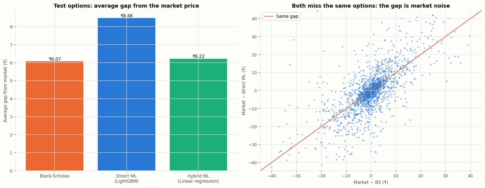
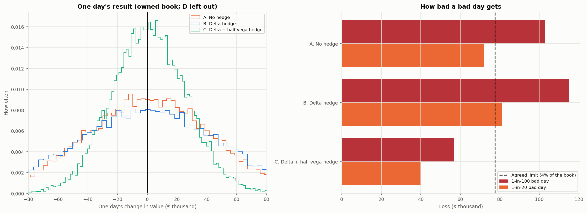

# Module 8 — Derivatives: module report

## Final report

**Business question (brief, verbatim):** "NovaFin has exposure to equity options. Management wants to know: Can ML improve option pricing and help manage derivatives exposure?"

**Final output:** `outputs/FINAL_M8_module_output.xlsx` (Read me with column guide · Key numbers · Board actions · T1 BS benchmark · T2 ML pricing · T2 pricing by stock · T2 hedging choices · T2 hedge scenarios · T2 loss chances · T2 loss chances (written) · T2 running the hedge · T2 choice rule · T2 hedge by stock · Hand-off to Module 9 · Decisions · Evidence index). Task reports: `task1_report.md`, `task2_report.md`.

### Terms

| Term | What it is, simply | Example |
| --- | --- | --- |
| Option, call, put | The right (not duty) to buy (call) or sell (put) a stock at a fixed price (strike) by a date | Right to buy at ₹1,500; stock at ₹1,700 → worth ₹200 |
| Spot | The stock's price today | ₹1,450 |
| Black-Scholes (BS) | The standard formula for an option's fair price from spot, strike, time, volatility, rate | Call ₹107.20 in the worked example |
| Gap | Market price − BS price | +₹2.80 |
| Direct / hybrid ML | ML predicting the price without BS / BS + a learned correction | — |
| Delta, gamma, vega, theta | Option ₹ change for: stock +₹1 / how delta changes / volatility +1 point / one day | Delta 0.6 → +₹0.60 |
| Delta hedge | Shares held to cancel the book's stock exposure | Sell ₹22.6 lakh of shares |
| Vega hedge | Options sold so the book stops gaining or losing when volatility changes; shares can't do this | Sell 1-year at-the-money calls |

## 1. The answer in brief

**Pricing: ML doesn't improve on Black-Scholes on this data. Exposure: yes — BS's Greeks show volatility is the book's biggest risk, and a delta + half vega hedge cuts the bad days by almost half (1-in-100 bad day −₹1.03 lakh → −₹56,653).**

| Finding | Number |
| --- | --- |
| BS is close to the market | Average gap ₹5.84 (about 3.1% of price), no bias (+₹0.05) |
| The gap has no pattern | Direction differs in no group; a learned correction makes it worse |
| ML on 2,000 unseen options | BS ₹6.07 · hybrid ML ₹6.22 (₹0.15 worse) · direct ML ₹8.48 (₹2.41 worse); BS best in 12 of 12 groups |
| The book (one unit of each option) | Worth ₹19.4 lakh; moves like ₹22.6 lakh of shares |
| Biggest risk | Volatility falling 5 points: −₹2.40 lakh (a 5% stock fall: −₹0.80 lakh) |
| 1-in-100 bad day: no hedge / delta only / **delta + half vega** | −₹1.03 lakh / −₹1.15 lakh (worse) / **−₹56,653** |
| Running C | ≈ ₹10,900 day 1; ≈ ₹45,500 a year of daily re-hedging (252 trading days, the usual count for option volatility); ≈ ₹13.3 lakh cash tied up |
| Data issue | Every option on a "stock" has its own spot and volatility: pricing unaffected; full vega hedge (D) unreliable |
| By stock | BS best in 13 of 15; stock exposure SBIN ₹2.08 lakh to TITAN ₹0.78 lakh; volatility risk similar in every stock |

**Recommendations:**
1. **Keep pricing with Black-Scholes;** don't deploy ML pricing (it would add ₹1,500–₹24,000 of mispricing per 10,000 options).
2. **Hedge with choice C, delta + half vega:** sell 3,813 one-year at-the-money calls (₹8.7 lakh received) and buy ≈ ₹22.0 lakh of shares (a holding, not a cost); reset the shares daily. 1-in-100 bad day −₹1.03 lakh → −₹56,653; costs ≈ ₹10,900 on day 1 and ≈ ₹45,500 a year; ≈ ₹13.3 lakh cash tied up.
3. **Don't use a delta-only hedge:** worse than no hedge on bad days (−₹1.15 lakh) and the costliest to run (₹77,500 a year).
4. **The Board sets the 1-in-100 bad-day limit; the choice rule picks the hedge:** 3%–5% of the book → C (4% agreed default); 6% → no hedge.
5. **Revisit ML with real market data** (price history, implied volatility), where smiles and estimation errors give ML something to learn.

## 2. The chain

Option data → BS price and Greeks (Task 1) → where BS misses (nowhere systematic) → ML vs BS on unseen options (Task 2) → hedge with BS Greeks → recommendation.

## 3. Task 1: Black-Scholes benchmark

- **10,000 options** on 15 stocks, one pricing day (31 Aug 2026); our BS matches the file within ₹0.27.
- **Gap market − BS:** MAE ₹5.84 (95% range ₹5.69–₹6.01), RMSE ₹9.81, bias +₹0.05 (range includes 0). It grows with price (₹1.48 → ₹14.42 by price fifth), at about 2.3–3.5% of price.
- **No pattern:** the direction of the gap differs by no call/put, moneyness, maturity, volatility, price or stock group (line 0.004). A LightGBM correction: R² −0.10.
- **359 impossible prices** (below the lowest logical price), all in the money: flagged as data errors.
- **Book risk:** ₹22.6 lakh of stock exposure; −5% → −₹0.80 lakh, +5% → +₹1.44 lakh; −₹2,068 a day; +₹50,463 per volatility point.

## 4. Task 2: ML pricing

| Pricer (test, 2,000 options) | Average gap | vs BS (95% range) |
| --- | --- | --- |
| Black-Scholes | ₹6.07 | — |
| Direct ML (LightGBM) | ₹8.48 | ₹2.09–₹2.71 worse |
| Hybrid ML (BS + linear correction) | ₹6.22 | ₹0.07–₹0.23 worse; without impossible prices, no clear difference |

- Chosen by 5-fold checks before the test (direct LightGBM ₹8.02, hybrid linear ₹5.59, BS ₹5.54). The test confirmed the order.
- Trees and the neural network fitted training options ₹1.8–₹3.3 better than unseen ones: they learned noise.
- The hybrid's correction did no better than corrections learned on shuffled gaps (p = 1.0).
- Direct ML relies on BS's own inputs: it re-learned the formula, less accurately.

**Pricing by stock:** BS closest in 13 of 15 stocks; hybrid ahead in SBIN and SUNPHARMA by ₹0.14–₹0.17 per option (noise).

**Managing exposure: four hedging choices**

| Choice | What NovaFin does | 1-in-100 bad day | 1-in-20 bad month | Running cost |
| --- | --- | --- | --- | --- |
| A. No hedge | Nothing | −₹1.03 lakh | −₹3.16 lakh | ₹0 |
| B. Delta | Sell ₹22.6 lakh of shares, daily reset | −₹1.15 lakh (worse) | −₹3.58 lakh | ₹77,500 a year |
| **C. Delta + half vega** | Sell 3,813 calls; buy ₹22.0 lakh of shares | **−₹56,653** | **−₹1.65 lakh** | ₹10,900 + ₹45,500 a year |
| D. Delta + full vega | Sell 7,625 calls; buy ₹66.5 lakh of shares | "Never loses" — **not reliable** on this data | — | — |

- **Why shares can't hedge volatility:** a share's price doesn't depend on it; only other options can offset it. **The book's main risk is markets calming down** (volatility −5 points: −₹2.40 lakh), not a crash.
- **Chance of a losing day stays about 49% under A–C:** hedging changes how much you can lose, not how often.
- **Checks:** with volatility moving half or twice as much, and for a written book, C still cuts the 1-in-100 bad day by 42% to 50%.
- **Choice rule:** the Board sets the most it accepts losing on a 1-in-100 bad day; pick the least trading within it. 3%–5% of the book → C (4% agreed default); 6% → no hedge; 2% → none of A–C reaches it.

## 5. Hand-off to Module 9 (workbook, Hand-off tab)

| Figure | Value | Status |
| --- | --- | --- |
| ML pricing better than BS? | No | Measured |
| Average gap BS / direct / hybrid | ₹6.07 / ₹8.48 / ₹6.22 per option | Measured |
| Book value / stock exposure | ₹19.4 lakh / ₹22.6 lakh | Measured + Assumption (one unit each) |
| 1-in-100 bad day, A / B / C | −₹1.03 lakh / −₹1.15 lakh / −₹56,653 | Simulated (assumptions stated) |
| Recommended hedge (C) | Sell 3,813 calls, buy ≈ ₹22.0 lakh of shares; ≈ ₹10,900 day 1, ≈ ₹45,500 a year; ≈ ₹13.3 lakh cash tied up | Measured + Assumption |
| Choice rule | Board's 1-in-100 bad-day limit → least trading within it | Conclusion |
| Time decay / volatility risk | −₹2,068 a day / ₹50,463 per point (C: −₹603 / ₹25,232) | Measured |

**For Module 9:** no capital for ML pricing. Hedging choice C ties up about ₹13.3 lakh of cash, costs about ₹45,500 a year to run, and cuts the 1-in-100 bad day by 45%, to about ₹56,653. If Module 9 sets a different loss limit, the workbook's choice-rule tab gives the matching hedge.

## 6. Key decisions

| ID | Decision | Why |
| --- | --- | --- |
| M8-01 | Calculate BS ourselves; check vs file | Brief: "calculate" |
| M8-06 | Compare in ₹; % only for options ≥ ₹1 | % misleads on cheap options |
| M8-07 | Breakdowns with tests | Shows whether there's a pattern for Task 2 |
| M8-08, M8-12 | Impossible prices flagged; excluded from training | Data errors |
| M8-02 | Direct and hybrid ML | Re-decided after Task 1 |
| M8-03 | 80/20 random, 5-fold choice, test once | One pricing day |
| M8-13 | Better = lower ₹ and % gap with 95% range above 0 | Same measures as Task 1 |
| M8-14 | Hedge with BS Greeks | ML didn't beat BS |
| M8-15 | Four hedging choices; choice rule on the 1-in-100 bad day; default C (4% limit) | Volatility is the biggest risk; shares can't hedge it |
| M8-17 | How often and how badly each hedge loses (100,000 simulated days); running costs | Scenarios alone showed how bad, not how likely |
| M8-18 | Data check: one price per stock? (no) | Hedges in ₹; D unreliable |
| M8-19 | Volatility scenarios in Task 1 | Biggest risk |
| M8-20 | Owned as main view; written book checked | Not in the data or brief |
| M8-16 | Every result by stock | Project rule: by-group breakdowns |

### Module 9 inputs: protecting the capital Module 9 puts into equities (decision M8-21; Task 2 step 9e)

**Why:** "Derivatives hedging" in Module 9 means protecting NovaFin's own exposures. The biggest is the equity money (Module 6: a 20% crash costs ₹20 crore per ₹100 crore, and diversification can't remove it). Module 8 had hedged only its own option book.

**How:** a 1-year put on the equity holding (the right to sell it at a floor), priced with Black-Scholes at Module 6's real-market swing (19.4%) and the 6.8% risk-free rate, plus 1% trading costs; checked at 25% (real puts often cost more).

| Floor | Priced at | Cost a year (per ₹100 crore) | Normal year after cost | Stocks −10% | **Stocks −20%** | Stocks −30% |
| --- | --- | --- | --- | --- | --- | --- |
| 100% | Module 6 swing (19.4%) | ₹4.67 crore | 10.9% | ₹-4.7 crore | **₹-4.7 crore** | ₹-4.7 crore |
| 100% | Check: puts priced dearer (25.0%) | ₹6.75 crore | 8.8% | ₹-6.8 crore | **₹-6.8 crore** | ₹-6.8 crore |
| 90% | Module 6 swing (19.4%) | ₹1.81 crore | 13.8% | ₹-11.8 crore | **₹-11.8 crore** | ₹-11.8 crore |
| 90% | Check: puts priced dearer (25.0%) | ₹3.33 crore | 12.3% | ₹-13.3 crore | **₹-13.3 crore** | ₹-13.3 crore |
| 80% | Module 6 swing (19.4%) | ₹0.49 crore | 15.1% | ₹-10.5 crore | **₹-20.5 crore** | ₹-20.5 crore |
| 80% | Check: puts priced dearer (25.0%) | ₹1.31 crore | 14.3% | ₹-11.3 crore | **₹-21.3 crore** | ₹-21.3 crore |

*Unprotected: −₹10 / −₹20 / −₹30 crore; normal year 15.6%.*

- **A 90% floor costs about ₹1.8 crore a year per ₹100 crore** (₹3.3 crore if puts are priced dearer): a 20% crash then costs ₹11.8 crore instead of ₹20 crore, and a normal year earns 13.8% instead of 15.6%.
- **A 100% floor is expensive** (₹4.7 crore a year, cutting the return to 10.9%); **an 80% floor** is cheap (₹0.5 crore) but only helps in a crash beyond 20%.
- **Module 7 link:** timing the equity money's own trades (Module 6 turnover about 0.8× a year) saves about 0.01% a year: real but small.
- The option book's own hedge (choice C) is also in the Module 9 inputs tab.

## 7. Limitations

- **The data looks simulated:** market = BS ± about 3% noise, with each option's own volatility given. Real markets have volatility smiles and estimated volatility, where ML can add value. The "no" is about this data.
- **Every option on a "stock" has its own spot and volatility:** a real stock has one of each; this makes the full vega hedge (D) look perfect when it wouldn't be.
- **Owned vs written** isn't in the data; results shown for both.
- **One pricing day:** no test of hedge performance over time; the simulation's assumptions (correlation 0.4, volatility moves of about 1 point a day) are checked but not measured.
- **Volatility is moved by the same points for every option;** option trading cost (1% of premium) is an assumption.
- **One unit of each option;** options on the same stock carry different spot prices, so the hedge is sized in ₹.
- **No dividends.**
