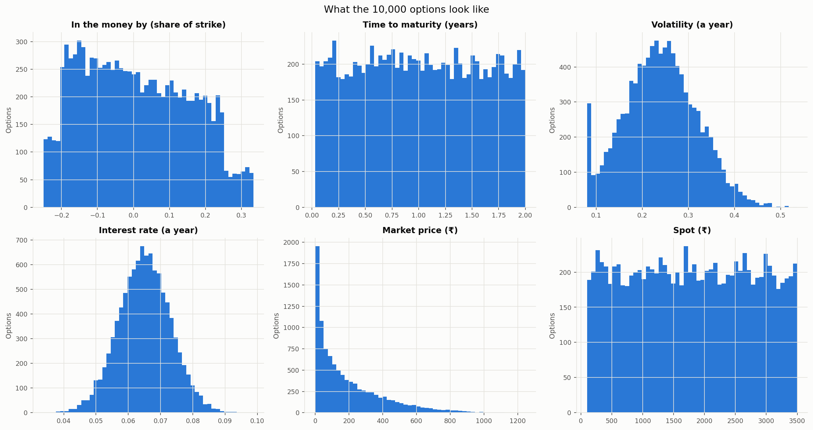
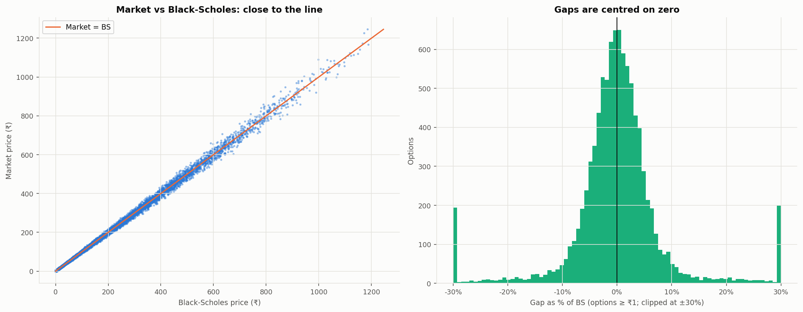
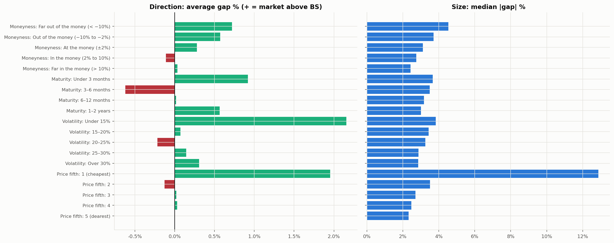
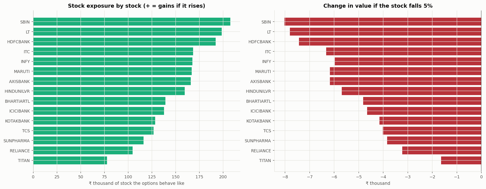

# Module 8 — Task 1 report: Black-Scholes benchmark

**Business question (brief, verbatim):** "NovaFin has exposure to equity options. Management wants to know: Can ML improve option pricing and help manage derivatives exposure?"

**Task 1 (brief, verbatim):** "Task 1 — Black-Scholes benchmark. Calculate theoretical option price. Compare: BS Price with: Market Price"

**Where the numbers come from:** `notebooks/m08_task1_bs_benchmark.ipynb`. Final file: `outputs/task1/FINAL_M8_T1_bs_benchmark.csv` (one row per option, with a plain-words explanation). Also in the module workbook `outputs/FINAL_M8_module_output.xlsx`.

## Terms

| Term | What it is, simply | Example |
| --- | --- | --- |
| Option | The right, not the duty, to buy or sell a stock at a fixed price by a fixed date | Pay ₹100 for the right to buy Reliance at ₹1,500 within 6 months |
| Call / put | Right to buy (gains if the stock rises) / right to sell (gains if it falls) | Strike ₹1,500, stock ₹1,700: call worth ₹200 |
| Strike / spot | The fixed price in the option / the stock's price today | ₹1,500 / ₹1,450 |
| Time to maturity | Years left until the option ends | 0.5 = 6 months |
| Volatility | How much the stock swings in a year; more swing = option worth more | 25% |
| In / out of the money | Would using the option today pay? | Call, spot ₹1,700, strike ₹1,500: 13% in the money |
| Black-Scholes (BS) | Standard formula for an option's fair price from spot, strike, time, volatility and rate | Spot 1,500, strike 1,550, 0.5 yr, 25%, 7% → call ₹107.20 |
| Gap | Market price − BS price | ₹110 − ₹107.20 = +₹2.80 |
| MAE / RMSE / bias | Average gap size / typical gap with big misses counted extra / average signed gap | Gaps +2, −4 → 3, 3.2, −1 |
| No-arbitrage floor | Lowest logical price; below it, buying would be free money | Call: spot − today's value of the strike |
| Delta / gamma / vega / theta | Option ₹ change for: stock +₹1 / how fast delta changes / volatility +1 point / one day passing | Delta 0.6: stock +₹1 → option +₹0.60 |

## 1. Summary

**Black-Scholes prices these options well: the market is on average ₹5.84 (about 3%) away, with no direction and no pattern a model could learn. Its Greeks show the book behaves like ₹22.6 lakh of stock, loses about ₹2,068 a day to time, and that volatility is its biggest risk.**

| # | Finding | Number |
| --- | --- | --- |
| 1 | Our BS matches the file's | Within ₹0.27 (rounding) |
| 2 | BS is close to the market | Average gap ₹5.84 (95% range ₹5.69–₹6.01); typical gap 3.1% of price; 69% within ±5% |
| 3 | BS is not biased | Average gap +₹0.05 (range −₹0.14 to +₹0.25, includes 0) |
| 4 | No pattern | Direction of the gap is the same in every group; a learned correction makes prices worse (R² −0.10) |
| 5 | Data errors | 359 market prices (3.6%) below the lowest logical price |
| 6 | Book risk (one unit each) | Worth ₹19.4 lakh; like ₹22.6 lakh of stock; −5% in all stocks → −₹0.80 lakh; **volatility −5 points → −₹2.40 lakh (biggest risk)**; −₹2,068 a day |
| 7 | Data issue | Every option on a "stock" has its own spot and volatility: pricing unaffected; hedges in ₹ |

## 2. The data (exploration)




**10,000 options on 15 large Indian stocks, all priced on 31 Aug 2026; no missing values.**

| What | Range / split | Meaning |
| --- | --- | --- |
| Calls / puts | 4,945 / 5,055 | Balanced |
| Stocks | 15, 624–702 options each | No stock dominates |
| In the money by | −25% to +33% (median −0.5%) | 29% far out of the money, 8% at the money, 30% far in the money |
| Time to maturity | 2 weeks to 2 years; half over 1 year | Mostly long-dated |
| Volatility | 8% to 54% a year (median 24%) | Typical for Indian large caps |
| Market price | ₹0.01 to ₹1,246 (median ₹124) | 390 options worth under ₹1 |
| Links between inputs | All near 0 except spot–strike (0.97) | Strikes are set near the spot, as in real markets |

Far-in-the-money options are 30% of options but **₹10.8 lakh of the ₹19.4 lakh book value** (they cost most).

### Data check: one price per stock? (decision M8-18)

| Check | Result | What it means |
| --- | --- | --- |
| Spot prices per stock on the one pricing day | 623–702 different spots per stock, ₹100–₹3,500 | A real stock has one price on a day: the stock label doesn't tie options together |
| Volatility per stock | Hundreds of different values | Same |
| Effect on pricing | None | BS uses each row's own inputs |
| Effect on risk | Small (₹42,500 vs ₹40,500 for a 1-in-100 day's stock-move risk, grouped vs separate) | Risk and hedges are added up in ₹; share counts per stock aren't meaningful |

## 3. Black-Scholes price (decision M8-01)

```text
d1 = [ln(spot ÷ strike) + (rate + volatility² ÷ 2) × time] ÷ (volatility × √time);   d2 = d1 − volatility × √time
Call = spot × N(d1) − strike × e^(−rate × time) × N(d2);   Put = strike × e^(−rate × time) × N(−d2) − spot × N(−d1)
N(x) = chance a bell-curve value is below x;   e^(−rate × time) = today's value of ₹1 paid at the end
```

**In words:** a call is worth the stock you'd likely receive minus today's value of the strike you'd likely pay. Our price matches the file's within ₹0.27 for every option.

## 4. How close is BS to the market? (decision M8-06)




| Measure | Value | 95% range | Good or bad? |
| --- | --- | --- | --- |
| Average gap (MAE) | **₹5.84** | ₹5.69–₹6.01 | Small next to a typical price of ₹124–₹194 |
| Typical gap, big misses extra (RMSE) | ₹9.81 | ₹9.51–₹10.14 | A few larger misses |
| Bias | **+₹0.05** | −₹0.14 to +₹0.25 | No bias |
| Median gap (% of BS, options ≥ ₹1) | **3.1%** | — | Typical miss |
| Within ±5% | 69% | — | Most options |
| More than 20% away | 6.1% | — | Mostly cheap options |

| BS price fifth | Price range | Average gap | Median gap % |
| --- | --- | --- | --- |
| 1 (cheapest) | ₹0–₹26 | ₹1.48 | 12.9% |
| 2 | ₹26–₹82 | ₹2.11 | 3.5% |
| 3 | ₹82–₹177 | ₹3.91 | 2.7% |
| 4 | ₹177–₹343 | ₹7.28 | 2.5% |
| 5 (dearest) | ₹343–₹1,188 | ₹14.42 | 2.3% |

**The gap grows with price, staying around 2.3–3.5% of it**; for the cheapest options a few rupees is a big %. The gap is mostly small with a few large ones (tail weight 9.7, where 0 = bell curve).

## 5. Where does BS miss? (decision M8-07)




**Nowhere in particular: the gap has no direction in any group.**

| Breakdown | Direction differs? (p, line 0.004) | Size differs? | Reading |
| --- | --- | --- | --- |
| Call or put | No (0.24) | Yes | Size follows price |
| Moneyness | No (0.57) | Yes | Far-out options: bigger % gap (cheaper) |
| Maturity | No (0.18) | Yes | Same |
| Volatility | No (0.32) | Yes | Same |
| Price fifth | No (0.49) | Yes | Same |
| Stock | No (0.52) | No (0.49) | All 15 stocks alike |

- **Link between each input and the gap's direction:** all between −0.003 and +0.017 (scale −1 to +1).
- **A flexible model (LightGBM) trying to predict the gap from the inputs** on options it hasn't seen: R² −0.10 (shuffled data: −0.02). The average gap rises from 6.61% to 6.85%. **There is no pattern to learn.**
- **Real markets often show a "volatility smile"** (far-out-of-the-money options dearer than BS). **This data doesn't:** the market here is BS plus about 3% random noise.

## 6. Impossible market prices (decision M8-08)

| | Count | Meaning |
| --- | --- | --- |
| Market price below the no-arbitrage floor | **359 (3.6%)**: 286 calls, 73 puts, all in the money | Data errors |
| BS below the floor | 0 | BS is always logical |
| Below intrinsic value (spot − strike, undiscounted) | 1,185 | **Not** an error for European options: the strike is paid only at the end |

They are deep in-the-money options worth little more than their floor; a normal negative gap pushes them below it. Their average gap is ₹12.62 vs ₹5.59 for the rest. **Kept and flagged here; Task 2 decides how to treat them.**

## 7. The option book's risk (decisions M8-04, M8-05; one unit of each option)




| Measure | Whole book | ₹ meaning |
| --- | --- | --- |
| Value at market | ₹19.4 lakh | — |
| Stock-equivalent exposure (delta × spot) | **₹22.6 lakh** | Moves like ₹22.6 lakh of shares; calls +₹55.3 lakh, puts −₹32.7 lakh |
| All stocks fall 5% | **−₹0.80 lakh** | Less than the ₹1.13 lakh a ₹22.6 lakh share holding would lose: options cushion falls (gamma) |
| All stocks rise 5% | **+₹1.44 lakh** | Gains more than it loses |
| Volatility +1 point | +₹50,463 | Gains if markets get jumpier |
| One day passing | **−₹2,068** | About ₹7.5 lakh a year: the cost of holding options |
| Largest exposures | SBIN ₹2.08 lakh, LT ₹1.98 lakh | Smallest TITAN ₹0.78 lakh |

**Volatility: the book's biggest risk (decision M8-19)**

| Scenario (owned book) | Change in value |
| --- | --- |
| Stocks −5% / +5% | −₹79,948 / +₹1,43,768 |
| **Volatility −5 points (markets calm down)** | **−₹2,39,685** |
| Volatility +5 points | +₹2,61,843 |
| Stocks −5% and volatility +5 (typical sell-off) | +₹1,80,001 |
| Stocks +5% and volatility −5 (calm rally) | −₹90,075 |

**A calm market hurts this book three times more than a 5% crash.** Shares can't hedge it (a share's price doesn't depend on volatility). **Owned or written?** The data and brief don't say; the main view is "owned" (M8-05). If NovaFin wrote these options, every sign flips; Task 2 checks both (M8-20).

**Valuing the book with BS instead of market prices** changes its total by only ₹530 (0.03%), because gaps cancel. Option by option they add up to ₹58,420 (3.0%).

## 8. What Task 1 means for Task 2

| What Task 1 found | What it means | Task 2 decision it affects |
| --- | --- | --- |
| No direction, no pattern; a learned correction makes prices worse | BS already uses all the information in the inputs | ML can at best match BS; judged against BS on unseen options |
| Gap ≈ 3% of price, growing with price | Compare in ₹ and %, by price group | Same measures as Task 1 |
| 359 impossible prices | Data errors | Train without them; report with and without |
| Book ≈ ₹22.6 lakh of stock; −5% → −₹0.80 lakh | Exposure is measurable now | Build the hedge |
| Volatility −5 points → −₹2.40 lakh | Biggest risk; shares can't hedge it | Compare hedges that include options |
| Spot and volatility differ for every option on a stock | Stock label isn't a real single stock | Hedges in ₹; distrust results that rely on mixing them |
| Owned or written not known | Every sign depends on it | Owned as main view; written as a check |

## 9. Limitations

- **One pricing day:** no history, so no test of how BS errors change over time.
- **Volatility is given per option:** in real markets it must be estimated, which is where most BS error comes from. Here BS gets the "right" volatility, which is why it fits so well.
- **One unit of each option:** real position sizes aren't in the data.
- **No dividends** in the BS formula.
