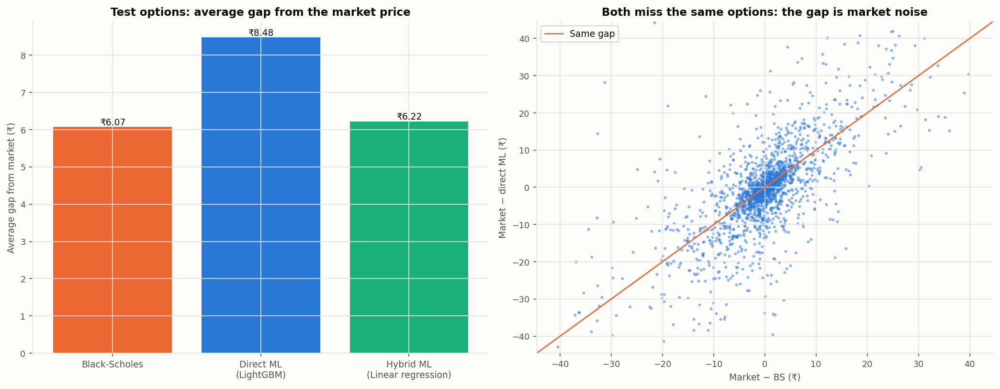
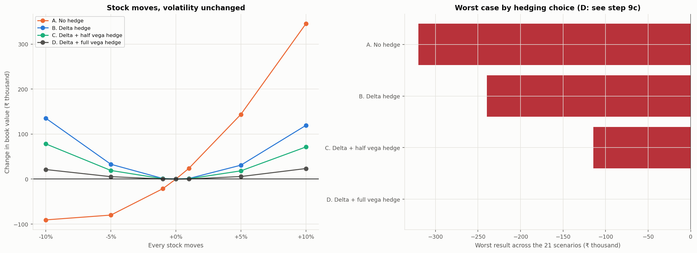
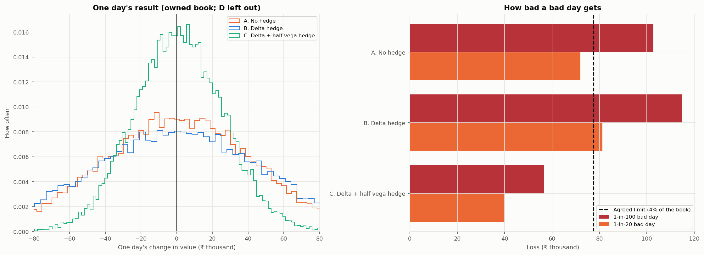

# Module 8 — Task 2 report: ML pricing vs Black-Scholes

**Business question (brief, verbatim):** "NovaFin has exposure to equity options. Management wants to know: Can ML improve option pricing and help manage derivatives exposure?"

**Task 2 (brief, verbatim):** "Task 2 — ML pricing. Predict: market price using ml models and compare performance w.r.t Black-Scholes"

**Where the numbers come from:** `notebooks/m08_task2_ml_pricing.ipynb`. Final file: `outputs/task2/FINAL_M8_T2_ml_pricing.csv` (each test option: BS, direct ML and hybrid ML prices vs market, the closest, why in words). Also in the module workbook `outputs/FINAL_M8_module_output.xlsx`.

## Terms

| Term | What it is, simply |
| --- | --- |
| Direct ML | The model learns the market price from the inputs alone, without the BS formula |
| Hybrid | BS price + a correction learned by ML |
| Linear regression / random forest / LightGBM / neural network | A weighted sum of inputs / many decision trees averaged / trees built one after another, each fixing the last one's errors / layers of simple units that can learn curved shapes |
| 5-fold check | Train on 4 of 5 parts of the training options, test on the 5th, rotate: picks the model without touching the test set |
| Paired comparison | BS and ML priced on the same unseen options; the ₹ difference gets a 95% range by resampling |
| Delta hedge | Hold shares that cancel the book's stock exposure, so small moves don't change its value |
| 1-in-100 bad day | The loss exceeded on only 1 day in 100: a standard way to size bad days (Value at Risk) |
| Vega hedge | Sell other options so the book no longer gains or loses when volatility changes (shares can't do this: their price doesn't depend on volatility) |
| Volatility point | A 1-point change in volatility, e.g. 24% → 25% a year |
| Gamma | Why owned options gain more on big moves than they lose: the one-sided shape a delta hedge leaves behind |

## 1. How Task 1 shaped Task 2 (decisions M8-02, M8-03, M8-10 to M8-14)

| Task 1 found | Task 2 decision |
| --- | --- |
| The gap market − BS has no direction and no pattern; a learned correction made prices worse | Test both direct ML and hybrid, honestly expecting neither to beat BS; judge against BS on the same unseen options (M8-02, M8-13) |
| Stock makes no difference (p 0.52) | No stock name as an input; no hold-out-stock test (M8-03, M8-10) |
| 359 impossible prices | Trained without them; test reported with and without (M8-12) |
| Book ≈ ₹22.6 lakh of stock; volatility −5 points → −₹2.40 lakh | Four hedging choices compared: 21 stress scenarios, and how often/badly each loses over 100,000 simulated days; choice rule on the 1-in-100 bad day; default C (M8-14, M8-15, M8-17) |
| Spot and volatility differ for every option on a stock | Hedges sized in ₹; D's "never loses" flagged unreliable (M8-18) |
| Owned or written not known | Owned as main view; written book checked (M8-20) |
| Results checked by group | By stock as well as by price, moneyness, call/put (M8-16) |

**Set-up:** 80% training (8,000 options → 7,709 after removing 291 impossible prices), 20% test (2,000, used once), random, seed 42. Inputs: spot ÷ strike, ln(spot ÷ strike), time, volatility, rate, call/put, volatility × √time; the hybrid also gets BS ÷ strike. Targets divided by the strike so cheap and dear stocks compare. Four models × two set-ups chosen by 5-fold checks.

## 2. Results

**In one sentence: on this data ML does not improve option pricing — Black-Scholes stays closest to the market — but BS's Greeks do help manage the exposure: they show volatility is the book's biggest risk, and a delta + half vega hedge cuts the bad days by almost half (1-in-100 bad day −₹1.03 lakh → −₹56,653).**

### ML vs Black-Scholes on 2,000 unseen options (decision M8-13)

| Pricer | Average gap from market | vs BS, per option (95% range) | Verdict |
| --- | --- | --- | --- |
| **Black-Scholes** | **₹6.07** | — | Benchmark |
| Direct ML (LightGBM, best of 4) | ₹8.48 | ₹2.41 worse (₹2.09 to ₹2.71 worse) | **Worse** |
| Hybrid ML (BS + linear correction, best of 4) | ₹6.22 | ₹0.15 worse (₹0.07 to ₹0.23 worse) | **Worse** |
| Hybrid, without the impossible prices | ₹5.83 vs BS ₹5.81 | ₹0.02 worse (range includes 0) | **No clear difference** |

| Check | Result | What it means |
| --- | --- | --- |
| 5-fold checks on training options | Best direct ₹8.02, best hybrid ₹5.59, BS ₹5.54 | Same order as the test: settled before the test was opened |
| Overfitting | Trees and the neural network fit their training options ₹1.8–₹3.3 better than unseen ones | They learned noise — there was nothing else to learn |
| By price fifth, moneyness, call/put | **BS best in 12 of 12 groups** | No corner of the book where ML wins |
| Shuffled-correction test | Real correction ₹6.22 vs shuffled ₹6.13; p = 1.0 | The hybrid's correction learned nothing real |
| What direct ML relies on | How far the stock is from the strike, call/put, total expected swing | Exactly BS's own inputs: it re-learned the formula, less accurately |
| BS and ML miss the same options | Link 0.73 | The gap is market noise that no pricer can predict |
| Closest to market, option by option | BS 751, direct ML 643, hybrid 606 of 2,000 | No pricer dominates individual options; BS wins most |

**Why:** Task 1 showed the market price here is BS ± about 3% random noise. A model can only learn patterns, and there are none.

### Pricing by stock (step 6b)

| | Result |
| --- | --- |
| BS closest to market | **13 of 15 stocks** |
| Where hybrid ML is closest | SBIN (₹6.69 vs ₹6.84) and SUNPHARMA (₹6.39 vs ₹6.56): ₹0.14–₹0.17 per option on about 135 options, within noise (Task 1: stock makes no difference, p 0.49) |
| Direct ML | Worse than BS in every stock (₹0.9–₹4.6 per option) |

### Managing exposure: four hedging choices (decisions M8-14, M8-15, M8-17, M8-20)

**The book has two risks** (Task 1): stock prices (it moves like ₹22.6 lakh of shares) and **volatility** (a 5-point fall, when markets calm down, costs ₹2.40 lakh, three times a 5% stock fall). **Shares can't hedge volatility** (a share's price doesn't depend on it), so only selling other options can.

| Choice | What NovaFin does |
| --- | --- |
| A. No hedge | Nothing |
| B. Delta hedge | Sell ₹22.6 lakh of shares, reset daily |
| **C. Delta + half vega (recommended)** | Sell 3,813 one-year at-the-money calls (₹8.7 lakh received); **buy** ₹22.0 lakh of shares to balance them; shares reset daily |
| D. Delta + full vega | Sell 7,625 calls (₹17.3 lakh); buy ₹66.5 lakh of shares |

**How often and how badly each loses** (100,000 simulated days; owned book):

| | A. None | B. Delta | **C. Delta + half vega** | D |
| --- | --- | --- | --- | --- |
| Chance of a losing day | 49% | 50% | 49% | 0% (not real, see below) |
| 1-in-20 bad day | −₹71,904 | −₹81,275 | **−₹39,928** | — |
| **1-in-100 bad day** | **−₹1.03 lakh** | **−₹1.15 lakh (worse than none)** | **−₹56,653** | — |
| 1-in-20 bad month | −₹3.16 lakh | −₹3.58 lakh | **−₹1.65 lakh** | — |
| Worst of 21 stress scenarios | −₹3.20 lakh | −₹2.40 lakh | −₹1.15 lakh | ₹0 |

**What running each hedge involves:**

| | B. Delta | **C. Delta + half vega** |
| --- | --- | --- |
| Day 1 | Sell ₹22.6 lakh of shares (needs margin) | Buy ₹22.0 lakh of shares; sell 3,813 calls (needs margin) |
| Cash tied up | Short sale: cash received but margin needed | **≈ ₹13.3 lakh** (₹22.0 lakh shares − ₹8.7 lakh premium) |
| Day-1 charges | ₹2,257 | ₹10,867 |
| How often reset | Shares every day | Shares every day; calls when the book changes |
| Shares traded on a typical day | ₹3.1 lakh | ₹1.8 lakh |
| Re-hedging charges a year | ₹77,500 | **₹45,500** |

**What it shows:**
- **No hedge changes how *often* you lose** (about half of all days, mostly by small amounts); hedging changes **how much**. C cuts the 1-in-100 bad day by 45% and the 1-in-20 bad month by 48%.
- **The ₹22 lakh of shares in C is not a cost:** it is a holding that can be sold back. The costs are about ₹10,900 on day 1, ≈ ₹45,500 a year of re-hedging charges (252 trading days, the usual count for option volatility), and ≈ ₹13.3 lakh of cash tied up.
- **Delta-only (B) is worse than no hedge.** Volatility usually rises when stocks fall, which partly protects a book that owns options; hedging only the stock moves removes that protection and leaves the volatility risk bare. It also costs the most to keep running.
- **D's "never loses" is not real.** Options on the same "stock" here carry different spot prices and volatilities (Task 1), so selling one 1-year call per stock against them creates a gain no real market would allow. D is flagged unreliable and left out of the choice rule.
- **Checks:** if volatility moves half or twice as much as assumed, C still cuts the 1-in-100 bad day by 46% to 50% (₹55,327 → ₹27,573; ₹2.13 lakh → ₹1.15 lakh). **If NovaFin wrote (sold) these options instead,** every risk flips, and C still cuts the bad day by 42% (₹1.05 lakh → ₹60,949).

**The choice rule (for the Board and Module 9):** the Board sets the most it accepts losing on a 1-in-100 bad day; pick the least trading within it (D excluded).

| Board's limit (share of the ₹19.4 lakh book) | Choice |
| --- | --- |
| 2% (₹38,791) | None of A–C reaches it (would need a fuller vega hedge, not reliable on this data) |
| 3%–5% (₹58,186–₹96,977) | **C** (4% = ₹77,581 is the agreed default) |
| 6% (₹1.16 lakh) | A (no hedge) |

**By stock (choice C):** each stock needs 230–275 calls sold and ₹0.9–₹2.0 lakh of shares bought. Volatility sensitivity is almost the same in every stock (₹3,000–₹3,700 per point); stock exposure differs most (SBIN ₹2.08 lakh, TITAN ₹0.78 lakh). Amounts are in ₹: share counts per stock are not meaningful on this data.

### In ₹

| Pricer | Average gap per option | Across the 10,000-option book | Per ₹1 crore of options |
| --- | --- | --- | --- |
| Black-Scholes | ₹6.07 | ₹0.61 lakh | ₹3.08 lakh |
| Hybrid ML | ₹6.22 | ₹0.62 lakh | ₹3.15 lakh |
| Direct ML | ₹8.48 | ₹0.85 lakh | ₹4.30 lakh |

Switching from BS to the best ML would add about ₹1,500 of mispricing across the book (direct ML: ₹24,000).

### The recommendation

| # | Action | Why | ₹ |
| --- | --- | --- | --- |
| 1 | **Keep pricing with Black-Scholes; don't deploy ML pricing** | ML was worse on unseen options, in 13 of 15 stocks and all 12 groups | Avoids ₹1,500–₹24,000 more mispricing per 10,000 options |
| 2 | **Hedge with choice C: delta + half vega; shares reset daily** | Cuts bad days by 45% and bad months by 48%; covers stock moves and half the volatility risk | 1-in-100 bad day −₹1.03 lakh → −₹56,653; ≈ ₹10,900 day 1 + ≈ ₹45,500 a year; ≈ ₹13.3 lakh cash tied up |
| 2b | **Don't use a delta-only hedge** | Worse than no hedge on bad days, and the costliest to run | 1-in-100 bad day −₹1.15 lakh; ₹77,500 a year |
| 3 | **The Board sets the 1-in-100 bad-day limit; the choice rule picks the hedge** | Agreed default 4% of the book → C | See the rule table |
| 4 | **Revisit ML when real market data is available** | Real markets have volatility smiles and estimated volatility, where ML can help; this data has neither | Needs a history of market prices and implied volatility |

**Answer to management:** "Can ML improve option pricing?" — **not on this data**; BS is already as close as anything can get. "Help manage derivatives exposure?" — **yes, through the Greeks**: they show the main risk is volatility, and a delta + half vega hedge cuts the bad days by almost half (1-in-100: −₹1.03 lakh → −₹56,653).

### Module 9 inputs: protecting the capital Module 9 puts into equities (decision M8-21; Task 2 step 9e)

**Why:** "Derivatives hedging" in Module 9 means protecting NovaFin's own exposures. The biggest is the equity money (Module 6: a 20% crash costs ₹20 crore per ₹100 crore, and diversification can't remove it). Module 8 had hedged only its own option book.

**How:** a 1-year put on the equity holding (the right to sell it at a floor), priced with Black-Scholes at Module 6's real-market swing (19.4%) and the 6.8% risk-free rate, plus 1% trading costs; checked at 25% (real puts often cost more).

| Floor | Priced at | Cost a year (per ₹100 crore) | Normal year after cost | Stocks −10% | **Stocks −20%** | Stocks −30% |
| --- | --- | --- | --- | --- | --- | --- |
| 100% | Module 6 swing (19.4%) | ₹4.67 crore | 10.9% | ₹-4.7 crore | **₹-4.7 crore** | ₹-4.7 crore |
| 100% | Check: puts priced dearer (25.0%) | ₹6.75 crore | 8.8% | ₹-6.8 crore | **₹-6.8 crore** | ₹-6.8 crore |
| 90% | Module 6 swing (19.4%) | ₹1.81 crore | 13.8% | ₹-11.8 crore | **₹-11.8 crore** | ₹-11.8 crore |
| 90% | Check: puts priced dearer (25.0%) | ₹3.33 crore | 12.3% | ₹-13.3 crore | **₹-13.3 crore** | ₹-13.3 crore |
| 80% | Module 6 swing (19.4%) | ₹0.49 crore | 15.1% | ₹-10.5 crore | **₹-20.5 crore** | ₹-20.5 crore |
| 80% | Check: puts priced dearer (25.0%) | ₹1.31 crore | 14.3% | ₹-11.3 crore | **₹-21.3 crore** | ₹-21.3 crore |

*Unprotected: −₹10 / −₹20 / −₹30 crore; normal year 15.6%.*

- **A 90% floor costs about ₹1.8 crore a year per ₹100 crore** (₹3.3 crore if puts are priced dearer): a 20% crash then costs ₹11.8 crore instead of ₹20 crore, and a normal year earns 13.8% instead of 15.6%.
- **A 100% floor is expensive** (₹4.7 crore a year, cutting the return to 10.9%); **an 80% floor** is cheap (₹0.5 crore) but only helps in a crash beyond 20%.
- **Module 7 link:** timing the equity money's own trades (Module 6 turnover about 0.8× a year) saves about 0.01% a year: real but small.
- The option book's own hedge (choice C) is also in the Module 9 inputs tab.

## 3. Limitations

- **One pricing day and given volatility:** the data has no volatility smile and no estimation error, the two places real ML pricing helps. The conclusion is about this data, not options in general.
- **Hedges are reset daily;** resetting costs charges not modelled beyond the first trade.
- **Volatility moves the same number of points for every option** in the scenarios; in real markets short- and long-dated volatility move differently, which a 1-year hedge call covers only partly.
- **Option trading cost (1% of premium) is an assumption;** exchange margin on short positions is not modelled.
- **The simulation assumes** stocks move together at correlation 0.4, volatility moves about 1 point a day and rises when stocks fall (checked at 0.5 and 2 points).
- **Options on the same stock carry different spot prices in the data,** so share hedges are sized in ₹, not in share counts.
- **One unit of each option** (position sizes are not in the data).
