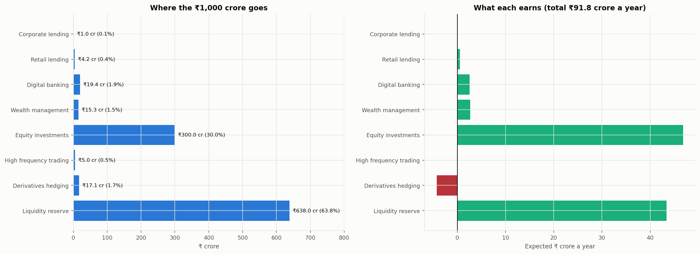
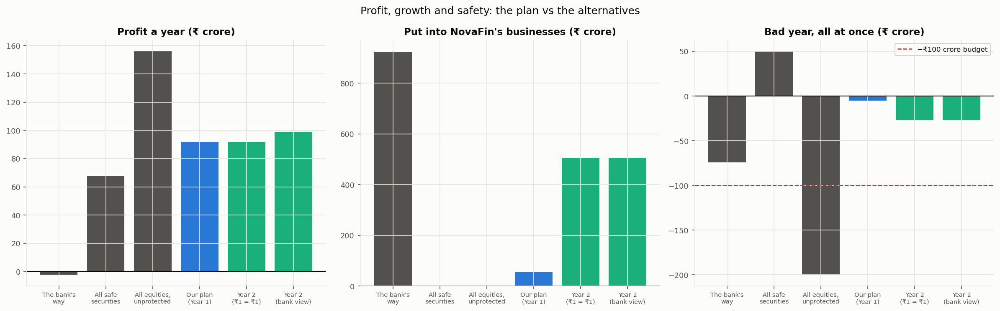
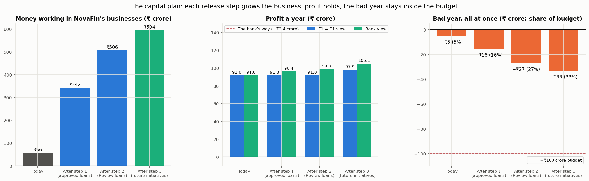
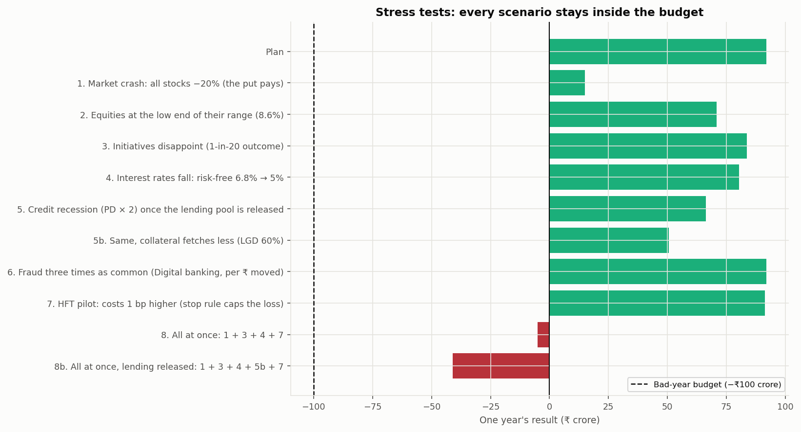
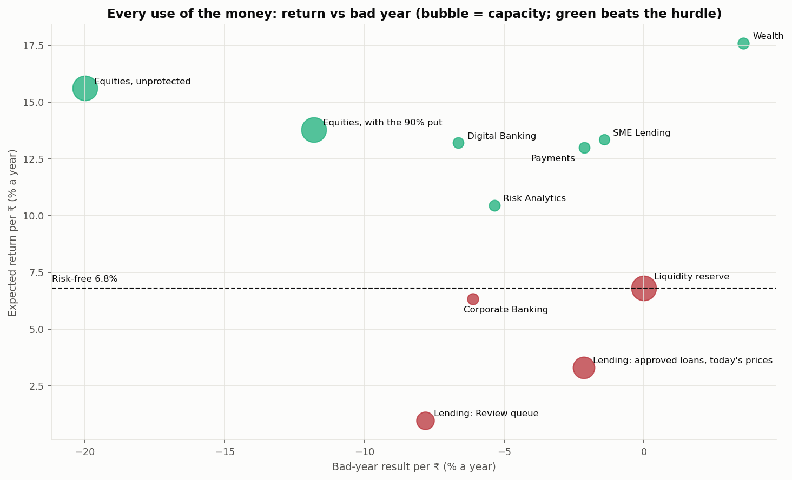

# Module 9 — Integrated capital allocation of ₹1,000 crore

## Final report

**The Board's question (brief, verbatim):** "The Board gives NovaFin: ₹1,000 crore. Students must allocate this capital. Potential allocation categories: Corporate lending · Retail lending · Digital banking · Equity investments · Wealth management · High frequency trading · Derivatives hedging. Students should construct their own allocation. And give explanation." Section 2: "Where should NovaFin deploy its capital, what risks will it take, and how should those risks be controlled?"

**Final output:** `outputs/FINAL_M9_module_output.xlsx` (Read me · Key numbers · Board actions · Allocation · Use now · Reserve release plan · Capital plan stages · Plan vs alternatives · What the ML adds · Growth path · Decision framework · Integration map · ML scorecard · Evidence · Optimiser comparison · Stress tests · Lending leverage · Governance · Actions · Hand-off · Decisions · Evidence index). Notebook: `notebooks/m09_allocation.ipynb`.

## Terms

| Term | Simply | Example |
| --- | --- | --- |
| Risk-free rate (hurdle) | What safe government securities pay; a risky use must beat it | 6.8% a year |
| Return per ₹ deployed | Yearly profit ÷ money put in | ₹100 crore earning ₹13.8 crore = 13.8% |
| Bad-year result | What ₹1 earns or loses in a bad but plausible year | Equities with a put: −11.8% in a crash |
| Bad-year budget | The most the ₹1,000 crore may lose in a bad year: a loss limit, not an amount we allocate | ₹100 crore (10%) |
| Put (90% floor) | The right to sell the equity holding at 90% of today's value | Costs 1.81% a year |
| Leverage (bank view) | ₹1 of capital supports ₹8.3 of loans funded by deposits | 12% capital ratio |
| Stress test | The allocation's result in a set crisis | Crash + rates fall + initiatives fail |
| Re-pricing | Charging each loan a rate that matches its risk score | Approved loans need about 12.3% a year; they pay 8.75% today |
| Expected loss | The average credit loss expected on a loan in a year | ₹100 lent, 20% chance of default, 40% lost if it defaults → ₹8 |
| Release test | The measurable check that must pass before reserve money moves into a business | Re-priced loans earn at least 6.8% after expected loss |
| LGD (loss given default) | The share of a loan lost if the borrower defaults | 40% here; 60% in the harsher test |
| Floor | Reserve money that is never released: a different rule from the bad-year budget | ₹100 crore (10% of the ₹1,000 crore) |
| ALCO | The asset–liability committee: the CFO-led committee that manages the balance sheet and approves releases | Meets every quarter |

## 1. The answer
**In one sentence: put ₹300 crore into equities protected by a put, ₹51 crore into strategic initiatives (all but ₹1 crore in units that clear the 6.8% hurdle), ₹5 crore into an HFT pilot and ₹6 crore into hedging, and hold ₹638 crore in safe securities that are released in tested steps: ₹286 crore into re-priced approved loans, ₹164 crore into fixed Review loans and up to ₹88 crore into future initiatives, keeping a ₹100 crore floor. That earns about ₹91.8 crore a year (9.2%) now, against about −₹2 crore if the money went the bank's current way; even a crash, a rate cut and failing initiatives together cost only about ₹5 crore; and once lending is released, NovaFin's businesses hold ₹506 crore instead of ₹56 crore.**

### Where the ₹1,000 crore goes (Year 1)

| Category | ₹ crore | Share | Expected return | What the money buys |
| --- | --- | --- | --- | --- |
| Equity investments | 300.0 | 30.0% | 15.6% | All 15 stocks, equal weight (no ML stock-picking) |
| Digital banking | 19.4 | 1.9% | 13.1% | Digital Banking and Payments initiatives, only while the ML fraud rule runs |
| Wealth management | 15.3 | 1.5% | 17.6% | Wealth initiatives (one approved now) |
| Derivatives hedging | 17.1 | 1.7% | cost | Risk Analytics initiatives (₹11.5 crore), the 90% put on the equities (₹5.4 crore a year), option-book hedge C (₹0.1 crore) |
| High frequency trading | 5.0 | 0.5% | 0% planned | Trading pilot with a stop rule (order timing needs no capital) |
| Retail lending | 4.2 | 0.4% | 13.3% | SME initiatives; approved retail loans wait in the reserve until re-priced |
| Corporate lending | 1.0 | 0.1% | 6.3% | One approved Corporate Banking initiative; corporate loans wait until re-priced |
| Liquidity reserve | 638.0 | 63.8% | 6.8% | Government securities; ₹286 crore earmarked for re-priced lending |
| **Total** | **1,000** | | **9.2% (₹91.8 crore)** | |

### Is it better than what NovaFin would do anyway? (profit, growth, safety)

| Way to deploy ₹1,000 crore | Profit a year | Put into NovaFin's businesses | Bad year, all at once |
| --- | --- | --- | --- |
| The bank's way (every loan at today's prices, all 180 initiatives) | **−₹2.4 crore** | ₹923 crore | −₹74 crore |
| All in safe securities | ₹68.0 crore | ₹0 | +₹50 crore |
| All in equities, unprotected | ₹156 crore | ₹0 | **−₹200 crore** (twice the budget) |
| **Our plan, Year 1** | **₹91.8 crore** | ₹56 crore | **−₹5 crore** |
| **Year 2, after re-pricing** | ₹91.8 crore (₹99.0 crore in the bank view) | **₹506 crore** | −₹27 crore |

- **The bank's way loses money:** its lending earns 0.43% above expected losses (on actual losses it breaks even at a 0.48% cost of funds) and its initiatives lose 3.6% a year. Putting more money through today's practice lowers profit.
- **Growth comes from re-pricing, not from lending more at today's prices.** Approved loans need about 12.3% a year (8.75% today), Review loans about 15.6% (9.8%). Once re-priced loans pass the quarterly test, ₹450 crore moves from the reserve into lending.

### The capital plan: what we use now, and how the ₹638 crore reserve is put to work

**In one line: the reserve is a waiting room, not idle money. It earns ₹43.4 crore a year while it waits, ₹538 crore of it moves into lending and initiatives as each test is passed, and only a ₹100 crore floor stays safe for good.**

**1. What we put to work now (Year 1)**

| Use | ₹ crore | Earns a year | Bad year | Owner | First action |
| --- | --- | --- | --- | --- | --- |
| Equities: all 15 stocks, equal weight, with a 1-year 90% put | 305.4 | +₹41.4 crore | −₹35.4 crore (20% crash, the put pays) | Chief Investment Officer | Month 1: buy, with the put |
| Initiatives ready now: 1075 Wealth in full, 1062 Corporate Banking in stages | 3.2 | +₹0.5 crore | ₹0.0 crore | Head of Strategy | Now |
| Initiatives after review: Wealth, Payments, Digital Banking, Risk Analytics, SME | 48.2 | +₹6.6 crore | −₹1.0 crore (1-in-20 case) | Head of Strategy | Quarters 1–2, unit by unit |
| HFT trading pilot with a stop rule | 5.0 | ₹0 planned | −₹0.5 crore (stop rule) | Head of Trading | Now; decide after 1 quarter |
| Option book hedge (choice C) | 0.1 | ₹0.0 crore | Cuts the 1-in-100 bad day by 45% | Derivatives desk | Now, reset daily |
| **Liquidity reserve, released by the plan below** | **638.0** | **+₹43.4 crore** | +₹31.9 crore (rates fall to 5%) | Treasurer with ALCO | Now |
| **Total** | **1,000** | **₹91.8 crore (9.2%)** | **−₹5.1 crore, all at once** | | |

**2. The reserve release plan: what moves the ₹638 crore, and when**

| Step | ₹ crore | What it funds | Released when (the test) | Checked | Owner | If the test fails | Cost of releasing it now, at today's prices |
| --- | --- | --- | --- | --- | --- | --- | --- |
| 1 | 286 | Approved loans, re-priced | Re-priced loans earn at least 6.8% a year after expected loss (rate about 12.3%, 8.75% today); the scorecard stays stable (score drift PSI ≤ 0.25; defaults ≤ 1.5 × predicted in every band); the plan's combined bad year stays within ₹100 crore | Every quarter | Chief Risk Officer + Head of Lending; ALCO releases | Stays in the reserve, earning 6.8% | ₹10.0 crore a year |
| 2 | 164 | Review loans, fixed | The same test at about 15.6% (9.8% today), or the risk cut by collateral or a person checking each large loan; only after step 1 | Every quarter, after step 1 | Chief Risk Officer + Head of Lending; ALCO releases | Stays in the reserve | ₹9.6 crore a year |
| 3 | up to 88 | Future initiatives | Each project passes Module 1's rules: Expected NPV above 0, return above 6.8% a year, loss tolerance decides full or staged funding; Digital only while the fraud rule runs; combined bad year within ₹100 crore | At each project review | Head of Strategy; CFO approves | Not funded; stays in the reserve | — |
| Floor | 100 | Never released | At least 10% of the ₹1,000 crore stays safe, for withdrawals and a bad year | Every quarter | Treasurer with ALCO | — | — |
| **Total** | **638** | | | | | | **₹19.6 crore a year** if all loans went out today |

**3. What each stage changes: profit, growth, risk**

| Stage | When | Reserve | Loan book | Money working in NovaFin's businesses | Profit a year | Profit, bank view | Bad year, all at once (budget used) | Same, if collateral also fetches less (LGD 60%) | Profit above the bank's way |
| --- | --- | --- | --- | --- | --- | --- | --- | --- | --- |
| Today | Now | ₹638 crore | ₹0 | ₹56 crore | ₹91.8 crore | ₹91.8 crore | −₹5.1 crore (5%) | −₹5.1 crore (5%) | +₹94.2 crore |
| After step 1 | Quarterly test; planned in Year 2 | ₹352 crore | ₹286 crore | ₹342 crore | ₹91.8 crore | ₹96.4 crore | −₹15.5 crore (16%) | −₹31.1 crore (31%) | +₹94.2 crore |
| After step 2 | Year 2 | ₹188 crore | ₹450 crore | ₹506 crore | ₹91.8 crore | ₹99.0 crore | −₹27.0 crore (27%) | −₹57.0 crore (57%) | +₹94.2 crore |
| After step 3 (if like today's initiatives) | As projects pass review | ₹100 crore (the floor) | ₹450 crore | ₹594 crore | ₹97.9 crore | ₹105.1 crore | −₹33.1 crore (33%) | −₹63.1 crore (63%) | +₹100.3 crore |

- **Growth:** money working in NovaFin's own businesses grows from ₹56 crore to ₹506 crore after the two lending steps, and up to ₹594 crore with step 3, ten times today.
- **Profit:** never falls. Re-priced loans are planned at exactly the 6.8% hurdle, so in the ₹1 = ₹1 view lending earns what the reserve did; anything above the hurdle is upside. In the bank view (deposits fund 88% of each loan at 5%), profit rises to ₹99.0 crore, and to ₹105.1 crore with step 3.
- **Loss avoided:** lending the ₹450 crore today, at today's prices, would cost ₹19.6 crore a year against the reserve and lose money in a recession. Waiting for the test avoids that.
- **Risk:** the combined bad year grows as money goes to work, but uses at most a third of the ₹100 crore budget (−₹33.1 crore after step 3). If collateral also fetches less (60% of a defaulted loan lost instead of 40%), it reaches −₹57.0 crore after step 2 and −₹63.1 crore after step 3: still inside the budget. Every release is stress-tested first.

### What the ML adds

| Module | ₹ effect |
| --- | --- |
| Credit risk | +₹7.4 crore a year above actual losses, with ₹354 crore less lent at risk |
| Initiatives | +₹17.4 crore a year expected (the 33 the plan funds, ₹51.4 crore at 13.7%, instead of all 180 at −3.6%); mostly from the NPV, payback and hurdle rules, because the success model only screens slow payers (the risk rating alone gives a similar Review list: 31 vs 38) |
| Equities | +₹15.0 crore a year on ₹300 crore by **not** following ML stock picks that failed validation (measured over 43 months; the gap is not beyond luck, p 0.39) |
| Fraud | Saves ₹4.58 crore per ₹100 crore of money moved |
| HFT order timing | ₹3.43 crore a year (261 trading days) per ₹100 crore of orders a day |
| **Total of the first three** | **₹39.8 crore a year** against the same decisions without this work (the loan book, the 180 initiatives, the ₹300 crore of equities), before fraud and order-timing savings, which scale with volumes. The equities ₹15.0 crore is measured but not proven beyond luck (p 0.39) |

### How safe is it?

| Stress | Year's result |
| --- | --- |
| Plan | +₹91.8 crore |
| Market crash −20% (the put pays) | +₹15.0 crore |
| Equities at the low end (8.6%) | +₹70.8 crore |
| Rates fall to 5% | +₹80.3 crore |
| Credit recession with the approved loans released at today's prices (LGD 60%) | +₹50.6 crore |
| **All at once, today** | **−₹5.1 crore** |
| All at once, approved loans released at today's prices (LGD 60%) | −₹41.1 crore |
| All at once, all three steps released (loans re-priced, LGD 60%) | −₹63.1 crore |
| Reverse stress | With the put no crash can break the ₹100 crore budget; without it a 50% fall would (with the rest of the plan earning as expected) |

**What the ₹100 crore is:** the bad-year budget, the most the whole ₹1,000 crore plan may lose in one bad year (10%). It is a **loss limit, not an amount we allocate**: all ₹1,000 crore is allocated. The brief gives no figure (it asks for "acceptable levels of" risk), so 5%, 10% and 15% were considered and 10% was agreed (M9-10). It did not shape the split: the 30% cap stopped equities first. The reserve floor is also ₹100 crore (10%), but it is a different rule: money that is never released.

All scenarios stay inside the ₹100 crore budget. Two ways to read how much of it is used today: **5%** (−₹5.1 crore) is the whole year's result, with the reserve's interest counted; **₹37.5 crore** is what the allocation rule counts, adding each use's own bad year and no interest, which leaves ₹62.5 crore.

### Why it looks like this
- **Few uses beat the 6.8% risk-free rate at scale:** equities (13.8% after the put) and ₹50 crore of initiatives. Lending at today's prices earns 3.3% and loses 2.2% in a recession.
- **The optimiser (method B) lands on the same split:** the result comes from the evidence and the limits, not the method.
- **The bank view of lending** (12% capital) beats the hurdle only if deposits cost under 2.8%, and loses 33% of the capital in a recession even at 2%. That's why the main view stays ₹1 = ₹1 and growth waits for re-pricing.
- **Evidence strength:** ₹638 crore strong (market rate), ₹306 crore medium (equities, the put, the option-book hedge), ₹51 crore weak (initiatives, staged), ₹5 crore pilot.
- **Liquidity:** ₹943 crore can come back within days; ₹51 crore (initiatives) is locked in for about 5 years; ₹5 crore (the put) is spent each year.

### Limitations
- **Synthetic data:** equities move independently, and every option on a stock has its own price. Real-market risk is a stress estimate.
- **No data links the businesses,** so the scenarios are set by hand. No cost of funds, running costs or recovery data. Lending's Year 2 assumes re-priced loans keep the same borrowers.
- **Short histories:** 43 months for equities, 3 test days for HFT. The P(Success) model is weak; it only screens slow payers (36 into Reject), and the risk rating alone gives a similar list.

## 2. The financial decision framework (used in every module and here)
Every result passes six steps before it drives money: **1 Data → 2 ML prediction (tested against a benchmark on unseen data; drives decisions fully only if it wins) → 3 Financial metric in ₹ → 4 Risk (bad year, stress) → 5 Decision rule (hurdle 6.8%, capacity, caps, budget) → 6 Control (owner, watch, trigger → action).**

| Module | 1 Data | 2 ML prediction | 3 Financial metric in ₹ | 4 Risk | 5 Decision rule | 6 Control and owner |
| --- | --- | --- | --- | --- | --- | --- |
| 1 Corporate finance | 180 initiatives | P(Success): lasso (weak; screens 36 slow payers into Reject) | NPV, Expected NPV, IRR by business unit | Payback, loss tolerance, 1-in-20 bad case | Fund / Review / Reject; return above 6.8% | Staged release; Head of Strategy |
| 2 Credit risk | 5,000 loans | PD: lasso scorecard (calibrated) | ECL = PD × 40% × loan; return per ₹ lent | PD × 2 recession; LGD 60% | Approve / Review / Reject; required rate | PSI, defaults vs PD; Chief Risk Officer |
| 3 Fraud | 30,000 transactions | P(fraud): LightGBM | Cost of fraud risk per ₹ moved | Fraud × 3 | Investigate above 4.76% (brief's costs) | Weekly cost check; Fraud Operations |
| 4 Customers | 5,000 customers | Churn: no model beats a coin flip beyond luck | CLV; fee yield 1.80% | Market −20%, churn × 2 | No model-driven retention spend | Randomised test first; Head of Wealth |
| 5 Equity markets | 15 stocks, 43 test months | Returns: no model beats luck | Return vs holding all 15 (after costs in Module 6) | Swing 10.9–13.2% for any top 5 vs 6.7% for all 15 | No ML stock-picking | Revisit only with new data; CIO |
| 6 Portfolio | Daily returns | Not ML (Markowitz vs equal weight) | Return 15.6%, Sharpe | VaR, CVaR, −20% crash | Equal weight | Monthly VaR limit; CIO |
| 7 HFT | Order book, 20 days | Direction: logistic regression | ₹ saved per ₹1 crore of orders; profit after costs | Costs +1 bp | Time orders; pilot with stop rule | Daily savings; Head of Trading |
| 8 Derivatives | 10,000 options | ML pricing loses to Black-Scholes | BS value, Greeks, put cost | 1-in-100 bad day; volatility −5 | BS pricing; hedge C; 90% put on equities | Daily hedge limit; derivatives desk |
| 9 Allocation | Modules 1–8 inputs | Uses every module's validated result | Return per ₹ deployed vs 6.8% | 8 stress scenarios; ₹100 crore budget | Best uses first within limits | Quarterly ALCO review; CFO |

## 3. Integrated decision-making: how the modules feed each other
| Link | What passes | How it is used | ₹ effect |
| --- | --- | --- | --- |
| Module 5 → Module 6 | No model predicts returns beyond luck | Module 6 holds all 15 at equal weight instead of ML picks | +₹15.0 crore a year on ₹300 crore (not beyond luck, p 0.39) |
| Module 6 → Module 8 | Equities' real-market swing (19.4%) and crash loss (−20%) | Module 8 prices the put that protects Module 9's equities | Crash loss ₹60 crore → ₹35.4 crore for ₹5.4 crore a year |
| Module 6 → Module 7 | Equity turnover (≈ 0.8× a year) | Order timing applied to the equity book's own trades | ₹0.03 crore a year |
| Module 1 → Modules 3, 4 | Return per ₹ of capital by business unit | Gives Digital banking and Wealth a return per ₹ of capital (no other data has one) | Digital 13.2%, Payments 13.0%, Wealth 17.6% a year |
| Module 3 → Digital banking money | Fraud cost 1.55% of money moved with the rule (6.13% without) | Digital banking initiatives are funded only while the rule runs | Saves ₹4.58 crore per ₹100 crore moved |
| Module 2 → Module 9 lending pool | Approved loans earn 3.3%; re-pricing needs about 12.3% | Lending waits in an earmarked pool; released when re-priced (growth path) | ₹450 crore of loan growth in Year 2 |
| Module 2 → stress tests | PD × 2 recession: −2.15% per ₹ lent | Scenario 5 of the allocation's stress test | −₹6.2 crore if the pool were lent in a recession |
| Module 8 → governance | Hedge C cuts the option book's 1-in-100 bad day by 45%; delta-only is worse than none | Hedging rule and trigger in the governance table | 1-in-100 bad day ≤ 4% of the book |
| Modules 1–8 → Module 9 | The same fields from every module (return, bad year, capacity, evidence) | One ranking across all businesses, best uses first | ₹91.8 crore a year vs −₹2.4 crore the bank's way |

## 4. Sound ML, validation and explainability
A model drives decisions only if it beats a simple benchmark on data it never saw; a weak one is used at most as a screen (Module 1's moves 36 Medium/High-risk slow payers from Review to Reject; the risk rating alone gives a similar list). Otherwise the simpler choice wins, which is itself a validated decision.

| Module | Predicts | Models compared (and benchmark) | Result on unseen data | Verdict | Validation | Explained by | Used in the allocation? |
| --- | --- | --- | --- | --- | --- | --- | --- |
| 1 Corporate finance | P(Success) | Lasso vs logistic, tree, forest, boosting; benchmark = historical success rate | ROC-AUC 0.578 ± 0.08; luck p 0.17 | Not beyond luck on ranking; its flag separates failures (30% vs 14%) | Repeated cross-validation; shuffled labels | Odds ratios | Screens 36 slow payers into Reject; the rating alone gives a similar list |
| 2 Credit risk | PD (default) | Lasso vs logistic, tree, forest, LightGBM; benchmark = the bank's own interest rate | ROC-AUC 0.731 vs 0.702 for the bank's rate (cross-validation); 0.741 vs 0.719 (1,000 test loans) | Won all 25 cross-validation rounds; on the test loans alone not proven at 95% (p = 0.065). Well calibrated (all 4 checks pass) | Cross-validation + held-out test; calibration tests; trees ruled out for overfitting | Odds ratios; a reason per loan | Yes: lending decisions |
| 3 Fraud | P(fraud) | Logistic, lasso, tree, forest, LightGBM; benchmark = amount alone | PR-AUC 0.132 vs 0.116, ROC-AUC 0.794 vs 0.788 (cross-validation); 0.124 vs 0.103, 0.815 vs 0.787 (later test) | ROC-AUC gain proven on the test; PR-AUC gain just touches zero. Cuts the cost of fraud risk 6.13% → 1.55% of money moved | Cross-validation + time-ordered test; costs from the brief | Reasons in words per transaction | Yes: condition for Digital banking |
| 4 Customers | Churn | Logistic, tree, forest, LightGBM (+ a 115-input search) | ROC-AUC 0.490 (coin flip 0.5); luck p 0.83 | No model beats a coin flip beyond luck | Shuffled labels; Bonferroni line | — | No (randomised test first) |
| 5 Equity markets | Next-month return | Linear, ridge, forest, LightGBM; benchmark = holding all 15 | Ridge IC 0.004; best top-5 p ≥ 0.40 | No model beats luck | Walk-forward, 43 months; shuffled returns | — | No (hold all 15) |
| 7 HFT | Next 0.1 s direction | Logistic, forest, LightGBM; benchmark = order-book imbalance alone | AUC 0.791 vs 0.781 (DeLong p < 0.0001); luck p 0.0099 | Beats the benchmark beyond luck; overfitting gap +0.003 | Separate tuning and test days; DeLong; shuffled labels | Buyer/seller balance in plain words | Yes: order timing; pilot |
| 8 Derivatives | Option price | Direct ML and hybrid × 4 models; benchmark = Black-Scholes | Average gap BS ₹6.07 vs best ML ₹6.22 | ML worse than Black-Scholes in all 12 groups and 13 of 15 stocks | Held-out options; paired 95% ranges; shuffled corrections | Greeks | No (Black-Scholes) |

Reproducibility: seed 42 everywhere; each module's runner gives the same files as its standalone notebooks (checked file by file on the project's computer; a fresh install of the libraries changed numbers by at most 0.000001).

## 5. Method and comparison

**Method A (chosen):** best uses first, by return above 6.8% per ₹ of bad-year loss, within capacity, a 30% cap per category, a ₹100 crore bad-year budget and a 10% minimum reserve; the rest to the reserve. **Method B (optimiser, with assumed links between businesses)** lands on the same shape:

| Caution (λ) | Initiatives (₹ crore) | Equities with put (₹ crore) | Lending (approved) (₹ crore) | Liquidity reserve (₹ crore) | Expected return (% a year) | Yearly swing (%) |
| --- | --- | --- | --- | --- | --- | --- |
| 2 | 51.4 | 300.0 | 0.0 | 648.6 | 9.3 | 4.8 |
| 5 | 51.4 | 300.0 | 0.0 | 648.6 | 9.3 | 4.8 |
| 10 | 51.4 | 279.1 | 0.0 | 669.5 | 9.1 | 4.5 |
| Method A (chosen) | 51.4 | 300.0 | 0.0 | 648.6 | 9.2 | 4.8 |

Method A's reserve column also holds the ₹5 crore pilot and the ₹5.6 crore of hedging (put and option book): ₹638.0 crore is the reserve itself.

**Lending as a leveraged bank business** (sensitivity, 12% capital):

| Cost of funds (% a year) | Return on capital, normal year (%) | Return on capital, recession year (%) |
| --- | --- | --- |
| 2.0 | 12.8 | −32.6 |
| 3.0 | 5.5 | −39.9 |
| 4.0 | −1.8 | −47.3 |
| 5.0 | −9.2 | −54.6 |
| 6.0 | −16.5 | −61.9 |

## 6. Governance and controls
| Model or control | Used for | Owner | What is watched | Trigger → action | How it is explained |
| --- | --- | --- | --- | --- | --- |
| PD scorecard (Module 2) | Lending decisions; the lending-pool release test | Chief Risk Officer (credit) | Monthly: score drift (PSI), defaults by band vs PD | PSI > 0.25 or defaults > 1.5 × PD in a band → re-fit; release the pool only for re-priced loans earning ≥ 6.8% after expected loss | Odds ratios; a reason for every loan |
| Fraud model and 4.76% line (Module 3) | Condition for Digital banking money | Head of Fraud Operations | Weekly: fraud caught, false alarms, cost per ₹ moved | Cost > 2% of money moved → review the line; investigations above capacity → add staff | Reasons in words per transaction |
| P(Success) model (Module 1) | Screens slow payers only (weak: ROC-AUC 0.58) | Head of Strategy | Success of funded initiatives vs predicted | Review money released only after human review, in stages at milestones | Odds ratios; every check per initiative |
| Order-timing model (Module 7) | Desk order timing; the HFT pilot | Head of Trading | Daily saving per ₹1 crore of orders; pilot profit after costs | Savings negative 5 days running → switch off; pilot stops if net profit < 0 | Buyer/seller balance in plain words |
| No model, by evidence (Modules 4, 5, 6, 8) | Stock-picking, option pricing, churn targeting | Investments, derivatives, wealth heads | — | Revisit only with new data; churn needs a randomised test before any spend | Results tables in each module |
| Equity limit and 90% put (Modules 6, 8) | ₹300 crore cap; crash protection | Chief Investment Officer | Monthly VaR (₹8 crore per ₹100 crore a month); the put's floor | VaR above limit → cut back to the cap; renew the put every year | Scenario table |
| Option-book hedge C (Module 8) | Volatility and stock risk of the option book | Derivatives desk | Daily: 1-in-100 bad day ≤ 4% of the book | Above the limit → resize the hedge | Hedging-choice table |
| The allocation (Module 9) | ₹1,000 crore | CFO with the asset–liability committee (ALCO) | Quarterly: stress tests, budget used, pool release test | Any scenario losing more than ₹100 crore → move money toward the reserve | Allocation and stress tables |

Across all models: a model inventory; three lines of defence (owner, yearly independent validation, internal audit); people decide every Review case; reproducible notebooks as the validation pack.

## 7. Action plan for senior management
Phased: **Now** (this Board meeting) → **Month 1** → **Quarter 1** → **Quarters 1–2** → **Every quarter** (the reserve release tests, planned to complete in Year 2) → **Ongoing**. Each action has an owner, its ₹ effect and how we know it worked.

| # | Phase | Action | Owner | When | ₹ effect | How we know it worked |
| --- | --- | --- | --- | --- | --- | --- |
| 1 | Now | Approve the allocation and the reserve release plan | Board | This meeting | ₹91.8 crore a year expected (9.2%) vs ₹68 crore all in safe securities; worst combined year −₹5.1 crore | Plan approved; every owner below named |
| 2 | Now | Fund the two ready projects: 1075 (Wealth) in full, 1062 (Corporate Banking) in stages at milestones | Head of Strategy | Now | ₹3.2 crore | Milestones met on time and on budget |
| 3 | Now | Run the order-timing model on the desk's and the equity book's orders; start the ₹5 crore trading pilot with a stop rule | Head of Trading | Now; continue or stop the pilot after 1 quarter | Saves ₹1,315 per ₹1 crore of orders; pilot loss capped at ₹0.5 crore | Savings stay positive; pilot net profit above 0 after costs, otherwise it stops |
| 4 | Now | Make the ML fraud rule the condition for Digital banking money; staff the investigation team | Head of Fraud Operations | Before any Digital banking release | Cost of fraud risk 1.55% of money moved vs 6.13% unscreened | Cost of fraud risk stays at or below 2% of money moved |
| 5 | Now | Hedge the option book with choice C (delta + half vega), reset daily | Derivatives desk | Now | Cuts the option book's 1-in-100 bad day by 45% | 1-in-100 bad day at or below 4% of the book |
| 6 | Month 1 | Buy ₹300 crore of equities (all 15, equal weight) with a 1-year 90% put | Chief Investment Officer | Within a month | +₹46.8 crore a year expected; the put costs ₹5.4 crore and caps a 20% crash at ₹35.4 crore instead of ₹60 crore | VaR within its limit every month; put renewed every year |
| 7 | Quarter 1 | Re-price the loan book by scorecard band, Retail first: approved loans about 12.3% (8.75% today), Review loans about 15.6% (9.76% today) | Chief Risk Officer + Head of Lending | Within a quarter | Prepares ₹450 crore of lending; lending it at today's prices would cost ₹19.6 crore a year | Re-priced loans earn at least 6.8% after expected loss; good borrowers are kept |
| 8 | Quarter 1 | Set up the model inventory, owners and triggers (the governance table); first independent validation within a year | Chief Risk Officer | Within a quarter | Model risk controlled | Inventory live; every trigger has an owner |
| 9 | Quarters 1–2 | Review and release the initiative units that beat 6.8% (Wealth, Payments, Digital Banking, Risk Analytics, SME), unit by unit, in stages | Head of Strategy | Over 2 quarters | ₹48.2 crore at about 13.7% a year | Each released project passes review; milestones met |
| 10 | Every quarter | Release step 1: ₹286 crore from the reserve into re-priced approved loans once the test passes | ALCO (Chief Risk Officer + Head of Lending) | Quarterly test; planned in Year 2 | Loan book +₹286 crore; money working in the businesses ₹342 crore; profit ≥ ₹91.8 crore (₹96.4 crore in the bank view) | Test passed; combined bad year −₹15.5 crore, inside the ₹100 crore budget |
| 11 | Every quarter | Release step 2: ₹164 crore into Review loans once fixed (re-priced, collateral added or checked) | ALCO (Chief Risk Officer + Head of Lending) | After step 1; planned in Year 2 | Loan book ₹450 crore; money working ₹506 crore; profit ≥ ₹91.8 crore (₹99.0 crore in the bank view) | Test passed; combined bad year −₹27.0 crore (27% of the budget) |
| 12 | Ongoing | Release step 3: up to ₹88 crore for future initiatives, only through Module 1's rules | Head of Strategy; CFO approves | As projects pass review | If they perform like today's: profit about ₹97.9 crore a year; money working ₹594 crore | Each project: Expected NPV above 0, return above 6.8%, within loss tolerance |
| 13 | Every quarter | Stress-test the whole plan; pause any release that would take the combined bad year past ₹100 crore; keep the ₹100 crore floor | CFO with ALCO | Every quarter | Worst combined year today −₹5.1 crore; −₹27.0 crore after steps 1–2; −₹63.1 crore after all three if collateral also fetches less | Every scenario inside the ₹100 crore budget |

## 8. Key decisions
| ID | Decision |
| --- | --- |
| M9-07 | ₹1 of capital = ₹1 deployed; the bank view of lending as a sensitivity |
| M9-08 | What ₹1 buys in each category (8 categories incl. liquidity reserve) |
| M9-09 | Method A (best uses first, within limits); optimiser as comparison |
| M9-10 | ₹100 crore bad-year budget (a loss limit: 10% of the ₹1,000 crore); 30% cap; reserve ≥ 10%; HFT ₹5 crore; equities with a 90% put |
| M9-11 | Lending pool earmarked in the reserve until re-priced |
| M9-12 | 8 stress scenarios + reverse stress; pass within ₹100 crore |
| M9-13 | Governance: owner, watch, trigger → action, explanation |
| M9-16 to M9-19 | Plan vs alternatives; what the ML adds; growth path; equity cap kept at 30% |
| M9-20 | Framework, integration map and ML scorecard shown explicitly |
| M9-21 | The capital plan: what we use now; the reserve released in three tested steps (₹286 + ₹164 + up to ₹88 crore) with a ₹100 crore floor; what each stage changes; phased action plan |
