# NovaFin capstone: progress and resume file

**Owner:** Pravin (working alone). **Course:** ML in Finance capstone, IIT Bombay.
**Last updated:** 10 Nov 2026. **Deadline:** 12 Nov 2026.
**Brief:** `docs/NovaFin_Group_Capstone_Project_CORRECTED.docx` (module numbers follow it).
**Module guide with index and model-comparison tables:** [CENTRAL.md](CENTRAL.md).
**Deliverables (in `deliverables/`):**
- **`NovaFin_Capstone_Report_v2.pdf` / `.html`: the current report** (Detailed Report + Code Guide), 24 pages:
  - executive summary and approach
  - **two pages per module**: a Story page (question → answer → step-by-step → four perspective charts: data, model,
    money, risk → so what) and a Method page (input, validation, model comparison, financial layer, assumptions, code)
  - risks and controls, then the code guide
  - the HTML has a tab per module with Story / Method sub-tabs
- `NovaFin_Capstone_Report_v1.pdf` / `.html`: the previous text-style report, kept for reference.
- `NovaFin_Board_Presentation_DRAFT.pdf` and `..._with_notes.html`: the Board deck draft, awaiting review.
- `NovaFin_Module_Guide.*`: the early layout prototype, superseded by v2.
- **Regenerate:**
  - report v2: `C:/Users/pravi/anaconda3/python.exe tools/make_report_v2.py` (shared chart and page blocks are in `tools/story_lib.py`)
  - v1 and the deck: `tools/make_deliverables.py`

> **To resume in a new chat:** open this folder and say *"Continue the NovaFin capstone from PROGRESS.md and CENTRAL.md."*
> Python: `C:/Users/pravi/anaconda3/python.exe` (plain `python` is a Windows Store stub). `shap`, `pypdf` and
> `python-pptx` were installed on 10 Nov.
> Rules agreed:
> - Use only concepts from the course notes (`docs/ml-in-finance-sessions-1-to-19-consolidated-notes.pdf`), except
>   where the brief explicitly requires a method (Black-Scholes, Greeks, HFT direction).
> - Write small, commented notebook cells and execute each notebook.
> - Update PROGRESS.md and CENTRAL.md after each module.

## Status: all modules complete
| # | Notebook | Module | Status | Output folder |
|---|---|---|---|---|
| 00 | 00_setup_and_data_audit | Setup | DONE | – |
| 01 | 01_strategic_initiatives | 1 Corporate finance | DONE | Module_01_Strategic_Initiatives |
| 02 | 02_credit_risk | 2 Credit risk | DONE | Module_02_Credit_Risk |
| 03 | 03_fraud | 3 Fraud | DONE | Module_03_Fraud_Detection |
| 04 | 04_churn_clv | 4 Churn and CLV | DONE | Module_04_Churn_CLV |
| 05 | 05_equity_returns | 5 Equity | DONE | Module_05_Equity_Returns |
| 06 | 06_portfolio | 6 Portfolio | DONE | Module_06_Portfolio_Optimisation |
| 07 | 07_hft | 7 HFT | DONE | Module_07_HFT |
| 08 | 08_options | 8 Derivatives | DONE | Module_08_Derivatives |
| 09 | 09_liquidity_stress | extra (liquidity reserve) | DONE | Extra_Liquidity_Reserve |
| 10 | 10_allocation | 9 Integrated allocation | DONE | Module_09_Integrated_Allocation |
| – | Report v2 (story + method, PDF/HTML) · v1 kept · Board deck draft | deliverables | v2 DONE · deck awaiting review | deliverables/ |

All 11 notebooks run top to bottom with no errors. Results are in `results/<folder>/` and figures in `figures/<folder>/`.

---

## Final answer (Module 9)
| Board category | ₹ cr | Share | Expected return |
|---|---|---|---|
| Equity investments | 250 | 25% | 13.3% |
| Wealth management (initiative 1075) | 221 | 22% | 26.2% |
| Liquidity reserves | 175 | 18% | 6.5% |
| Digital banking (initiatives 1041, 1149, 1038) | 163 | 16% | 19.6% |
| Corporate lending (initiative 1062 + approved loans) | 120 | 12% | 21.9% |
| Retail lending (approved loans, capital at 12.5%) | 41 | 4% | 11.3% |
| Risk management / hedging buffer | 20 | 2% | −3.8% (cost of insurance) |
| HFT pilot | 10 | 1% | 0% (planning) |
| **Total** | **1,000** | 100% | **16.5% (₹165 cr/yr)** |

- **Stress loss** ₹116 cr (limit ₹150 cr). In a combined crisis year the group still earns +₹49 cr.
- **Alternatives:** equal split earns 12.3% and all-liquid 6.5%. Return-chasing earns 22.0% but fails the risk
  appetite (no reserve, ₹971 cr in initiatives).

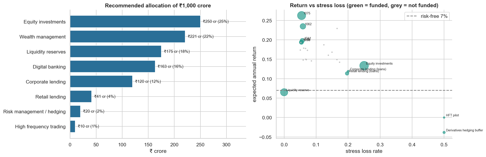

---

## Results by module

### Module 1: Strategic initiatives
| Item | Value |
|---|---|
| Model (CV AUC, 5-fold × 10) | **3-driver logistic 0.625** · full logistic 0.559 · gradient boosting 0.503 · random forest 0.446 |
| Drivers | Low risk rating (89% success vs ~70%) > business growth > expected ROI |
| NPV > 0 | 3% (3-year) · **33% (5-year base)** · 60% (7-year) |
| Decision | Fund 21 (₹3,004 cr) · Review 18 · Reject 141; realised success 86% / 72% / 76% |

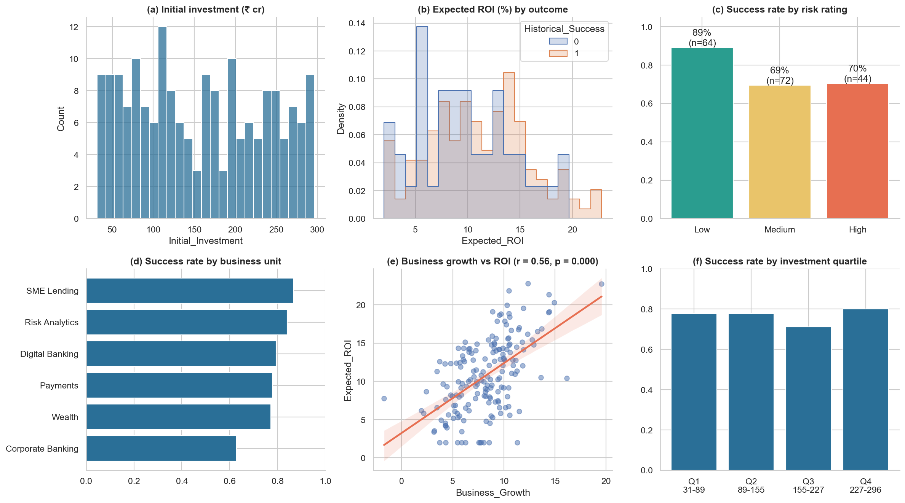
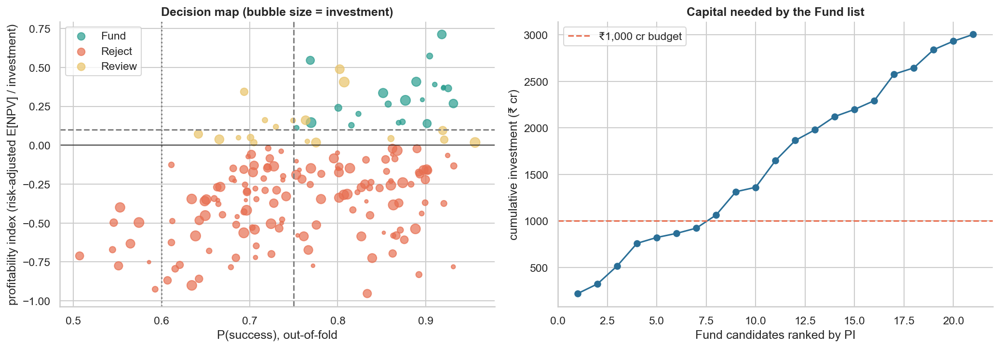

### Module 2: Credit risk
| Item | Value |
|---|---|
| Model | Logistic regression: CV AUC 0.729 (RF 0.706, GB 0.702), test AUC 0.746; calibration gap 0.008 |
| PD bands | A <10% · B 10–20% · C 20–35% · D >35%; realised default 7% → 47% (the brief's Low <5% band holds only 7% of loans) |
| Book | Exposure ₹640 cr, ECL ₹63 cr (9.8%) |
| Decision | Approve 836 (₹68 cr, ECL 2.8%) · Review 815 · Reject 3,349 |
| Stress | PD ×1.5 → ECL 4.2% (> 3% appetite) |

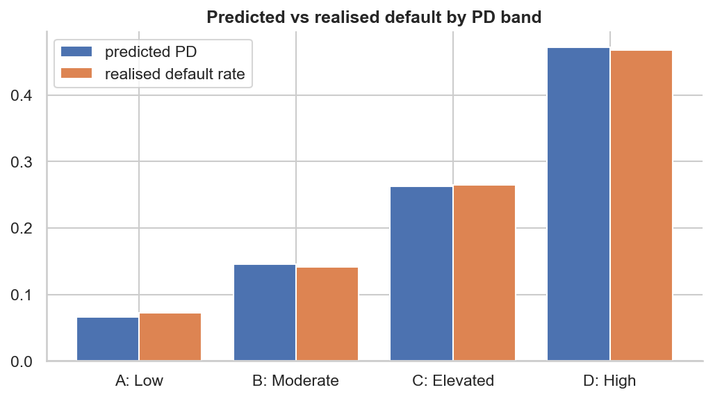
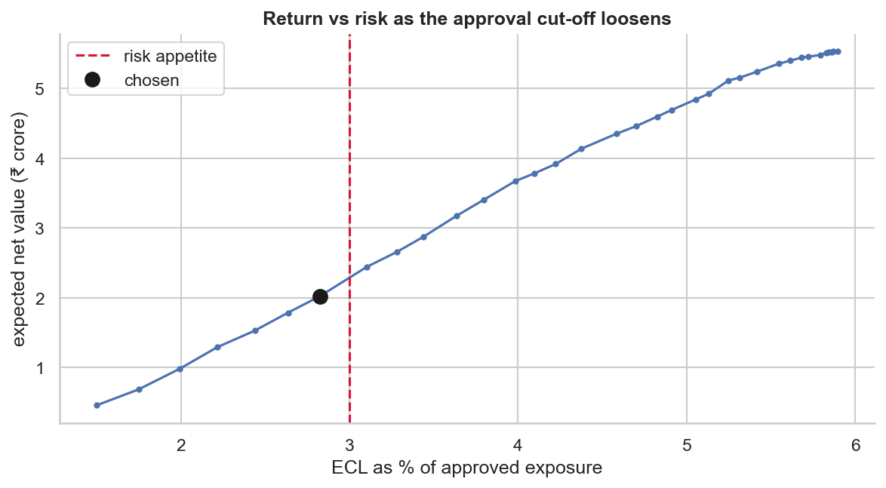

### Module 3: Fraud detection
| Item | Value |
|---|---|
| Split | time: 2025 train · Jan–Apr 2026 validation · May–Aug 2026 test |
| Test cost (₹ lakh) | **Random forest 8.98** · GB 9.10 · logistic 9.90 · amount rule 10.48 · Isolation Forest 14.31 · no model 14.40 |
| Policy | investigate 7.5% of transactions, recall 51%, precision 16%, **38% saving** |
| Stress | saving 20–50% under every cost and drift case |

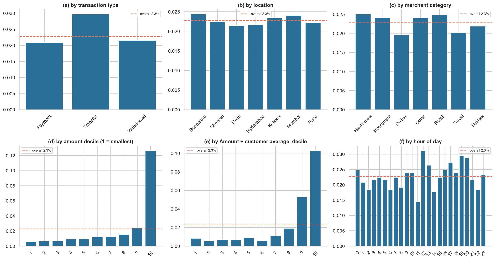
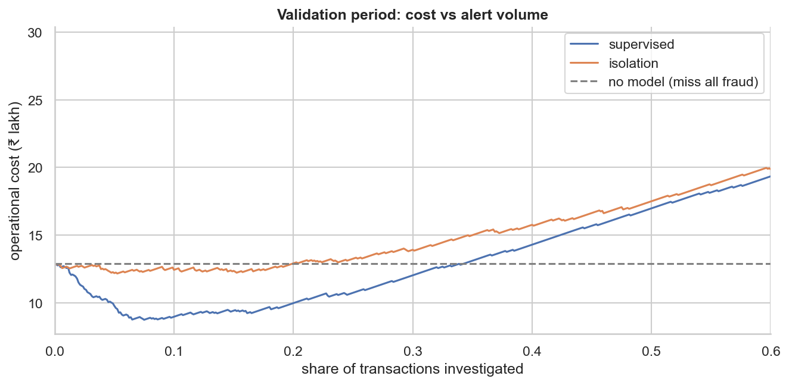

### Module 4: Churn and CLV
| Item | Value |
|---|---|
| Churn models | CV AUC 0.49–0.51, signal-to-noise < 1: **no signal** |
| CLV | supplied = one-year margin formula; lifetime CLV ₹174 cr; top 20% of customers = 42% of value |
| Targeting | EVaR list reaches churners worth ₹0.95 cr vs ₹0.31 cr random (3×) |
| Campaign | value protected ₹37.8 lakh, cost ₹15 lakh, **net ₹22.8 lakh** |

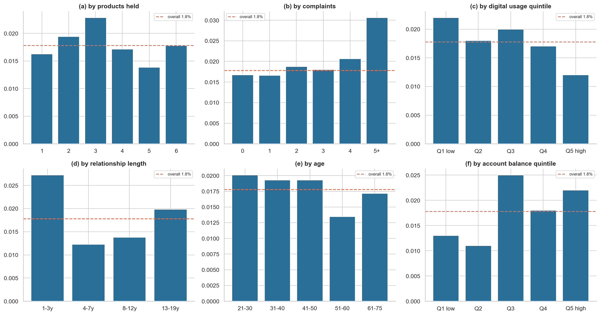
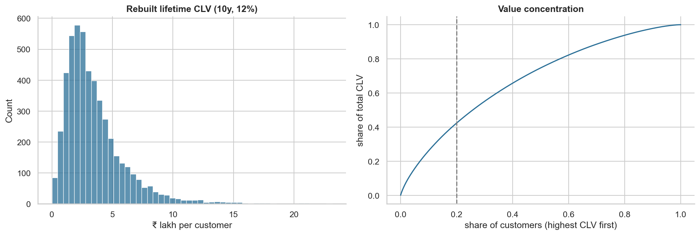

### Module 5: Equity returns
| Item | Value |
|---|---|
| Rank IC (t-stat) | Ridge 0.056 (1.2) · GB 0.014 · RF 0.004 · momentum −0.024: not significant |
| Top-5 portfolios | GB 20.4% / Sharpe 1.03 · Ridge 17.2% / 0.72 · equal-weight 16.2% / **1.32** |

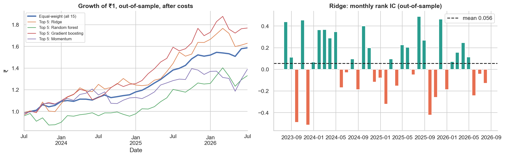

### Module 6: Portfolio optimisation
| Strategy | Return | Vol | Sharpe | Turnover/mo |
|---|---|---|---|---|
| ML tilt | 18.2% | 7.0% | 1.43 (p = 0.16) | 31% |
| ML mean-variance | 23.0% | 10.5% | 1.38 (p = 0.12) | 103% |
| **Equal-weight (chosen)** | 16.1% | 6.3% | 1.30 | 7% |
| Minimum variance | 15.9% | 6.3% | 1.28 | 7% |
| Markowitz max-Sharpe | 8.4% | 12.3% | 0.15 | 37% |

Crisis stress: monthly 99% VaR rises from 5% to 30%.

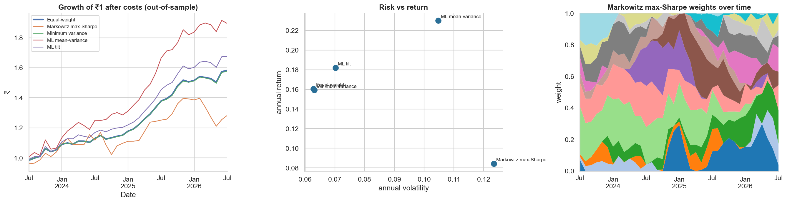

### Module 7: HFT
| Item | Value |
|---|---|
| Direction models | macro-F1 0.443 (all three) vs 0.441 for the imbalance rule and 0.199 for no-skill |
| Trading (test, threshold 0.55) | 3,800 trades/day, 62% hit rate, 1.65 bp net, ₹6.3 lakh/day |
| Stress | costs ×2 → −₹0.8 lakh/day; 1-event delay → −₹1.1 lakh/day |
| Execution | "buy now" calls +3.4 bp vs "wait" −3.9 bp |

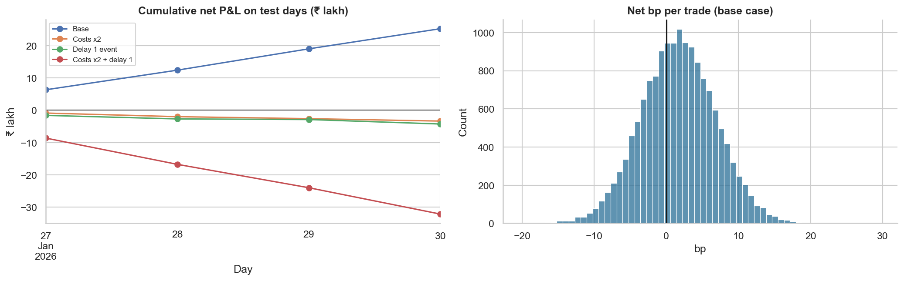

### Module 8: Derivatives
| Item | Value |
|---|---|
| Black-Scholes check | matches the supplied price (max diff ₹0.27); RMSE vs market ₹9.48 (test) |
| ML (test RMSE) | hybrid 10.32 · GB 12.74 · RF 14.64 · Ridge 59.53: **none beats BS** |
| VaR 1-day 99% (historical) | unhedged ₹0.28 cr → delta-hedged ₹0.06 cr (−80%) |
| Stress | crash: hedged −₹10.0 cr; volatility spike −₹5.4 cr |
| Hedge cost | ₹2.2 cr a year vs ₹7.5 cr of time decay |

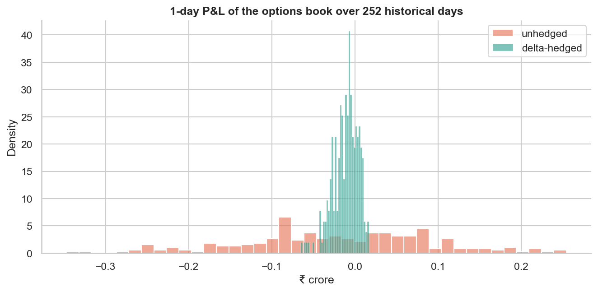

### Extra: Liquidity reserve
| Scenario (30 days, 99%) | Need | Shortfall | Survival |
|---|---|---|---|
| A. Funding freeze | ₹199 cr | ₹85 cr | 23 days |
| **B. Freeze + 10% run (policy)** | ₹286 cr | **₹172 cr → reserve ₹175 cr** | 15 days |
| C. Severe | ₹372 cr | ₹259 cr | 11 days |

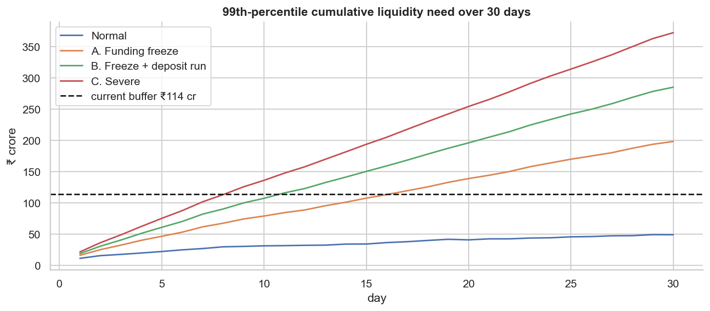

---

## Decisions agreed (shared assumptions in `src/novafin.py`)
- **Brief and shared rates:** LGD 40% · discount rate 12% · risk-free 7% · cost of funds 6% · ECL appetite 3% ·
  fraud costs ₹10,000 / ₹500 · ₹1,000 cr budget · 1,000 contacts · seed 42.
- **Module-specific:**
  - initiatives: 5-year life, loss on failure 30/50/70%
  - churn: annual flag, 30% save rate, ₹1,500 per call
  - equity: monthly rebalance, 10 bps costs
  - lending: 12.5% capital ratio, 4 origination cycles a year
  - options: short 100 of each option
  - liquidity: in ₹ lakh, LCR-style scenario B
- **Allocation limits:** reserve ≥ ₹175 cr · each category ≤ 30% · initiatives ≤ 50% · equity ≤ 25% · stress
  loss ≤ 15%.

## Course alignment
Methods outside the notes were replaced (details in [CENTRAL.md](CENTRAL.md#course-alignment-of-methods)):

| Replaced | Replacement |
|---|---|
| chi-square, Mann-Whitney | group rates and the t-statistic |
| Brier score | calibration gap |
| permutation test | signal-to-noise against the CV spread |
| polynomial features | Ridge on finance features |
| expected shortfall, Monte Carlo VaR | historical-simulation VaR |
| bootstrap | historical 30-day windows |
| annuity factor | PI ÷ 5 |
| linear/integer programming | ranking within limits |

Black-Scholes and the Greeks are kept because the brief requires them.
